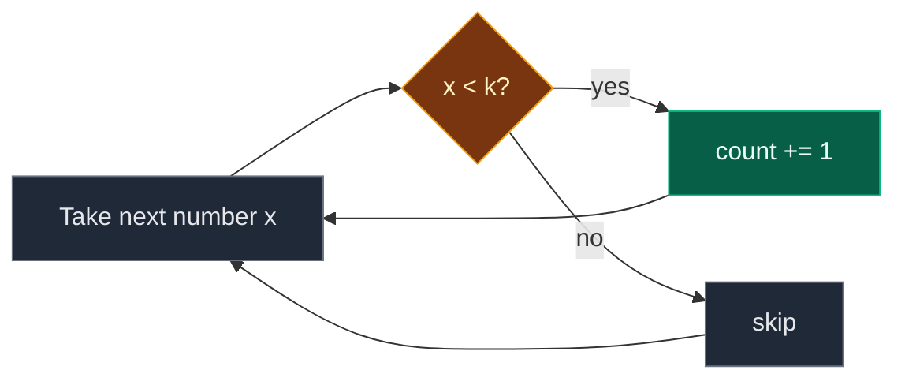

# 25. 3065. Minimum Operations to Exceed Threshold Value I

| Difficulty | Pattern | Source | Time | Space |
|:---:|:---:|:---:|:---:|:---:|
| **Easy** | Traversal: Count by Condition | [3065. Minimum Operations to Exceed Threshold Value I](https://leetcode.com/problems/minimum-operations-to-exceed-threshold-value-i/) | `O(n)` | `O(1)` |

## 1. Problem Statement

You get an integer array `nums` and an integer `k`.

In one operation, you can remove **one copy of the smallest number** in `nums`.

Return the **minimum number of operations** so that every number left in `nums` is `>= k`.

### Example

```text
nums = [2, 11, 10, 1, 3]
k = 10

Operation 1: remove 1   -> [2, 11, 10, 3]
Operation 2: remove 2   -> [11, 10, 3]
Operation 3: remove 3   -> [11, 10]

Now every number is >= 10.
Output: 3
```

We use this same example in every section below.

### Constraints

- `1 <= nums.length <= 50`
- `1 <= nums[i] <= 10^9`
- `1 <= k <= 10^9`
- At least one index `i` has `nums[i] >= k`

## 2. Core Theory

### What the problem really asks

The problem talks about "remove the smallest". That sounds like we must sort or simulate.

But look closer:

- A number `>= k` is already fine. We never need to remove it.
- A number `< k` is bad. It must be removed sooner or later.
- We always remove the smallest, so all the bad numbers go first, before any good number.

So the answer is simply: **how many numbers are smaller than `k`?**

```text
nums:   2   11   10   1   3
k = 10
        bad good good bad bad

Bad numbers = 3  ->  answer = 3
```

### Why one pass is enough

Each number decides for itself. It does not care about its neighbors. So we look at each number once and count.



## 3. Edge Cases

| Case | Input | Expected | Why it matters |
|:---|:---|:---:|:---|
| All numbers already fine | `nums = [1,1,2,4,9], k = 1` | `0` | Nothing is smaller than `k` |
| Number equal to `k` | `nums = [10], k = 10` | `0` | `10 >= 10` is fine. Use `<`, not `<=` |
| Only one good number | `nums = [1,1,2,4,9], k = 9` | `4` | Every number except `9` goes |
| Duplicates below `k` | `nums = [5,5,5,20], k = 6` | `3` | Each copy is one operation |
| Single element | `nums = [7], k = 3` | `0` | Smallest input |

## 4. Brute Force: Simulate the Removals

### Idea

Do exactly what the problem says. While the smallest number is `< k`, remove it and count one operation.

### Code

```python
# Import List for type hints
from typing import List


# Simulate removing the smallest number
class SolutionBrute:

    # Main method
    def minOperations(self, nums: List[int], k: int) -> int:

        # Work on a copy so the input is not changed
        arr = list(nums)

        # Count the removals
        ops = 0

        # Keep going while the smallest number is too small
        while arr and min(arr) < k:

            # Remove one copy of the smallest number
            arr.remove(min(arr))

            # One more operation
            ops += 1

        # Return the number of removals
        return ops
```

### Complexity

| Measure | Complexity | Why |
|:---|:---:|:---|
| **Time** | `O(n^2)` | Each `min` and `remove` is `O(n)`, done up to `n` times |
| **Space** | `O(n)` | The copy of the array |

## 5. Optimal Approach: Count Numbers Smaller Than k

### Idea

1. Start `count = 0`.
2. Look at every number once.
3. If the number is `< k`, add 1 to `count`.
4. Return `count`.

### Visual Walkthrough (Story Version)

**The story:** five kids stand in a line to ride a roller coaster. There is a height sign: "You must be at least 10 tall." A guard walks down the line. Every kid shorter than 10 must leave the line. The guard counts how many kids leave.

**How to read the pictures:** each box is a kid's height. `^` is where the guard stands. `X` marks a kid who must leave.

**Start**

```text
[2][11][10][1][3]     sign: at least 10
                      kids sent away: 0
```

**Step 1: guard checks the kid with height 2**

```text
[2][11][10][1][3]
 ^
 X   2 < 10, too short. Kid leaves.   kids sent away: 1
```

**Step 2: guard checks the kid with height 11**

```text
[2][11][10][1][3]
 X  ^
    11 >= 10, tall enough. Kid stays.  kids sent away: 1
```

**Step 3: guard checks the kid with height 10**

```text
[2][11][10][1][3]
 X       ^
    10 >= 10, exactly tall enough. Stays.  kids sent away: 1
```

**Step 4: guard checks the kid with height 1**

```text
[2][11][10][1][3]
 X          ^
            X   1 < 10, too short. Leaves.  kids sent away: 2
```

**Step 5: guard checks the kid with height 3**

```text
[2][11][10][1][3]
 X          X  ^
               X   3 < 10, too short. Leaves.  kids sent away: 3
```

**End: who is left on the ride?**

```text
   [11][10]        3 kids were sent away
```

**All steps at a glance**

| Step | Kid height | Tall enough? | Kids sent away |
|:---:|:---:|:---:|:---:|
| 1 | 2 | No | 1 |
| 2 | 11 | Yes | 1 |
| 3 | 10 | Yes | 1 |
| 4 | 1 | No | 2 |
| 5 | 3 | No | 3 |

**What the story teaches**

| In the story | In the code |
|:---|:---|
| Kid in line | `nums[i]` |
| Height sign | `k` |
| Too short | `x < k` |
| Kid leaves | One operation, `count += 1` |
| Kids sent away | The answer `count` |

### Step-by-Step Example

```text
nums = [2, 11, 10, 1, 3], k = 10
```

**Start:** `count = 0`

**Step 1: `x = nums[0] = 2`**

1. Is `2 < 10`? Yes.
2. `count = 0 + 1 = 1`.

**Step 2: `x = nums[1] = 11`**

1. Is `11 < 10`? No.
2. `count` stays `1`.

**Step 3: `x = nums[2] = 10`**

1. Is `10 < 10`? No.
2. `count` stays `1`.

**Step 4: `x = nums[3] = 1`**

1. Is `1 < 10`? Yes.
2. `count = 1 + 1 = 2`.

**Step 5: `x = nums[4] = 3`**

1. Is `3 < 10`? Yes.
2. `count = 2 + 1 = 3`.

**End:** loop is over. Return `count = 3`.

| Step | i | x | `x < k`? | count |
|:---:|:---:|:---:|:---:|:---:|
| start | – | – | – | 0 |
| 1 | 0 | 2 | Yes | 1 |
| 2 | 1 | 11 | No | 1 |
| 3 | 2 | 10 | No | 1 |
| 4 | 3 | 1 | Yes | 2 |
| 5 | 4 | 3 | Yes | 3 |

### Code

```python
# Import List for type hints
from typing import List


# Solution for 3065. Minimum Operations to Exceed Threshold Value I
class Solution:

    # Main method
    def minOperations(self, nums: List[int], k: int) -> int:

        # Number of values that must be removed
        count = 0

        # Look at every number once
        for x in nums:

            # A number below k must be removed
            if x < k:

                # One more operation
                count += 1

        # Return the total
        return count


# The example from this note
nums = [2, 11, 10, 1, 3]

# Count after each traced step (running the method on each prefix)
expected_after_step = [1, 1, 1, 2, 3]

# Check every traced step
for step in range(5):

    # The count after step + 1 numbers must match the table
    assert Solution().minOperations(nums[:step + 1], 10) == expected_after_step[step]

# Full example
assert Solution().minOperations(nums, 10) == 3

# LeetCode example 2: all numbers already fine
assert Solution().minOperations([1, 1, 2, 4, 9], 1) == 0

# LeetCode example 3: only 9 stays
assert Solution().minOperations([1, 1, 2, 4, 9], 9) == 4

# Edge case: number equal to k stays
assert Solution().minOperations([10], 10) == 0

# Edge case: duplicates below k
assert Solution().minOperations([5, 5, 5, 20], 6) == 3

# Edge case: single element
assert Solution().minOperations([7], 3) == 0

# Brute force gives the same answers
for arr, kk in [(nums, 10), ([1, 1, 2, 4, 9], 1), ([1, 1, 2, 4, 9], 9), ([5, 5, 5, 20], 6), ([10], 10)]:

    # Both methods must agree
    assert SolutionBrute().minOperations(arr, kk) == Solution().minOperations(arr, kk)

# All checks passed
print("All tests passed")
```

### Complexity

| Measure | Complexity | Why |
|:---|:---:|:---|
| **Time** | `O(n)` | One look at each number |
| **Space** | `O(1)` | Only the `count` variable |

## 6. Common Mistakes

| Mistake | What goes wrong | Fix |
|:---|:---|:---|
| Using `x <= k` | A number equal to `k` is counted, but it is already fine | Use strict `x < k` |
| Sorting first | Works, but costs `O(n log n)` for no reason | Just count in one pass |
| Simulating with `remove` on the input | Changes the caller's list and is `O(n^2)` | Count, do not remove |
| Stopping at the first number `>= k` | Bad numbers can come later in the array | Check every number |

## 7. Interview Follow-ups

### Q1. Why don't we need to sort?

**Answer:**
- We remove the smallest each time, so all numbers `< k` leave before any number `>= k`.
- The order of removal does not change how many go.
- So we only need to count them.

### Q2. What if many queries ask with different `k` values?

**Answer:**
- Sort `nums` once.
- For each `k`, use binary search (`bisect_left(nums, k)`) to count numbers `< k`.
- Each query is then `O(log n)`.

### Q3. What changes in version II of this problem (3066)?

**Answer:**
- There, an operation takes the two smallest `x` and `y` and adds back `min(x, y) * 2 + max(x, y)`.
- Numbers change, so simple counting fails.
- Use a min-heap and simulate.

### Q4. Can you write it in one line in Python?

**Answer:**
- Yes: `return sum(1 for x in nums if x < k)`.
- Same `O(n)` time and `O(1)` space.

## 8. Interview Explanation

> Every operation removes the current smallest number, so all numbers below k are removed before any number that is already at least k. That means the answer is just how many numbers are smaller than k. I scan the array once and add one to a counter for each number less than k. This is O(n) time and O(1) space, and it never changes the input.
