# 01. 1752. Check if Array Is Sorted and Rotated

| Difficulty | Pattern | Key idea | Source | Time | Space | Next in this folder |
|:---:|:---:|:---|:---:|:---:|:---:|:---:|
| **Easy** | Count Drops / Circular Scan | Read the array as a circle and count the places where a number is bigger than the next one; at most one is allowed | [1752. Check if Array Is Sorted and Rotated](https://leetcode.com/problems/check-if-array-is-sorted-and-rotated/) | `O(n)` | `O(1)` | [189. Rotate Array](02.%20189.%20Rotate%20Array.md) |

## 1. Problem Statement

You get an array `nums`.

Return `True` if the array was first sorted in **non-decreasing** order, and then **rotated** some number of positions (zero is allowed). Otherwise return `False`.

- The array may contain **duplicates**.
- Rotating by `x` positions gives an array `B` where `B[i] == A[(i + x) % n]`. In plain words: cut the sorted array somewhere and move the front part to the back.

### Example

**The array we take:** `nums = [4, 5, 5, 7, 1, 2, 2]`.

```text
Input:  nums = [4, 5, 5, 7, 1, 2, 2]
Output: True    (it is [1, 2, 2, 4, 5, 5, 7] cut after the 2s)
```

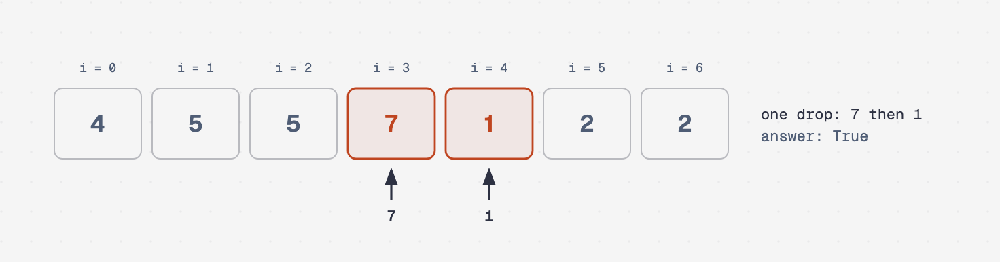

This example has the tricky parts of the problem:

- Equal neighbours (`5, 5` and `2, 2`). They are **not** drops.
- The last number `2` sits next to the first number `4` when we read in a circle. That pair must be checked too.

We use this example in every section below. Smaller LeetCode examples:

```text
nums = [3, 4, 5, 1, 2]   gives True
nums = [2, 1, 3, 4]      gives False   (two drops: 2 to 1, and 4 back to 2)
nums = [1, 2, 3]         gives True    (rotated by 0)
```

### Constraints, in plain words

| Limit | What it means in plain words | What it tells us |
|:---|:---|:---|
| `1 <= nums.length <= 100` | The list has at least 1 number and at most 100 numbers | Even trying every rotation is only about 15,000 steps. Any method passes; we still learn the `O(n)` one for interviews |
| `1 <= nums[i] <= 100` | Every number is a small positive whole number | No overflow and no negative numbers to worry about |
| Duplicates are allowed | Equal numbers can sit next to each other | A drop must be strictly bigger, `>`, not `>=` |

**How fast is fast enough?**

- The judge gives your code about **1 second**, and a computer does roughly **100 million** simple steps in 1 second.
- **Try every rotation:** 100 numbers give about **15,000** steps. Tiny.
- **Count drops in one pass:** **100** steps.
- Both pass here. The one-pass idea matters when the list is huge, and it is what interviewers want to hear.

In the chart, the grey bars are brute force steps and the orange line is the one-pass count. Every number was counted by running the code on the list `[2, 3, ..., n, 1]`, where the sorted rotation is the last one brute force tries.

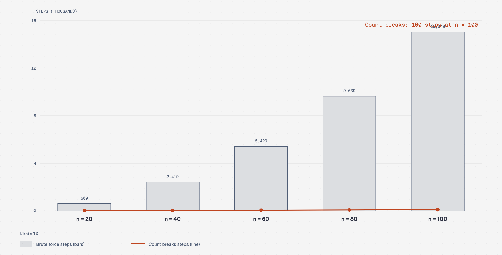

| List size `n` | Brute force steps | One-pass steps | Brute force time (at 100 million steps per second) | One-pass time | One pass is faster by |
|:---:|:---:|:---:|:---:|:---:|:---:|
| 20 | 609 | 20 | 0.006 milliseconds | 0.0002 milliseconds | about 30 times |
| 40 | 2,419 | 40 | 0.024 milliseconds | 0.0004 milliseconds | about 60 times |
| 60 | 5,429 | 60 | 0.054 milliseconds | 0.0006 milliseconds | about 90 times |
| 80 | 9,639 | 80 | 0.096 milliseconds | 0.0008 milliseconds | about 120 times |
| 100 | 15,049 | 100 | 0.150 milliseconds | 0.0010 milliseconds | about 150 times |

## 2. Core Idea

### Read the array as a circle

After the last number, wrap back to the first. A sorted array read this way goes up, up, up, and then drops **once**, where the biggest number wraps back to the smallest.

Rotating does not change the circle. It only changes **where we start reading**. So a sorted-and-rotated array still has **at most one drop** around the circle.

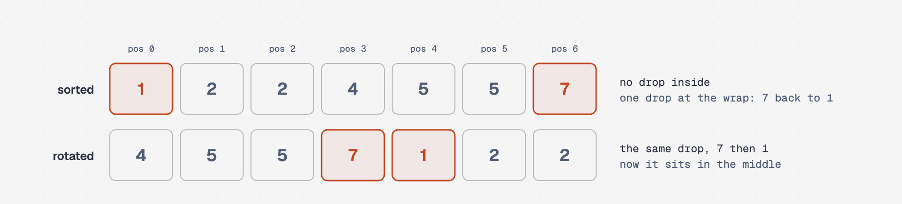

### The rule

A **drop** is a pair where `nums[i] > nums[(i + 1) % n]`. The `% n` makes the last index wrap to `0`.

- Zero or one drop: `True`.
- Two or more drops: `False`.

### Why "at most one" and not "exactly one"

If every value is equal, like `[3, 3, 3]`, there are **zero** drops. It is still sorted. So the test is `<= 1`.

### Why the wrap pair matters

Without the wrap, `[3, 1, 2, 4]` shows only one drop (`3 > 1`) and would be wrongly accepted. The wrap pair `4 > 3` is the second drop.

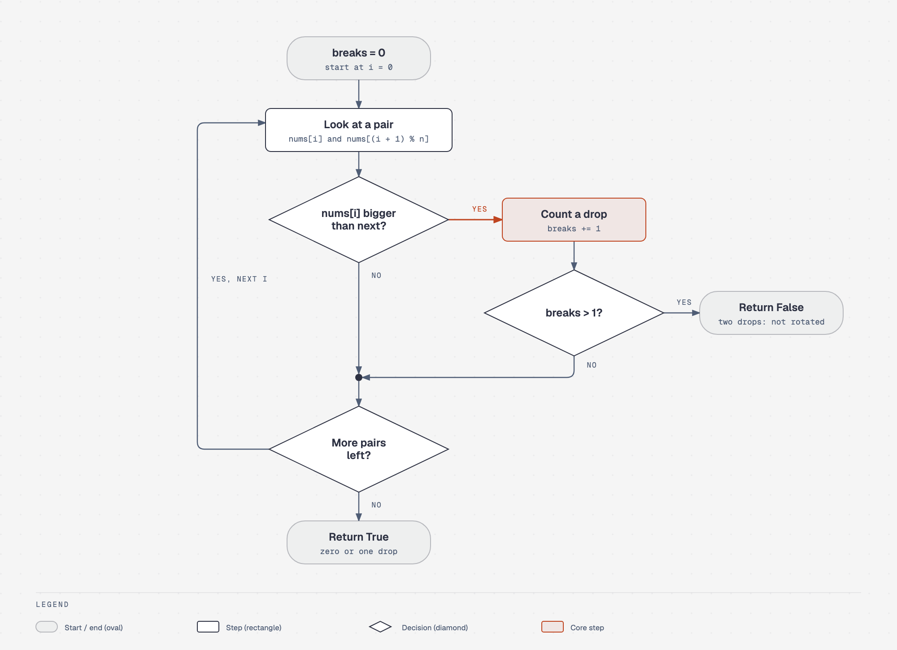

## 3. Edge Cases

| Case | Input | Expected | Why it matters | Code that handles it |
|:---|:---|:---:|:---|:---|
| Single element | `[1]` | `True` | The only pair is `1` with itself, which is not a drop | `(i + 1) % n` is `0` when `n = 1` |
| Two elements, descending | `[2, 1]` | `True` | It is `[1, 2]` rotated once; one drop | `breaks <= 1` |
| All identical | `[3, 3, 3]` | `True` | Zero drops; the test must allow zero | `if breaks > 1` instead of `breaks != 1` |
| Already sorted | `[1, 2, 3]` | `True` | The only drop is the wrap `3` back to `1` | The wrap pair is checked |
| Two drops | `[2, 1, 3, 4]` | `False` | `2 > 1` and the wrap `4 > 2` | `return False` when `breaks > 1` |
| Drop hidden without the wrap | `[3, 1, 2, 4]` | `False` | Only the wrap check finds the second drop | `nums[(i + 1) % n]` |

## 4. Brute Force: Try Every Rotation

### Idea

Build every rotation `nums[r:] + nums[:r]`. If any rotation is sorted, return `True`. On our example it builds rotations starting at `r = 0, 1, 2, 3` (all have a drop) and finds the sorted one at `r = 4`, after 51 steps.

### Code

```python
# Import List for type hints
from typing import List


# Try every rotation and check if it is sorted
class SolutionBrute:

    # Main method
    def check(self, nums: List[int]) -> bool:

        # Number of elements
        n = len(nums)

        # Try every possible starting point
        for r in range(n):

            # Build the rotation that starts at index r
            rotated = nums[r:] + nums[:r]

            # Assume this rotation is sorted
            is_sorted = True

            # Check every neighbour pair
            for i in range(1, n):

                # A drop means this rotation is not sorted
                if rotated[i - 1] > rotated[i]:

                    # Mark it as not sorted
                    is_sorted = False

                    # Stop checking this rotation
                    break

            # Found a sorted rotation
            if is_sorted:

                # It is sorted and rotated
                return True

        # No rotation is sorted
        return False
```

### Complexity

| Measure | Complexity | Why | At the limit (`n = 100`) | Compared with brute force |
|:---|:---:|:---|:---:|:---|
| **Time** | `O(n^2)` | `n` rotations, `O(n)` to build and check each one | about 15,000 steps | This is the baseline |
| **Space** | `O(n)` | Each rotated copy is a new list of `n` numbers | 100 numbers per copy | This is the baseline |

## 5. Better Approach: Find the First Drop, Check One Rotation

### Idea

If the array is sorted and rotated, the first drop (reading left to right, no wrap) shows **where the sorted array starts**. So:

1. Find the first `i` with `nums[i] > nums[i + 1]`. If there is none, the array is already sorted: return `True`.
2. Build the one rotation that starts at `i + 1`, and check that it has no drop.

### Run it on our example, step by step

**The array we take:** `nums = [4, 5, 5, 7, 1, 2, 2]`.

**Step 1: find the first drop**

- `4 <= 5`, `5 <= 5`, `5 <= 7`: no drop yet. Equal numbers are not drops.
- `7 > 1`: the first drop is at `i = 3`. So the sorted array should start at `i = 4`.

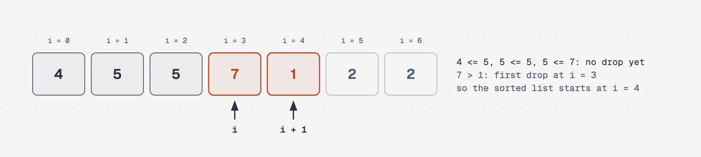

**Step 2: check that one rotation**

- `nums[4:] + nums[:4] = [1, 2, 2, 4, 5, 5, 7]`.
- Left to right there is no drop. Return `True`.

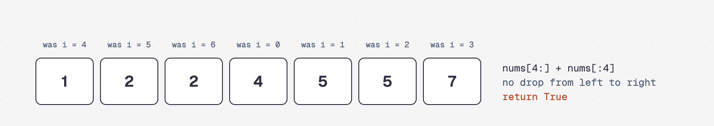

### Code

```python
# Better: find the first drop, then check the one rotation it points to
class SolutionBetter:

    # Main method
    def check(self, nums: List[int]) -> bool:

        # Number of elements
        n = len(nums)

        # Look for the first drop, left to right, without the wrap
        for i in range(n - 1):

            # Found the first drop
            if nums[i] > nums[i + 1]:

                # The sorted array would start right after it
                rotated = nums[i + 1:] + nums[:i + 1]

                # It must have no drop at all
                return all(rotated[k] <= rotated[k + 1] for k in range(n - 1))

        # No drop at all: already sorted
        return True
```

### Complexity

| Measure | Complexity | Why | At the limit (`n = 100`) | Compared with brute force |
|:---|:---:|:---|:---:|:---|
| **Time** | `O(n)` | One scan to find the drop, one scan to check the rotation | about 200 steps | About 75 times fewer steps |
| **Space** | `O(n)` | The rotated copy | 100 numbers | Same memory as brute force |

## 6. Optimal Approach: Count Drops Around the Circle

### Idea

1. `breaks = 0`.
2. For each `i` from `0` to `n - 1`, compare `nums[i]` with `nums[(i + 1) % n]`.
3. If `nums[i]` is bigger, that is a drop: `breaks += 1`.
4. If `breaks > 1`, return `False` right away.
5. After the loop, return `True`.

No copy is made, so the extra space is `O(1)`.

### Run it on our example, step by step

**The array we take:** `nums = [4, 5, 5, 7, 1, 2, 2]`, `n = 7`.

Think of seven kids sitting around a round table in clockwise order. The teacher walks around once. Between each kid and the next kid, she asks: "Is the next kid shorter?" Each yes is a drop. A real height-order seating has at most one drop, where the tallest kid sits next to the shortest.

**How to read the pictures:** the arrow `i` is the number we are on, the arrow `next` is the one after it (it wraps to index 0 at the end), orange marks a drop, and faded boxes are already checked.

**Start:** `breaks = 0`.

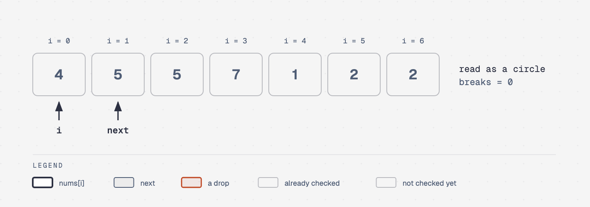

**Step 1: i = 0, next = 1**

- Compare `nums[0] = 4` with `nums[1] = 5`. Is `4 > 5`? No.
- `breaks` stays `0`.

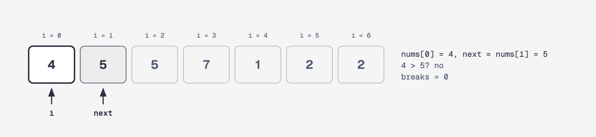

**Step 2: i = 1, next = 2**

- Compare `nums[1] = 5` with `nums[2] = 5`. Is `5 > 5`? No. Equal numbers are not a drop.
- `breaks` stays `0`.

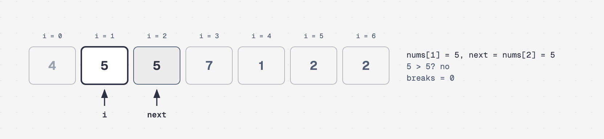

**Step 3: i = 2, next = 3**

- Compare `nums[2] = 5` with `nums[3] = 7`. Is `5 > 7`? No.
- `breaks` stays `0`.

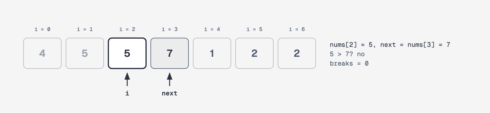

**Step 4: i = 3, next = 4**

- Compare `nums[3] = 7` with `nums[4] = 1`. Is `7 > 1`? **Yes, a drop.**
- `breaks = 1`. Is `breaks > 1`? No, keep going. One drop is allowed.

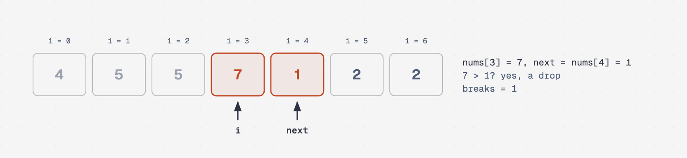

**Step 5: i = 4, next = 5**

- Compare `nums[4] = 1` with `nums[5] = 2`. Is `1 > 2`? No.
- `breaks` stays `1`.

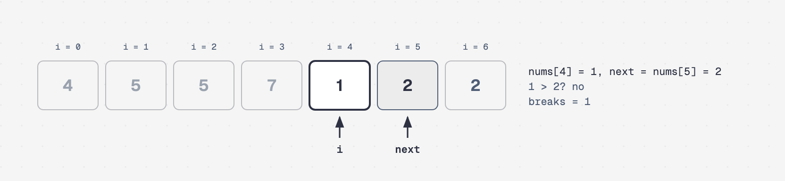

**Step 6: i = 5, next = 6**

- Compare `nums[5] = 2` with `nums[6] = 2`. Is `2 > 2`? No. Equal again.
- `breaks` stays `1`.

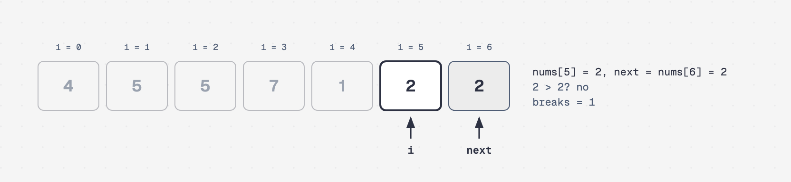

**Step 7: i = 6, next wraps to 0**

- `(6 + 1) % 7 = 0`, so `next` wraps around to the first number.
- Compare `nums[6] = 2` with `nums[0] = 4`. Is `2 > 4`? No.
- `breaks` stays `1`. The loop is over. One drop: return `True`.

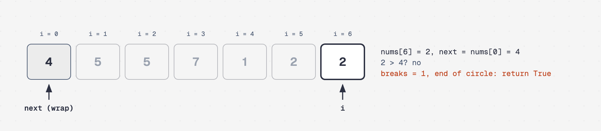

**All steps at a glance**

| Step | `i` | `next = (i + 1) % 7` | `nums[i]` | `nums[next]` | Drop? | `breaks` after | What happens |
|:---:|:---:|:---:|:---:|:---:|:---:|:---:|:---|
| 1 | 0 | 1 | 4 | 5 | No | 0 | Keep going |
| 2 | 1 | 2 | 5 | 5 | No | 0 | Equal numbers are not a drop |
| 3 | 2 | 3 | 5 | 7 | No | 0 | Keep going |
| 4 | 3 | 4 | 7 | 1 | **Yes** | 1 | The one allowed drop |
| 5 | 4 | 5 | 1 | 2 | No | 1 | Keep going |
| 6 | 5 | 6 | 2 | 2 | No | 1 | Equal numbers are not a drop |
| 7 | 6 | 0 | 2 | 4 | No | 1 | The wrap pair; loop over, return `True` |

### Code

```python
# Solution for 1752. Check if Array Is Sorted and Rotated
class Solution:

    # Main method
    def check(self, nums: List[int]) -> bool:

        # Number of elements
        n = len(nums)

        # Count places where the order drops
        breaks = 0

        # Look at every index once
        for i in range(n):

            # Next index around the circle (last wraps to 0)
            next_index = (i + 1) % n

            # A bigger value before a smaller one is a drop
            if nums[i] > nums[next_index]:

                # Count this drop
                breaks += 1

            # Two drops can never come from one rotation
            if breaks > 1:

                # Not sorted and rotated
                return False

        # Zero or one drop means sorted and rotated
        return True
```

### Complexity

| Measure | Complexity | Why | At the limit (`n = 100`) | Compared with brute force |
|:---|:---:|:---|:---:|:---|
| **Time** | `O(n)` | One pass around the circle, one comparison per index | 100 steps | About 150 times fewer steps |
| **Space** | `O(1)` | Only `breaks` and one index, no copy of the list | a few variables | No copies at all |

## 7. Common Mistakes

| Mistake | What goes wrong | Fix |
|:---|:---|:---|
| Looping `range(n - 1)` and forgetting the wrap | `[3, 1, 2, 4]` shows one drop and is wrongly accepted | Loop `range(n)` with `(i + 1) % n` |
| Testing `breaks == 1` | `[3, 3, 3]` has zero drops and is wrongly rejected | Use `breaks <= 1` |
| Counting `>=` as a drop | Equal neighbours count, so our example `[4, 5, 5, 7, 1, 2, 2]` fails | Count only strict `>` |
| Returning `False` on the first drop | Every rotated array is rejected | Only stop when `breaks > 1` |

## 8. Interview Follow-ups

### Q1. How would you also return the rotation amount?

**Answer:**
- The drop at index `i` means the sorted array starts at index `i + 1`.
- With the rule `B[i] == A[(i + x) % n]`, that gives `x = (n - (i + 1)) % n`.
- Our example drops at `i = 3`, so `x = (7 - 4) % 7 = 3`.
- With zero drops, `x = 0`. With duplicates, the answer may not be unique.

### Q2. What if the original was sorted in non-increasing order?

**Answer:**
- Mirror it: count circular rises `nums[i] < nums[(i + 1) % n]`.
- Accept when that count is at most one.

### Q3. What if the rotation must be non-zero?

**Answer:**
- Reject the case where the only drop is the wrap at `i = n - 1` (no real cut).
- All-equal arrays stay `True`, because every rotation of them looks the same.

### Q4. Can we find the minimum or search for a target faster than `O(n)`?

**Answer:**
- Yes, with binary search when values are distinct (LeetCode 153 and 33).
- Compare `nums[mid]` with `nums[hi]` to know which half is sorted.
- With duplicates the worst case drops back to `O(n)`.

### Q5. What if the data comes as a stream?

**Answer:**
- Count drops as values arrive, keeping only the previous value.
- Save the first value, and do the wrap check when the stream ends.
- Still `O(1)` space.

## 9. Interview Explanation

> A sorted array read as a circle goes up all the way and drops only once, where the end wraps back to the start. Rotating only changes where we start reading, so a sorted and rotated array has at most one drop. I loop over every index, compare nums[i] with nums[(i + 1) % n], and count the drops. If the count goes above one, I return False; otherwise True. The modulo handles the wrap pair, and allowing zero drops handles arrays where all values are equal. This is O(n) time and O(1) space.
