# 02. 189. Rotate Array

| Difficulty | Pattern | Key idea | Source | Time | Space | Before in this folder |
|:---:|:---:|:---|:---:|:---:|:---:|:---:|
| **Medium** | Array Reversal / In-place Rotation | Reverse the whole array, then reverse the first `k` numbers, then reverse the rest; that turns `A B` into `B A` | [189. Rotate Array](https://leetcode.com/problems/rotate-array/) | `O(n)` | `O(1)` | [1752. Check if Array Is Sorted and Rotated](01.%201752.%20Check%20if%20Array%20Is%20Sorted%20and%20Rotated.md) |

## 1. Problem Statement

You get an integer array `nums`. Rotate the array to the **right** by `k` steps. `k` is non-negative.

- Change `nums` **in place**. Do not return anything.
- Rotating right by one step moves the last number to the front.

### Example

**The array we take:** `nums = [3, 8, 1, 9, 4, 7, 2]`, `k = 10`.

```text
Input:  nums = [3, 8, 1, 9, 4, 7, 2], k = 10
Output: [4, 7, 2, 3, 8, 1, 9]
```

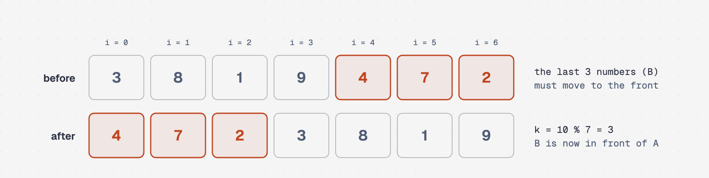

This example has the tricky parts of the problem:

- `k = 10` is **bigger** than the length 7. Rotating 7 times brings the array back to the start, so only `10 % 7 = 3` steps matter.
- The numbers are not sorted, so you can clearly see which block moved.

We use this example in every section below. Smaller LeetCode examples:

```text
nums = [1, 2, 3, 4, 5, 6, 7], k = 3        gives [5, 6, 7, 1, 2, 3, 4]
nums = [-1, -100, 3, 99],     k = 2        gives [3, 99, -1, -100]
```

### Constraints, in plain words

| Limit | What it means in plain words | What it tells us |
|:---|:---|:---|
| `1 <= nums.length <= 10^5` | The list has at least 1 number and at most 100,000 numbers | Shifting one step `k` times can take about 10 billion moves. Too slow; we need `O(n)` |
| `-2^31 <= nums[i] <= 2^31 - 1` | Any 32-bit whole number, negative or positive | We only move numbers, never add them, so there is no overflow |
| `0 <= k <= 10^5` | `k` can be 0, and it can be bigger than the list | Always do `k = k % n` first |
| Follow-up: `O(1)` extra space | Do it without a second list | This is what the three reversals give us |

**How fast is fast enough?**

- The judge gives your code about **1 second**, and a computer does roughly **100 million** simple steps in 1 second.
- **Shift one step, `k` times:** with 100,000 numbers and `k` close to `n`, that is about **10 billion** moves. About 100 seconds. Far too slow.
- **Three reversals:** about **100,000** swaps. About a thousandth of a second.

In the chart, the grey bars are the moves of shifting `k` times (with `k = n - 1`, the worst case after `k % n`) and the orange line is the swaps of three reversals. The numbers were worked out from the loop counts.

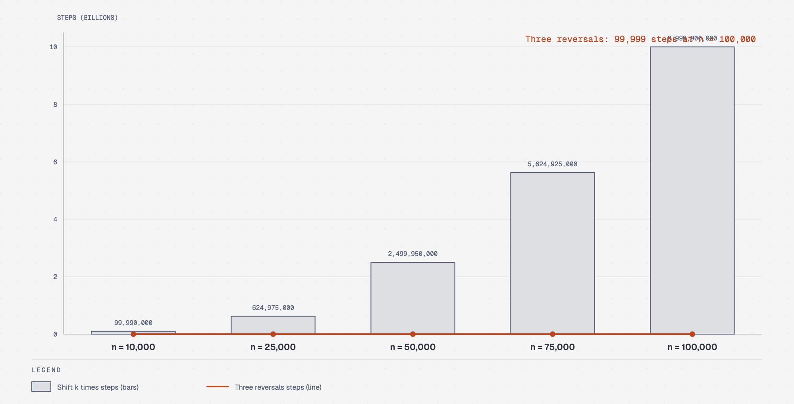

| List size `n` (with `k = n - 1`) | Shift moves | Reversal swaps | Shift time (at 100 million steps per second) | Reversal time | Reversals are faster by |
|:---:|:---:|:---:|:---:|:---:|:---:|
| 10,000 | 99,990,000 | 9,999 | 999.90 milliseconds | 0.10 milliseconds | about 10,000 times |
| 25,000 | 624,975,000 | 24,999 | 6.2 seconds | 0.25 milliseconds | about 25,000 times |
| 50,000 | 2,499,950,000 | 49,999 | 25.0 seconds | 0.50 milliseconds | about 50,000 times |
| 75,000 | 5,624,925,000 | 74,999 | 56.2 seconds | 0.75 milliseconds | about 75,000 times |
| 100,000 | 9,999,900,000 | 99,999 | 100.0 seconds | 1.00 milliseconds | about 100,000 times |

## 2. Core Idea

### Rotating right by `k` turns `A B` into `B A`

Split the array into two blocks:

- `A` = the first `n - k` numbers = `[3, 8, 1, 9]`
- `B` = the last `k` numbers = `[4, 7, 2]`

Rotating right by 3 moves `B` to the front: `A B` becomes `B A`. Every approach is a way to make that happen.

### Why three reversals work

Reversing the whole array puts the blocks in the right order, but each block comes out **backwards**: `reverse(A B) = reverse(B) reverse(A)`. Reversing each block again fixes it.

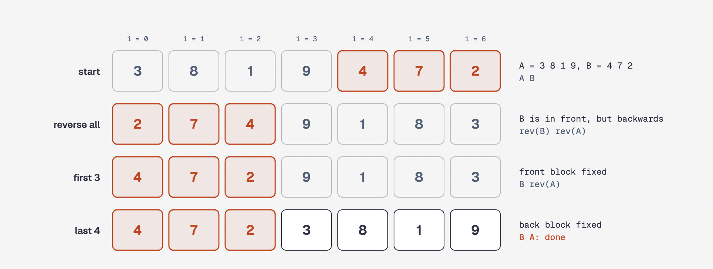

Each number is swapped at most twice. That is `O(n)` time with `O(1)` extra space.

### All the ways at a glance

| Approach | Time | Space | How | Good for |
|:---|:---:|:---:|:---|:---|
| Shift by one, `k` times | `O(n * k)` | `O(1)` | Move the last number to the front, repeat `k` times | Explaining the problem, never for large input |
| Extra array | `O(n)` | `O(n)` | Put `nums[i]` at `(i + k) % n` in a new list | When memory does not matter |
| Slicing | `O(n)` | `O(n)` | `nums[:] = nums[-k:] + nums[:-k]` | A quick Python one-liner (needs `k %= n` and `k > 0`) |
| Three reversals | `O(n)` | `O(1)` | `A B` to `B A` with three reverses | The interview answer |
| Cyclic replacement | `O(n)` | `O(1)` | Carry each number to its new spot along `gcd(n, k)` cycles | Another `O(1)` way, easier to get wrong |

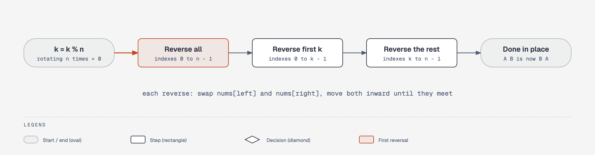

## 3. Edge Cases

| Case | Input | Expected | Why it matters | Code that handles it |
|:---|:---|:---:|:---|:---|
| `k == 0` | `[1, 2, 3]`, `k = 0` | `[1, 2, 3]` | Reversing all and reversing all again gives the start | `self._reverse(nums, 0, -1)` does nothing |
| `k == n` | `[1, 2, 3]`, `k = 3` | `[1, 2, 3]` | Without `k %= n` the array ends up reversed | `k = k % n` |
| `k > n` | `[3, 8, 1, 9, 4, 7, 2]`, `k = 10` | `[4, 7, 2, 3, 8, 1, 9]` | `10 % 7 = 3` | `k = k % n` |
| Single element | `[1]`, `k = 1` | `[1]` | `k % 1 = 0` always | `k = k % n` |
| Two elements | `[1, 2]`, `k = 1` | `[2, 1]` | Smallest real rotation, catches off-by-one mistakes | The three `_reverse` calls |
| Duplicates | `[1, 2, 1, 2]`, `k = 2` | `[1, 2, 1, 2]` | Logic must follow positions, not values | Only indexes are used |

## 4. Brute Force: Rotate One Step, k Times

### Idea

One right rotation: save the last number, shift every other number one place right, put the saved number at index `0`. Do it `k` times. On our example (`k = 3` after `% 7`) that is 3 rounds of 7 moves each.

### Code

```python
# Import List for type hints
from typing import List


# Rotate by one step, k times
class SolutionBrute:

    # Main method
    def rotate(self, nums: List[int], k: int) -> None:

        # Number of elements
        n = len(nums)

        # Only k % n steps matter
        k = k % n

        # Do one right rotation k times
        for _ in range(k):

            # Save the last element; it goes to the front
            last = nums[n - 1]

            # Shift every element one place to the right
            for i in range(n - 1, 0, -1):

                # Copy the left neighbor into this spot
                nums[i] = nums[i - 1]

            # Put the saved element at the front
            nums[0] = last
```

### Complexity

| Measure | Complexity | Why | At the limit (`n = 10^5`, `k` near `n`) | Compared with brute force |
|:---|:---:|:---|:---:|:---|
| **Time** | `O(n * k)` | `k` rounds, each shifts `n` numbers | about 10,000,000,000 moves | This is the baseline |
| **Space** | `O(1)` | One saved value, no new list | one variable | This is the baseline |

## 5. Better Approach: Extra Array

### Idea

The number at index `i` ends up at index `(i + k) % n`. Write each number straight to its new place in a new list, then copy the list back into `nums`.

### Run it on our example

**The array we take:** `nums = [3, 8, 1, 9, 4, 7, 2]`, `k = 3`.

- `3` at index 0 goes to `(0 + 3) % 7 = 3`. `8` goes to 4. `1` goes to 5. `9` goes to 6.
- `4` at index 4 goes to `(4 + 3) % 7 = 0`. `7` goes to 1. `2` goes to 2. These three wrap around to the front.
- `result = [4, 7, 2, 3, 8, 1, 9]`. Copy it back with `nums[:] = result`.

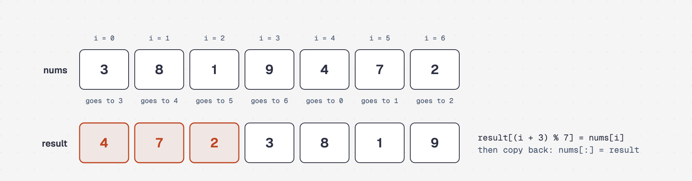

### Code

```python
# Write each element to its final place in a new list
class SolutionBetter:

    # Main method
    def rotate(self, nums: List[int], k: int) -> None:

        # Number of elements
        n = len(nums)

        # New list of the same size
        result = [0] * n

        # Move every element to its new index
        for i in range(n):

            # Element at i goes to (i + k) % n
            result[(i + k) % n] = nums[i]

        # Copy back into the same list object (in place)
        nums[:] = result
```

### Complexity

| Measure | Complexity | Why | At the limit (`n = 10^5`) | Compared with brute force |
|:---|:---:|:---|:---:|:---|
| **Time** | `O(n)` | One pass to place every number, one pass to copy back | about 200,000 steps | About 50,000 times fewer steps |
| **Space** | `O(n)` | The extra list of `n` numbers | 100,000 numbers | Needs extra memory |

## 6. Optimal Approach: Three Reversals

### Idea

1. `k = k % n`.
2. Reverse the whole array (indexes `0` to `n - 1`).
3. Reverse the first `k` numbers (indexes `0` to `k - 1`).
4. Reverse the rest (indexes `k` to `n - 1`).

Reversing a range uses two pointers: swap `nums[left]` and `nums[right]`, then move both inward until they meet.

### Run it on our example, step by step

**The array we take:** `nums = [3, 8, 1, 9, 4, 7, 2]`, `k = 10`.

**Before the steps:** `n = 7`, so `k = 10 % 7 = 3`. Block `A = [3, 8, 1, 9]`, block `B = [4, 7, 2]`.

Think of seven kids standing in a narrow hallway. The last 3 kids must get to the front, but kids can only **swap places** with each other. Nobody may leave the line. The teacher does it in three rounds of turning groups around.

**How to read the pictures:** each picture shows the line **after** the swap. Orange marks the two numbers that were just swapped, the arrows `left` and `right` show the two pointers, and faded boxes are outside the part being reversed in this round.

**Start:** nothing has moved yet. `left` and `right` sit at the two ends.

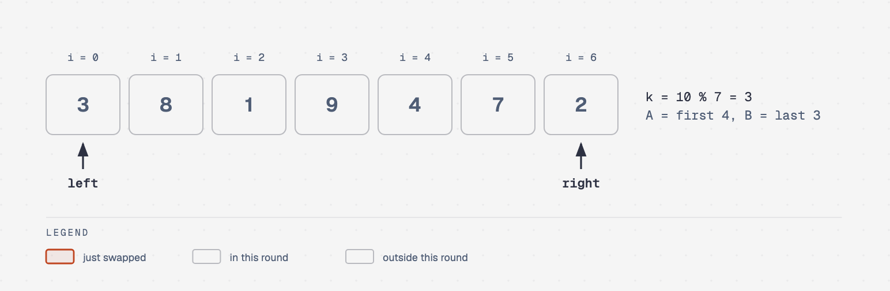

**Step 1: round 1 (reverse all), swap index 0 and index 6**

- Swap `3` and `2`. The line is now `[2, 8, 1, 9, 4, 7, 3]`.
- `left` moves to 1, `right` moves to 5.

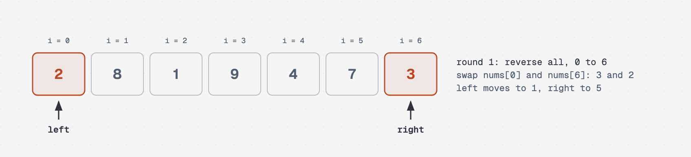

**Step 2: round 1, swap index 1 and index 5**

- Swap `8` and `7`. The line is now `[2, 7, 1, 9, 4, 8, 3]`.
- `left` moves to 2, `right` moves to 4.

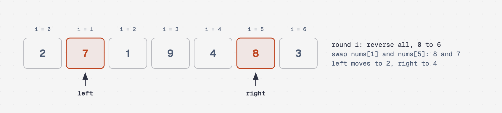

**Step 3: round 1, swap index 2 and index 4**

- Swap `1` and `4`. The line is now `[2, 7, 4, 9, 1, 8, 3]`.
- `left` and `right` both move to 3 and meet. The middle number `9` stays. Round 1 is over: `B` is in front, but backwards (`2, 7, 4`).

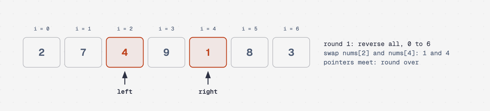

**Step 4: round 2 (reverse the first 3), swap index 0 and index 2**

- Swap `2` and `4`. The line is now `[4, 7, 2, 9, 1, 8, 3]`.
- `left` and `right` meet at 1. Round 2 is over: the front block `4, 7, 2` is fixed.

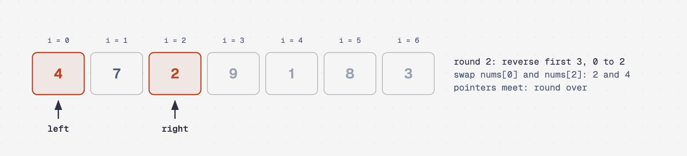

**Step 5: round 3 (reverse the last 4), swap index 3 and index 6**

- Swap `9` and `3`. The line is now `[4, 7, 2, 3, 1, 8, 9]`.
- `left` moves to 4, `right` moves to 5.

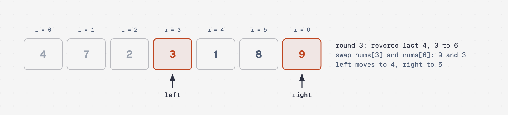

**Step 6: round 3, swap index 4 and index 5**

- Swap `1` and `8`. The line is now `[4, 7, 2, 3, 8, 1, 9]`.
- `left` passes `right`. Round 3 is over. The array is rotated: `[4, 7, 2, 3, 8, 1, 9]`.

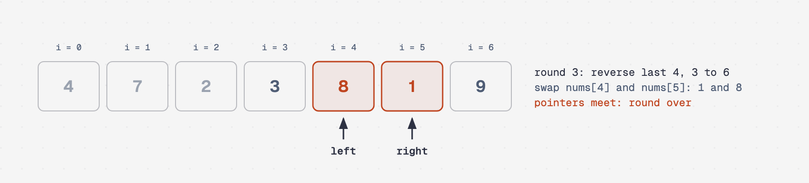

**All steps at a glance**

| Step | Round | Range reversed | Swap positions | Numbers swapped | Array after the swap | What happens next |
|:---:|:---:|:---:|:---:|:---:|:---|:---|
| 1 | 1 | 0 to 6 | 0 and 6 | 3 and 2 | `[2, 8, 1, 9, 4, 7, 3]` | `left` = 1, `right` = 5 |
| 2 | 1 | 0 to 6 | 1 and 5 | 8 and 7 | `[2, 7, 1, 9, 4, 8, 3]` | `left` = 2, `right` = 4 |
| 3 | 1 | 0 to 6 | 2 and 4 | 1 and 4 | `[2, 7, 4, 9, 1, 8, 3]` | Pointers meet at 3, round 1 over |
| 4 | 2 | 0 to 2 | 0 and 2 | 2 and 4 | `[4, 7, 2, 9, 1, 8, 3]` | Pointers meet at 1, round 2 over |
| 5 | 3 | 3 to 6 | 3 and 6 | 9 and 3 | `[4, 7, 2, 3, 1, 8, 9]` | `left` = 4, `right` = 5 |
| 6 | 3 | 3 to 6 | 4 and 5 | 1 and 8 | `[4, 7, 2, 3, 8, 1, 9]` | Pointers cross, done |

Six swaps rotated the array in place. Shifting one step at a time would need 3 rounds of 7 moves.

### Code

```python
# Import List for type hints
from typing import List


# Solution for 189. Rotate Array
class Solution:

    # Reverse nums[left..right] in place
    def _reverse(self, nums: List[int], left: int, right: int) -> None:

        # Keep going until the pointers meet or cross
        while left < right:

            # Swap the two ends
            nums[left], nums[right] = nums[right], nums[left]

            # Move left pointer inward
            left += 1

            # Move right pointer inward
            right -= 1

    # Main method
    def rotate(self, nums: List[int], k: int) -> None:

        # Number of elements
        n = len(nums)

        # Only k % n steps matter
        k = k % n

        # Round 1: reverse the whole array
        self._reverse(nums, 0, n - 1)

        # Round 2: reverse the first k elements
        self._reverse(nums, 0, k - 1)

        # Round 3: reverse the remaining n - k elements
        self._reverse(nums, k, n - 1)
```

### Complexity

| Measure | Complexity | Why | At the limit (`n = 10^5`) | Compared with brute force |
|:---|:---:|:---|:---:|:---|
| **Time** | `O(n)` | Each number is swapped at most twice across the three reversals | about 100,000 swaps | About 100,000 times fewer steps |
| **Space** | `O(1)` | Only the two pointers, the list is changed in place | a few variables | No extra list |

## 7. Common Mistakes

| Mistake | What goes wrong | Fix |
|:---|:---|:---|
| Forgetting `k %= n` | `k == n` leaves the array reversed; `k > n` gives bad indexes | Do `k = k % n` first |
| Reversing the first `n - k` and the last `k` | Gives a **left** rotation: `[9, 4, 7, 2, 3, 8, 1]` for our example | Right rotation: reverse all, then `0 to k - 1`, then `k to n - 1` |
| Writing `nums = nums[-k:] + nums[:-k]` | Makes a new local list; the caller's list does not change | Use `nums[:] = ...` |
| Cyclic replacement with one cycle only | The rotation splits into `gcd(n, k)` cycles; one walk misses the others | Count moved numbers and start new cycles until all `n` are moved |

## 8. Interview Follow-ups

### Q1. How do you rotate left by `k`?

**Answer:**
- Left by `k` is the same as right by `n - k`.
- Do `k %= n`, then call the right rotation with `(n - k) % n`.
- Or reverse the first `k`, reverse the rest, then reverse all.

### Q2. Is there another `O(1)` space way without reversal?

**Answer:**
- Yes, cyclic replacement.
- Carry one value to its new spot `(i + k) % n`, pick up the value that was there, and keep going.
- There are `gcd(n, k)` separate cycles, so count moved numbers and start a new cycle when one closes.
- Same `O(n)` time, but easier to get wrong.

### Q3. What if `k` is huge, like `10^18`?

**Answer:**
- Nothing changes. `k %= n` makes it smaller than `n` in one step.
- The work depends only on `n`.

### Q4. How do you rotate a linked list (LeetCode 61)?

**Answer:**
- Find the length `n` and the tail.
- Do `k %= n`, and link the tail to the head to make a ring.
- Walk `n - k` steps from the head to find the new tail, then cut the ring after it.

### Q5. Why is reversal good for huge arrays stored on disk?

**Answer:**
- Each reversal reads from both ends toward the middle, so it reads memory in order.
- Cyclic replacement jumps by `k` every step, which is slow on disk.

## 9. Interview Explanation

> Rotating right by k means the last k numbers move to the front, so the array A B must become B A. First I set k to k % n, because rotating n times changes nothing. Then I reverse the whole array, which gives reverse(B) reverse(A): the blocks are in the right order but each one is backwards. Next I reverse the first k numbers and then the remaining n - k numbers, which fixes each block and gives B A. Each number is swapped at most twice, so it is O(n) time and O(1) extra space, done in place.
