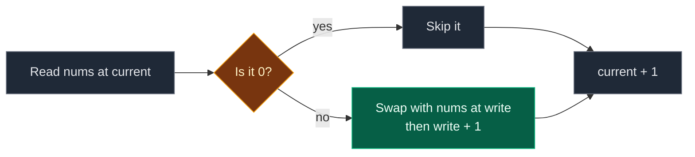

# 01. 283. Move Zeroes

| Difficulty | Pattern | Source | Time | Space |
|:---:|:---:|:---:|:---:|:---:|
| **Easy** | Two Pointers | [283. Move Zeroes](https://leetcode.com/problems/move-zeroes/) | `O(n)` | `O(1)` |

## 1. Problem Statement

You get an integer array `nums`.

Move all the `0`s to the end of the array.

The non-zero numbers must stay in the same order as before.

You must do this **in-place**. Do not make a copy of the array.

Follow-up: can you keep the number of operations small?

### Example

```text
Input:  nums = [0, 1, 0, 3, 12]
Output: [1, 3, 12, 0, 0]

Non-zero numbers in order: 1, 3, 12
They go to the front, in the same order.
The two zeros go to the back.
```

We use this same example in every section below.

### Constraints

- `1 <= nums.length <= 10^4`
- `-2^31 <= nums[i] <= 2^31 - 1`

## 2. Core Theory

### What the problem really asks

Split the array into two parts:

- Front part: all non-zero numbers, in their old order.
- Back part: all zeros.

We are not sorting. `[12, 3, 1, 0, 0]` is wrong, because the order of `1, 3, 12` changed.

### Why two pointers fit

We use two pointers that walk left to right:

| Pointer | When it moves | Meaning |
|:---|:---|:---|
| `current` (reader) | Every step | The number we are looking at now |
| `write` (writer) | Only when we place a non-zero | Where the next non-zero should go |

The key rule (the invariant):

- Everything before `write` is a non-zero number, in the original order.
- Everything from `write` up to `current - 1` is a zero.

```text
 non-zeros (done)   zeros     not seen yet
[  1   3  ][  0   0  ][  12  ...  ]
            ^write      ^current
```

When `current` finds a non-zero, we swap it with `nums[write]`. The cell at `write` holds a zero (or the same number), so the zero moves back and the non-zero moves to the front. Then `write` moves one step.

### Why the order stays the same

- We read left to right.
- Each non-zero goes to the next free front slot.
- So the first non-zero we see goes first, the second goes second, and so on.



### Same family

| Problem | What we keep at the front |
|:---|:---|
| **283. Move Zeroes** | Non-zero numbers |
| 27. Remove Element | Numbers not equal to `val` |
| 26. Remove Duplicates from Sorted Array | First copy of each number |

Same reader/writer skeleton. Only the "should I keep it?" test changes.

## 3. Edge Cases

| Case | Input | Expected | Why it matters |
|:---|:---|:---:|:---|
| Single zero | `[0]` | `[0]` | `write` never moves. Nothing changes |
| Single non-zero | `[1]` | `[1]` | `write == current`, so a swap would be a self-swap. The guard skips it |
| All zeros | `[0, 0, 0]` | `[0, 0, 0]` | No swap ever happens |
| No zeros | `[1, 2, 3]` | `[1, 2, 3]` | Already correct. With the guard, zero writes |
| Zeros at the front | `[0, 0, 1]` | `[1, 0, 0]` | The non-zero must travel all the way to index 0 |
| Negative numbers | `[0, -1, 0, -3]` | `[-1, -3, 0, 0]` | The test is `!= 0`, not `> 0` |
| Duplicate values | `[0, 2, 0, 2, 1]` | `[2, 2, 1, 0, 0]` | Equal values keep their order too |

## 4. Brute Force: Extra Array

### Idea

1. Make a new list `temp`.
2. Put every non-zero number into `temp`.
3. Add zeros to `temp` until it has the same length as `nums`.
4. Copy `temp` back into `nums`.

### Code

```python
# Import List for type hints
from typing import List


# Brute force: build a new list, then copy it back
class SolutionBrute:

    # Main method
    def moveZeroes(self, nums: List[int]) -> None:

        # New list that will hold the answer
        temp = []

        # Look at every number
        for num in nums:

            # Keep only the non-zero numbers
            if num != 0:

                # Add it, keeping the order
                temp.append(num)

        # How many zeros we skipped
        zero_count = len(nums) - len(temp)

        # Add that many zeros at the end
        for _ in range(zero_count):

            # Add one zero
            temp.append(0)

        # Copy the answer back into nums
        for i in range(len(nums)):

            # Overwrite one cell
            nums[i] = temp[i]
```

### Complexity

| Measure | Complexity | Why |
|:---|:---:|:---|
| **Time** | `O(n)` | A few passes, each one linear |
| **Space** | `O(n)` | The extra list `temp` |

It works, but it uses extra memory. The problem wants in-place.

## 5. Better Approach: Overwrite, Then Fill Zeros

### Idea

1. Keep a pointer `write = 0`.
2. For every non-zero number, write it at `nums[write]` and move `write` one step.
3. After the loop, every cell from `write` to the end gets `0`.

No extra list. But it writes every non-zero, even ones already in the right place.

### Code

```python
# Better: compact the non-zeros to the front, then fill zeros
class SolutionBetter:

    # Main method
    def moveZeroes(self, nums: List[int]) -> None:

        # Where the next non-zero goes
        write = 0

        # Look at every index
        for i in range(len(nums)):

            # Only non-zero numbers are kept
            if nums[i] != 0:

                # Copy it to the front part
                nums[write] = nums[i]

                # Next free front slot
                write += 1

        # Fill the rest with zeros
        for i in range(write, len(nums)):

            # Put a zero here
            nums[i] = 0
```

### Complexity

| Measure | Complexity | Why |
|:---|:---:|:---|
| **Time** | `O(n)` | One pass to compact, one pass to fill |
| **Space** | `O(1)` | Only one pointer |

## 6. Optimal Approach: Two Pointers With Swap

### Idea

1. `write = 0`.
2. Walk `current` from left to right.
3. If `nums[current]` is not zero:
   - If `current != write`, swap `nums[current]` and `nums[write]`.
   - Move `write` one step.
4. Zeros are pushed back by the swaps. No second pass needed.

The guard `current != write` skips useless self-swaps. So an array with no zeros costs zero writes.

### Visual Walkthrough (Story Version)

Before the code, let us see the idea as a story.

**The story:** five kids stand in a line for a photo. Some kids hold a balloon with a number. Some kids hold an **empty** balloon (that is the `0`). The teacher says: "Kids with numbers go to the front. Keep your order. Empty balloons go to the back."

**The helpers:**

- **Reader** walks down the line and looks at each kid. (`current`)
- **Gate** marks the next free spot at the front. (`write`)
- When the reader finds a kid with a number, that kid swaps places with whoever stands at the gate. Then the gate moves one step.

**How to read the pictures:** each box is one kid. `R` = reader. `G` = gate.

**Start**

```text
[0][1][0][3][12]
 R
 G
```

Gate is at spot 0. Reader is at spot 0.

**Step 1: reader looks at spot 0**

- The kid holds an empty balloon (`0`).
- Empty balloons wait. Nobody moves. Gate stays.

```text
[0][1][0][3][12]
    R
 G
```

**Step 2: reader looks at spot 1**

- The kid holds `1`. A number!
- The reader is at spot 1, the gate is at spot 0. Different spots, so they swap.
- Kid `1` goes to spot 0. The empty balloon goes to spot 1.
- Gate moves to spot 1.

```text
[1][0][0][3][12]
       R
    G
```

**Step 3: reader looks at spot 2**

- Empty balloon. Nobody moves. Gate stays at spot 1.

```text
[1][0][0][3][12]
          R
    G
```

**Step 4: reader looks at spot 3**

- The kid holds `3`. A number!
- Reader at spot 3, gate at spot 1. Swap.
- Kid `3` goes to spot 1. The empty balloon goes to spot 3.
- Gate moves to spot 2.

```text
[1][3][0][0][12]
              R
       G
```

**Step 5: reader looks at spot 4**

- The kid holds `12`. A number!
- Reader at spot 4, gate at spot 2. Swap.
- Kid `12` goes to spot 2. The empty balloon goes to spot 4.
- Gate moves to spot 3.

```text
[1][3][12][0][0]
           G
```

The reader has walked past the last kid. Done. Number kids are at the front in the old order `1, 3, 12`. Empty balloons are at the back.

**All steps at a glance**

| Step | Reader spot | Balloon | Gate before | Action | Line after | Gate after |
|:---:|:---:|:---:|:---:|:---|:---|:---:|
| 1 | 0 | `0` | 0 | Wait | `[0,1,0,3,12]` | 0 |
| 2 | 1 | `1` | 0 | Swap spots 0 and 1 | `[1,0,0,3,12]` | 1 |
| 3 | 2 | `0` | 1 | Wait | `[1,0,0,3,12]` | 1 |
| 4 | 3 | `3` | 1 | Swap spots 1 and 3 | `[1,3,0,0,12]` | 2 |
| 5 | 4 | `12` | 2 | Swap spots 2 and 4 | `[1,3,12,0,0]` | 3 |

**What the story teaches**

| In the story | In the code |
|:---|:---|
| Kid in the line | One cell of `nums` |
| Empty balloon | The value `0` |
| Reader | `current` |
| Gate | `write` |
| Kid with a number swaps with the gate spot | `nums[write], nums[current] = nums[current], nums[write]` |
| Gate moves one step | `write += 1` |
| Kid already at the gate, no swap | Guard `current != write` |

Now the same steps again, this time with the exact variables.

### Step-by-Step Example

```text
nums = [0, 1, 0, 3, 12]
```

**Start**

```text
index:  0  1  2  3  4
nums:  [0, 1, 0, 3, 12]
write = 0
```

**Step 1: `current = 0`**

1. `nums[0] = 0`.
2. Is `0 != 0`? No. Skip.
3. `write` stays `0`.

```text
nums:  [0, 1, 0, 3, 12]
write = 0
```

**Step 2: `current = 1`**

1. `nums[1] = 1`.
2. Is `1 != 0`? Yes.
3. Is `current (1) != write (0)`? Yes. Swap `nums[0]` and `nums[1]`.
4. `nums[0] = 1`, `nums[1] = 0`.
5. `write = 0 + 1 = 1`.

```text
nums:  [1, 0, 0, 3, 12]
write = 1
```

**Step 3: `current = 2`**

1. `nums[2] = 0`.
2. Is `0 != 0`? No. Skip.
3. `write` stays `1`.

```text
nums:  [1, 0, 0, 3, 12]
write = 1
```

**Step 4: `current = 3`**

1. `nums[3] = 3`.
2. Is `3 != 0`? Yes.
3. Is `current (3) != write (1)`? Yes. Swap `nums[1]` and `nums[3]`.
4. `nums[1] = 3`, `nums[3] = 0`.
5. `write = 1 + 1 = 2`.

```text
nums:  [1, 3, 0, 0, 12]
write = 2
```

**Step 5: `current = 4`**

1. `nums[4] = 12`.
2. Is `12 != 0`? Yes.
3. Is `current (4) != write (2)`? Yes. Swap `nums[2]` and `nums[4]`.
4. `nums[2] = 12`, `nums[4] = 0`.
5. `write = 2 + 1 = 3`.

```text
nums:  [1, 3, 12, 0, 0]
write = 3
```

**End**

The loop is over. `nums = [1, 3, 12, 0, 0]`. This matches the expected output.

| current | nums[current] | Non-zero? | Swap? | nums after | write after |
|:---:|:---:|:---:|:---|:---|:---:|
| 0 | 0 | No | – | `[0,1,0,3,12]` | 0 |
| 1 | 1 | Yes | `nums[0] <-> nums[1]` | `[1,0,0,3,12]` | 1 |
| 2 | 0 | No | – | `[1,0,0,3,12]` | 1 |
| 3 | 3 | Yes | `nums[1] <-> nums[3]` | `[1,3,0,0,12]` | 2 |
| 4 | 12 | Yes | `nums[2] <-> nums[4]` | `[1,3,12,0,0]` | 3 |

### Code

```python
# Solution for 283. Move Zeroes
class Solution:

    # Main method
    def moveZeroes(self, nums: List[int]) -> None:

        # Where the next non-zero goes
        write = 0

        # Reader walks over every index
        for current in range(len(nums)):

            # Only non-zero numbers move to the front
            if nums[current] != 0:

                # Skip the swap when the number is already in place
                if current != write:

                    # Swap the non-zero to the front and the zero to the back
                    nums[write], nums[current] = nums[current], nums[write]

                # Next free front slot
                write += 1


# Replay the example step by step and check the state after each step
nums = [0, 1, 0, 3, 12]

# Expected (nums, write) after each value of current
expected_steps = [
    ([0, 1, 0, 3, 12], 0),
    ([1, 0, 0, 3, 12], 1),
    ([1, 0, 0, 3, 12], 1),
    ([1, 3, 0, 0, 12], 2),
    ([1, 3, 12, 0, 0], 3),
]

# Start the writer at 0
write = 0

# Same loop as the solution
for current in range(len(nums)):

    # Same non-zero test
    if nums[current] != 0:

        # Same guard
        if current != write:

            # Same swap
            nums[write], nums[current] = nums[current], nums[write]

        # Same writer move
        write += 1

    # Check the state matches the traced table
    assert (nums, write) == expected_steps[current]

# Full solution on the example
arr = [0, 1, 0, 3, 12]

# Run it in place
Solution().moveZeroes(arr)

# Check the answer
assert arr == [1, 3, 12, 0, 0]

# Helper that runs a solution and returns the changed list
def run(sol, data):

    # Copy so the original is not changed
    copy = list(data)

    # Move zeros in place
    sol.moveZeroes(copy)

    # Give back the result
    return copy

# LeetCode example 2
assert run(Solution(), [0]) == [0]

# Single non-zero
assert run(Solution(), [1]) == [1]

# All zeros
assert run(Solution(), [0, 0, 0]) == [0, 0, 0]

# No zeros
assert run(Solution(), [1, 2, 3]) == [1, 2, 3]

# Zeros at the front
assert run(Solution(), [0, 0, 1]) == [1, 0, 0]

# Negative numbers
assert run(Solution(), [0, -1, 0, -3]) == [-1, -3, 0, 0]

# Duplicate values keep their order
assert run(Solution(), [0, 2, 0, 2, 1]) == [2, 2, 1, 0, 0]

# Random tests: brute, better and optimal must agree
import random

# Fixed seed so the test is repeatable
random.seed(283)

# Many random arrays
for _ in range(300):

    # Random array with many zeros
    data = [random.choice([0, 0, 1, -1, 2, 5]) for _ in range(random.randint(1, 12))]

    # Brute force answer
    want = run(SolutionBrute(), data)

    # Better approach must match
    assert run(SolutionBetter(), data) == want

    # Optimal approach must match
    assert run(Solution(), data) == want

# All checks passed
print("All tests passed")
```

### Complexity

| Measure | Complexity | Why |
|:---|:---:|:---|
| **Time** | `O(n)` | One pass. Each index is read once |
| **Space** | `O(1)` | Only the `write` pointer |

## 7. Common Mistakes

| Mistake | What goes wrong | Fix |
|:---|:---|:---|
| Swapping the non-zero with the **last** cell | Zeros go back, but the order of non-zeros breaks | Swap with `write`, the front boundary |
| Moving `write` on every step | `write` stays equal to `current`, nothing is compacted | Move `write` only inside the non-zero branch |
| Forgetting the fill loop in the "better" version | `[0,1,0,3,12]` ends as `[1,3,12,3,12]` | After compacting, set `nums[write:]` to `0` |
| Using `nums.remove(0)` inside a loop | Skips elements and changes the length | Never resize. Overwrite with two pointers |
| Writing `nums = [...]` | Only the local name changes. The caller sees nothing | Change cells by index, or use `nums[:] = ...` |
| Testing `nums[i] > 0` | Negative numbers are treated like zeros | Test `nums[i] != 0` |

## 8. Interview Follow-ups

### Q1. How do you keep the number of writes small?

**Answer:**
- Add the guard `if current != write` before the swap.
- An array with no zeros then does zero writes.
- Only numbers that really need to move are touched.

### Q2. What if the zeros must go to the front instead?

**Answer:**
- Walk from the right end to the left.
- Start `write` at `n - 1` and move it left after each placement.
- The non-zeros stay in order at the back. Zeros end up at the front.

### Q3. How do you move every copy of some value `val` to the end?

**Answer:**
- Same code. Change the test `nums[current] != 0` to `nums[current] != val`.
- This is LeetCode 27 (Remove Element) with a fill step.

### Q4. What if there are three groups, like negatives, zeros and positives?

**Answer:**
- Two pointers are not enough. Use the Dutch National Flag idea (LeetCode 75) with `low`, `mid`, `high`.
- It is one pass and `O(1)` space.
- But it is not stable. If order inside each group matters, use extra space.

### Q5. Is there another way to see the same idea?

**Answer:**
- Yes, the "snowball" view. Count zeros seen so far, call it `snow`.
- Each non-zero moves `snow` steps left: `nums[i - snow] = nums[i]`, then `nums[i] = 0`.
- `write` is just `current - snow`. Same algorithm, different words.

## 9. Interview Explanation

> I keep a write pointer that marks where the next non-zero number belongs. I scan the array left to right with a second pointer. When I see a non-zero number, I swap it into the write position and move the write pointer one step. Everything before the write pointer is non-zero in the original order, and everything between the two pointers is zero, so each swap sends a zero backward. Because I read left to right, the order of the non-zeros is kept. I skip the swap when both pointers are equal to avoid useless writes. It is O(n) time and O(1) space.
