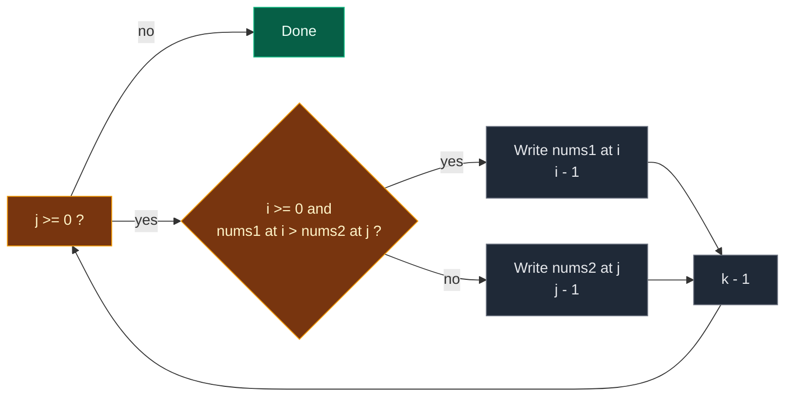

# 02. 88. Merge Sorted Array

| Difficulty | Pattern | Source | Time | Space |
|:---:|:---:|:---:|:---:|:---:|
| **Easy** | Two Pointers (Merge From Back) | [88. Merge Sorted Array](https://leetcode.com/problems/merge-sorted-array/) | `O(m + n)` | `O(1)` |

## 1. Problem Statement

You get two integer arrays, `nums1` and `nums2`. Both are sorted from small to big.

You also get two numbers:

- `m` = how many real numbers are in `nums1`.
- `n` = how many numbers are in `nums2`.

`nums1` has length `m + n`. The first `m` cells are real numbers. The last `n` cells are `0` placeholders. Ignore them.

Merge `nums2` into `nums1` so that `nums1` becomes one sorted array. Do not return anything. Change `nums1` in place.

Follow-up: can you do it in `O(m + n)` time?

### Example

```text
Input:  nums1 = [1, 2, 3, 0, 0, 0], m = 3
        nums2 = [2, 5, 6],          n = 3
Output: [1, 2, 2, 3, 5, 6]

Real part of nums1: [1, 2, 3]
nums2:              [2, 5, 6]
Merged:             [1, 2, 2, 3, 5, 6]
```

We use this same example in every section below.

### Constraints

- `nums1.length == m + n`
- `nums2.length == n`
- `0 <= m, n <= 200`
- `1 <= m + n <= 200`
- `-10^9 <= nums1[i], nums2[j] <= 10^9`

## 2. Core Theory

### What the problem really asks

This is the "merge" step of merge sort. Two sorted lists become one sorted list.

The twist: the answer must live inside `nums1`, and the free space is at the **end** of `nums1`.

### Why merging from the front fails

If we write the smallest number into `nums1[0]` first, we may overwrite a real number of `nums1` that we have not read yet.

```text
nums1 = [1, 2, 3, 0, 0, 0]
         ^ writing here can destroy 1, 2 or 3 before we use them
```

### Why merging from the back works

The biggest remaining number is always at the **end** of one of the two real parts.

So we fill `nums1` from the back:

- `i` = last real number in `nums1` (starts at `m - 1`).
- `j` = last number in `nums2` (starts at `n - 1`).
- `k` = where to write (starts at `m + n - 1`).

```text
nums1 = [1, 2, 3, 0, 0, 0]       nums2 = [2, 5, 6]
               ^i       ^k                     ^j
```

At each step, put the bigger of `nums1[i]` and `nums2[j]` at `k`.

Why we never destroy unread data:

- At the start `k - i = n`.
- `k` moves left every step. `i` moves left only when we take from `nums1`.
- So `k` is always at or to the right of `i`. We only write on free cells or cells already read.

### When do we stop?

- When `nums2` is empty (`j < 0`), we stop. Any numbers left in `nums1` are already in the right place.
- If `nums1` runs out first (`i < 0`), we keep copying from `nums2`.



## 3. Edge Cases

| Case | Input | Expected | Why it matters |
|:---|:---|:---:|:---|
| `nums2` is empty | `nums1=[1], m=1, nums2=[], n=0` | `[1]` | `j` starts at `-1`. The loop never runs |
| `nums1` has no real numbers | `nums1=[0], m=0, nums2=[1], n=1` | `[1]` | `i` starts at `-1`. Every value comes from `nums2` |
| All of `nums1` smaller | `[1,2,3,0,0,0]`, `[4,5,6]` | `[1,2,3,4,5,6]` | `nums2` runs out first. `nums1` part is already in place |
| All of `nums2` smaller | `[4,5,6,0,0,0]`, `[1,2,3]` | `[1,2,3,4,5,6]` | `nums1` runs out first. We keep copying `nums2` |
| Negative numbers | `[-3,-1,0,0], m=2`, `[-5,-2]` | `[-5,-3,-2,-1]` | Placeholder zeros are bigger than real data. Trust `m`, not the values |
| All equal | `[2,2,0,0], m=2`, `[2,2]` | `[2,2,2,2]` | Every comparison is a tie |

## 4. Brute Force: Copy Then Sort

### Idea

1. Copy `nums2` into the free cells of `nums1` (from index `m`).
2. Sort `nums1`.

### Code

```python
# Import List for type hints
from typing import List


# Brute force: copy nums2 in, then sort everything
class SolutionBrute:

    # Main method
    def merge(self, nums1: List[int], m: int, nums2: List[int], n: int) -> None:

        # Go over every number in nums2
        for j in range(n):

            # Put it into the free cell after the real part
            nums1[m + j] = nums2[j]

        # Sort the whole array in place
        nums1.sort()
```

### Complexity

| Measure | Complexity | Why |
|:---|:---:|:---|
| **Time** | `O((m + n) log(m + n))` | Sorting the full array |
| **Space** | `O(1)` extra (sort may use some internal memory) | No new list |

It ignores the fact that both arrays are already sorted.

## 5. Better Approach: Merge Into a New List

### Idea

1. Copy the real part of `nums1` into `left`.
2. Merge `left` and `nums2` from the front into a new list `merged`, always taking the smaller head.
3. Copy `merged` back into `nums1`.

### Code

```python
# Better: normal front merge using an extra list
class SolutionBetter:

    # Main method
    def merge(self, nums1: List[int], m: int, nums2: List[int], n: int) -> None:

        # Copy of the real part of nums1
        left = nums1[:m]

        # The merged answer
        merged = []

        # Pointer into left
        i = 0

        # Pointer into nums2
        j = 0

        # While both lists still have numbers
        while i < m and j < n:

            # Take the smaller head
            if left[i] <= nums2[j]:

                # Head of left is smaller or equal
                merged.append(left[i])

                # Move in left
                i += 1

            # Otherwise nums2 has the smaller head
            else:

                # Take from nums2
                merged.append(nums2[j])

                # Move in nums2
                j += 1

        # Add what is left of left
        merged.extend(left[i:])

        # Add what is left of nums2
        merged.extend(nums2[j:])

        # Copy the answer back into nums1
        nums1[:] = merged
```

### Complexity

| Measure | Complexity | Why |
|:---|:---:|:---|
| **Time** | `O(m + n)` | Each number is taken once |
| **Space** | `O(m + n)` | `left` and `merged` |

Fast, but it uses extra memory. The back merge removes that.

## 6. Optimal Approach: Merge From the Back

### Idea

1. `i = m - 1`, `j = n - 1`, `k = m + n - 1`.
2. While `j >= 0`:
   - If `i >= 0` and `nums1[i] > nums2[j]`: write `nums1[i]` at `k`, then `i -= 1`.
   - Else: write `nums2[j]` at `k`, then `j -= 1`.
   - `k -= 1`.
3. When `j < 0`, stop. Leftover `nums1` numbers are already in place.

### Visual Walkthrough (Story Version)

Before the code, let us see the idea as a story.

**The story:** there is a shelf with 6 spots. The first 3 spots hold books with heights `1, 2, 3`. The last 3 spots are empty (`_`). On a cart next to the shelf are 3 more books: `2, 5, 6`. Both piles are already sorted, short to tall.

We want all 6 books on the shelf, short to tall.

**The trick:** start from the **right end** of the shelf. That end is empty, so we never knock over a book we still need. Each time, look at the tallest book left on the shelf part and the tallest book left on the cart. The taller one goes to the right-most empty spot.

**How to read the pictures:** `S` = tallest unplaced shelf book (`i`). `C` = tallest unplaced cart book (`j`). `W` = the spot we fill next (`k`). `_` = empty spot.

**Start**

```text
shelf: [1][2][3][_][_][_]        cart: [2][5][6]
              S        W                     C
```

**Step 1: compare shelf `3` with cart `6`**

- `6` is taller. Cart book `6` goes to spot 5.
- Cart pointer moves left. Write spot moves left.

```text
shelf: [1][2][3][_][_][6]        cart: [2][5][ ]
              S     W                     C
```

**Step 2: compare shelf `3` with cart `5`**

- `5` is taller. Cart book `5` goes to spot 4.

```text
shelf: [1][2][3][_][5][6]        cart: [2][ ][ ]
              S  W                     C
```

**Step 3: compare shelf `3` with cart `2`**

- `3` is taller. Shelf book `3` moves to spot 3.
- Shelf pointer moves left. Spot 2 is now free to reuse.

```text
shelf: [1][2][3][3][5][6]        cart: [2][ ][ ]
           S  W                        C
```

(The old copy of `3` at spot 2 will be covered next.)

**Step 4: compare shelf `2` with cart `2`**

- Same height. Our rule: shelf goes first only if it is **strictly** taller. It is not, so cart book `2` goes to spot 2.
- The cart is now empty.

```text
shelf: [1][2][2][3][5][6]        cart: [ ][ ][ ]
           S
```

**Stop:** the cart is empty. Books `1` and `2` on the left were never moved, and they are already in the right spots.

**All steps at a glance**

| Step | Shelf book (`i`) | Cart book (`j`) | Taller | Placed at spot | Shelf after |
|:---:|:---:|:---:|:---|:---:|:---|
| 1 | 3 | 6 | Cart | 5 | `[1,2,3,_,_,6]` |
| 2 | 3 | 5 | Cart | 4 | `[1,2,3,_,5,6]` |
| 3 | 3 | 2 | Shelf | 3 | `[1,2,3,3,5,6]` |
| 4 | 2 | 2 | Tie, cart | 2 | `[1,2,2,3,5,6]` |
| stop | – | none | – | – | `[1,2,2,3,5,6]` |

**What the story teaches**

| In the story | In the code |
|:---|:---|
| Shelf | `nums1` |
| Empty spots on the right | The `n` placeholder zeros |
| Cart | `nums2` |
| Tallest unplaced shelf book | `nums1[i]` |
| Tallest unplaced cart book | `nums2[j]` |
| Right-most empty spot | `k` |
| Cart is empty, stop | Loop `while j >= 0` ends |
| Left books never move | Leftover `nums1` is already in place |

Now the same steps again, this time with the exact variables.

### Step-by-Step Example

```text
nums1 = [1, 2, 3, 0, 0, 0], m = 3
nums2 = [2, 5, 6],          n = 3
```

**Start**

```text
index:  0  1  2  3  4  5
nums1: [1, 2, 3, 0, 0, 0]
i = 2, j = 2, k = 5
```

**Step 1**

1. Is `j (2) >= 0`? Yes, keep going.
2. `i (2) >= 0`, and `nums1[2] = 3`, `nums2[2] = 6`.
3. Is `3 > 6`? No. Take from `nums2`.
4. `nums1[5] = 6`.
5. `j = 2 - 1 = 1`.
6. `k = 5 - 1 = 4`.

```text
nums1: [1, 2, 3, 0, 0, 6]
i = 2, j = 1, k = 4
```

**Step 2**

1. Is `j (1) >= 0`? Yes.
2. `nums1[2] = 3`, `nums2[1] = 5`.
3. Is `3 > 5`? No. Take from `nums2`.
4. `nums1[4] = 5`.
5. `j = 1 - 1 = 0`.
6. `k = 4 - 1 = 3`.

```text
nums1: [1, 2, 3, 0, 5, 6]
i = 2, j = 0, k = 3
```

**Step 3**

1. Is `j (0) >= 0`? Yes.
2. `nums1[2] = 3`, `nums2[0] = 2`.
3. Is `3 > 2`? Yes. Take from `nums1`.
4. `nums1[3] = 3`.
5. `i = 2 - 1 = 1`.
6. `k = 3 - 1 = 2`.

```text
nums1: [1, 2, 3, 3, 5, 6]
i = 1, j = 0, k = 2
```

**Step 4**

1. Is `j (0) >= 0`? Yes.
2. `nums1[1] = 2`, `nums2[0] = 2`.
3. Is `2 > 2`? No. Take from `nums2`.
4. `nums1[2] = 2`.
5. `j = 0 - 1 = -1`.
6. `k = 2 - 1 = 1`.

```text
nums1: [1, 2, 2, 3, 5, 6]
i = 1, j = -1, k = 1
```

**Check the loop again**

- Is `j (-1) >= 0`? No. Stop.
- `nums1[0..1] = [1, 2]` were never touched and are already right.

**Final:** `nums1 = [1, 2, 2, 3, 5, 6]`.

| Step | `nums1[i]` | `nums2[j]` | `nums1[i] > nums2[j]`? | Write | nums1 after | i | j | k |
|:---:|:---:|:---:|:---:|:---|:---|:---:|:---:|:---:|
| start | – | – | – | – | `[1,2,3,0,0,0]` | 2 | 2 | 5 |
| 1 | 3 | 6 | No | `nums1[5] = 6` | `[1,2,3,0,0,6]` | 2 | 1 | 4 |
| 2 | 3 | 5 | No | `nums1[4] = 5` | `[1,2,3,0,5,6]` | 2 | 0 | 3 |
| 3 | 3 | 2 | Yes | `nums1[3] = 3` | `[1,2,3,3,5,6]` | 1 | 0 | 2 |
| 4 | 2 | 2 | No | `nums1[2] = 2` | `[1,2,2,3,5,6]` | 1 | -1 | 1 |

### Code

```python
# Solution for 88. Merge Sorted Array
class Solution:

    # Main method
    def merge(self, nums1: List[int], m: int, nums2: List[int], n: int) -> None:

        # Last real number in nums1
        i = m - 1

        # Last number in nums2
        j = n - 1

        # Last cell of nums1, where we write next
        k = m + n - 1

        # Keep going while nums2 still has numbers
        while j >= 0:

            # nums1 still has numbers and its last one is bigger
            if i >= 0 and nums1[i] > nums2[j]:

                # Put the nums1 number at the write spot
                nums1[k] = nums1[i]

                # Move left in nums1
                i -= 1

            # Otherwise the nums2 number is bigger or equal, or nums1 is empty
            else:

                # Put the nums2 number at the write spot
                nums1[k] = nums2[j]

                # Move left in nums2
                j -= 1

            # Move the write spot left
            k -= 1


# Replay the example step by step and check the state after each step
nums1 = [1, 2, 3, 0, 0, 0]

# The second array
nums2 = [2, 5, 6]

# Start pointers
i, j, k = 2, 2, 5

# Expected (nums1, i, j, k) after each step
expected_steps = [
    ([1, 2, 3, 0, 0, 6], 2, 1, 4),
    ([1, 2, 3, 0, 5, 6], 2, 0, 3),
    ([1, 2, 3, 3, 5, 6], 1, 0, 2),
    ([1, 2, 2, 3, 5, 6], 1, -1, 1),
]

# Count the steps
step = 0

# Same loop as the solution
while j >= 0:

    # Same comparison
    if i >= 0 and nums1[i] > nums2[j]:

        # Take from nums1
        nums1[k] = nums1[i]

        # Move i
        i -= 1

    # Take from nums2
    else:

        # Write the nums2 number
        nums1[k] = nums2[j]

        # Move j
        j -= 1

    # Move k
    k -= 1

    # Check against the traced table
    assert (nums1, i, j, k) == expected_steps[step]

    # Next step
    step += 1

# Exactly 4 steps were traced
assert step == 4

# Helper that runs a solution and returns nums1
def run(sol, a, m, b, n):

    # Copy so tests do not share lists
    a = list(a)

    # Merge in place
    sol.merge(a, m, list(b), n)

    # Give back the result
    return a

# The example
assert run(Solution(), [1, 2, 3, 0, 0, 0], 3, [2, 5, 6], 3) == [1, 2, 2, 3, 5, 6]

# LeetCode example 2: nums2 is empty
assert run(Solution(), [1], 1, [], 0) == [1]

# LeetCode example 3: nums1 has no real numbers
assert run(Solution(), [0], 0, [1], 1) == [1]

# All of nums1 smaller
assert run(Solution(), [1, 2, 3, 0, 0, 0], 3, [4, 5, 6], 3) == [1, 2, 3, 4, 5, 6]

# All of nums2 smaller
assert run(Solution(), [4, 5, 6, 0, 0, 0], 3, [1, 2, 3], 3) == [1, 2, 3, 4, 5, 6]

# Negative numbers
assert run(Solution(), [-3, -1, 0, 0], 2, [-5, -2], 2) == [-5, -3, -2, -1]

# All equal
assert run(Solution(), [2, 2, 0, 0], 2, [2, 2], 2) == [2, 2, 2, 2]

# Random tests: brute, better and optimal must agree
import random

# Fixed seed so the test is repeatable
random.seed(88)

# Many random cases
for _ in range(300):

    # Random sizes
    m, n = random.randint(0, 6), random.randint(0, 6)

    # Skip the empty case, it is outside the constraints
    if m + n == 0:

        # Try the next case
        continue

    # Sorted real part plus n placeholder zeros
    a = sorted(random.randint(-5, 5) for _ in range(m)) + [0] * n

    # Sorted second array
    b = sorted(random.randint(-5, 5) for _ in range(n))

    # Brute force answer
    want = run(SolutionBrute(), a, m, b, n)

    # Better must match
    assert run(SolutionBetter(), a, m, b, n) == want

    # Optimal must match
    assert run(Solution(), a, m, b, n) == want

# All checks passed
print("All tests passed")
```

### Complexity

| Measure | Complexity | Why |
|:---|:---:|:---|
| **Time** | `O(m + n)` | Each step places one number. At most `m + n` steps |
| **Space** | `O(1)` | Only three pointers |

## 7. Common Mistakes

| Mistake | What goes wrong | Fix |
|:---|:---|:---|
| Merging from the front in place | Overwrites real `nums1` numbers before they are read | Fill from the back, where the free space is |
| Loop `while i >= 0 and j >= 0` with no follow-up | If `nums1` runs out first, leftover `nums2` is never copied | Loop on `j >= 0` and check `i >= 0` inside |
| Using `len(nums1)` instead of `m` | Placeholder zeros are treated as real numbers | Use `m` for the real part |
| Finding the real part by looking for zeros | `0` is a valid value, and negatives make placeholders the biggest | Trust `m` and `n` only |
| Starting `k = m + n` | First write goes past the end, `IndexError` | `k = m + n - 1` |
| Writing `nums1 = merged` | Only the local name changes | Use `nums1[:] = merged` or index writes |

## 8. Interview Follow-ups

### Q1. Why do we not need a loop for leftover `nums1` numbers?

**Answer:**
- If `nums2` runs out first, the leftover `nums1` numbers sit at the front.
- They are smaller than everything already placed.
- So they are already in their final spots.

### Q2. Does `>` versus `>=` change the answer?

**Answer:**
- Not for plain numbers. The output is the same.
- It changes which copy of a tie goes first. That matters only if items carry extra data (stability).

### Q3. How would you merge `k` sorted arrays?

**Answer:**
- Use a min-heap with the head of each array.
- Pop the smallest, then push the next item from that array.
- Time `O(N log k)`, where `N` is the total count.

### Q4. What if `nums1` had no free space at the end?

**Answer:**
- A true in-place merge with `O(1)` space is hard.
- A simple method is the "gap method" (like Shell sort). It is `O((m + n) log(m + n))`.
- Otherwise, use an extra array.

### Q5. What if the arrays are too big for memory?

**Answer:**
- Stream them from disk. Keep only the current head of each.
- Write the smaller one to the output file.
- This is how external merge sort works.

## 9. Interview Explanation

> Both arrays are sorted, and the free space in nums1 is at the end, so I merge from the back. I keep i at the last real number of nums1, j at the end of nums2, and k at the last cell of nums1. While nums2 still has numbers, I write the bigger of nums1[i] and nums2[j] at k and move that pointer and k left. The write pointer never passes the read pointer of nums1, so I never overwrite something I still need. When nums2 runs out, any nums1 numbers left are already in place. It is O(m + n) time and O(1) extra space.
