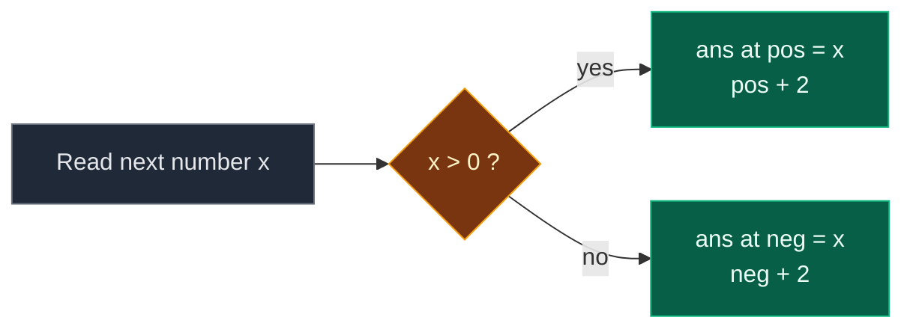

# 03. 2149. Rearrange Array Elements by Sign

| Difficulty | Pattern | Source | Time | Space |
|:---:|:---:|:---:|:---:|:---:|
| **Medium** | Two Write Indices | [2149. Rearrange Array Elements by Sign](https://leetcode.com/problems/rearrange-array-elements-by-sign/) | `O(n)` | `O(n)` |

## 1. Problem Statement

You get an integer array `nums` of **even** length. It has the **same number** of positive and negative numbers.

Rearrange it so that:

1. Every two neighbors have **opposite signs**.
2. Numbers with the same sign keep their **old order**.
3. The array **starts with a positive** number.

Return the new array. You do not have to do it in place.

### Example

```text
Input:  nums = [3, 1, -2, -5, 2, -4]
Output: [3, -2, 1, -5, 2, -4]

Positives in order: 3, 1, 2
Negatives in order: -2, -5, -4
Answer: +, -, +, -, +, -  ->  [3, -2, 1, -5, 2, -4]
```

We use this same example in every section below.

### Constraints

- `2 <= nums.length <= 2 * 10^5`
- `nums.length` is even
- `1 <= |nums[i]| <= 10^5` (no zeros)
- `nums` has an equal number of positive and negative numbers

## 2. Core Theory

### What the problem really asks

The answer must look like `+ - + - + -`. So the slot of every number is decided by its sign:

```text
index:  0   1   2   3   4   5
sign:   +   -   +   -   +   -
```

- Positives go to **even** indices: `0, 2, 4, ...`
- Negatives go to **odd** indices: `1, 3, 5, ...`

And because order must stay the same:

- The 1st positive goes to index `0`, the 2nd to `2`, the 3rd to `4`.
- The 1st negative goes to index `1`, the 2nd to `3`, the 3rd to `5`.

### Why two write pointers fit

We do not need to search or swap. We just keep two "next free slot" pointers:

| Pointer | Starts at | Moves by | Holds |
|:---|:---:|:---:|:---|
| `pos` | 0 | +2 | Next slot for a positive |
| `neg` | 1 | +2 | Next slot for a negative |

Read `nums` left to right. Drop each number into its pointer's slot. Move that pointer by 2.



### Why the order stays the same

- We read left to right.
- Each positive takes the next even slot. So positives land in the order we saw them.
- Same for negatives with odd slots.

## 3. Edge Cases

| Case | Input | Expected | Why it matters |
|:---|:---|:---:|:---|
| Smallest input | `[-1, 1]` | `[1, -1]` | Negative comes first in input but must go second |
| Already alternating | `[1, -1, 2, -2]` | `[1, -1, 2, -2]` | Output equals input |
| All negatives first | `[-1, -2, 1, 2]` | `[1, -1, 2, -2]` | Pointers fill the odd slots first |
| All positives first | `[1, 2, -1, -2]` | `[1, -1, 2, -2]` | Pointers fill the even slots first |
| Duplicates | `[5, 5, -5, -5]` | `[5, -5, 5, -5]` | Same values, order still kept |

## 4. Brute Force: Split Then Interleave

### Idea

1. Put all positives into a list `positives` (in order).
2. Put all negatives into a list `negatives` (in order).
3. Build the answer by taking `positives[i]`, then `negatives[i]`, for each `i`.

### Code

```python
# Import List for type hints
from typing import List


# Brute force: two lists, then zip them together
class SolutionBrute:

    # Main method
    def rearrangeArray(self, nums: List[int]) -> List[int]:

        # Positives in their old order
        positives = []

        # Negatives in their old order
        negatives = []

        # Look at every number
        for x in nums:

            # Positive number
            if x > 0:

                # Keep it in the positive list
                positives.append(x)

            # Negative number
            else:

                # Keep it in the negative list
                negatives.append(x)

        # The answer
        ans = []

        # Take one positive and one negative each round
        for i in range(len(positives)):

            # Positive first
            ans.append(positives[i])

            # Then negative
            ans.append(negatives[i])

        # Return the answer
        return ans
```

### Complexity

| Measure | Complexity | Why |
|:---|:---:|:---|
| **Time** | `O(n)` | Two passes |
| **Space** | `O(n)` | Two helper lists plus the answer |

This is already linear. The optimal way does it in one pass with no helper lists.

## 5. Optimal Approach: Two Write Pointers

### Idea

1. Make `ans` of size `n`.
2. `pos = 0`, `neg = 1`.
3. For each `x` in `nums`:
   - If `x > 0`: `ans[pos] = x`, `pos += 2`.
   - Else: `ans[neg] = x`, `neg += 2`.
4. Return `ans`.

### Visual Walkthrough (Story Version)

Before the code, let us see the idea as a story.

**The story:** 6 kids come to a dance class one by one. Kids with a **red** shirt are positive. Kids with a **blue** shirt are negative. The teacher has 6 chairs in a row. The rule: red, blue, red, blue, red, blue. And kids of the same color must sit in the order they arrived.

**The helpers:**

- **Red usher** points to the next free red chair. Red chairs are 0, 2, 4. (`pos`)
- **Blue usher** points to the next free blue chair. Blue chairs are 1, 3, 5. (`neg`)
- When a kid arrives, the usher of their color seats them and then points two chairs ahead.

**How to read the pictures:** `_` = empty chair. `R` = red usher. `B` = blue usher. Chair numbers are on top.

**Start**

```text
chair:  0   1   2   3   4   5
       [_] [_] [_] [_] [_] [_]
        R   B
```

Kids waiting: `3, 1, -2, -5, 2, -4`.

**Step 1: kid `3` arrives (red)**

- Red usher points to chair 0. Kid `3` sits there.
- Red usher moves to chair 2.

```text
chair:  0   1   2   3   4   5
       [3] [_] [_] [_] [_] [_]
            B   R
```

**Step 2: kid `1` arrives (red)**

- Red usher points to chair 2. Kid `1` sits there.
- Red usher moves to chair 4.

```text
chair:  0   1   2   3   4   5
       [3] [_] [1] [_] [_] [_]
            B           R
```

**Step 3: kid `-2` arrives (blue)**

- Blue usher points to chair 1. Kid `-2` sits there.
- Blue usher moves to chair 3.

```text
chair:  0   1   2   3   4   5
       [3] [-2][1] [_] [_] [_]
                    B   R
```

**Step 4: kid `-5` arrives (blue)**

- Blue usher points to chair 3. Kid `-5` sits there.
- Blue usher moves to chair 5.

```text
chair:  0   1   2   3   4   5
       [3] [-2][1] [-5][_] [_]
                        R   B
```

**Step 5: kid `2` arrives (red)**

- Red usher points to chair 4. Kid `2` sits there.
- Red usher moves to chair 6 (past the end, no more red kids).

```text
chair:  0   1   2   3   4   5
       [3] [-2][1] [-5][2] [_]
                            B
```

**Step 6: kid `-4` arrives (blue)**

- Blue usher points to chair 5. Kid `-4` sits there.
- Blue usher moves to chair 7 (past the end).

```text
chair:  0   1   2   3   4   5
       [3] [-2][1] [-5][2] [-4]
```

All chairs are full: `[3, -2, 1, -5, 2, -4]`.

**All steps at a glance**

| Step | Kid | Color | Chair used | Red usher after | Blue usher after | Row after |
|:---:|:---:|:---:|:---:|:---:|:---:|:---|
| 1 | 3 | red | 0 | 2 | 1 | `[3,_,_,_,_,_]` |
| 2 | 1 | red | 2 | 4 | 1 | `[3,_,1,_,_,_]` |
| 3 | -2 | blue | 1 | 4 | 3 | `[3,-2,1,_,_,_]` |
| 4 | -5 | blue | 3 | 4 | 5 | `[3,-2,1,-5,_,_]` |
| 5 | 2 | red | 4 | 6 | 5 | `[3,-2,1,-5,2,_]` |
| 6 | -4 | blue | 5 | 6 | 7 | `[3,-2,1,-5,2,-4]` |

**What the story teaches**

| In the story | In the code |
|:---|:---|
| Kid | One number `x` |
| Red shirt | `x > 0` |
| Blue shirt | `x < 0` |
| Row of chairs | `ans` |
| Red usher | `pos`, starts at 0 |
| Blue usher | `neg`, starts at 1 |
| Usher moves two chairs | `pos += 2` or `neg += 2` |

Now the same steps again, this time with the exact variables.

### Step-by-Step Example

```text
nums = [3, 1, -2, -5, 2, -4]
n = 6
```

**Start**

```text
ans = [0, 0, 0, 0, 0, 0]
pos = 0, neg = 1
```

**Step 1: `x = 3`**

1. Is `3 > 0`? Yes.
2. `ans[pos] = ans[0] = 3`.
3. `pos = 0 + 2 = 2`.

```text
ans = [3, 0, 0, 0, 0, 0]
pos = 2, neg = 1
```

**Step 2: `x = 1`**

1. Is `1 > 0`? Yes.
2. `ans[2] = 1`.
3. `pos = 2 + 2 = 4`.

```text
ans = [3, 0, 1, 0, 0, 0]
pos = 4, neg = 1
```

**Step 3: `x = -2`**

1. Is `-2 > 0`? No.
2. `ans[neg] = ans[1] = -2`.
3. `neg = 1 + 2 = 3`.

```text
ans = [3, -2, 1, 0, 0, 0]
pos = 4, neg = 3
```

**Step 4: `x = -5`**

1. Is `-5 > 0`? No.
2. `ans[3] = -5`.
3. `neg = 3 + 2 = 5`.

```text
ans = [3, -2, 1, -5, 0, 0]
pos = 4, neg = 5
```

**Step 5: `x = 2`**

1. Is `2 > 0`? Yes.
2. `ans[4] = 2`.
3. `pos = 4 + 2 = 6`.

```text
ans = [3, -2, 1, -5, 2, 0]
pos = 6, neg = 5
```

**Step 6: `x = -4`**

1. Is `-4 > 0`? No.
2. `ans[5] = -4`.
3. `neg = 5 + 2 = 7`.

```text
ans = [3, -2, 1, -5, 2, -4]
pos = 6, neg = 7
```

**End:** return `[3, -2, 1, -5, 2, -4]`.

| Step | x | x > 0? | Write | ans after | pos | neg |
|:---:|:---:|:---:|:---|:---|:---:|:---:|
| start | – | – | – | `[0,0,0,0,0,0]` | 0 | 1 |
| 1 | 3 | Yes | `ans[0] = 3` | `[3,0,0,0,0,0]` | 2 | 1 |
| 2 | 1 | Yes | `ans[2] = 1` | `[3,0,1,0,0,0]` | 4 | 1 |
| 3 | -2 | No | `ans[1] = -2` | `[3,-2,1,0,0,0]` | 4 | 3 |
| 4 | -5 | No | `ans[3] = -5` | `[3,-2,1,-5,0,0]` | 4 | 5 |
| 5 | 2 | Yes | `ans[4] = 2` | `[3,-2,1,-5,2,0]` | 6 | 5 |
| 6 | -4 | No | `ans[5] = -4` | `[3,-2,1,-5,2,-4]` | 6 | 7 |

### Code

```python
# Solution for 2149. Rearrange Array Elements by Sign
class Solution:

    # Main method
    def rearrangeArray(self, nums: List[int]) -> List[int]:

        # Answer array with the same size
        ans = [0] * len(nums)

        # Next even slot for a positive
        pos = 0

        # Next odd slot for a negative
        neg = 1

        # Read every number in order
        for x in nums:

            # Positive number
            if x > 0:

                # Put it in the next even slot
                ans[pos] = x

                # Jump to the next even slot
                pos += 2

            # Negative number
            else:

                # Put it in the next odd slot
                ans[neg] = x

                # Jump to the next odd slot
                neg += 2

        # Return the answer
        return ans


# Replay the example step by step and check the state after each step
nums = [3, 1, -2, -5, 2, -4]

# Expected (ans, pos, neg) after each number
expected_steps = [
    ([3, 0, 0, 0, 0, 0], 2, 1),
    ([3, 0, 1, 0, 0, 0], 4, 1),
    ([3, -2, 1, 0, 0, 0], 4, 3),
    ([3, -2, 1, -5, 0, 0], 4, 5),
    ([3, -2, 1, -5, 2, 0], 6, 5),
    ([3, -2, 1, -5, 2, -4], 6, 7),
]

# Start state
ans, pos, neg = [0] * 6, 0, 1

# Same loop as the solution
for step, x in enumerate(nums):

    # Same sign test
    if x > 0:

        # Write the positive
        ans[pos] = x

        # Move pos
        pos += 2

    # Negative case
    else:

        # Write the negative
        ans[neg] = x

        # Move neg
        neg += 2

    # Check against the traced table
    assert (ans, pos, neg) == expected_steps[step]

# Full solution on the example
assert Solution().rearrangeArray([3, 1, -2, -5, 2, -4]) == [3, -2, 1, -5, 2, -4]

# LeetCode example 2
assert Solution().rearrangeArray([-1, 1]) == [1, -1]

# Already alternating
assert Solution().rearrangeArray([1, -1, 2, -2]) == [1, -1, 2, -2]

# All negatives first
assert Solution().rearrangeArray([-1, -2, 1, 2]) == [1, -1, 2, -2]

# All positives first
assert Solution().rearrangeArray([1, 2, -1, -2]) == [1, -1, 2, -2]

# Duplicates
assert Solution().rearrangeArray([5, 5, -5, -5]) == [5, -5, 5, -5]

# Random tests: brute force and optimal must agree
import random

# Fixed seed so the test is repeatable
random.seed(2149)

# Many random cases
for _ in range(300):

    # Half the length
    half = random.randint(1, 6)

    # Equal counts of positives and negatives
    data = [random.randint(1, 9) for _ in range(half)] + [-random.randint(1, 9) for _ in range(half)]

    # Shuffle them
    random.shuffle(data)

    # Both answers must match
    assert Solution().rearrangeArray(data) == SolutionBrute().rearrangeArray(data)

# All checks passed
print("All tests passed")
```

### Complexity

| Measure | Complexity | Why |
|:---|:---:|:---|
| **Time** | `O(n)` | One pass over `nums` |
| **Space** | `O(n)` | The answer array (needed for output) |

## 6. Common Mistakes

| Mistake | What goes wrong | Fix |
|:---|:---|:---|
| Starting `neg` at `0` | Negatives overwrite positives | `pos = 0`, `neg = 1` |
| Moving pointers by 1 | Two numbers of the same sign end up side by side | Move by 2 |
| Swapping in place to fix signs | Breaks the order of same-sign numbers | Use a new array |
| Starting with a negative | Breaks rule 3 | Positives own index 0 |
| Testing `x >= 0` vs `x > 0` without thinking | Fine here (no zeros), but zero handling must be stated in an interview | Say "no zeros by the constraints" |

## 7. Interview Follow-ups

### Q1. What if the counts of positives and negatives are not equal (LeetCode variant)?

**Answer:**
- Alternate while both groups have numbers.
- Then put all leftover numbers at the end, in order.
- Split into two lists first, then merge. Still `O(n)`.

### Q2. Can you do it in `O(1)` extra space?

**Answer:**
- Not in `O(n)` time while keeping the order.
- An in-place version needs rotations, which costs `O(n^2)`.
- The output array is allowed, so `O(n)` space is the right trade.

### Q3. What if the array must start with a negative?

**Answer:**
- Swap the starting points: `neg = 0`, `pos = 1`.
- Nothing else changes.

### Q4. How would you handle zeros?

**Answer:**
- First decide where zeros belong (with positives, or at the end).
- The current problem has no zeros, so `x > 0` is enough.

### Q5. Can you do it with one pointer?

**Answer:**
- Yes, keep two counters `p` and `q` for how many positives and negatives are placed.
- Positive slot is `2 * p`, negative slot is `2 * q + 1`.
- It is the same idea in a different form.

## 8. Interview Explanation

> Since the answer must alternate starting with a positive, every positive goes to an even index and every negative to an odd index, and the k-th positive must go to index 2k to keep the order. So I make a result array and keep two write pointers, pos at 0 and neg at 1. I read the input left to right, put each number at its sign's pointer, and move that pointer by two. It is one pass, O(n) time, and O(n) space for the output.
