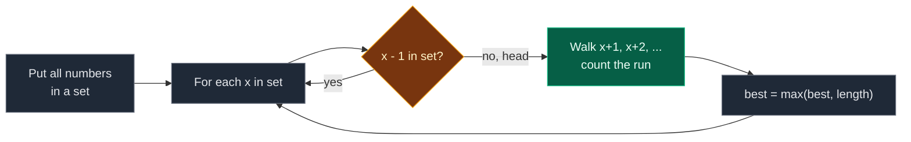

# 01. 128. Longest Consecutive Sequence

| Difficulty | Pattern | Source | Time | Space |
|:---:|:---:|:---:|:---:|:---:|
| **Medium** | Hash Set | [128. Longest Consecutive Sequence](https://leetcode.com/problems/longest-consecutive-sequence/) | `O(n)` | `O(n)` |

## 1. Problem Statement

You get an unsorted integer array `nums`.

Return the length of the longest run of **consecutive** numbers, like `5, 6, 7, 8`.

The numbers do not need to be next to each other in the array. Only the values matter.

Your algorithm must run in `O(n)` time.

### Example

```text
Input:  nums = [100, 4, 200, 1, 3, 2]
Output: 4

The values 1, 2, 3, 4 are all present.
That is the longest run, so the answer is 4.
100 and 200 are runs of length 1.
```

We use this same example in every section below.

### Constraints

- `0 <= nums.length <= 10^5`
- `-10^9 <= nums[i] <= 10^9`

## 2. Core Theory

### What the problem really asks

Group the values into runs `x, x+1, x+2, ...` and find the longest run.

```text
values on a number line:

  1  2  3  4  .....  100  .....  200
 [==========]        [=]         [=]
   run of 4         run 1       run 1
```

Sorting would put runs next to each other, but sorting is `O(n log n)`. We need `O(n)`.

### Why a hash set fits

- We do not need to know **where** `x + 1` is. Only **if** it exists.
- A set answers "is `x + 1` here?" in `O(1)` on average.
- So we can walk a run `x, x+1, x+2, ...` by asking the set again and again.

### The key trick: start only at the head of a run

A number `x` is the **head** (start) of a run when `x - 1` is **not** in the set.

```text
set = {1, 2, 3, 4, 100, 200}

x = 1    0 missing    -> head, walk 1,2,3,4   -> 4
x = 2    1 present    -> not a head, skip
x = 3    2 present    -> skip
x = 4    3 present    -> skip
x = 100  99 missing   -> head, walk 100       -> 1
x = 200  199 missing  -> head, walk 200       -> 1
```

### Why this is still `O(n)`

- There is a loop inside a loop. But the inner walk only starts at a head.
- Each run is walked **once**, from its head.
- So across the whole program, the inner walk takes at most `n` steps in total.
- Outer loop `n` + all inner walks `n` = `O(n)`.



## 3. Edge Cases

| Case | Input | Expected | Why it matters |
|:---|:---|:---:|:---|
| Empty array | `[]` | `0` | Start `best = 0`, not `1` |
| One number | `[1]` | `1` | One number is a run of length 1 |
| Duplicates | `[1, 2, 0, 1]` | `3` | The set removes the extra `1`. Length must not grow |
| All same | `[7, 7, 7]` | `1` | Set becomes `{7}` |
| No neighbors | `[10, 30, 20]` | `1` | Every number is its own head |
| Negatives | `[-1, -2, -3, 5]` | `3` | Run `-3, -2, -1` |
| Crosses zero | `[-1, 0, 1]` | `3` | `0` is a real value, not "missing" |
| Huge gap | `[1, 2, 3, 1000000000]` | `3` | Cost depends on how many numbers, not how big |

## 4. Brute Force: Walk From Every Number

### Idea

For every number `x`, count how far `x + 1, x + 2, ...` go by searching the **list** each time. Keep the best length.

Searching a list is `O(n)`, and we may do it many times.

### Code

```python
# Import List for type hints
from typing import List


# Brute force: walk from every number, search the list each time
class SolutionBrute:

    # Main method
    def longestConsecutive(self, nums: List[int]) -> int:

        # Best length found so far
        best = 0

        # Try every number as a start
        for x in nums:

            # Current value in the run
            cur = x

            # Length of this run
            length = 1

            # Linear search in the list for the next value
            while cur + 1 in nums:

                # Move to the next value
                cur += 1

                # The run is one longer
                length += 1

            # Keep the best length
            best = max(best, length)

        # Return the best length
        return best
```

### Complexity

| Measure | Complexity | Why |
|:---|:---:|:---|
| **Time** | `O(n^3)` worst case | `n` starts, each walk up to `n` steps, each `in` on a list is `O(n)` |
| **Space** | `O(1)` | Only a few variables |

## 5. Better Approach: Sort Then Scan

### Idea

1. Sort `nums`.
2. Walk left to right with a counter `length`.
3. Same as previous number: skip (duplicate).
4. Previous number + 1: `length += 1`.
5. Otherwise: start a new run, `length = 1`.

### Code

```python
# Better: sort, then count runs in one scan
class SolutionBetter:

    # Main method
    def longestConsecutive(self, nums: List[int]) -> int:

        # Empty input has no run
        if not nums:

            # Answer is 0
            return 0

        # Sort a copy of the numbers
        arr = sorted(nums)

        # Best length so far
        best = 1

        # Length of the current run
        length = 1

        # Look at each number after the first
        for i in range(1, len(arr)):

            # Duplicate of the previous number
            if arr[i] == arr[i - 1]:

                # Ignore it
                continue

            # Next value in the run
            if arr[i] == arr[i - 1] + 1:

                # The run grows
                length += 1

            # A gap, so a new run starts
            else:

                # Reset the run length
                length = 1

            # Keep the best length
            best = max(best, length)

        # Return the best length
        return best
```

### Complexity

| Measure | Complexity | Why |
|:---|:---:|:---|
| **Time** | `O(n log n)` | Sorting |
| **Space** | `O(n)` | The sorted copy (`O(1)` if sorted in place) |

Simple and good, but it breaks the `O(n)` rule.

## 6. Optimal Approach: Hash Set + Start Only at Heads

### Idea

1. Put all numbers in a set `num_set`.
2. For each `x` in `num_set`:
   - If `x - 1` is in the set, skip. `x` is not a head.
   - Otherwise, walk `x + 1, x + 2, ...` while they are in the set. Count the length.
   - Update `best`.
3. Return `best`.

### Visual Walkthrough (Story Version)

Before the code, let us see the idea as a story.

**The story:** some train cars are lying around a big yard. Each car has a number painted on it: `100, 4, 200, 1, 3, 2`. Car `x` can hook onto car `x + 1`. We want to know: **what is the longest train we can build?**

**The rules:**

- First, we put every car in a **lookup book** so we can check "do we have car 7?" in one second. (`set`)
- We only start building a train from an **engine**. An engine is a car that has **no car in front of it**: car `x` is an engine if car `x - 1` does not exist.
- From an engine, we keep hooking the next car `x + 1`, `x + 2`, ... until the next one is missing.
- A car that is not an engine is skipped. Its train will be built from its own engine.

**How to read the pictures:** `[E]` = engine. `==` = hooked. `?` = we look it up in the book.

**Start: the lookup book**

```text
book = {100, 4, 200, 1, 3, 2}
best train so far = 0
```

**Step 1: look at car `100`**

- Is car `99` in the book? No. So `100` is an engine.
- Is car `101` in the book? No. Train stops.

```text
[E100]   ?101 no
length = 1, best = 1
```

**Step 2: look at car `4`**

- Is car `3` in the book? Yes. So `4` is not an engine. Skip it.

```text
[3]==[4]   4 has a car in front, skip
best = 1
```

**Step 3: look at car `200`**

- Is car `199` in the book? No. Engine.
- Is car `201` in the book? No. Train stops.

```text
[E200]   ?201 no
length = 1, best = 1
```

**Step 4: look at car `1`**

- Is car `0` in the book? No. Engine!
- Car `2`? Yes, hook it. Car `3`? Yes, hook it. Car `4`? Yes, hook it. Car `5`? No, stop.

```text
[E1]==[2]==[3]==[4]   ?5 no
length = 4, best = 4
```

**Step 5: look at car `3`**

- Is car `2` in the book? Yes. Not an engine. Skip.

```text
best = 4
```

**Step 6: look at car `2`**

- Is car `1` in the book? Yes. Not an engine. Skip.

```text
best = 4
```

The longest train has **4** cars.

**All steps at a glance**

| Step | Car | Car in front (`x - 1`)? | Engine? | Train built | Length | Best |
|:---:|:---:|:---:|:---:|:---|:---:|:---:|
| 1 | 100 | 99 no | Yes | `100` | 1 | 1 |
| 2 | 4 | 3 yes | No | – | – | 1 |
| 3 | 200 | 199 no | Yes | `200` | 1 | 1 |
| 4 | 1 | 0 no | Yes | `1-2-3-4` | 4 | 4 |
| 5 | 3 | 2 yes | No | – | – | 4 |
| 6 | 2 | 1 yes | No | – | – | 4 |

**What the story teaches**

| In the story | In the code |
|:---|:---|
| Train car with number `x` | A value `x` |
| Lookup book | `num_set = set(nums)` |
| Engine (no car in front) | `x - 1 not in num_set` |
| Hook the next car | `while cur + 1 in num_set` |
| Longest train | `best` |
| Skipping non-engines | This is what keeps it `O(n)` |

Now the same steps again, this time with the exact variables.

### Step-by-Step Example

```text
nums = [100, 4, 200, 1, 3, 2]
num_set = {1, 2, 3, 4, 100, 200}
best = 0
```

To keep the trace easy, we visit the numbers in input order. A Python set may visit them in another order. That does not change the answer, because each run is still counted once, from its head.

**Step 1: `x = 100`**

1. Is `99` in the set? No. So `100` is a head.
2. `cur = 100`, `length = 1`.
3. Is `101` in the set? No. Stop walking.
4. `best = max(0, 1) = 1`.

```text
best = 1
```

**Step 2: `x = 4`**

1. Is `3` in the set? Yes. Not a head. Skip.

```text
best = 1
```

**Step 3: `x = 200`**

1. Is `199` in the set? No. Head.
2. `cur = 200`, `length = 1`.
3. Is `201` in the set? No. Stop.
4. `best = max(1, 1) = 1`.

```text
best = 1
```

**Step 4: `x = 1`**

1. Is `0` in the set? No. Head.
2. `cur = 1`, `length = 1`.
3. Is `2` in the set? Yes. `cur = 2`, `length = 2`.
4. Is `3` in the set? Yes. `cur = 3`, `length = 3`.
5. Is `4` in the set? Yes. `cur = 4`, `length = 4`.
6. Is `5` in the set? No. Stop.
7. `best = max(1, 4) = 4`.

```text
best = 4
```

**Step 5: `x = 3`**

1. Is `2` in the set? Yes. Skip.

```text
best = 4
```

**Step 6: `x = 2`**

1. Is `1` in the set? Yes. Skip.

```text
best = 4
```

**End:** return `4`.

| Step | x | `x - 1` in set? | Head? | Walk | length | best |
|:---:|:---:|:---:|:---:|:---|:---:|:---:|
| 1 | 100 | No | Yes | 101 missing | 1 | 1 |
| 2 | 4 | Yes | No | – | – | 1 |
| 3 | 200 | No | Yes | 201 missing | 1 | 1 |
| 4 | 1 | No | Yes | 2, 3, 4 found, 5 missing | 4 | 4 |
| 5 | 3 | Yes | No | – | – | 4 |
| 6 | 2 | Yes | No | – | – | 4 |

### Code

```python
# Solution for 128. Longest Consecutive Sequence
class Solution:

    # Main method
    def longestConsecutive(self, nums: List[int]) -> int:

        # Put every number in a set for fast lookups
        num_set = set(nums)

        # Best length found so far
        best = 0

        # Visit each different number once
        for x in num_set:

            # x has a number before it, so it is not a head
            if x - 1 in num_set:

                # Its run will be counted from the head
                continue

            # Start walking from the head
            cur = x

            # The head alone is a run of 1
            length = 1

            # Keep going while the next number exists
            while cur + 1 in num_set:

                # Move to the next number
                cur += 1

                # The run grows by one
                length += 1

            # Keep the best length
            best = max(best, length)

        # Return the best length
        return best


# Replay the example step by step, in input order, and check each step
nums = [100, 4, 200, 1, 3, 2]

# The lookup set
num_set = set(nums)

# Expected (is_head, length, best) for each x; length is None when skipped
expected_steps = [
    (True, 1, 1),
    (False, None, 1),
    (True, 1, 1),
    (True, 4, 4),
    (False, None, 4),
    (False, None, 4),
]

# Best so far
best = 0

# Same logic as the solution
for step, x in enumerate(nums):

    # Head test
    is_head = x - 1 not in num_set

    # No run length unless x is a head
    length = None

    # Walk only from a head
    if is_head:

        # Start at x
        cur, length = x, 1

        # Walk forward
        while cur + 1 in num_set:

            # Next value and longer run
            cur, length = cur + 1, length + 1

        # Update best
        best = max(best, length)

    # Check against the traced table
    assert (is_head, length, best) == expected_steps[step]

# Full solution on the example
assert Solution().longestConsecutive([100, 4, 200, 1, 3, 2]) == 4

# LeetCode example 2
assert Solution().longestConsecutive([0, 3, 7, 2, 5, 8, 4, 6, 0, 1]) == 9

# LeetCode example 3
assert Solution().longestConsecutive([1, 0, 1, 2]) == 3

# Empty array
assert Solution().longestConsecutive([]) == 0

# One number
assert Solution().longestConsecutive([1]) == 1

# All same
assert Solution().longestConsecutive([7, 7, 7]) == 1

# No neighbors
assert Solution().longestConsecutive([10, 30, 20]) == 1

# Negatives
assert Solution().longestConsecutive([-1, -2, -3, 5]) == 3

# Crosses zero
assert Solution().longestConsecutive([-1, 0, 1]) == 3

# Huge gap
assert Solution().longestConsecutive([1, 2, 3, 1000000000]) == 3

# Random tests: brute, better and optimal must agree
import random

# Fixed seed so the test is repeatable
random.seed(128)

# Many random cases
for _ in range(300):

    # Small random array with duplicates and gaps
    data = [random.randint(-6, 6) for _ in range(random.randint(0, 10))]

    # Brute force answer
    want = SolutionBrute().longestConsecutive(data)

    # Better must match
    assert SolutionBetter().longestConsecutive(data) == want

    # Optimal must match
    assert Solution().longestConsecutive(data) == want

# All checks passed
print("All tests passed")
```

### Complexity

| Measure | Complexity | Why |
|:---|:---:|:---|
| **Time** | `O(n)` average | Building the set is `O(n)`. Each number is walked over once, from its run's head |
| **Space** | `O(n)` | The set |

## 7. Common Mistakes

| Mistake | What goes wrong | Fix |
|:---|:---|:---|
| No `x - 1 in set` check | Every number walks its run again. `O(n^2)` | Walk only from heads |
| Looping over `nums` instead of the set | Duplicate heads walk the same run again | Loop over `num_set` |
| Using `in nums` on the list | Each lookup is `O(n)` | Make a set first |
| Starting `best = 1` | Empty input returns `1` | Start at `0` |
| Sorting "to help" | Adds `O(n log n)` for nothing | The set does not need order |

## 8. Interview Follow-ups

### Q1. Why is it `O(n)` with a loop inside a loop?

**Answer:**
- The inner walk only starts at a head.
- Each run is walked once. All runs together have at most `n` numbers.
- So the inner loop does at most `n` steps in total.

### Q2. How do you return the run itself, not just its length?

**Answer:**
- Also save the head when you find a new best.
- At the end, the run is `range(best_head, best_head + best)`.

### Q3. When is sorting the better choice?

**Answer:**
- When memory is tight. Sorting in place uses `O(1)` extra space.
- It costs `O(n log n)` time, so it breaks this problem's rule.

### Q4. Can Union-Find solve it?

**Answer:**
- Yes. Join `x` with `x + 1` when both exist.
- The answer is the size of the biggest group.
- It works, but it is more code than the set walk.

### Q5. Does a huge value like `10^9` slow it down?

**Answer:**
- No. The set only stores values that exist.
- Each walk stops as soon as the next value is missing.
- Cost depends on how many numbers there are, not how big they are.

## 9. Interview Explanation

> I put all numbers in a hash set so I can check if a value exists in O(1). Then for each number x, I only start counting if x minus 1 is not in the set, which means x is the start of a run. From there I keep checking x plus 1, x plus 2, and so on, and count how long the run is, keeping the best. Because each run is walked only once from its start, the total work is O(n), and the set takes O(n) space.
