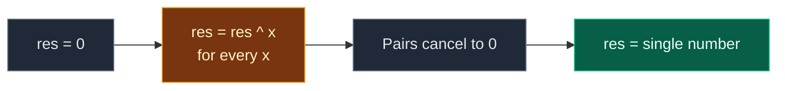

# 01. 136. Single Number

| Difficulty | Pattern | Source | Time | Space |
|:---:|:---:|:---:|:---:|:---:|
| **Easy** | Bit Manipulation (XOR) | [136. Single Number](https://leetcode.com/problems/single-number/) | `O(n)` | `O(1)` |

## 1. Problem Statement

You get a non-empty integer array `nums`.

Every number appears **twice**, except for **one** number that appears once.

Find that single number.

Your solution must run in linear time and use only constant extra space.

### Example

```text
Input:  nums = [4, 1, 2, 1, 2]
Output: 4

1 appears twice. 2 appears twice. 4 appears once.
```

We use this same example in every section below.

### Constraints

- `1 <= nums.length <= 3 * 10^4`
- `-3 * 10^4 <= nums[i] <= 3 * 10^4`
- Every element appears twice except for one element which appears once.

## 2. Core Theory

### What XOR is

XOR (written `^`) compares two numbers bit by bit:

- Bits are **different** -> `1`
- Bits are **same** -> `0`

```text
  5 = 101
^ 3 = 011
---------
  6 = 110
```

### The three rules that solve the problem

| Rule | Example | Meaning |
|:---|:---|:---|
| `x ^ x = 0` | `7 ^ 7 = 0` | A number cancels itself |
| `x ^ 0 = x` | `7 ^ 0 = 7` | Zero changes nothing |
| Order does not matter | `a ^ b ^ a = a ^ a ^ b` | We can regroup freely |

### Why XOR of everything gives the answer

Regroup the pairs next to each other:

```text
4 ^ 1 ^ 2 ^ 1 ^ 2
= 4 ^ (1 ^ 1) ^ (2 ^ 2)
= 4 ^   0     ^   0
= 4
```

Every pair cancels to `0`. Only the single number is left.



### Same family

| Problem | XOR trick |
|:---|:---|
| **136. Single Number** | XOR all numbers |
| 268. Missing Number | XOR all indices and all values |
| Missing and Repeating | XOR splits the two unknowns by one bit |

## 3. Edge Cases

| Case | Input | Expected | Why it matters |
|:---|:---|:---:|:---|
| One number | `[1]` | `1` | `0 ^ 1 = 1` |
| Single is zero | `[0, 1, 1]` | `0` | Result `0` is a real answer, not "not found" |
| Single at the end | `[2, 2, 7]` | `7` | Position does not matter |
| Negative single | `[-1, 3, 3]` | `-1` | XOR works on negative numbers too |
| Pairs not next to each other | `[5, 9, 5]` | `9` | Order does not matter |

## 4. Brute Force: Count Each Number

### Idea

For each number, count how many times it appears by scanning the whole array. Return the one with count `1`.

### Code

```python
# Import List for type hints
from typing import List


# Brute force: count every number with a second loop
class SolutionBrute:

    # Main method
    def singleNumber(self, nums: List[int]) -> int:

        # Try every number
        for x in nums:

            # How many times x appears
            count = 0

            # Scan the whole array
            for y in nums:

                # Same value found
                if y == x:

                    # Count it
                    count += 1

            # Appears once, so this is the answer
            if count == 1:

                # Return it
                return x

        # Not reached for valid input
        return -1
```

### Complexity

| Measure | Complexity | Why |
|:---|:---:|:---|
| **Time** | `O(n^2)` | Two nested loops |
| **Space** | `O(1)` | Only a counter |

## 5. Better Approach: Hash Map Count

### Idea

Count every number in a dictionary in one pass. Return the key with count `1`.

### Code

```python
# Better: count with a dictionary
class SolutionBetter:

    # Main method
    def singleNumber(self, nums: List[int]) -> int:

        # Value -> how many times it appears
        count = {}

        # Count every number
        for x in nums:

            # Add one to its count
            count[x] = count.get(x, 0) + 1

        # Look at each value and its count
        for x, c in count.items():

            # The one that appears once
            if c == 1:

                # Return it
                return x

        # Not reached for valid input
        return -1
```

### Complexity

| Measure | Complexity | Why |
|:---|:---:|:---|
| **Time** | `O(n)` | One pass to count, one pass over keys |
| **Space** | `O(n)` | The dictionary |

Fast, but it breaks the "constant extra space" rule.

## 6. Optimal Approach: XOR Everything

### Idea

1. `res = 0`.
2. For every `x`, do `res = res ^ x`.
3. Return `res`.

### Visual Walkthrough (Story Version)

Before the code, let us see the idea as a story.

**The story:** there is a magic box with three light switches. Each number is a little card that says which switches to **flip**. Flipping a switch twice puts it back the way it was. At the end, only the switches flipped an **odd** number of times stay on.

The cards (in 3-bit binary):

```text
4 = 1 0 0   flip switch "4"
1 = 0 0 1   flip switch "1"
2 = 0 1 0   flip switch "2"
```

**The rule:** every card except one comes in a pair. A pair flips the same switches twice, so it undoes itself. The cards that are left show the lonely card.

**How to read the pictures:** `[ON]` / `[  ]` for switches `4`, `2`, `1` (left to right).

**Start: all switches off**

```text
 4    2    1
[  ] [  ] [  ]     box = 0
```

**Step 1: card `4` (flip switch 4)**

```text
 4    2    1
[ON] [  ] [  ]     box = 4
```

**Step 2: card `1` (flip switch 1)**

```text
 4    2    1
[ON] [  ] [ON]     box = 5
```

**Step 3: card `2` (flip switch 2)**

```text
 4    2    1
[ON] [ON] [ON]     box = 7
```

**Step 4: card `1` again (flip switch 1 back off)**

```text
 4    2    1
[ON] [ON] [  ]     box = 6
```

The two `1` cards undid each other.

**Step 5: card `2` again (flip switch 2 back off)**

```text
 4    2    1
[ON] [  ] [  ]     box = 4
```

The two `2` cards undid each other. Only switch `4` is on. The lonely card is **4**.

**All steps at a glance**

| Step | Card | Switches after (4 2 1) | Box value |
|:---:|:---:|:---:|:---:|
| start | – | `0 0 0` | 0 |
| 1 | 4 | `1 0 0` | 4 |
| 2 | 1 | `1 0 1` | 5 |
| 3 | 2 | `1 1 1` | 7 |
| 4 | 1 | `1 1 0` | 6 |
| 5 | 2 | `1 0 0` | 4 |

**What the story teaches**

| In the story | In the code |
|:---|:---|
| Magic box | `res` |
| Card | One number `x` |
| Flip the switches on a card | `res ^= x` |
| Flipping twice undoes it | `x ^ x = 0` |
| All off at the start | `res = 0` |
| Switches left on | The single number |

Now the same steps again, this time with the exact variables.

### Step-by-Step Example

```text
nums = [4, 1, 2, 1, 2]
```

**Start**

```text
res = 0   (binary 000)
```

**Step 1: `x = 4`**

```text
  000   (res = 0)
^ 100   (x = 4)
= 100   -> res = 4
```

**Step 2: `x = 1`**

```text
  100   (res = 4)
^ 001   (x = 1)
= 101   -> res = 5
```

**Step 3: `x = 2`**

```text
  101   (res = 5)
^ 010   (x = 2)
= 111   -> res = 7
```

**Step 4: `x = 1`**

```text
  111   (res = 7)
^ 001   (x = 1)
= 110   -> res = 6
```

**Step 5: `x = 2`**

```text
  110   (res = 6)
^ 010   (x = 2)
= 100   -> res = 4
```

**End:** return `4`.

| Step | x | x (binary) | res before | res after | res after (binary) |
|:---:|:---:|:---:|:---:|:---:|:---:|
| 1 | 4 | `100` | 0 | 4 | `100` |
| 2 | 1 | `001` | 4 | 5 | `101` |
| 3 | 2 | `010` | 5 | 7 | `111` |
| 4 | 1 | `001` | 7 | 6 | `110` |
| 5 | 2 | `010` | 6 | 4 | `100` |

### Code

```python
# Solution for 136. Single Number
class Solution:

    # Main method
    def singleNumber(self, nums: List[int]) -> int:

        # Start with 0, it changes nothing in XOR
        res = 0

        # XOR every number into res
        for x in nums:

            # Pairs cancel, the single number stays
            res ^= x

        # Return the single number
        return res


# Replay the example step by step and check res after each step
nums = [4, 1, 2, 1, 2]

# Expected res after each number
expected_steps = [4, 5, 7, 6, 4]

# Start value
res = 0

# Same loop as the solution
for step, x in enumerate(nums):

    # Same XOR
    res ^= x

    # Check against the traced table
    assert res == expected_steps[step]

# Full solution on the example
assert Solution().singleNumber([4, 1, 2, 1, 2]) == 4

# LeetCode example 1
assert Solution().singleNumber([2, 2, 1]) == 1

# LeetCode example 3: one number
assert Solution().singleNumber([1]) == 1

# Single is zero
assert Solution().singleNumber([0, 1, 1]) == 0

# Single at the end
assert Solution().singleNumber([2, 2, 7]) == 7

# Negative single
assert Solution().singleNumber([-1, 3, 3]) == -1

# Pairs not next to each other
assert Solution().singleNumber([5, 9, 5]) == 9

# Random tests: brute, better and optimal must agree
import random

# Fixed seed so the test is repeatable
random.seed(136)

# Many random cases
for _ in range(300):

    # Distinct values to use
    values = random.sample(range(-50, 51), random.randint(1, 8))

    # The first one is single, the rest appear twice
    data = [values[0]] + values[1:] * 2

    # Shuffle the order
    random.shuffle(data)

    # Brute force answer
    want = SolutionBrute().singleNumber(data)

    # It must be the single value
    assert want == values[0]

    # Better must match
    assert SolutionBetter().singleNumber(data) == want

    # Optimal must match
    assert Solution().singleNumber(data) == want

# All checks passed
print("All tests passed")
```

### Complexity

| Measure | Complexity | Why |
|:---|:---:|:---|
| **Time** | `O(n)` | One pass |
| **Space** | `O(1)` | Only `res` |

## 7. Common Mistakes

| Mistake | What goes wrong | Fix |
|:---|:---|:---|
| Starting `res = 1` | `1` is mixed into the answer | Start at `0`, the XOR identity |
| Using `+` and `-` instead of `^` | Sums do not cancel pairs | Use XOR |
| Sorting first | Adds `O(n log n)` and changes the input | XOR needs no order |
| Treating `res == 0` as "not found" | `0` can be the real single number | Return `res` as it is |
| Using a set or map and calling it `O(1)` space | It is `O(n)` space | Say so, then give XOR |

## 8. Interview Follow-ups

### Q1. What if every number appears three times except one (LeetCode 137)?

**Answer:**
- XOR does not work, because three copies do not cancel.
- Count the `1`s at each bit position. Take each count mod 3.
- The bits left over make the single number. Still `O(n)` time, `O(1)` space.

### Q2. What if two numbers appear once and the rest twice (LeetCode 260)?

**Answer:**
- XOR all numbers. You get `a ^ b`, which is not zero.
- Pick any set bit of it, for example `xor & -xor`.
- Split the numbers into two groups by that bit. XOR each group. One gives `a`, the other `b`.

### Q3. Does it work on a stream of numbers?

**Answer:**
- Yes. Keep one variable `res` and XOR each number as it comes.
- No need to store anything else.

### Q4. Can we split the work across many machines?

**Answer:**
- Yes. Each machine XORs its own part.
- Then XOR the partial results together. Order does not matter.

### Q5. Why does XOR work for negative numbers?

**Answer:**
- XOR works on the bits. Negative numbers are just bits too (two's complement).
- `x ^ x = 0` holds for every bit pattern, so pairs still cancel.

## 9. Interview Explanation

> I use XOR. A number XOR itself is zero, a number XOR zero is itself, and the order of XOR does not matter. So if I XOR every number in the array, each pair cancels out to zero, and only the number that appears once is left. I start with zero and XOR each element into it. It is one pass, O(n) time, and O(1) extra space.
