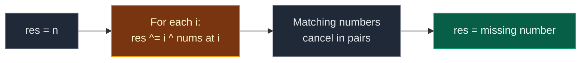

# 02. 268. Missing Number

| Difficulty | Pattern | Source | Time | Space |
|:---:|:---:|:---:|:---:|:---:|
| **Easy** | Math / Bit Manipulation (XOR) | [268. Missing Number](https://leetcode.com/problems/missing-number/) | `O(n)` | `O(1)` |

## 1. Problem Statement

You get an array `nums` with `n` **different** numbers.

All numbers are from the range `0` to `n` (both included). That range has `n + 1` numbers, but the array has only `n`. So exactly **one** number is missing.

Return the missing number.

Follow-up: can you do it in `O(n)` time and `O(1)` extra space?

### Example

```text
Input:  nums = [3, 0, 1]
Output: 2

n = 3, so the full range is 0, 1, 2, 3.
The array has 3, 0, 1.
2 is not there, so the answer is 2.
```

We use this same example in every section below.

### Constraints

- `n == nums.length`
- `1 <= n <= 10^4`
- `0 <= nums[i] <= n`
- All numbers in `nums` are unique.

## 2. Core Theory

### What the problem really asks

We know what the **full** list should be: `0, 1, ..., n`. We have the full list minus one number.

So: compare "what should be there" with "what is there". The difference is the answer.

### Two ways to compare in `O(1)` space

| Trick | Full list | Our list | Answer |
|:---|:---|:---|:---|
| Sum | `0 + 1 + ... + n = n(n+1)/2` | `sum(nums)` | `full - ours` |
| XOR | `0 ^ 1 ^ ... ^ n` | `nums[0] ^ ... ^ nums[n-1]` | `full ^ ours` |

### Why XOR works

- `x ^ x = 0` and `x ^ 0 = x`. Order does not matter.
- XOR all numbers `0..n` **and** all numbers in `nums` together.
- Every number that is in both appears twice and cancels.
- The missing number appears only once (in the full list). It is what stays.

```text
full:  0  1  2  3
nums:  3  0  1
pairs: 0-0, 1-1, 3-3 cancel
left:  2
```

### A neat way to write it in one loop

- Indices `0..n-1` give us `0..n-1` of the full list.
- Start with `res = n` to add the last number of the full list.
- Then for each `i`, do `res ^= i ^ nums[i]`.



## 3. Edge Cases

| Case | Input | Expected | Why it matters |
|:---|:---|:---:|:---|
| Missing `0` | `[1]` | `0` | Missing value at the low end |
| Missing `n` | `[0]` | `1` | `n` is never an index. That is why `res` starts at `n` |
| Missing `n`, longer | `[0, 1, 2]` | `3` | Every index matches its value |
| Missing `0`, longer | `[1, 2, 3]` | `0` | Answer `0` is real, not "nothing" |
| Unsorted, bigger | `[9,6,4,2,3,5,7,0,1]` | `8` | Order does not matter |

## 4. Brute Force: Check Every Number

### Idea

For each `v` from `0` to `n`, check if `v` is in the list. The first one not found is the answer.

### Code

```python
# Import List for type hints
from typing import List


# Brute force: search the list for every number 0..n
class SolutionBrute:

    # Main method
    def missingNumber(self, nums: List[int]) -> int:

        # Size of the array
        n = len(nums)

        # Try every number in the full range
        for v in range(n + 1):

            # Linear search in the list
            if v not in nums:

                # v is missing
                return v

        # Not reached for valid input
        return -1
```

### Complexity

| Measure | Complexity | Why |
|:---|:---:|:---|
| **Time** | `O(n^2)` | `n + 1` searches, each `O(n)` |
| **Space** | `O(1)` | No extra memory |

## 5. Better Approach: Hash Set

### Idea

Put all numbers in a set. Then check `0..n` against the set. Each check is `O(1)`.

### Code

```python
# Better: use a set for fast lookups
class SolutionBetter:

    # Main method
    def missingNumber(self, nums: List[int]) -> int:

        # All numbers we have
        seen = set(nums)

        # Try every number in the full range
        for v in range(len(nums) + 1):

            # Fast check in the set
            if v not in seen:

                # v is missing
                return v

        # Not reached for valid input
        return -1
```

### Complexity

| Measure | Complexity | Why |
|:---|:---:|:---|
| **Time** | `O(n)` | Build the set, then `n + 1` fast checks |
| **Space** | `O(n)` | The set |

Fast, but it uses `O(n)` space. The follow-up wants `O(1)`.

## 6. Optimal Approach: XOR of Indices and Values

### Idea

1. `res = n`.
2. For each index `i`: `res ^= i ^ nums[i]`.
3. Return `res`.

Every number that appears as both an index (or `n`) and a value cancels. The missing number appears only once.

### Visual Walkthrough (Story Version)

Before the code, let us see the idea as a story.

**The story:** a class has seats with tags `0, 1, 2, 3`. Only 3 kids came today, and each kid holds a card with a seat number: `3, 0, 1`. One seat is empty. Which one?

We have a **matching basket**. We drop seat tags and kid cards into it. Whenever two equal numbers meet in the basket, they **pop** and vanish. At the end, the one number left in the basket is the empty seat.

**How to read the pictures:** `basket { ... }` shows the numbers waiting for their match.

**Start: drop the last seat tag `3` (that is `res = n`)**

```text
basket { 3 }
```

**Step 1: `i = 0`. Drop seat tag `0` and kid card `nums[0] = 3`**

- Card `3` meets tag `3` in the basket. Pop! Both vanish.
- Tag `0` waits for its match.

```text
basket { 0 }
```

**Step 2: `i = 1`. Drop seat tag `1` and kid card `nums[1] = 0`**

- Card `0` meets tag `0`. Pop!
- Tag `1` waits.

```text
basket { 1 }
```

**Step 3: `i = 2`. Drop seat tag `2` and kid card `nums[2] = 1`**

- Card `1` meets tag `1`. Pop!
- Tag `2` waits. No more kids are coming.

```text
basket { 2 }
```

Only tag `2` is left. Seat **2** is empty.

**All steps at a glance**

| Step | Seat tag dropped | Kid card dropped | Pops | Basket after |
|:---:|:---:|:---:|:---|:---|
| start | 3 | – | – | `{3}` |
| 1 | 0 | 3 | 3 with 3 | `{0}` |
| 2 | 1 | 0 | 0 with 0 | `{1}` |
| 3 | 2 | 1 | 1 with 1 | `{2}` |

**What the story teaches**

| In the story | In the code |
|:---|:---|
| Seat tag | A number from the full range `0..n` (index `i`, plus `n`) |
| Kid card | A value `nums[i]` |
| Matching basket | `res` |
| Drop into the basket | `res ^= ...` |
| Two equal numbers pop | `x ^ x = 0` |
| Last tag dropped first | `res = n` |
| The number left | The missing number |

Now the same steps again, this time with the exact variables. (The basket "holds" one number here only because things popped nicely. In bits, `res` is the XOR of everything still unmatched.)

### Step-by-Step Example

```text
nums = [3, 0, 1]
n = 3
```

**Start**

```text
res = n = 3   (binary 11)
```

**Step 1: `i = 0`, `nums[0] = 3`**

1. `i ^ nums[i] = 0 ^ 3 = 3` (binary `11`).
2. `res = 3 ^ 3 = 0` (binary `00`).

```text
res = 0
```

**Step 2: `i = 1`, `nums[1] = 0`**

1. `i ^ nums[i] = 1 ^ 0 = 1` (binary `01`).
2. `res = 0 ^ 1 = 1` (binary `01`).

```text
res = 1
```

**Step 3: `i = 2`, `nums[2] = 1`**

1. `i ^ nums[i] = 2 ^ 1 = 3` (binary `11`).
2. `res = 1 ^ 3 = 2` (binary `10`).

```text
res = 2
```

**End:** return `2`.

| Step | i | nums[i] | `i ^ nums[i]` | res before | res after |
|:---:|:---:|:---:|:---:|:---:|:---:|
| start | – | – | – | – | 3 |
| 1 | 0 | 3 | 3 | 3 | 0 |
| 2 | 1 | 0 | 1 | 0 | 1 |
| 3 | 2 | 1 | 3 | 1 | 2 |

### Code

```python
# Solution for 268. Missing Number
class Solution:

    # Main method
    def missingNumber(self, nums: List[int]) -> int:

        # Start with n, the one number that is never an index
        res = len(nums)

        # Walk over every index
        for i in range(len(nums)):

            # Add the index and the value, matching numbers cancel
            res ^= i ^ nums[i]

        # The only number left is the missing one
        return res


# Replay the example step by step and check res after each step
nums = [3, 0, 1]

# Expected res after each index
expected_steps = [0, 1, 2]

# Start with n
res = len(nums)

# The start value is n = 3
assert res == 3

# Same loop as the solution
for i in range(len(nums)):

    # Same XOR
    res ^= i ^ nums[i]

    # Check against the traced table
    assert res == expected_steps[i]

# Full solution on the example
assert Solution().missingNumber([3, 0, 1]) == 2

# LeetCode example 2: missing n
assert Solution().missingNumber([0, 1]) == 2

# LeetCode example 3
assert Solution().missingNumber([9, 6, 4, 2, 3, 5, 7, 0, 1]) == 8

# Missing 0
assert Solution().missingNumber([1]) == 0

# Missing n with one number
assert Solution().missingNumber([0]) == 1

# Missing n, longer
assert Solution().missingNumber([0, 1, 2]) == 3

# Missing 0, longer
assert Solution().missingNumber([1, 2, 3]) == 0

# Random tests: brute, better and optimal must agree
import random

# Fixed seed so the test is repeatable
random.seed(268)

# Many random cases
for _ in range(300):

    # Random n
    n = random.randint(1, 15)

    # Full range 0..n
    full = list(range(n + 1))

    # Pick the missing number
    gone = random.choice(full)

    # Remove it
    full.remove(gone)

    # Shuffle the rest
    random.shuffle(full)

    # Brute force must find it
    assert SolutionBrute().missingNumber(full) == gone

    # Better must find it
    assert SolutionBetter().missingNumber(full) == gone

    # Optimal must find it
    assert Solution().missingNumber(full) == gone

# All checks passed
print("All tests passed")
```

### Complexity

| Measure | Complexity | Why |
|:---|:---:|:---|
| **Time** | `O(n)` | One pass |
| **Space** | `O(1)` | Only `res` |

## 7. Common Mistakes

| Mistake | What goes wrong | Fix |
|:---|:---|:---|
| Starting `res = 0` instead of `n` | The number `n` is never added. Wrong answer unless `n` is the missing one | Start with `res = n` |
| Sum formula `n * (n - 1) // 2` | That is the sum of `0..n-1`. Off by `n` | Use `n * (n + 1) // 2` |
| Using `/` in the sum formula | Returns a float like `2.0` | Use `//` |
| After sorting, no `return n` fallback | When `n` is missing, every index matches and nothing is returned | Return `n` after the loop |
| Treating answer `0` as "not found" | `0` can be the real answer | Return `res` as it is |

## 8. Interview Follow-ups

### Q1. Can you do it with the sum formula instead?

**Answer:**
- Yes. Expected sum is `n * (n + 1) // 2`.
- Answer is `expected - sum(nums)`.
- Also `O(n)` time and `O(1)` space.

### Q2. Why prefer XOR in Java or C++?

**Answer:**
- The sum can overflow a 32-bit `int` for large `n`.
- XOR never grows past the bit size of the numbers, so it cannot overflow.
- In Python both are safe, because Python integers have no limit.

### Q3. What if two numbers are missing?

**Answer:**
- XOR everything. You get `a ^ b`.
- Pick any set bit of it. Split all numbers into two groups by that bit.
- XOR each group to get `a` and `b`.

### Q4. What if one number is missing and another is repeated?

**Answer:**
- That is the "Missing and Repeating" problem.
- Use sum and sum of squares, or the XOR split trick.

### Q5. What if the array is sorted?

**Answer:**
- Binary search for the first index where `nums[i] != i`.
- That index is the answer. If none, the answer is `n`.
- Time `O(log n)`.

## 9. Interview Explanation

> I know the full range should be 0 to n, and exactly one number is missing. XOR cancels equal numbers, so I XOR all numbers from 0 to n together with all numbers in the array. Every number present appears twice and cancels, so only the missing one is left. I do it in one loop by starting with n and XOR-ing each index and each value. It is O(n) time and O(1) space, and unlike the sum formula it cannot overflow in fixed-width languages.
