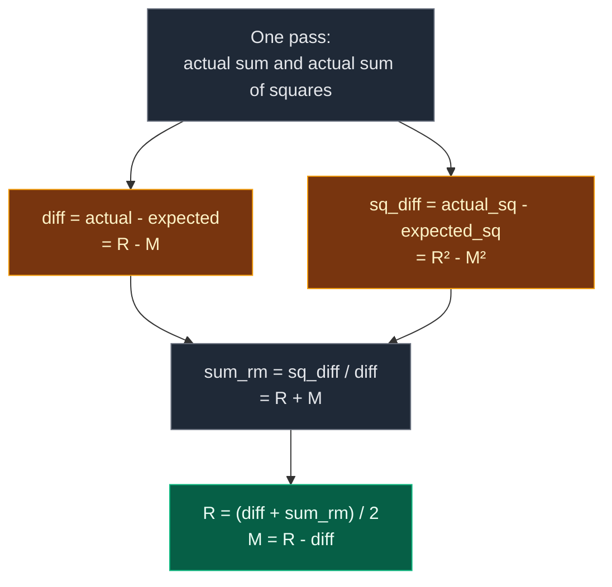

# 03. Missing And Repeating

| Difficulty | Pattern | Source | Time | Space |
|:---:|:---:|:---:|:---:|:---:|
| **Easy** | Math (Sum and Sum of Squares) | [Missing And Repeating](https://www.geeksforgeeks.org/problems/find-missing-and-repeating2512/1) | `O(n)` | `O(1)` |

## 1. Problem Statement

You get an unsorted array `arr` of size `n`.

It should hold every number from `1` to `n` exactly once. But:

- One number is **missing**.
- One other number appears **twice** (repeating).

Return `[repeating, missing]`.

### Example

```text
Input:  arr = [3, 1, 2, 5, 3]
Output: [3, 4]

n = 5, so it should hold 1, 2, 3, 4, 5.
3 appears twice  -> repeating = 3
4 is not there   -> missing   = 4
```

We use this same example in every section below.

### Constraints

- `2 <= n <= 10^6`
- `1 <= arr[i] <= n`

## 2. Core Theory

### What the problem really asks

The array is `1..n` where one value `M` was replaced by a second copy of another value `R`.

We need two numbers, so we need **two clues** (two equations).

### Clue 1: the sum

- Expected sum of `1..n` is `n(n+1)/2`.
- In the array, `R` is counted one extra time and `M` is not counted.
- So `actual_sum - expected_sum = R - M`. Call it `diff`.

One equation, two unknowns. Not enough yet.

### Clue 2: the sum of squares

- Expected sum of squares of `1..n` is `n(n+1)(2n+1)/6`.
- Same reason: `actual_sq - expected_sq = R² - M²`. Call it `sq_diff`.
- `R² - M² = (R - M)(R + M)`. So `R + M = sq_diff / diff`.

### Solve the two easy equations

```text
R - M = diff
R + M = sum_rm   (= sq_diff / diff)

Add them:  2R = diff + sum_rm   ->  R = (diff + sum_rm) / 2
Then:      M = R - diff
```

`diff` is never `0`, because `R != M`. And `sq_diff / diff` is always a whole number, because it equals `R + M`.



### Other `O(1)` space ways

| Way | Changes the array? | Note |
|:---|:---:|:---|
| **Sum + sum of squares** | No | Needs 64-bit numbers in Java/C++ |
| Negative marking | Yes | Flip sign at index `x - 1`. A slot flipped twice = repeating |
| XOR split | No | XOR gives `R ^ M`, split by one bit |

## 3. Edge Cases

| Case | Input | Expected | Why it matters |
|:---|:---|:---:|:---|
| Smallest | `[2, 2]` | `[2, 1]` | `n = 2`, missing is `1` |
| Missing is `n` | `[1, 2, 2]` | `[2, 3]` | The missing number is the largest |
| Repeating is `1` | `[4, 3, 6, 2, 1, 1]` | `[1, 5]` | Repeating at the low end |
| Repeating is `n` | `[1, 3, 3]` | `[3, 2]` | Repeating at the high end |
| Repeating below missing | `[3, 1, 2, 5, 3]` | `[3, 4]` | `diff` is negative. Signs must still work |
| Repeating above missing | `[1, 2, 4, 4, 5]` | `[4, 3]` | `diff` is positive |
| Large `n` | `n = 10^6` | exact pair | Sum of squares is about `3.3 * 10^17`. Needs 64-bit outside Python |

## 4. Brute Force: Count Every Value

### Idea

For each value `v` from `1` to `n`, count how many times it appears by scanning the array.

- Count `2` -> repeating.
- Count `0` -> missing.

### Code

```python
# Import List for type hints
from typing import List


# Brute force: count each value with a full scan
class SolutionBrute:

    # Main method (GfG name)
    def findTwoElement(self, arr: List[int]) -> List[int]:

        # Size of the array
        n = len(arr)

        # Answers start as unknown
        repeating, missing = -1, -1

        # Try every value 1..n
        for v in range(1, n + 1):

            # How many times v appears
            count = 0

            # Scan the whole array
            for x in arr:

                # Same value found
                if x == v:

                    # Count it
                    count += 1

            # Seen twice
            if count == 2:

                # This is the repeating number
                repeating = v

            # Never seen
            elif count == 0:

                # This is the missing number
                missing = v

        # Repeating first, then missing
        return [repeating, missing]
```

### Complexity

| Measure | Complexity | Why |
|:---|:---:|:---|
| **Time** | `O(n^2)` | `n` values, each needs a full scan |
| **Space** | `O(1)` | Only counters |

## 5. Better Approach: Frequency Array

### Idea

Make `freq` of size `n + 1`. Count each value in one pass. Then scan `1..n`: count `2` is repeating, count `0` is missing.

### Code

```python
# Better: count all values in one pass with a frequency array
class SolutionBetter:

    # Main method (GfG name)
    def findTwoElement(self, arr: List[int]) -> List[int]:

        # Size of the array
        n = len(arr)

        # freq[v] = how many times v appears
        freq = [0] * (n + 1)

        # Count every value
        for x in arr:

            # One more x
            freq[x] += 1

        # Answers start as unknown
        repeating, missing = -1, -1

        # Check every value 1..n
        for v in range(1, n + 1):

            # Seen twice
            if freq[v] == 2:

                # This is the repeating number
                repeating = v

            # Never seen
            elif freq[v] == 0:

                # This is the missing number
                missing = v

        # Repeating first, then missing
        return [repeating, missing]
```

### Complexity

| Measure | Complexity | Why |
|:---|:---:|:---|
| **Time** | `O(n)` | Two passes |
| **Space** | `O(n)` | The `freq` array |

## 6. Optimal Approach: Sum and Sum of Squares

### Idea

1. `expected_sum = n(n+1)/2`, `expected_sq = n(n+1)(2n+1)/6`.
2. One pass: add up `actual_sum` and `actual_sq`.
3. `diff = actual_sum - expected_sum` (this is `R - M`).
4. `sq_diff = actual_sq - expected_sq` (this is `R² - M²`).
5. `sum_rm = sq_diff // diff` (this is `R + M`).
6. `R = (diff + sum_rm) // 2`, `M = R - diff`.

### Visual Walkthrough (Story Version)

Before the code, let us see the idea as a story.

**The story:** a box should hold 5 square tiles, sizes `1, 2, 3, 4, 5`. Tile `k` weighs `k` grams and covers `k × k` squares of floor. A sneaky kid took out one tile and put in a **copy** of another tile. We cannot see inside the box. We can only **weigh** the tiles and measure the **floor area** they cover.

**Two clues:**

- A full box should weigh `1+2+3+4+5 = 15` grams.
- A full box should cover `1+4+9+16+25 = 55` squares.

We drop the tiles on a table one by one and keep a running total.

**How to read the pictures:** `weight` and `area` are the running totals. `#` blocks are a small bar for the weight.

**Start**

```text
weight =  0
area   =  0
```

**Step 1: tile `3`** (weighs 3, area 9)

```text
weight =  3   ###
area   =  9
```

**Step 2: tile `1`** (weighs 1, area 1)

```text
weight =  4   ####
area   = 10
```

**Step 3: tile `2`** (weighs 2, area 4)

```text
weight =  6   ######
area   = 14
```

**Step 4: tile `5`** (weighs 5, area 25)

```text
weight = 11   ###########
area   = 39
```

**Step 5: tile `3`** again (weighs 3, area 9)

```text
weight = 14   ##############
area   = 48
```

**Detective time**

- Weight is `14`, should be `15`. The copy is **1 gram lighter** than the missing tile: `R - M = -1`.
- Area is `48`, should be `55`. So `R² - M² = -7`.
- `R² - M² = (R - M)(R + M)`, so `-7 = -1 × (R + M)`, which means `R + M = 7`.
- Two tiles that add to `7` and differ by `-1`: `R = 3`, `M = 4`.

The copied tile is **3**. The missing tile is **4**.

**All steps at a glance**

| Step | Tile | Weight added | Area added | Weight total | Area total |
|:---:|:---:|:---:|:---:|:---:|:---:|
| start | – | – | – | 0 | 0 |
| 1 | 3 | 3 | 9 | 3 | 9 |
| 2 | 1 | 1 | 1 | 4 | 10 |
| 3 | 2 | 2 | 4 | 6 | 14 |
| 4 | 5 | 5 | 25 | 11 | 39 |
| 5 | 3 | 3 | 9 | 14 | 48 |
| check | – | should be 15 | should be 55 | diff = -1 | sq_diff = -7 |

**What the story teaches**

| In the story | In the code |
|:---|:---|
| Tile `k` | Value `x` in `arr` |
| Weight | `actual_sum` |
| Floor area | `actual_sq` |
| Full box weight / area | `expected_sum`, `expected_sq` |
| How much lighter | `diff = R - M` |
| How much less area | `sq_diff = R² - M²` |
| "They add to 7" | `sum_rm = sq_diff // diff` |
| Copied tile, missing tile | `R`, `M` |

Now the same steps again, this time with the exact variables.

### Step-by-Step Example

```text
arr = [3, 1, 2, 5, 3]
n = 5
expected_sum = 5 * 6 // 2      = 15
expected_sq  = 5 * 6 * 11 // 6 = 55
```

**Start**

```text
actual_sum = 0, actual_sq = 0
```

**Step 1: `x = 3`**

1. `actual_sum = 0 + 3 = 3`.
2. `actual_sq = 0 + 9 = 9`.

**Step 2: `x = 1`**

1. `actual_sum = 3 + 1 = 4`.
2. `actual_sq = 9 + 1 = 10`.

**Step 3: `x = 2`**

1. `actual_sum = 4 + 2 = 6`.
2. `actual_sq = 10 + 4 = 14`.

**Step 4: `x = 5`**

1. `actual_sum = 6 + 5 = 11`.
2. `actual_sq = 14 + 25 = 39`.

**Step 5: `x = 3`**

1. `actual_sum = 11 + 3 = 14`.
2. `actual_sq = 39 + 9 = 48`.

**After the loop**

1. `diff = 14 - 15 = -1`. This is `R - M`.
2. `sq_diff = 48 - 55 = -7`. This is `R² - M²`.
3. `sum_rm = -7 // -1 = 7`. This is `R + M`.
4. `R = (-1 + 7) // 2 = 3`.
5. `M = 3 - (-1) = 4`.

**End:** return `[3, 4]`.

| Step | x | actual_sum | actual_sq |
|:---:|:---:|:---:|:---:|
| start | – | 0 | 0 |
| 1 | 3 | 3 | 9 |
| 2 | 1 | 4 | 10 |
| 3 | 2 | 6 | 14 |
| 4 | 5 | 11 | 39 |
| 5 | 3 | 14 | 48 |

| diff | sq_diff | sum_rm | R | M |
|:---:|:---:|:---:|:---:|:---:|
| -1 | -7 | 7 | 3 | 4 |

### Code

```python
# Solution for GfG Missing And Repeating
class Solution:

    # Main method (GfG name)
    def findTwoElement(self, arr: List[int]) -> List[int]:

        # Size of the array
        n = len(arr)

        # Sum of 1..n
        expected_sum = n * (n + 1) // 2

        # Sum of squares of 1..n
        expected_sq = n * (n + 1) * (2 * n + 1) // 6

        # Running sum of the array
        actual_sum = 0

        # Running sum of squares of the array
        actual_sq = 0

        # One pass over the array
        for x in arr:

            # Add the value
            actual_sum += x

            # Add its square
            actual_sq += x * x

        # R - M
        diff = actual_sum - expected_sum

        # R squared minus M squared
        sq_diff = actual_sq - expected_sq

        # R + M, always a whole number
        sum_rm = sq_diff // diff

        # Solve for the repeating number
        repeating = (diff + sum_rm) // 2

        # Then the missing number
        missing = repeating - diff

        # Repeating first, then missing
        return [repeating, missing]


# Replay the example step by step and check the totals after each step
arr = [3, 1, 2, 5, 3]

# Expected (actual_sum, actual_sq) after each value
expected_steps = [(3, 9), (4, 10), (6, 14), (11, 39), (14, 48)]

# Start totals
actual_sum, actual_sq = 0, 0

# Same loop as the solution
for step, x in enumerate(arr):

    # Add the value
    actual_sum += x

    # Add its square
    actual_sq += x * x

    # Check against the traced table
    assert (actual_sum, actual_sq) == expected_steps[step]

# Expected totals for n = 5
assert (5 * 6 // 2, 5 * 6 * 11 // 6) == (15, 55)

# The values found after the loop
diff, sq_diff = actual_sum - 15, actual_sq - 55

# Check diff and sq_diff
assert (diff, sq_diff) == (-1, -7)

# Check R + M
assert sq_diff // diff == 7

# Full solution on the example
assert Solution().findTwoElement([3, 1, 2, 5, 3]) == [3, 4]

# GfG example 1: smallest
assert Solution().findTwoElement([2, 2]) == [2, 1]

# GfG example 2: repeating is n
assert Solution().findTwoElement([1, 3, 3]) == [3, 2]

# GfG example 3: repeating is 1
assert Solution().findTwoElement([4, 3, 6, 2, 1, 1]) == [1, 5]

# Missing is n
assert Solution().findTwoElement([1, 2, 2]) == [2, 3]

# Repeating above missing
assert Solution().findTwoElement([1, 2, 4, 4, 5]) == [4, 3]

# Random tests: brute, better and optimal must agree
import random

# Fixed seed so the test is repeatable
random.seed(2512)

# Many random cases
for _ in range(300):

    # Random n
    n = random.randint(2, 12)

    # Pick two different values
    rep, miss = random.sample(range(1, n + 1), 2)

    # Every value except miss, plus one extra rep
    data = [v for v in range(1, n + 1) if v != miss] + [rep]

    # Shuffle the order
    random.shuffle(data)

    # Brute force must find the pair
    assert SolutionBrute().findTwoElement(data) == [rep, miss]

    # Better must match
    assert SolutionBetter().findTwoElement(data) == [rep, miss]

    # Optimal must match
    assert Solution().findTwoElement(data) == [rep, miss]

# Large n still exact (sum of squares is huge)
big = list(range(1, 100001))

# Replace 777 with a second copy of 31415
big[776] = 31415

# Optimal handles it
assert Solution().findTwoElement(big) == [31415, 777]

# All checks passed
print("All tests passed")
```

### Complexity

| Measure | Complexity | Why |
|:---|:---:|:---|
| **Time** | `O(n)` | One pass, then a few math steps |
| **Space** | `O(1)` | Only a few numbers. The array is not changed |

## 7. Common Mistakes

| Mistake | What goes wrong | Fix |
|:---|:---|:---|
| Using only the sum | `R - M` alone fits many pairs | Add a second clue: sum of squares or XOR |
| 32-bit `int` in Java/C++ | Sum of squares overflows for big `n` | Use `long` / `long long` |
| Mixing up `diff` sign | `M = R + diff` gives the wrong value | `diff = R - M`, so `M = R - diff` |
| Returning `[missing, repeating]` | Wrong order for GfG | Return `[repeating, missing]` |
| Negative marking with `x - 1` instead of `abs(x) - 1` | Index can be negative after marking | Always use `abs(x)` |

## 8. Interview Follow-ups

### Q1. Why is the sum alone not enough?

**Answer:**
- It only gives `R - M`.
- Many pairs have the same difference.
- We need a second, different clue to pin both down.

### Q2. Can you do it without big numbers?

**Answer:**
- Yes, use **negative marking**. For each `x`, flip the sign of `arr[abs(x) - 1]`.
- If that slot is already negative, `abs(x)` is the repeating number.
- At the end, the one slot still positive at index `i` means `i + 1` is missing.
- It changes the array, so mention that.

### Q3. How does the XOR way work?

**Answer:**
- XOR all values and all of `1..n`. Pairs cancel, so you get `R ^ M`.
- Pick one set bit. Split everything into two groups by that bit, XOR each group.
- You get `R` and `M`, but not which is which. Count one of them in the array to decide.

### Q4. What if the array must not be changed?

**Answer:**
- Use the sum and squares way, or XOR. Both only read the array.

### Q5. How does cyclic sort compare?

**Answer:**
- Swap each value to index `value - 1` until it is home or a copy is already there.
- Then the one index `i` with `arr[i] != i + 1` gives `repeating = arr[i]` and `missing = i + 1`.
- `O(n)` time, `O(1)` space, but it changes the array.

## 9. Interview Explanation

> The array is 1 to n with one value M replaced by a second copy of R, so I need two equations. The actual sum minus the expected sum gives R minus M. The actual sum of squares minus the expected sum of squares gives R squared minus M squared, which factors into (R minus M) times (R plus M), so dividing gives R plus M. With R minus M and R plus M, I solve for both. It is one pass, O(n) time, O(1) space, and it does not change the array. In Java or C++ I would use 64-bit numbers for the square sum.
