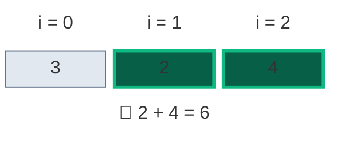
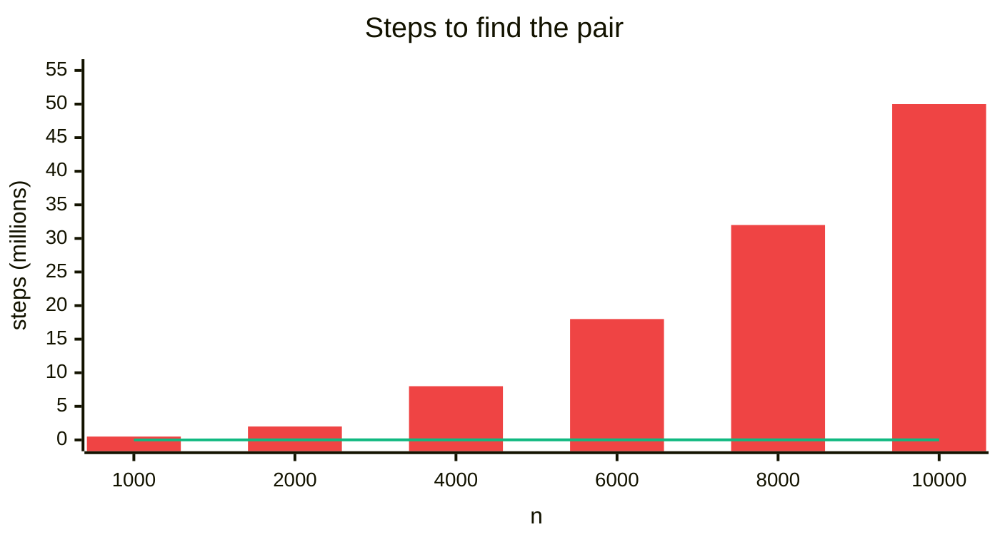
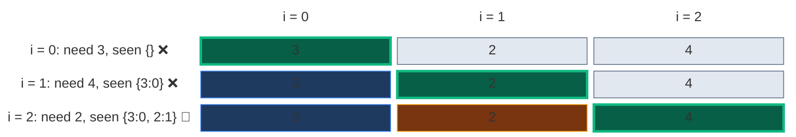
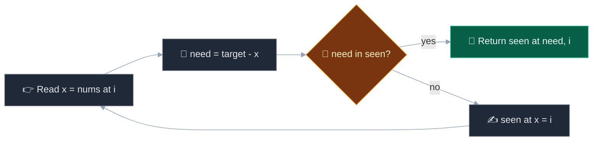
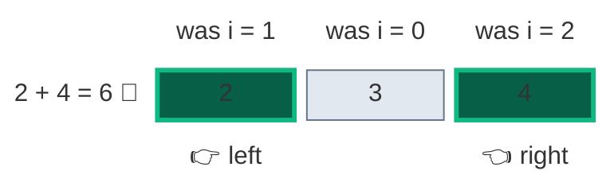
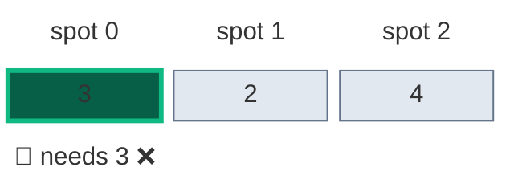
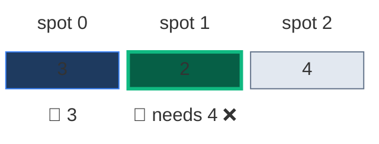
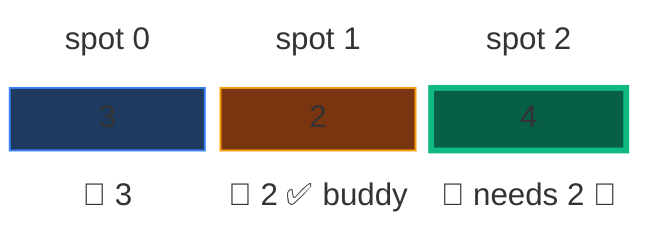

# 01. 1. Two Sum

| Difficulty | Pattern | Key idea | Source | Time | Space | Next in this folder |
|:---:|:---:|:---|:---:|:---:|:---:|:---:|
| **Easy** | Hash Map / Complement | For each `x`, look up `target - x` among the numbers already seen | [1. Two Sum](https://leetcode.com/problems/two-sum/) | `O(n)` | `O(n)` | [15. 3Sum](02.%2015.%203Sum.md) |

## 1. Problem Statement

You get an integer array `nums` and an integer `target`.

Return the **indices** of the two numbers that add up to `target`.

- There is exactly one answer.
- You cannot use the same element twice.
- You can return the two indices in any order.

### Example

```text
Input:  nums = [3, 2, 4], target = 6
Output: [1, 2]      (2 + 4 = 6)
```



`3 + 3 = 6` looks like an answer too, but there is only **one** 3. Index 0 cannot be used twice. We use this example in every section below.

Other LeetCode examples:

```text
nums = [2, 7, 11, 15], target = 9   -> [0, 1]
nums = [3, 3],         target = 6   -> [0, 1]
```

### Constraints

- `2 <= nums.length <= 10^4`
- `-10^9 <= nums[i] <= 10^9`
- `-10^9 <= target <= 10^9`
- Only one valid answer exists.

### What the constraints tell us (simple theory)

A **constraint** is the biggest input the judge will ever give you. A computer does about **100 million (10^8) simple steps per second**.

| Biggest input `n` | Steps you can afford | Ideas that fit | Steps at the biggest `n` | Time at 10^8 steps/sec |
|:---:|:---:|:---|:---:|:---:|
| up to ~5,000 | about `n^2` | Two nested loops | 5,000 × 5,000 = 25,000,000 | 0.25 s |
| up to ~100,000 | about `n log n` | Sorting, binary search | 100,000 × 17 ≈ 1,700,000 | 17 ms |
| up to ~1,000,000 | about `n` | One loop with a hash map | 1,000,000 | 10 ms |

**For this problem:** `n` is at most `10^4`.

- Checking every pair is about `n^2 / 2` = `5 × 10^7` steps. It passes, but only just. This is why LeetCode asks for "better than `O(n^2)`".
- Sorting + two pointers: about `n log n` ≈ `1.4 × 10^5` steps.
- One pass with a hash map: `n` = `10^4` steps.

**How the work grows** (worst case: the answer is the last pair; counted by running code). Red bars = brute force steps, green line = hash map steps.



| `n` | Brute force steps | Hash map steps | Brute force time at 10^8 steps/sec | Hash map time at 10^8 steps/sec | Hash map is faster by |
|:---:|:---:|:---:|:---:|:---:|:---:|
| 1,000 | 499,500 | 1,000 | 5.0 ms | 10 µs | about 500× |
| 2,000 | 1,999,000 | 2,000 | 20.0 ms | 20 µs | about 1,000× |
| 4,000 | 7,998,000 | 4,000 | 80.0 ms | 40 µs | about 2,000× |
| 6,000 | 17,997,000 | 6,000 | 180.0 ms | 60 µs | about 3,000× |
| 8,000 | 31,996,000 | 8,000 | 320.0 ms | 80 µs | about 4,000× |
| 10,000 | 49,995,000 | 10,000 | 499.9 ms | 100 µs | about 5,000× |

## 2. Core Theory

### 🔑 Turn "find a pair" into "look up one number"

For a number `x`, the partner it needs is fixed:

```text
need = target - x
```

So the real question is: **"Have I already seen `need`? At which index?"** A dictionary `seen` (value → index) answers that in `O(1)` on average.

### ⚠️ Check first, then store

At index `i`:

1. Look up `need` in `seen`. Right now `seen` only holds numbers **before** `i`.
2. Only after that, store `nums[i]`.

So a number can never pair with itself. Green = current number, blue = already in `seen`.



### 🤔 Why not sort + two pointers?

- Sorting costs `O(n log n)` and moves the numbers, so the original indices are lost.
- To keep them we sort `(value, index)` pairs, which already costs `O(n)` extra space.
- So the hash map wins here. Sorting + two pointers wins when the input is already sorted (LeetCode 167) or for 3Sum / 4Sum, where we need all answers without repeats.



## 3. Edge Cases

| Case | Input | Expected | Why it matters | Code that handles it |
|:---|:---|:---:|:---|:---|
| Smallest | `[1, 2]`, `3` | `[0, 1]` | Two numbers only, the pair is found on the last step | `for i, x in enumerate(nums)` |
| Duplicates make the answer | `[3, 3]`, `6` | `[0, 1]` | Check before store gives `[0, 1]`, not `[0, 0]` | `if need in seen` runs before `seen[x] = i` |
| Self-pair trap | `[3, 2, 4]`, `6` | `[1, 2]` | `3 + 3` must not use index 0 twice | The first 3 is not in `seen` when it looks |
| Negatives | `[-1, -2, -3, -4, -5]`, `-8` | `[2, 4]` | `target - x` works for negatives too | `need = target - x` |
| Zeros | `[0, 4, 3, 0]`, `0` | `[0, 3]` | `0 + 0` needs two different zeros | The second 0 finds the first in `seen` |

## 4. Brute Force: Try Every Pair

### Idea

Check every pair `(i, j)` with `i < j`. Return the first pair that adds up to `target`.

### Code

```python
# Import List for type hints
from typing import List


# Brute force: check all pairs
class SolutionBrute:

    # Main method
    def twoSum(self, nums: List[int], target: int) -> List[int]:

        # Number of elements
        n = len(nums)

        # First index of the pair
        for i in range(n):

            # Second index, always after i
            for j in range(i + 1, n):

                # Does this pair add up?
                if nums[i] + nums[j] == target:

                    # Return the two indices
                    return [i, j]

        # Not reached for valid input
        return []
```

### Complexity

| Measure | Complexity | Why | At the limit (`n = 10^4`) | Compared with brute force |
|:---|:---:|:---|:---:|:---|
| **Time** | `O(n^2)` | About `n^2 / 2` pairs are checked | about 50,000,000 pair checks | This is the baseline |
| **Space** | `O(1)` | No extra memory, only two loop indices | a few variables | This is the baseline |

## 5. Better Approach: Sort With Indices + Two Pointers

### Idea

1. Make pairs `(value, index)` and sort them by value.
2. 👉 `left` starts at the smallest value, 👈 `right` at the biggest.
3. Sum too small → `left += 1`. Sum too big → `right -= 1`. Equal → return the two saved indices.

On our example the sorted pairs are `(2,1) (3,0) (4,2)`. The top row shows the original index of each value.



### Code

```python
# Better: sort (value, index) pairs, then use two pointers
class SolutionBetter:

    # Main method
    def twoSum(self, nums: List[int], target: int) -> List[int]:

        # Pairs of (value, original index), sorted by value
        arr = sorted((v, i) for i, v in enumerate(nums))

        # Left pointer at the smallest value
        left = 0

        # Right pointer at the biggest value
        right = len(arr) - 1

        # Move the pointers toward each other
        while left < right:

            # Sum of the two values
            s = arr[left][0] + arr[right][0]

            # Found the pair
            if s == target:

                # Return original indices, smaller first
                return sorted([arr[left][1], arr[right][1]])

            # Sum is too small
            if s < target:

                # Use a bigger left value
                left += 1

            # Sum is too big
            else:

                # Use a smaller right value
                right -= 1

        # Not reached for valid input
        return []
```

### Complexity

| Measure | Complexity | Why | At the limit (`n = 10^4`) | Compared with brute force |
|:---|:---:|:---|:---:|:---|
| **Time** | `O(n log n)` | Sorting the pairs; the pointer walk is only `O(n)` | about 140,000 steps | About 350× fewer steps |
| **Space** | `O(n)` | The list of `(value, index)` pairs | 10,000 pairs | Needs extra memory |

## 6. Optimal Approach: One-Pass Hash Map

### Idea

1. `seen = {}` (value → index).
2. For each index `i` with value `x`:
   - `need = target - x`.
   - If `need` is in `seen`, return `[seen[need], i]`.
   - Else store `seen[x] = i`.

### Visual Walkthrough (Story Version)

**The story:** kids walk into a party one by one. Each kid has a number sticker. We want **two kids** whose stickers add up to `6`. At the door there is a 📖 **guest book** that lists the sticker and spot of every kid already inside.

- 🚪 A new kid thinks: "I have `x`. My buddy must have `6 - x`."
- 📖 The kid checks the guest book **first**.
- 🎯 Buddy found → done. ✍️ Not found → the kid writes their own sticker in the book and goes in.

**How to read the pictures:** green = kid at the door, blue = kids already inside (in the book), orange = the buddy we found, grey = still outside.

**Step 1: kid at spot 0, sticker `3`**

- Buddy needs `6 - 3 = 3`. The book is empty, so no. (The kid's own 3 is not in the book yet.)
- ✍️ Write `3 → spot 0`. Book: `{3: 0}`.



**Step 2: kid at spot 1, sticker `2`**

- Buddy needs `6 - 2 = 4`. Not in the book.
- ✍️ Write `2 → spot 1`. Book: `{3: 0, 2: 1}`.



**Step 3: kid at spot 2, sticker `4`**

- Buddy needs `6 - 4 = 2`. 📖 The book says `2` is at spot 1!
- 🎯 Answer: `[1, 2]`.



**All steps at a glance**

| Step | `i` | `x` | `need` | In `seen`? | `seen` after | Result | What the kid says |
|:---:|:---:|:---:|:---:|:---:|:---|:---|:---|
| 1 | 0 | 3 | 3 | ❌ | `{3: 0}` | keep going | "I need a 3, but the book is empty. I write myself in." |
| 2 | 1 | 2 | 4 | ❌ | `{3: 0, 2: 1}` | keep going | "I need a 4. Not in the book. I write myself in." |
| 3 | 2 | 4 | 2 | ✅ index 1 | `{3: 0, 2: 1}` | return `[1, 2]` | "I need a 2. The book says spot 1. Found my buddy!" |

**What the story teaches**

| In the story | In the code | Why it matters |
|:---|:---|:---|
| 🚪 Kid at the door | `nums[i]` at index `i` | We visit every number exactly once |
| Buddy needed | `need = target - nums[i]` | Turns "find a pair" into "find one number", so we never need a second loop |
| 📖 Guest book | `seen` dictionary | Answers "seen it? where?" in `O(1)` |
| Check the book first | `if need in seen` | The pair is found as soon as the second number arrives |
| ✍️ Write yourself in | `seen[nums[i]] = i` | Later numbers can now find this one |
| Never pick yourself | The check happens before the write | Stops `3 + 3` from using one 3 twice |

### Code

```python
# Solution for 1. Two Sum
class Solution:

    # Main method; trace collects (need, found, seen) after each step
    def twoSum(self, nums: List[int], target: int, trace=None) -> List[int]:

        # value -> index, only for numbers before the current one
        seen = {}

        # Walk over every index and value
        for i, x in enumerate(nums):

            # The partner this number needs
            need = target - x

            # Check first: is the partner already seen?
            if need in seen:

                # Record the final step when tracing
                if trace is not None:

                    # Save need, found and a copy of seen
                    trace.append((need, True, dict(seen)))

                # Return the partner's index and ours
                return [seen[need], i]

            # Then store this number for later numbers
            seen[x] = i

            # Record this step when tracing
            if trace is not None:

                # Save need, found and a copy of seen
                trace.append((need, False, dict(seen)))

        # Not reached for valid input
        return []


# Import random for the agreement tests
import random

# Run our example with the trace switched on
steps = []

# The answer from the walkthrough
assert Solution().twoSum([3, 2, 4], 6, steps) == [1, 2]

# Every step matches the table above
assert steps == [(3, False, {3: 0}), (4, False, {3: 0, 2: 1}), (2, True, {3: 0, 2: 1})]

# LeetCode example 1
assert Solution().twoSum([2, 7, 11, 15], 9) == [0, 1]

# LeetCode example 3: duplicates make the answer
assert Solution().twoSum([3, 3], 6) == [0, 1]

# Smallest
assert Solution().twoSum([1, 2], 3) == [0, 1]

# Negatives
assert Solution().twoSum([-1, -2, -3, -4, -5], -8) == [2, 4]

# Zeros
assert Solution().twoSum([0, 4, 3, 0], 0) == [0, 3]

# Fixed seed so the test is repeatable
random.seed(1)

# Many random cases
for _ in range(500):

    # Random distinct numbers
    data = random.sample(range(-30, 31), random.randint(2, 10))

    # Pick two different positions
    a, b = sorted(random.sample(range(len(data)), 2))

    # Target from those two
    t = data[a] + data[b]

    # All pairs that hit the target
    pairs = [(i, j) for i in range(len(data)) for j in range(i + 1, len(data)) if data[i] + data[j] == t]

    # Only test inputs with exactly one answer
    if len(pairs) != 1:

        # Try the next case
        continue

    # Brute force finds it
    assert SolutionBrute().twoSum(data, t) == [a, b]

    # Better finds it
    assert SolutionBetter().twoSum(data, t) == [a, b]

    # Optimal finds it
    assert Solution().twoSum(data, t) == [a, b]

# Big input: answer is the last pair
big = list(range(1, 10 ** 4 + 1))

# One pass is fast even at the limit
assert Solution().twoSum(big, big[-1] + big[-2]) == [10 ** 4 - 2, 10 ** 4 - 1]

# All checks passed
print("All tests passed")
```

### Complexity

| Measure | Complexity | Why | At the limit (`n = 10^4`) | Compared with brute force |
|:---|:---:|:---|:---:|:---|
| **Time** | `O(n)` average | One pass, each lookup is `O(1)` on average | about 10,000 steps | About 5,000× fewer steps |
| **Space** | `O(n)` | The dictionary holds up to `n` numbers | up to 10,000 entries | Trades memory for speed |

## 7. Common Mistakes

| Mistake | What goes wrong | Fix |
|:---|:---|:---|
| Store first, then check | `[3, 2, 4], 6` finds the same 3 and returns `[0, 0]` | Check `need in seen` first, then store |
| Key by index instead of value | Cannot ask "have I seen value `need`?" | Key = value, value = index |
| Sort `nums` and return sorted positions | Indices no longer match the input | Use the hash map, or sort `(value, index)` pairs |
| Use `nums.index(need)` | `O(n)` per lookup, and may return the current index | Use a dictionary |

## 8. Interview Follow-ups

### Q1. The array is already sorted and you must use `O(1)` space?

**Answer:**
- Use two pointers on the array (LeetCode 167).
- Sum too small → move `left` right. Too big → move `right` left.
- `O(n)` time, `O(1)` space.

### Q2. How do you return all pairs, not just one?

**Answer:**
- Do not return early.
- For pairs of values without repeats, sort and use two pointers, skipping equal neighbours after each hit (the 3Sum trick).

### Q3. What if the same element can be used twice?

**Answer:**
- Store first, then check. Now `x + x = target` is allowed.
- It is the opposite of the normal rule.

### Q4. What if the numbers do not fit in memory?

**Answer:**
- Split the numbers into buckets by hash, so `x` and `target - x` land in buckets we can load together.
- Or sort on disk and run two pointers over the two ends of the file.

### Q5. How does this grow into 3Sum?

**Answer:**
- Fix one number with an outer loop. Find the other two with two pointers on the sorted array.
- `O(n^2)` total. Skip equal neighbours to avoid repeated triplets. See the next note.

## 9. Interview Explanation

> For each number x, the partner it needs is target minus x. I walk the array once with a dictionary from value to index. At each index I first check if the partner is already in the dictionary. If yes, I return the two indices. If not, I store the current number. Checking before storing means a number never pairs with itself. Each lookup is O(1) on average, so it is O(n) time and O(n) space. If the array were sorted, I would use two pointers instead and need only O(1) space.
