# 01. 1. Two Sum

| Difficulty | Pattern | Key idea | Source | Time | Space | Next in this folder |
|:---:|:---:|:---|:---:|:---:|:---:|:---:|
| **Easy** | Hash Map / Complement | For each number `x`, look up `target - x` among the numbers already seen | [1. Two Sum](https://leetcode.com/problems/two-sum/) | `O(n)` | `O(n)` | [15. 3Sum](02.%2015.%203Sum.md) |

## 1. Problem Statement

You get an integer array `nums` and an integer `target`.

Return the **indices** of the two numbers that add up to `target`.

- There is exactly one answer.
- You cannot use the same element twice.
- You can return the two indices in any order.

### Example

```text
Input:  nums = [5, 1, 8, 3, 6, 11, 4], target = 10
Output: [4, 6]      (nums[4] + nums[6] = 6 + 4 = 10)
```

**The array we take:** `nums = [5, 1, 8, 3, 6, 11, 4]`, `target = 10`.

![Example: in nums = [5, 1, 8, 3, 6, 11, 4], indices 4 and 6 hold 6 and 4, which add up to 10](images/two-sum-example.png)

Watch out for the `5` at index 0. `5 + 5 = 10`, but there is only **one** 5, and one element cannot be used twice. We use this example in every section below.

Smaller LeetCode examples:

```text
nums = [2, 7, 11, 15], target = 9   gives [0, 1]
nums = [3, 3],         target = 6   gives [0, 1]
```

### Constraints, in plain words

| Limit | What it means in plain words | What it tells us |
|:---|:---|:---|
| `2 <= nums.length <= 10^4` | The list has at least 2 numbers and at most 10,000 numbers | Trying every pair means up to about 50 million checks. One pass means only 10,000 steps |
| `-10^9 <= nums[i] <= 10^9` | Numbers can be negative, and as big as one billion | `target - x` can reach two billion. Fine in Python; in Java or C++ use `long` |
| `-10^9 <= target <= 10^9` | The target can be negative too | Nothing special: `need = target - x` works for any sign |
| Only one valid answer | There is always exactly one pair, never zero, never two | We can return the moment we find it |

**How fast is fast enough?** Think of it like this:

- The judge gives your code about **1 second**.
- In 1 second a computer can do roughly **100 million** simple steps.
- **Try every pair:** 10,000 numbers make about **50 million** pairs. That is about half a second. It passes, but only just, and LeetCode asks you to do better.
- **One pass with a dictionary:** 10,000 numbers need **10,000** steps. That is about a ten-thousandth of a second.

The chart shows the same thing as the list grows. The grey bars are the pair checks of brute force; the orange line is the hash map, which stays near zero. Every number was counted by running the code on the worst case, where the answer is the last pair.

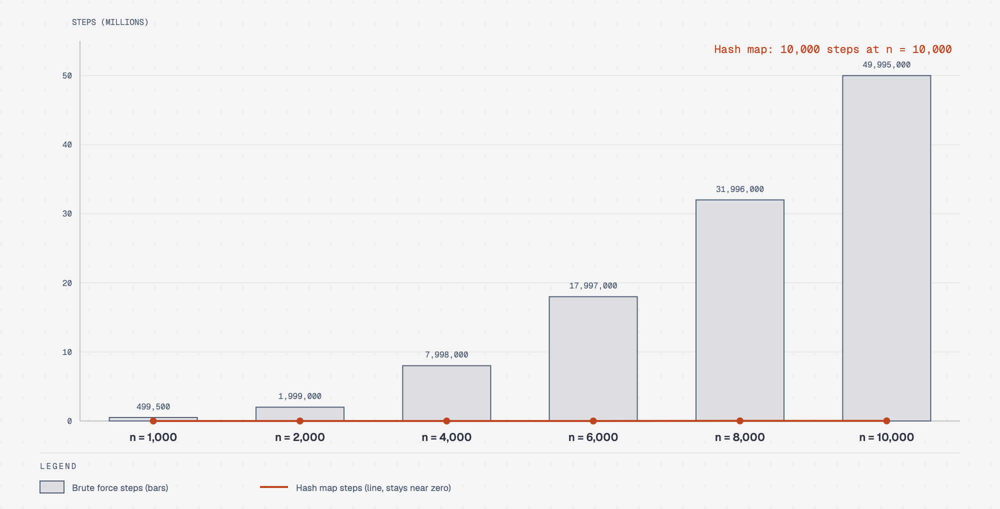

| List size `n` | Brute force pair checks | Hash map steps | Brute force time (at 100 million steps per second) | Hash map time | Hash map is faster by |
|:---:|:---:|:---:|:---:|:---:|:---:|
| 1,000 | 499,500 | 1,000 | 5 milliseconds | 0.01 milliseconds | about 500 times |
| 2,000 | 1,999,000 | 2,000 | 20 milliseconds | 0.02 milliseconds | about 1,000 times |
| 4,000 | 7,998,000 | 4,000 | 80 milliseconds | 0.04 milliseconds | about 2,000 times |
| 6,000 | 17,997,000 | 6,000 | 180 milliseconds | 0.06 milliseconds | about 3,000 times |
| 8,000 | 31,996,000 | 8,000 | 320 milliseconds | 0.08 milliseconds | about 4,000 times |
| 10,000 | 49,995,000 | 10,000 | 500 milliseconds | 0.10 milliseconds | about 5,000 times |

## 2. Core Idea

### Turn "find a pair" into "look up one number"

For a number `x`, the partner it needs is fixed:

```text
need = target - x
```

So the real question is: **"Have I already seen `need`? At which index?"** A dictionary `seen` (value to index) answers that in `O(1)` time on average.

### Check first, then store

At index `i`:

1. Look up `need` in `seen`. Right now `seen` only holds numbers **before** `i`.
2. Only after that, store `nums[i]` in `seen`.

Because the lookup happens before the store, a number can never pair with itself. In our example the `5` looks for another `5`, finds nothing, and only then is stored.

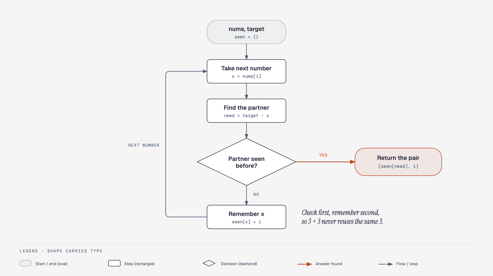

## 3. Edge Cases

| Case | Input | Expected | Why it matters | Code that handles it |
|:---|:---|:---:|:---|:---|
| Smallest | `[1, 2]`, `3` | `[0, 1]` | Two numbers only, the pair is found on the last step | `for i, x in enumerate(nums)` |
| Duplicates make the answer | `[3, 3]`, `6` | `[0, 1]` | Check before store gives `[0, 1]`, not `[0, 0]` | `if need in seen` runs before `seen[x] = i` |
| Self-pair trap | `[5, 1, 8, 3, 6, 11, 4]`, `10` | `[4, 6]` | `5 + 5` must not use index 0 twice | The 5 is not in `seen` when it looks |
| Negatives | `[-1, -2, -3, -4, -5]`, `-8` | `[2, 4]` | `target - x` works for negatives too | `need = target - x` |
| Zeros | `[0, 4, 3, 0]`, `0` | `[0, 3]` | `0 + 0` needs two different zeros | The second 0 finds the first in `seen` |

## 4. Brute Force: Try Every Pair

### Idea

Check every pair `(i, j)` with `i < j`. Return the first pair that adds up to `target`. On our example it checks 20 of the 21 pairs before it finds `(4, 6)`.

### Code

```python
# Import List for type hints
from typing import List


# Brute force: check all pairs
class SolutionBrute:

    # Main method
    def twoSum(self, nums: List[int], target: int) -> List[int]:

        # Number of elements
        n = len(nums)

        # First index of the pair
        for i in range(n):

            # Second index, always after i
            for j in range(i + 1, n):

                # Does this pair add up?
                if nums[i] + nums[j] == target:

                    # Return the two indices
                    return [i, j]

        # Not reached for valid input
        return []
```

### Complexity

| Measure | Complexity | Why | At the limit (`n = 10^4`) | Compared with brute force |
|:---|:---:|:---|:---:|:---|
| **Time** | `O(n^2)` | About `n^2 / 2` pairs are checked | about 50,000,000 pair checks | This is the baseline |
| **Space** | `O(1)` | No extra memory, only two loop indices | a few variables | This is the baseline |

## 5. Better Approach: Sort With Indices + Two Pointers

### Idea

1. Make pairs `(value, original index)` and sort them by value. We keep the index because sorting moves the numbers.
2. `left` starts at the smallest value, `right` at the biggest.
3. Sum too small: move `left` right to a bigger value. Sum too big: move `right` left to a smaller value. Equal: return the two saved indices.

### Run it on our example, step by step

**The array we take:** `nums = [5, 1, 8, 3, 6, 11, 4]`, `target = 10`.

**Before the steps:** pair each value with its index, then sort the pairs by value.

```text
pairs:  (5, 0) (1, 1) (8, 2) (3, 3) (6, 4) (11, 5) (4, 6)
sorted: (1, 1) (3, 3) (4, 6) (5, 0) (6, 4) (8, 2) (11, 5)
```

The picture shows the sorted values. The small label on top is the index each value had in the original list. `left` starts at the first box, `right` at the last box.

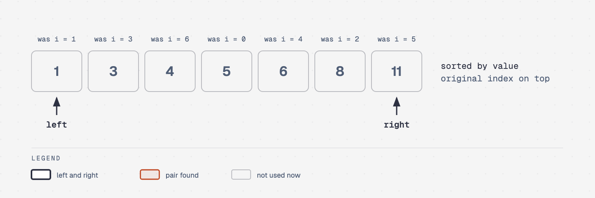

**Step 1: left = 1, right = 11**

- Sum: `1 + 11 = 12`. That is bigger than 10.
- `1` is the smallest value still in play, and even with it `11` makes the sum too big. So `11` can never be in the answer. Move `right` one step left.

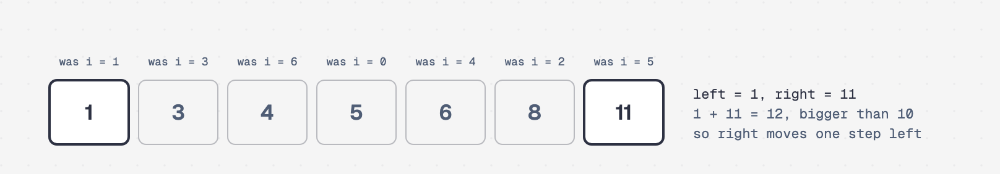

**Step 2: left = 1, right = 8**

- Sum: `1 + 8 = 9`. That is smaller than 10.
- `8` is the biggest value still in play, and even with it `1` makes the sum too small. So `1` can never be in the answer. Move `left` one step right.

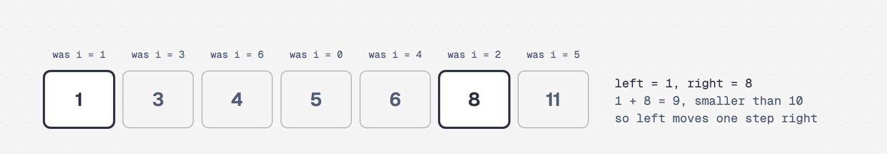

**Step 3: left = 3, right = 8**

- Sum: `3 + 8 = 11`. That is bigger than 10.
- `3` is the smallest value still in play, and even with it `8` makes the sum too big. So `8` can never be in the answer. Move `right` one step left.

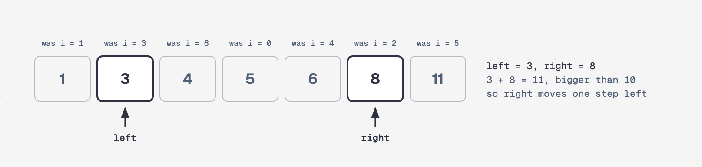

**Step 4: left = 3, right = 6**

- Sum: `3 + 6 = 9`. That is smaller than 10.
- `6` is the biggest value still in play, and even with it `3` makes the sum too small. So `3` can never be in the answer. Move `left` one step right.

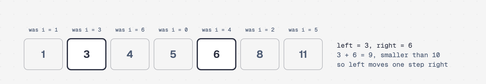

**Step 5: left = 4, right = 6**

- Sum: `4 + 6 = 10`. That is exactly the target.
- Their original indices are 6 and 4. Return them smaller first: `[4, 6]`.

![Step 5: 4 + 6 = 10, return [4, 6]](images/two-sum-better-step-5.png)

| Step | `left` value | `right` value | Sum | What happens | Why |
|:---:|:---:|:---:|:---:|:---|:---|
| 1 | 1 | 11 | 12 | `right` moves left | 12 is bigger than 10, so 11 is too big for every `left` |
| 2 | 1 | 8 | 9 | `left` moves right | 9 is smaller than 10, so 1 is too small for every `right` |
| 3 | 3 | 8 | 11 | `right` moves left | 11 is bigger than 10 |
| 4 | 3 | 6 | 9 | `left` moves right | 9 is smaller than 10 |
| 5 | 4 | 6 | 10 | Found: original indices 6 and 4, return `[4, 6]` | The sum hits the target |

### Code

```python
# Better: sort (value, index) pairs, then use two pointers
class SolutionBetter:

    # Main method
    def twoSum(self, nums: List[int], target: int) -> List[int]:

        # Pairs of (value, original index), sorted by value
        arr = sorted((v, i) for i, v in enumerate(nums))

        # Left pointer at the smallest value
        left = 0

        # Right pointer at the biggest value
        right = len(arr) - 1

        # Move the pointers toward each other
        while left < right:

            # Sum of the two values
            s = arr[left][0] + arr[right][0]

            # Found the pair
            if s == target:

                # Return original indices, smaller first
                return sorted([arr[left][1], arr[right][1]])

            # Sum is too small
            if s < target:

                # Use a bigger left value
                left += 1

            # Sum is too big
            else:

                # Use a smaller right value
                right -= 1

        # Not reached for valid input
        return []
```

### Complexity

| Measure | Complexity | Why | At the limit (`n = 10^4`) | Compared with brute force |
|:---|:---:|:---|:---:|:---|
| **Time** | `O(n log n)` | Sorting the pairs; the pointer walk is only `O(n)` | about 140,000 steps | About 350 times fewer steps |
| **Space** | `O(n)` | The list of `(value, index)` pairs | 10,000 pairs | Needs extra memory |

## 6. Optimal Approach: One-Pass Hash Map

### Idea

1. `seen = {}` maps a value to its index.
2. For each index `i` with value `x`:
   - `need = target - x`.
   - If `need` is in `seen`, return `[seen[need], i]`.
   - Otherwise store `seen[x] = i` and move on.

### Run it on our example, step by step

**The array we take:** `nums = [5, 1, 8, 3, 6, 11, 4]`, `target = 10`.

Think of a party. Kids walk in one at a time, each with a number sticker. At the door is a guest book (`seen`) with every kid already inside. A new kid works out the buddy they need (`10 - x`), checks the book first, and only then writes their own number in it.

**Start:** `seen = {}`, the book is empty. No number has been visited yet.

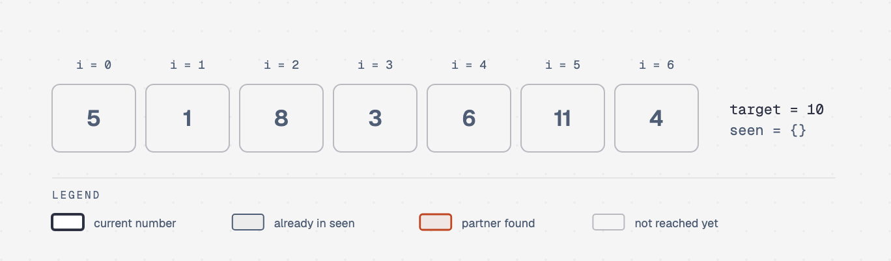

**Step 1: i = 0, x = 5**

- Partner needed: `need = 10 - 5 = 5`.
- Look in `seen = {}`. 5 is not there. The 5 is **not** in the book yet, so it cannot pair with itself. This is the self-pair trap, and check-first avoids it.
- Store this number: `seen[5] = 0`. Now `seen = {5: 0}`.

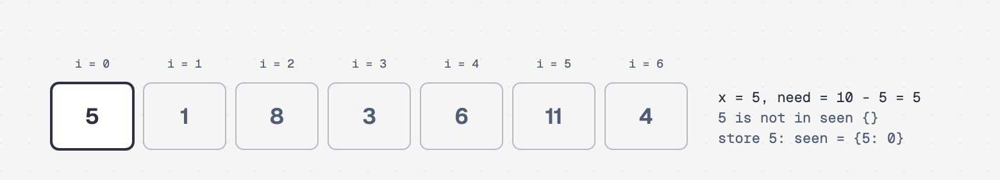

**Step 2: i = 1, x = 1**

- Partner needed: `need = 10 - 1 = 9`.
- Look in `seen = {5: 0}`. 9 is not there.
- Store this number: `seen[1] = 1`. Now `seen = {5: 0, 1: 1}`.

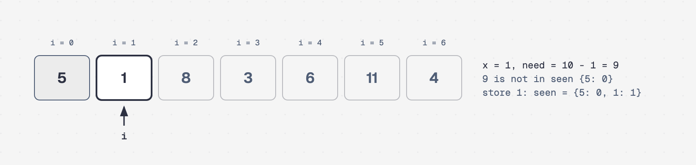

**Step 3: i = 2, x = 8**

- Partner needed: `need = 10 - 8 = 2`.
- Look in `seen = {5: 0, 1: 1}`. 2 is not there.
- Store this number: `seen[8] = 2`. Now `seen = {5: 0, 1: 1, 8: 2}`.

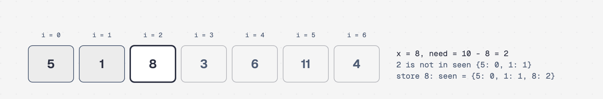

**Step 4: i = 3, x = 3**

- Partner needed: `need = 10 - 3 = 7`.
- Look in `seen = {5: 0, 1: 1, 8: 2}`. 7 is not there.
- Store this number: `seen[3] = 3`. Now `seen = {5: 0, 1: 1, 8: 2, 3: 3}`.

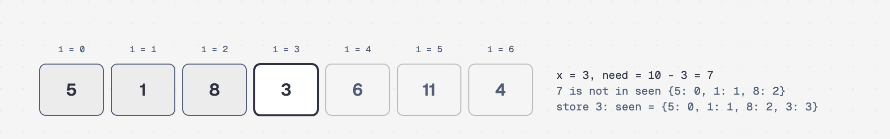

**Step 5: i = 4, x = 6**

- Partner needed: `need = 10 - 6 = 4`.
- Look in `seen = {5: 0, 1: 1, 8: 2, 3: 3}`. 4 is not there. Its partner 4 comes later in the list, so it is not in the book yet.
- Store this number: `seen[6] = 4`. Now `seen = {5: 0, 1: 1, 8: 2, 3: 3, 6: 4}`.

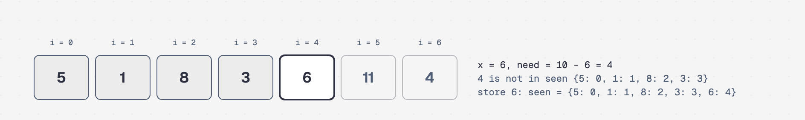

**Step 6: i = 5, x = 11**

- Partner needed: `need = 10 - 11 = -1`.
- Look in `seen = {5: 0, 1: 1, 8: 2, 3: 3, 6: 4}`. -1 is not there.
- Store this number: `seen[11] = 5`. Now `seen = {5: 0, 1: 1, 8: 2, 3: 3, 6: 4, 11: 5}`.

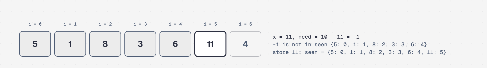

**Step 7: i = 6, x = 4**

- Partner needed: `need = 10 - 4 = 6`.
- Look in `seen = {5: 0, 1: 1, 8: 2, 3: 3, 6: 4, 11: 5}`. **6 is there, at index 4.**
- Return `[4, 6]`. Check: `nums[4] + nums[6] = 6 + 4 = 10`.

![Step 7: x = 4 needs 6, found in seen at index 4, return [4, 6]](images/two-sum-opt-step-7.png)

**All steps at a glance**

| Step | `i` | `x` | `need = 10 - x` | Is `need` in `seen`? | `seen` after this step | What happens |
|:---:|:---:|:---:|:---:|:---:|:---|:---|
| 1 | 0 | 5 | 5 | No. The book is empty; the 5 is not in it yet | `{5: 0}` | Store 5. This is the self-pair trap, and check-first avoids it |
| 2 | 1 | 1 | 9 | No | `{5: 0, 1: 1}` | Store 1 |
| 3 | 2 | 8 | 2 | No | `{5: 0, 1: 1, 8: 2}` | Store 8 |
| 4 | 3 | 3 | 7 | No | `{5: 0, 1: 1, 8: 2, 3: 3}` | Store 3 |
| 5 | 4 | 6 | 4 | No. The 4 comes later | `{5: 0, 1: 1, 8: 2, 3: 3, 6: 4}` | Store 6 |
| 6 | 5 | 11 | -1 | No | `{5: 0, 1: 1, 8: 2, 3: 3, 6: 4, 11: 5}` | Store 11 |
| 7 | 6 | 4 | 6 | **Yes, at index 4** | not changed | Return `[4, 6]` |

The pair is found when its **second** number arrives. The 6 had to wait in the book for the 4.

### Code

```python
# Solution for 1. Two Sum
class Solution:

    # Main method
    def twoSum(self, nums: List[int], target: int) -> List[int]:

        # value -> index, only for numbers before the current one
        seen = {}

        # Walk over every index and value
        for i, x in enumerate(nums):

            # The partner this number needs
            need = target - x

            # Check first: is the partner already seen?
            if need in seen:

                # Return the partner's index and ours
                return [seen[need], i]

            # Then store this number for later numbers
            seen[x] = i

        # Not reached for valid input
        return []
```

### Complexity

| Measure | Complexity | Why | At the limit (`n = 10^4`) | Compared with brute force |
|:---|:---:|:---|:---:|:---|
| **Time** | `O(n)` average | One pass, each lookup is `O(1)` on average | about 10,000 steps | About 5,000 times fewer steps |
| **Space** | `O(n)` | The dictionary holds up to `n` numbers | up to 10,000 entries | Trades memory for speed |

## 7. Common Mistakes

| Mistake | What goes wrong | Fix |
|:---|:---|:---|
| Store first, then check | In our example the 5 finds itself and returns `[0, 0]` | Check `need in seen` first, then store |
| Key by index instead of value | Cannot ask "have I seen value `need`?" | Key = value, value = index |
| Sort `nums` and return sorted positions | Indices no longer match the input | Use the hash map, or sort `(value, index)` pairs |
| Use `nums.index(need)` | `O(n)` per lookup, and may return the current index | Use a dictionary |

## 8. Interview Follow-ups

### Q1. The array is already sorted and you must use `O(1)` space?

**Answer:**
- Use two pointers on the array (LeetCode 167).
- Sum too small: move `left` right. Too big: move `right` left.
- `O(n)` time, `O(1)` space.

### Q2. How do you return all pairs, not just one?

**Answer:**
- Do not return early.
- For pairs of values without repeats, sort and use two pointers, skipping equal neighbours after each hit (the 3Sum trick).

### Q3. What if the same element can be used twice?

**Answer:**
- Store first, then check. Now `x + x = target` is allowed.
- It is the opposite of the normal rule.

### Q4. What if the numbers do not fit in memory?

**Answer:**
- Split the numbers into buckets by hash, so `x` and `target - x` land in buckets we can load together.
- Or sort on disk and run two pointers over the two ends of the file.

### Q5. How does this grow into 3Sum?

**Answer:**
- Fix one number with an outer loop. Find the other two with two pointers on the sorted array.
- `O(n^2)` total. Skip equal neighbours to avoid repeated triplets. See the next note.

## 9. Interview Explanation

> For each number x, the partner it needs is target minus x. I walk the array once with a dictionary from value to index. At each index I first check if the partner is already in the dictionary. If yes, I return the two indices. If not, I store the current number. Checking before storing means a number never pairs with itself. Each lookup is O(1) on average, so it is O(n) time and O(n) space. If the array were sorted, I would use two pointers instead and need only O(1) space.
