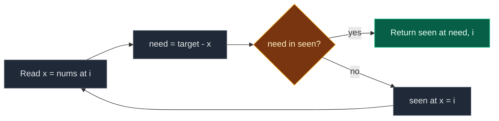

# 01. 1. Two Sum

| Difficulty | Pattern | Source | Time | Space |
|:---:|:---:|:---:|:---:|:---:|
| **Easy** | Hash Map / Complement | [1. Two Sum](https://leetcode.com/problems/two-sum/) | `O(n)` | `O(n)` |

## 1. Problem Statement

You get an integer array `nums` and an integer `target`.

Return the **indices** of the two numbers that add up to `target`.

- There is exactly one answer.
- You cannot use the same element twice.
- You can return the two indices in any order.

Follow-up: can you do better than `O(n^2)` time?

### Example

```text
Input:  nums = [3, 2, 4], target = 6
Output: [1, 2]

nums[1] + nums[2] = 2 + 4 = 6.
Note: 3 + 3 = 6 too, but there is only one 3.
We cannot use index 0 twice.
```

We use this same example in every section below.

### Constraints

- `2 <= nums.length <= 10^4`
- `-10^9 <= nums[i] <= 10^9`
- `-10^9 <= target <= 10^9`
- Only one valid answer exists.

## 2. Core Theory

### What the problem really asks

Find `i != j` with `nums[i] + nums[j] == target`. Return the positions.

### Turn the pair question into a lookup question

For each number `x`, the partner it needs is fixed:

```text
need = target - x
```

So the question becomes: **"Have I already seen `need`? At which index?"**

A dictionary `seen` (value -> index) answers that in `O(1)` on average.

### Why "check first, then store" matters

At index `i`:

1. Look up `need` in `seen`. `seen` only has numbers **before** `i`.
2. Only then store `nums[i]`.

Because `nums[i]` is not in `seen` yet when we look, a number can never pair with itself. That is why `[3, 2, 4], target 6` does not return `[0, 0]`.

```text
i:       0      1         2
nums:    3      2         4
need:    3      4         2
seen:   {}   {3:0}   {3:0, 2:1}   <- 2 found at index 1 -> [1, 2]
```

### Why not sort + two pointers?

- Sorting is `O(n log n)` and loses the original indices.
- To keep them we must carry `(value, index)` pairs, which already costs `O(n)` space.
- So the hash map is faster and simpler here. Sorting is better when the array is already sorted (LeetCode 167) or for 3Sum/4Sum.



## 3. Edge Cases

| Case | Input | Expected | Why it matters |
|:---|:---|:---:|:---|
| Smallest | `[1, 2]`, `3` | `[0, 1]` | Two numbers only |
| Duplicates make the answer | `[3, 3]`, `6` | `[0, 1]` | Check before store gives `[0, 1]`, not `[0, 0]` |
| Self-pair trap | `[3, 2, 4]`, `6` | `[1, 2]` | `3 + 3` must not use index 0 twice |
| Negatives | `[-1, -2, -3, -4, -5]`, `-8` | `[2, 4]` | `target - x` works for negatives |
| Zeros | `[0, 4, 3, 0]`, `0` | `[0, 3]` | `0 + 0 = 0` needs two different zeros |
| Far apart | `[1, 3, 5, 9]`, `10` | `[0, 3]` | Old entries must stay in `seen` |

## 4. Brute Force: Try Every Pair

### Idea

Check every pair `(i, j)` with `i < j`. Return the first pair that adds up to `target`.

### Code

```python
# Import List for type hints
from typing import List


# Brute force: check all pairs
class SolutionBrute:

    # Main method
    def twoSum(self, nums: List[int], target: int) -> List[int]:

        # Number of elements
        n = len(nums)

        # First index of the pair
        for i in range(n):

            # Second index, always after i
            for j in range(i + 1, n):

                # Does this pair add up?
                if nums[i] + nums[j] == target:

                    # Return the two indices
                    return [i, j]

        # Not reached for valid input
        return []
```

### Complexity

| Measure | Complexity | Why |
|:---|:---:|:---|
| **Time** | `O(n^2)` | About `n²/2` pairs |
| **Space** | `O(1)` | No extra memory |

## 5. Better Approach: Sort With Indices + Two Pointers

### Idea

1. Make pairs `(value, index)` and sort them by value.
2. `left = 0`, `right = n - 1`.
3. Sum too small -> `left += 1`. Sum too big -> `right -= 1`. Equal -> return the two saved indices.

### Code

```python
# Better: sort (value, index) pairs, then use two pointers
class SolutionBetter:

    # Main method
    def twoSum(self, nums: List[int], target: int) -> List[int]:

        # Pairs of (value, original index), sorted by value
        arr = sorted((v, i) for i, v in enumerate(nums))

        # Left pointer at the smallest value
        left = 0

        # Right pointer at the biggest value
        right = len(arr) - 1

        # Move the pointers toward each other
        while left < right:

            # Sum of the two values
            s = arr[left][0] + arr[right][0]

            # Found the pair
            if s == target:

                # Return original indices, smaller first
                return sorted([arr[left][1], arr[right][1]])

            # Sum is too small
            if s < target:

                # Use a bigger left value
                left += 1

            # Sum is too big
            else:

                # Use a smaller right value
                right -= 1

        # Not reached for valid input
        return []
```

### Complexity

| Measure | Complexity | Why |
|:---|:---:|:---|
| **Time** | `O(n log n)` | Sorting |
| **Space** | `O(n)` | The list of pairs |

## 6. Optimal Approach: One-Pass Hash Map

### Idea

1. `seen = {}` (value -> index).
2. For each index `i` with value `x`:
   - `need = target - x`.
   - If `need` is in `seen`, return `[seen[need], i]`.
   - Else store `seen[x] = i`.

### Visual Walkthrough (Story Version)

Before the code, let us see the idea as a story.

**The story:** kids walk into a party one by one. Each kid has a number sticker. The game: find **two kids** whose stickers add up to `6`. At the door there is a **guest book**. It lists the sticker of every kid already inside and where they stand.

**The rules:**

- A new kid at the door thinks: "I have `x`. My buddy must have `6 - x`."
- The kid checks the guest book **first**: is my buddy already inside?
- If yes, we found the pair. If no, the kid writes their own sticker and spot in the book, then goes in.
- Because the kid checks the book **before** writing in it, a kid can never pick themselves as the buddy.

**How to read the pictures:** `door:` = the kid arriving. `book:` = the guest book (sticker -> spot).

**Start**

```text
door:  (nobody yet)
line:  [3] [2] [4]
book:  { }
```

**Step 1: kid at spot 0 with sticker `3`**

- "My buddy needs `6 - 3 = 3`."
- Is `3` in the book? No, the book is empty. (The kid's own 3 is not in the book yet.)
- Write `3 -> spot 0` in the book.

```text
door:  [3]  needs 3  -> not found
book:  { 3: spot 0 }
```

**Step 2: kid at spot 1 with sticker `2`**

- "My buddy needs `6 - 2 = 4`."
- Is `4` in the book? No.
- Write `2 -> spot 1`.

```text
door:  [2]  needs 4  -> not found
book:  { 3: spot 0, 2: spot 1 }
```

**Step 3: kid at spot 2 with sticker `4`**

- "My buddy needs `6 - 4 = 2`."
- Is `2` in the book? **Yes**, at spot 1!
- Pair found: spot 1 and spot 2.

```text
door:  [4]  needs 2  -> FOUND at spot 1
book:  { 3: spot 0, 2: spot 1 }
answer: [1, 2]
```

**All steps at a glance**

| Step | Spot | Sticker | Buddy needed | In the book? | Book after | Result |
|:---:|:---:|:---:|:---:|:---:|:---|:---|
| 1 | 0 | 3 | 3 | No | `{3:0}` | keep going |
| 2 | 1 | 2 | 4 | No | `{3:0, 2:1}` | keep going |
| 3 | 2 | 4 | 2 | Yes, spot 1 | `{3:0, 2:1}` | `[1, 2]` |

**What the story teaches**

| In the story | In the code |
|:---|:---|
| Kid at the door | `nums[i]` at index `i` |
| Buddy needed | `need = target - nums[i]` |
| Guest book | `seen` dictionary |
| Check the book first | `if need in seen` |
| Write yourself in the book | `seen[nums[i]] = i` |
| Never pick yourself | Check happens before the write |

Now the same steps again, this time with the exact variables.

### Step-by-Step Example

```text
nums = [3, 2, 4], target = 6
```

**Start**

```text
seen = {}
```

**Step 1: `i = 0`, `x = 3`**

1. `need = 6 - 3 = 3`.
2. Is `3` in `seen = {}`? No.
3. Store `seen[3] = 0`.

```text
seen = {3: 0}
```

**Step 2: `i = 1`, `x = 2`**

1. `need = 6 - 2 = 4`.
2. Is `4` in `seen = {3: 0}`? No.
3. Store `seen[2] = 1`.

```text
seen = {3: 0, 2: 1}
```

**Step 3: `i = 2`, `x = 4`**

1. `need = 6 - 4 = 2`.
2. Is `2` in `seen = {3: 0, 2: 1}`? Yes, `seen[2] = 1`.
3. Return `[1, 2]`.

**End:** answer `[1, 2]`. Check: `nums[1] + nums[2] = 2 + 4 = 6`.

| i | x | need | need in seen? | seen after | Action |
|:---:|:---:|:---:|:---:|:---|:---|
| 0 | 3 | 3 | No | `{3: 0}` | Store |
| 1 | 2 | 4 | No | `{3: 0, 2: 1}` | Store |
| 2 | 4 | 2 | Yes (index 1) | `{3: 0, 2: 1}` | Return `[1, 2]` |

### Code

```python
# Solution for 1. Two Sum
class Solution:

    # Main method
    def twoSum(self, nums: List[int], target: int) -> List[int]:

        # value -> index, only for numbers before the current one
        seen = {}

        # Walk over every index and value
        for i, x in enumerate(nums):

            # The partner this number needs
            need = target - x

            # Check first: is the partner already seen?
            if need in seen:

                # Return the partner's index and ours
                return [seen[need], i]

            # Then store this number for later numbers
            seen[x] = i

        # Not reached for valid input
        return []


# Replay the example step by step and check the state after each step
nums, target = [3, 2, 4], 6

# Expected (need, found, seen) after each index
expected_steps = [
    (3, False, {3: 0}),
    (4, False, {3: 0, 2: 1}),
    (2, True, {3: 0, 2: 1}),
]

# Start with an empty dictionary
seen = {}

# The answer once found
answer = None

# Same loop as the solution
for i, x in enumerate(nums):

    # Same partner
    need = target - x

    # Same check
    found = need in seen

    # Partner found
    if found:

        # Save the answer
        answer = [seen[need], i]

    # Partner not found
    else:

        # Store this number
        seen[x] = i

    # Check against the traced table
    assert (need, found, seen) == expected_steps[i]

    # Stop when found, like the solution
    if found:

        # Leave the loop
        break

# The traced answer
assert answer == [1, 2]

# Full solution on the example
assert Solution().twoSum([3, 2, 4], 6) == [1, 2]

# LeetCode example 1
assert Solution().twoSum([2, 7, 11, 15], 9) == [0, 1]

# LeetCode example 3: duplicates make the answer
assert Solution().twoSum([3, 3], 6) == [0, 1]

# Smallest
assert Solution().twoSum([1, 2], 3) == [0, 1]

# Negatives
assert Solution().twoSum([-1, -2, -3, -4, -5], -8) == [2, 4]

# Zeros
assert Solution().twoSum([0, 4, 3, 0], 0) == [0, 3]

# Far apart
assert Solution().twoSum([1, 3, 5, 9], 10) == [0, 3]

# Random tests: all three must return a valid pair
import random

# Fixed seed so the test is repeatable
random.seed(1)

# Many random cases
for _ in range(300):

    # Random list of distinct numbers so the answer is unique
    data = random.sample(range(-30, 31), random.randint(2, 10))

    # Pick two different positions
    a, b = sorted(random.sample(range(len(data)), 2))

    # Target from those two
    t = data[a] + data[b]

    # Skip cases with more than one valid pair
    pairs = [(i, j) for i in range(len(data)) for j in range(i + 1, len(data)) if data[i] + data[j] == t]

    # Only test unique-answer inputs
    if len(pairs) != 1:

        # Try the next case
        continue

    # Brute force answer
    assert SolutionBrute().twoSum(data, t) == [a, b]

    # Better must match
    assert SolutionBetter().twoSum(data, t) == [a, b]

    # Optimal must match
    assert Solution().twoSum(data, t) == [a, b]

# All checks passed
print("All tests passed")
```

### Complexity

| Measure | Complexity | Why |
|:---|:---:|:---|
| **Time** | `O(n)` average | One pass, each lookup is `O(1)` on average |
| **Space** | `O(n)` | The dictionary |

## 7. Common Mistakes

| Mistake | What goes wrong | Fix |
|:---|:---|:---|
| Store first, then check | `[3, 2, 4], 6` finds the same 3 and returns `[0, 0]` | Check `need in seen` first, then store |
| Key by index instead of value | Cannot look up "have I seen value `need`?" | Key = value, value = index |
| Sorting `nums` and returning sorted positions | Indices no longer match the input | Use the hash map, or sort `(value, index)` pairs |
| Using `nums.index(need)` | `O(n)` per lookup, and may return the current index | Use a dictionary |
| Skipping duplicate values | Can drop the only valid partner | Let later duplicates overwrite; any valid pair is fine |

## 8. Interview Follow-ups

### Q1. The array is already sorted and you must use `O(1)` space?

**Answer:**
- Use two pointers on the array (LeetCode 167).
- Sum too small -> move `left` right. Too big -> move `right` left.
- `O(n)` time, `O(1)` space.

### Q2. How do you return all pairs, not just one?

**Answer:**
- Do not return early. Keep going.
- For value pairs without repeats, sort and use two pointers, skipping equal neighbors after each hit.

### Q3. What if the same element can be used twice?

**Answer:**
- Store first, then check. Now `x + x = target` is allowed.
- This is the opposite of the normal rule.

### Q4. What if the data does not fit in memory?

**Answer:**
- Split the numbers into buckets by hash.
- Send `x` to the bucket of `x` and look for `target - x` in its bucket.
- Or sort on disk and use two pointers on the streams.

### Q5. How does this extend to 3Sum?

**Answer:**
- Fix one number with an outer loop. Find the other two with two pointers on a sorted array.
- Total `O(n^2)`. Skip duplicates to avoid repeated triplets.

## 9. Interview Explanation

> For each number x, the partner it needs is target minus x. So I walk the array once with a dictionary from value to index. At each index I first check if the partner is already in the dictionary. If yes, I return the two indices. If not, I store the current number and its index. Checking before storing means a number can never pair with itself. Each lookup is O(1) on average, so the whole thing is O(n) time and O(n) space.
