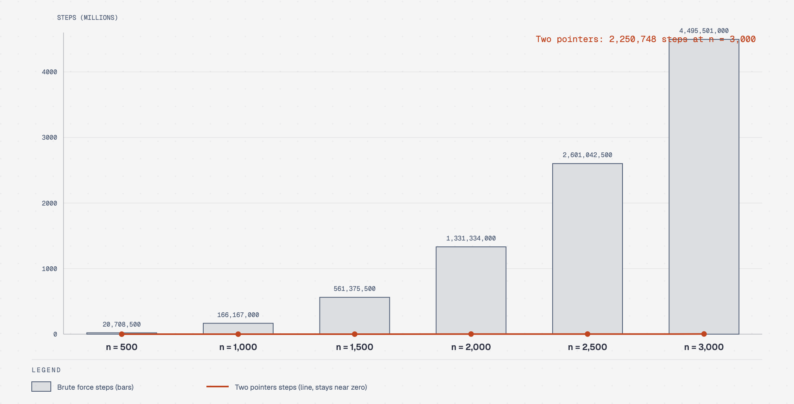
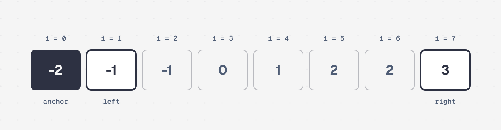
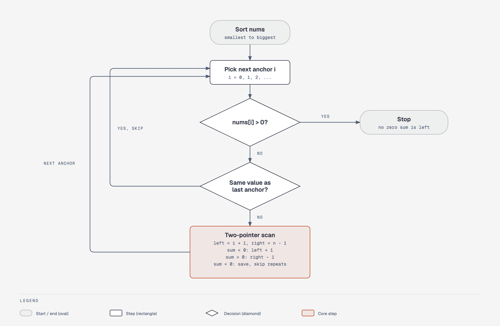
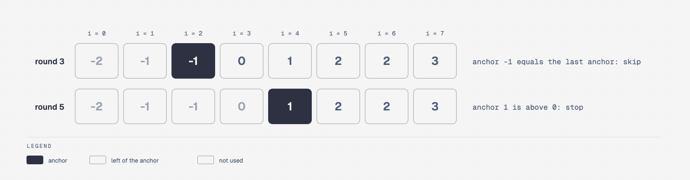
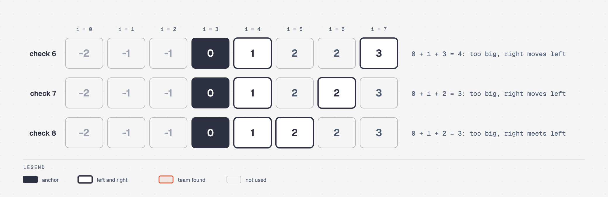

# 02. 15. 3Sum

| Difficulty | Pattern | Key idea | Source | Time | Space | Before / after |
|:---:|:---:|:---|:---:|:---:|:---:|:---:|
| **Medium** | Sorting + Two Pointers | Fix one number, find the other two with two pointers, skip repeats | [15. 3Sum](https://leetcode.com/problems/3sum/) | `O(n^2)` | `O(1)` extra | [1. Two Sum](01.%201.%20Two%20Sum.md) / [18. 4Sum](03.%2018.%204Sum.md) |

## 1. Problem Statement

You get an integer array `nums`.

Return all **unique** triplets `[a, b, c]` from three different positions such that `a + b + c == 0`.

- The same set of values must not appear twice in the answer.
- The order of the triplets, and inside each triplet, does not matter.

### Example

```text
Input:  nums = [1, -1, -1, 0, 2, -2, 2, 3]
Output: [[-2, -1, 3], [-2, 0, 2], [-1, -1, 2], [-1, 0, 1]]
```

This example has every tricky part of the problem:

- Two `-1`s and two `2`s, so the same team can be built in more than one way. Each team must be listed **once**.
- A positive number, so we can see the early stop.

We use this example in every section below. Smaller LeetCode examples:

```text
nums = [-1, 0, 1, 2, -1, -4]   gives [[-1, -1, 2], [-1, 0, 1]]
nums = [0, 1, 1]               gives []
nums = [0, 0, 0]               gives [[0, 0, 0]]
```

### Constraints, in plain words

| Limit | What it means in plain words | What it tells us |
|:---|:---|:---|
| `3 <= nums.length <= 3000` | The list has at least 3 numbers and at most 3,000 numbers | Three nested loops are far too slow at 3,000; two loops are fine |
| `-10^5 <= nums[i] <= 10^5` | Numbers can be negative, and as big as one hundred thousand | The sum of three numbers stays small, so there is no overflow in any language |
| Answer must have no repeats | `[-1, 0, 1]` built from two different `-1`s still counts once | We need a way to skip repeated values |

**How fast is fast enough?**

- The judge gives your code about **1 second**, and a computer does roughly **100 million** simple steps in 1 second.
- **Try every group of three:** 3,000 numbers make about **4.5 billion** groups. That is about 45 seconds. Far too slow.
- **Sort, fix one number, two pointers for the rest:** about **2.3 million** steps. That is about two hundredths of a second.

In the chart, the grey bars are brute force checks and the orange line is the two-pointer method. Every number was counted by running the code on the list `[-n/2, ..., n/2 - 1]`.



| List size `n` | Brute force checks | Two-pointer steps | Brute force time (at 100 million steps per second) | Two-pointer time | Two pointers are faster by |
|:---:|:---:|:---:|:---:|:---:|:---:|
| 500 | 20,708,500 | 62,623 | 0.2 seconds | 0.6 milliseconds | about 331 times |
| 1,000 | 166,167,000 | 250,248 | 1.7 seconds | 2.5 milliseconds | about 664 times |
| 1,500 | 561,375,500 | 562,873 | 5.6 seconds | 5.6 milliseconds | about 997 times |
| 2,000 | 1,331,334,000 | 1,000,498 | 13.3 seconds | 10 milliseconds | about 1,331 times |
| 2,500 | 2,601,042,500 | 1,563,123 | 26 seconds | 15.6 milliseconds | about 1,664 times |
| 3,000 | 4,495,501,000 | 2,250,748 | 45 seconds | 22.5 milliseconds | about 1,997 times |

## 2. Core Idea

### Fix one, find two

- Fix the first number `nums[i]`. Call it the **anchor**.
- Now we need two more numbers that add up to `-nums[i]`.
- That is Two Sum on the part to the right of the anchor.

### Why sort first

After sorting, Two Sum on a sorted range is easy with two pointers:

- Sum **too small**: we need a bigger number, so `left` moves right.
- Sum **too big**: we need a smaller number, so `right` moves left.
- Sum **= 0**: save the team, then move both.



Sorting also puts **equal values next to each other**. That makes repeats easy to skip:

1. Skip an anchor equal to the previous anchor.
2. After a hit, skip `left` values equal to the one just used.
3. After a hit, skip `right` values equal to the one just used.

### Early stop

If `nums[i] > 0`, every number to its right is also `> 0`. Three positive numbers can never sum to `0`, so stop.



## 3. Edge Cases

| Case | Input | Expected | Why it matters | Code that handles it |
|:---|:---|:---:|:---|:---|
| No answer | `[0, 1, 1]` | `[]` | The only triplet sums to 2 | `while left < right` ends with nothing saved |
| All zeros | `[0, 0, 0]` | `[[0, 0, 0]]` | One triplet | The `s == 0` branch saves it |
| Many zeros | `[0, 0, 0, 0]` | `[[0, 0, 0]]` | Skips must collapse repeats; stop only on `> 0`, not `>= 0` | `if nums[i] > 0: break` and the two skip loops |
| All positive | `[1, 2, 3, 4]` | `[]` | The early stop fires at once | `if nums[i] > 0: break` |
| Heavy duplicates | `[-2, 0, 0, 2, 2]` | `[[-2, 0, 2]]` | Both `left` and `right` skips must work | `nums[left] == nums[left - 1]` and `nums[right] == nums[right + 1]` |

## 4. Brute Force: Try Every Triplet

### Idea

Three nested loops. For each triplet that sums to `0`, sort its three values and put them in a set to remove repeats. On our example it checks all 56 groups of three.

### Code

```python
# Import List for type hints
from typing import List


# Brute force: all triplets, set for uniqueness
class SolutionBrute:

    # Main method
    def threeSum(self, nums: List[int]) -> List[List[int]]:

        # Number of elements
        n = len(nums)

        # Unique triplets as sorted tuples
        found = set()

        # First position
        for i in range(n):

            # Second position
            for j in range(i + 1, n):

                # Third position
                for k in range(j + 1, n):

                    # Sum is zero
                    if nums[i] + nums[j] + nums[k] == 0:

                        # Store in sorted form so repeats match
                        found.add(tuple(sorted((nums[i], nums[j], nums[k]))))

        # Turn tuples into lists, in sorted order
        return [list(t) for t in sorted(found)]
```

### Complexity

| Measure | Complexity | Why | At the limit (`n = 3000`) | Compared with brute force |
|:---|:---:|:---|:---:|:---|
| **Time** | `O(n^3)` | Three nested loops try every group of three positions | about 4,500,000,000 checks | This is the baseline |
| **Space** | `O(k)` | The set of `k` unique answers | one entry per unique triplet | This is the baseline |

## 5. Better Approach: Anchor + Hash Set

### Idea

For each anchor `i`, run the hash-set Two Sum (note 01) on the rest:

- For each `j > i`, the third value must be `-(nums[i] + nums[j])`.
- If that value was seen between `i` and `j`, we have a triplet.
- Store sorted triplets in a set to remove repeats.

It is as fast as the optimal method, but it needs extra memory and a set to remove repeats.

### Code

```python
# Better: fix one number, use a hash set for the other two
class SolutionBetter:

    # Main method
    def threeSum(self, nums: List[int]) -> List[List[int]]:

        # Number of elements
        n = len(nums)

        # Unique triplets as sorted tuples
        found = set()

        # Fix the first number
        for i in range(n):

            # Values seen after i in this round
            seen = set()

            # Second number
            for j in range(i + 1, n):

                # The value the third number must have
                third = -(nums[i] + nums[j])

                # Third number was seen between i and j
                if third in seen:

                    # Store in sorted form so repeats match
                    found.add(tuple(sorted((nums[i], nums[j], third))))

                # Remember this value for later j
                seen.add(nums[j])

        # Turn tuples into lists, in sorted order
        return [list(t) for t in sorted(found)]
```

### Complexity

| Measure | Complexity | Why | At the limit (`n = 3000`) | Compared with brute force |
|:---|:---:|:---|:---:|:---|
| **Time** | `O(n^2)` | Two loops, `O(1)` set work inside the inner loop | about 4,500,000 steps | About 1,000 times fewer steps |
| **Space** | `O(n + k)` | The `seen` set plus the answer set | up to 3,000 values in `seen` | Needs extra memory |

## 6. Optimal Approach: Sort + Two Pointers

### Idea

1. Sort `nums`.
2. For each anchor `i`:
   - If `nums[i] > 0`, stop.
   - If `i > 0` and `nums[i] == nums[i - 1]`, skip this anchor.
   - Set `left = i + 1` and `right = n - 1`. While `left < right`:
     - `s = nums[i] + nums[left] + nums[right]`.
     - `s < 0`: `left += 1`. `s > 0`: `right -= 1`.
     - `s == 0`: save, move both, then skip repeats on both sides.

### Run it on our example, end to end

Think of eight kids holding number cards. They line up by card: `-2, -1, -1, 0, 1, 2, 2, 3`. One kid steps forward as the **anchor**. Two helpers, **left** and **right**, look for two more kids so the three cards add up to 0.

**Round 1: anchor `-2` (i = 0)**

![Round 1: -2 + -1 + 3 = 0 saves [-2, -1, 3]; after skipping the second -1, -2 + 0 + 2 = 0 saves [-2, 0, 2]](images/three-sum-round-1.png)

- Check 1: `-2 + -1 + 3 = 0`. Save `[-2, -1, 3]`. Both pointers move: `left` to i = 2, `right` to i = 6.
- `left` now sits on another `-1`, the value just used. Skip it: `left` moves to i = 3.
- Check 2: `-2 + 0 + 2 = 0`. Save `[-2, 0, 2]`. Both move: `left` to i = 4, `right` to i = 5.
- `right` now sits on another `2`, the value just used. Skip it: `right` moves to i = 4 and meets `left`. Round over.

**Round 2: anchor `-1` (i = 1)**

![Round 2: -1 + -1 + 3 = 1 too big; -1 + -1 + 2 = 0 saves [-1, -1, 2]; -1 + 0 + 1 = 0 saves [-1, 0, 1]](images/three-sum-round-2.png)

- Check 3: `-1 + -1 + 3 = 1`. Too big, `right` moves to i = 6.
- Check 4: `-1 + -1 + 2 = 0`. Save `[-1, -1, 2]`. Both move: `left` to i = 3, `right` to i = 5. `right` is on another `2`, so it skips to i = 4.
- Check 5: `-1 + 0 + 1 = 0`. Save `[-1, 0, 1]`. Both move and cross. Round over.

**Round 3 and round 5: skip and stop**



- Round 3: the anchor at i = 2 is `-1` again. It would find the same teams as round 2, so skip it.
- Round 5 (after round 4 below): the anchor at i = 4 is `1`. Every number from here on is positive, so stop.

**Round 4: anchor `0` (i = 3)**



- Checks 6, 7, 8: `0 + 1 + 3 = 4`, then `0 + 1 + 2 = 3` twice. All too big, so `right` keeps moving left until it meets `left`. No team.

**All steps at a glance**

| Step | `i` | Anchor | `left` | `right` | Sum | What happens | Teams so far |
|:---:|:---:|:---:|:---:|:---:|:---:|:---|:---:|
| 1 | 0 | -2 | 1 | 7 | 0 | Save `[-2, -1, 3]`, move both, skip the repeated `-1` on the left | 1 |
| 2 | 0 | -2 | 3 | 6 | 0 | Save `[-2, 0, 2]`, move both, skip the repeated `2` on the right | 2 |
| 3 | 1 | -1 | 2 | 7 | 1 | Too big, `right` moves left | 2 |
| 4 | 1 | -1 | 2 | 6 | 0 | Save `[-1, -1, 2]`, move both, skip the repeated `2` on the right | 3 |
| 5 | 1 | -1 | 3 | 4 | 0 | Save `[-1, 0, 1]`, move both, they cross | 4 |
| skip | 2 | -1 | | | | Same anchor as before, skip the whole round | 4 |
| 6 | 3 | 0 | 4 | 7 | 4 | Too big, `right` moves left | 4 |
| 7 | 3 | 0 | 4 | 6 | 3 | Too big, `right` moves left | 4 |
| 8 | 3 | 0 | 4 | 5 | 3 | Too big, `right` meets `left` | 4 |
| stop | 4 | 1 | | | | Anchor above 0, stop the search | 4 |

Eight sum checks found all four teams. Brute force needed 56.

### Code

```python
# Solution for 15. 3Sum
class Solution:

    # Main method
    def threeSum(self, nums: List[int]) -> List[List[int]]:

        # Sort so two pointers and duplicate skipping work
        nums.sort()

        # Number of elements
        n = len(nums)

        # The answer list
        res = []

        # Each anchor needs two numbers to its right
        for i in range(n - 2):

            # A positive anchor can never reach zero
            if nums[i] > 0:

                # Stop the whole search
                break

            # Same anchor as before gives the same triplets
            if i > 0 and nums[i] == nums[i - 1]:

                # Skip it
                continue

            # Left pointer just after the anchor
            left = i + 1

            # Right pointer at the end
            right = n - 1

            # Search while the pointers have not met
            while left < right:

                # Sum of the three numbers
                s = nums[i] + nums[left] + nums[right]

                # Too small
                if s < 0:

                    # Need a bigger left value
                    left += 1

                # Too big
                elif s > 0:

                    # Need a smaller right value
                    right -= 1

                # Exactly zero
                else:

                    # Save the triplet
                    res.append([nums[i], nums[left], nums[right]])

                    # Move left past the used value
                    left += 1

                    # Move right past the used value
                    right -= 1

                    # Skip repeats on the left
                    while left < right and nums[left] == nums[left - 1]:

                        # Next left
                        left += 1

                    # Skip repeats on the right
                    while left < right and nums[right] == nums[right + 1]:

                        # Next right
                        right -= 1

        # Return all unique triplets
        return res
```

### Complexity

| Measure | Complexity | Why | At the limit (`n = 3000`) | Compared with brute force |
|:---|:---:|:---|:---:|:---|
| **Time** | `O(n^2)` | Sort is `O(n log n)`. Each anchor does one `O(n)` two-pointer pass | about 2,250,000 steps | About 2,000 times fewer steps |
| **Space** | `O(1)` extra | Only pointers (Python's sort may use up to `O(n)` inside) | a few loop variables | No set needed for repeats |

## 7. Common Mistakes

| Mistake | What goes wrong | Fix |
|:---|:---|:---|
| Anchor skip with `nums[i] == nums[i + 1]` | Skips the first `-1`, so `[-1, -1, 2]` is lost | Compare back: `i > 0 and nums[i] == nums[i - 1]` |
| Skip repeats before moving the pointers | Compares a value with itself, never skips | Move `left` and `right` first, then skip |
| No `left < right` in the skip loops | Pointers run past each other, index error | Guard every skip loop |
| Stop on `nums[i] >= 0` | `[0, 0, 0]` is lost | Stop only on `nums[i] > 0` |

## 8. Interview Follow-ups

### Q1. Why move both pointers after a hit?

**Answer:**
- With `left` fixed, any other `right` value gives a different sum, so it cannot be `0` again unless the value repeats.
- The skip loops handle repeats. So both pointers must move to find a new pair.

### Q2. Does the `nums[i] > 0` stop ever lose an answer?

**Answer:**
- No. After sorting, `nums[left]` and `nums[right]` are `>= nums[i] > 0`.
- So every sum from there on is positive.

### Q3. Can you avoid sorting and still get `O(n^2)`?

**Answer:**
- Yes, with the hash set approach.
- But it needs `O(n)` extra space and a set to remove repeats.
- Sorting is `O(n log n)`, smaller than `O(n^2)`, so it costs nothing extra.

### Q4. How does this extend to 4Sum or kSum?

**Answer:**
- Add one more fixed number per level. The base case is always two-pointer Two Sum.
- kSum is `O(n^(k-1))`. See the next note.

### Q5. What if the target is not 0?

**Answer:**
- Compare `s` with `target` instead of `0`.
- The early stop `nums[i] > 0` is only safe when the target is `0`. A safe version: stop when `nums[i] > 0` and `nums[i] > target`.

## 9. Interview Explanation

> I sort the array, fix one number as an anchor, and look for two more numbers that cancel it, using two pointers on the part to its right. If the sum is too small I move the left pointer right, if too big I move the right pointer left, and on a hit I save the triplet and move both. Sorting puts equal values together, so I skip an anchor equal to the previous one and skip repeated values after each hit. That keeps triplets unique without a set. I stop early when the anchor is positive. It is O(n^2) time and O(1) extra space.
