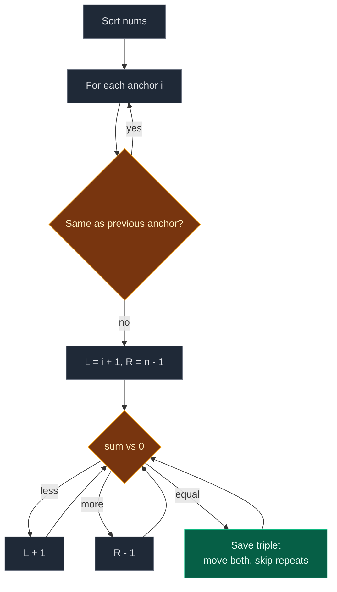

# 02. 15. 3Sum

| Difficulty | Pattern | Source | Time | Space |
|:---:|:---:|:---:|:---:|:---:|
| **Medium** | Sorting + Two Pointers | [15. 3Sum](https://leetcode.com/problems/3sum/) | `O(n^2)` | `O(1)` extra |

## 1. Problem Statement

You get an integer array `nums`.

Return all **unique** triplets `[a, b, c]` taken from three different positions such that `a + b + c == 0`.

- The same triplet of values must not appear twice in the answer.
- The order of the triplets, and inside each triplet, does not matter.

### Example

```text
Input:  nums = [-1, 0, 1, 2, -1, -4]
Output: [[-1, -1, 2], [-1, 0, 1]]

(-1) + (-1) + 2 = 0
(-1) +   0  + 1 = 0
[-1, 0, 1] can be built in two ways (two different -1s),
but it is listed only once.
```

We use this same example in every section below.

### Constraints

- `3 <= nums.length <= 3000`
- `-10^5 <= nums[i] <= 10^5`

## 2. Core Theory

### What the problem really asks

Pick three positions whose values add to `0`. Report each **set of values** only once.

### Fix one, find two

- Fix the first number `nums[i]` (the anchor).
- Now we need two more numbers that add to `-nums[i]`.
- That is a Two Sum problem on the rest of the array.

### Why sort first

After sorting, Two Sum on a sorted range is easy with two pointers:

```text
sorted: [-4, -1, -1, 0, 1, 2]
          i   L            R

sum < 0  -> need bigger  -> L moves right
sum > 0  -> need smaller -> R moves left
sum = 0  -> save it, move both
```

Sorting also puts equal values next to each other. So skipping duplicates is easy:

- Skip an anchor equal to the previous anchor.
- After a hit, skip `L` values equal to the one just used, and the same for `R`.

### Early stop

If `nums[i] > 0`, every number to its right is also `> 0`. The sum can never be `0`. Stop.



## 3. Edge Cases

| Case | Input | Expected | Why it matters |
|:---|:---|:---:|:---|
| No answer | `[0, 1, 1]` | `[]` | The only triplet sums to 2 |
| All zeros | `[0, 0, 0]` | `[[0, 0, 0]]` | One triplet |
| Many zeros | `[0, 0, 0, 0]` | `[[0, 0, 0]]` | Duplicate skipping must collapse them |
| All positive | `[1, 2, 3, 4]` | `[]` | Early stop fires at once |
| Heavy duplicates | `[-2, 0, 0, 2, 2]` | `[[-2, 0, 2]]` | Both `L` and `R` skips must work |
| Repeated anchor | `[-1, 0, 1, 2, -1, -4]` | `[[-1,-1,2],[-1,0,1]]` | Second `-1` anchor must be skipped |

## 4. Brute Force: Try Every Triplet

### Idea

Three nested loops. For each triplet that sums to `0`, sort its three values and put them in a set (to remove repeats).

### Code

```python
# Import List for type hints
from typing import List


# Brute force: all triplets, set for uniqueness
class SolutionBrute:

    # Main method
    def threeSum(self, nums: List[int]) -> List[List[int]]:

        # Number of elements
        n = len(nums)

        # Unique triplets as sorted tuples
        found = set()

        # First position
        for i in range(n):

            # Second position
            for j in range(i + 1, n):

                # Third position
                for k in range(j + 1, n):

                    # Sum is zero
                    if nums[i] + nums[j] + nums[k] == 0:

                        # Store in sorted form so repeats match
                        found.add(tuple(sorted((nums[i], nums[j], nums[k]))))

        # Turn tuples into lists, in sorted order
        return [list(t) for t in sorted(found)]
```

### Complexity

| Measure | Complexity | Why |
|:---|:---:|:---|
| **Time** | `O(n^3)` | Three nested loops |
| **Space** | `O(k)` | The set of `k` answers |

## 5. Better Approach: Anchor + Hash Set

### Idea

For each anchor `i`, run a hash-set Two Sum on the rest:

- For each `j > i`, the third value must be `-(nums[i] + nums[j])`.
- If it was seen earlier in this round (between `i` and `j`), we have a triplet.
- Store sorted triplets in a set to remove repeats.

### Code

```python
# Better: fix one number, use a hash set for the other two
class SolutionBetter:

    # Main method
    def threeSum(self, nums: List[int]) -> List[List[int]]:

        # Number of elements
        n = len(nums)

        # Unique triplets as sorted tuples
        found = set()

        # Fix the first number
        for i in range(n):

            # Values seen after i in this round
            seen = set()

            # Second number
            for j in range(i + 1, n):

                # The value the third number must have
                third = -(nums[i] + nums[j])

                # Third number was seen between i and j
                if third in seen:

                    # Store in sorted form so repeats match
                    found.add(tuple(sorted((nums[i], nums[j], third))))

                # Remember this value for later j
                seen.add(nums[j])

        # Turn tuples into lists, in sorted order
        return [list(t) for t in sorted(found)]
```

### Complexity

| Measure | Complexity | Why |
|:---|:---:|:---|
| **Time** | `O(n^2)` | Two loops, `O(1)` set work inside |
| **Space** | `O(n + k)` | The `seen` set plus the answer set |

Same speed as the optimal one, but it needs extra memory and a set to remove repeats.

## 6. Optimal Approach: Sort + Two Pointers

### Idea

1. Sort `nums`.
2. For each anchor `i` from `0` to `n - 3`:
   - If `nums[i] > 0`, stop.
   - If `i > 0` and `nums[i] == nums[i - 1]`, skip this anchor.
   - `L = i + 1`, `R = n - 1`. While `L < R`:
     - `s = nums[i] + nums[L] + nums[R]`.
     - `s < 0`: `L += 1`. `s > 0`: `R -= 1`.
     - `s == 0`: save, move both, then skip repeats on both sides.

### Visual Walkthrough (Story Version)

Before the code, let us see the idea as a story.

**The story:** six kids hold number cards: `-1, 0, 1, 2, -1, -4`. The teacher wants **teams of three** whose cards add to `0`. No two teams may have the same cards.

**First, line up by card number** (smallest to biggest):

```text
spot:  0    1    2    3    4    5
     [-4] [-1] [-1] [ 0] [ 1] [ 2]
```

**The rules:**

- One kid steps forward as the **captain** (`i`).
- Two helpers pick partners: **Lefty** starts just right of the captain (`L`). **Righty** starts at the far end (`R`).
- Team total too small? Lefty moves right to a bigger card.
- Team total too big? Righty moves left to a smaller card.
- Total is `0`? Write the team down. Both helpers move, skipping kids with the same card as the one just used.
- A captain with the same card as the last captain sits out (same teams again).
- A captain with a card above `0` ends the game.

**How to read the pictures:** `C` = captain, `L` = Lefty, `R` = Righty.

**Round 1: captain `-4` (spot 0)**

```text
     [-4] [-1] [-1] [ 0] [ 1] [ 2]
       C    L                   R      total = -4 + -1 + 2 = -3  too small, L right
```

```text
     [-4] [-1] [-1] [ 0] [ 1] [ 2]
       C         L              R      total = -4 + -1 + 2 = -3  too small, L right
```

```text
     [-4] [-1] [-1] [ 0] [ 1] [ 2]
       C              L         R      total = -4 + 0 + 2 = -2   too small, L right
```

```text
     [-4] [-1] [-1] [ 0] [ 1] [ 2]
       C                   L    R      total = -4 + 1 + 2 = -1   too small, L right
```

```text
     [-4] [-1] [-1] [ 0] [ 1] [ 2]
       C                       LR      L meets R, round over. No team.
```

**Round 2: captain `-1` (spot 1)**

```text
     [-4] [-1] [-1] [ 0] [ 1] [ 2]
            C    L              R      total = -1 + -1 + 2 = 0   TEAM [-1, -1, 2]!
```

Both helpers move: Lefty to spot 3 (card `0`, different from `-1`), Righty to spot 4 (card `1`, different from `2`). No skipping needed.

```text
     [-4] [-1] [-1] [ 0] [ 1] [ 2]
            C         L    R           total = -1 + 0 + 1 = 0    TEAM [-1, 0, 1]!
```

Both helpers move: Lefty to spot 4, Righty to spot 3. They crossed. Round over.

```text
     [-4] [-1] [-1] [ 0] [ 1] [ 2]
            C          R    L          crossed, round over
```

**Round 3: spot 2 has card `-1`, same as the last captain**

```text
     [-4] [-1] [-1] [ 0] [ 1] [ 2]
                 C                     same card as last captain, sit out
```

**Round 4: captain `0` (spot 3)**

```text
     [-4] [-1] [-1] [ 0] [ 1] [ 2]
                      C    L    R      total = 0 + 1 + 2 = 3     too big, R left
```

```text
     [-4] [-1] [-1] [ 0] [ 1] [ 2]
                      C   LR           L meets R, round over
```

No more captains (a captain needs two kids to its right). Teams found: `[-1, -1, 2]` and `[-1, 0, 1]`.

**All steps at a glance**

| Round | Captain | Lefty card | Righty card | Total | Move | Teams so far |
|:---:|:---:|:---:|:---:|:---:|:---|:---:|
| 1 | -4 | -1 (spot 1) | 2 | -3 | L right | 0 |
| 1 | -4 | -1 (spot 2) | 2 | -3 | L right | 0 |
| 1 | -4 | 0 | 2 | -2 | L right | 0 |
| 1 | -4 | 1 | 2 | -1 | L right, meets R | 0 |
| 2 | -1 | -1 | 2 | 0 | Save, both move | 1 |
| 2 | -1 | 0 | 1 | 0 | Save, both move, cross | 2 |
| 3 | -1 | – | – | – | Sit out (repeat captain) | 2 |
| 4 | 0 | 1 | 2 | 3 | R left, meets L | 2 |

**What the story teaches**

| In the story | In the code |
|:---|:---|
| Line up by card | `nums.sort()` |
| Captain | Anchor `i` |
| Lefty, Righty | `L`, `R` |
| Too small, Lefty moves right | `s < 0: L += 1` |
| Too big, Righty moves left | `s > 0: R -= 1` |
| Write the team down | `res.append([...])` |
| Skip kids with the same card | `while L < R and nums[L] == nums[L - 1]` |
| Repeat captain sits out | `if i > 0 and nums[i] == nums[i - 1]: continue` |
| Captain above 0 ends game | `if nums[i] > 0: break` |

Now the same steps again, this time with the exact variables.

### Step-by-Step Example

```text
nums = [-1, 0, 1, 2, -1, -4]
after sort: [-4, -1, -1, 0, 1, 2]
n = 6, anchors i = 0, 1, 2, 3
res = []
```

**Anchor `i = 0`, `nums[0] = -4`**

1. Is `-4 > 0`? No. Is `i > 0`? No, so no repeat check.
2. `L = 1`, `R = 5`.
3. `s = -4 + (-1) + 2 = -3`. Less than 0. `L = 2`.
4. `s = -4 + (-1) + 2 = -3`. Less than 0. `L = 3`.
5. `s = -4 + 0 + 2 = -2`. Less than 0. `L = 4`.
6. `s = -4 + 1 + 2 = -1`. Less than 0. `L = 5`.
7. Is `L (5) < R (5)`? No. Anchor done.

```text
res = []
```

**Anchor `i = 1`, `nums[1] = -1`**

1. Is `-1 > 0`? No. Is `nums[1] == nums[0]` (`-1 == -4`)? No.
2. `L = 2`, `R = 5`.
3. `s = -1 + (-1) + 2 = 0`. Hit! Save `[-1, -1, 2]`.
4. `L = 3`, `R = 4`.
5. Skip `L`: is `nums[3] (0) == nums[2] (-1)`? No, stop.
6. Skip `R`: is `nums[4] (1) == nums[5] (2)`? No, stop.
7. `s = -1 + 0 + 1 = 0`. Hit! Save `[-1, 0, 1]`.
8. `L = 4`, `R = 3`.
9. Skip loops do not run because `L < R` is false.
10. Is `L (4) < R (3)`? No. Anchor done.

```text
res = [[-1, -1, 2], [-1, 0, 1]]
```

**Anchor `i = 2`, `nums[2] = -1`**

1. Is `-1 > 0`? No.
2. Is `nums[2] == nums[1]` (`-1 == -1`)? Yes. Skip this anchor.

```text
res = [[-1, -1, 2], [-1, 0, 1]]
```

**Anchor `i = 3`, `nums[3] = 0`**

1. Is `0 > 0`? No. Is `nums[3] == nums[2]` (`0 == -1`)? No.
2. `L = 4`, `R = 5`.
3. `s = 0 + 1 + 2 = 3`. More than 0. `R = 4`.
4. Is `L (4) < R (4)`? No. Anchor done.

```text
res = [[-1, -1, 2], [-1, 0, 1]]
```

**End:** loop over `i` ends (`range(n - 2)` stops at 3). Return `[[-1, -1, 2], [-1, 0, 1]]`.

| i | nums[i] | L | R | s | Action | res size |
|:---:|:---:|:---:|:---:|:---:|:---|:---:|
| 0 | -4 | 1 | 5 | -3 | L+1 | 0 |
| 0 | -4 | 2 | 5 | -3 | L+1 | 0 |
| 0 | -4 | 3 | 5 | -2 | L+1 | 0 |
| 0 | -4 | 4 | 5 | -1 | L+1 | 0 |
| 1 | -1 | 2 | 5 | 0 | Save, L=3, R=4 | 1 |
| 1 | -1 | 3 | 4 | 0 | Save, L=4, R=3 | 2 |
| 2 | -1 | – | – | – | Skip repeat anchor | 2 |
| 3 | 0 | 4 | 5 | 3 | R-1 | 2 |

### Code

```python
# Solution for 15. 3Sum
class Solution:

    # Main method
    def threeSum(self, nums: List[int]) -> List[List[int]]:

        # Sort so two pointers and duplicate skipping work
        nums.sort()

        # Number of elements
        n = len(nums)

        # The answer list
        res = []

        # Each anchor needs two numbers to its right
        for i in range(n - 2):

            # A positive anchor can never reach zero
            if nums[i] > 0:

                # Stop the whole search
                break

            # Same anchor as before gives the same triplets
            if i > 0 and nums[i] == nums[i - 1]:

                # Skip it
                continue

            # Left pointer just after the anchor
            left = i + 1

            # Right pointer at the end
            right = n - 1

            # Search while the pointers have not met
            while left < right:

                # Sum of the three numbers
                s = nums[i] + nums[left] + nums[right]

                # Too small
                if s < 0:

                    # Need a bigger left value
                    left += 1

                # Too big
                elif s > 0:

                    # Need a smaller right value
                    right -= 1

                # Exactly zero
                else:

                    # Save the triplet
                    res.append([nums[i], nums[left], nums[right]])

                    # Move left past the used value
                    left += 1

                    # Move right past the used value
                    right -= 1

                    # Skip repeats on the left
                    while left < right and nums[left] == nums[left - 1]:

                        # Next left
                        left += 1

                    # Skip repeats on the right
                    while left < right and nums[right] == nums[right + 1]:

                        # Next right
                        right -= 1

        # Return all unique triplets
        return res


# Replay the example step by step and log every comparison
nums = sorted([-1, 0, 1, 2, -1, -4])

# The sorted array
assert nums == [-4, -1, -1, 0, 1, 2]

# Expected log: (i, left, right, s), or (i, 'skip') for a skipped anchor
expected_log = [
    (0, 1, 5, -3),
    (0, 2, 5, -3),
    (0, 3, 5, -2),
    (0, 4, 5, -1),
    (1, 2, 5, 0),
    (1, 3, 4, 0),
    (2, "skip"),
    (3, 4, 5, 3),
]

# What actually happens
log = []

# Triplets found
res = []

# Same loop as the solution
for i in range(len(nums) - 2):

    # Same early stop
    if nums[i] > 0:

        # Stop
        break

    # Same repeat-anchor check
    if i > 0 and nums[i] == nums[i - 1]:

        # Record the skip
        log.append((i, "skip"))

        # Skip it
        continue

    # Same pointers
    left, right = i + 1, len(nums) - 1

    # Same inner loop
    while left < right:

        # Same sum
        s = nums[i] + nums[left] + nums[right]

        # Record this comparison
        log.append((i, left, right, s))

        # Too small
        if s < 0:

            # Move left
            left += 1

        # Too big
        elif s > 0:

            # Move right
            right -= 1

        # Hit
        else:

            # Save it
            res.append([nums[i], nums[left], nums[right]])

            # Move both
            left, right = left + 1, right - 1

            # Skip left repeats
            while left < right and nums[left] == nums[left - 1]:

                # Next left
                left += 1

            # Skip right repeats
            while left < right and nums[right] == nums[right + 1]:

                # Next right
                right -= 1

# Every comparison matches the traced table
assert log == expected_log

# The traced answer
assert res == [[-1, -1, 2], [-1, 0, 1]]

# Full solution on the example
assert Solution().threeSum([-1, 0, 1, 2, -1, -4]) == [[-1, -1, 2], [-1, 0, 1]]

# LeetCode example 2: no answer
assert Solution().threeSum([0, 1, 1]) == []

# LeetCode example 3: all zeros
assert Solution().threeSum([0, 0, 0]) == [[0, 0, 0]]

# Many zeros
assert Solution().threeSum([0, 0, 0, 0]) == [[0, 0, 0]]

# All positive
assert Solution().threeSum([1, 2, 3, 4]) == []

# Heavy duplicates
assert Solution().threeSum([-2, 0, 0, 2, 2]) == [[-2, 0, 2]]

# Random tests: brute, better and optimal must agree
import random

# Fixed seed so the test is repeatable
random.seed(15)

# Many random cases
for _ in range(300):

    # Small array with many repeats
    data = [random.randint(-4, 4) for _ in range(random.randint(3, 9))]

    # Brute force answer (already sorted)
    want = SolutionBrute().threeSum(list(data))

    # Better must match
    assert SolutionBetter().threeSum(list(data)) == want

    # Optimal must match (its output is in sorted order too)
    assert Solution().threeSum(list(data)) == want

# All checks passed
print("All tests passed")
```

### Complexity

| Measure | Complexity | Why |
|:---|:---:|:---|
| **Time** | `O(n^2)` | Sort is `O(n log n)`. Each anchor does one `O(n)` two-pointer pass |
| **Space** | `O(1)` extra | Only pointers (sorting may use `O(log n)` to `O(n)` inside Python) |

## 7. Common Mistakes

| Mistake | What goes wrong | Fix |
|:---|:---|:---|
| Anchor skip with `nums[i] == nums[i + 1]` | Skips the first `-1`, so `[-1, -1, 2]` is lost | Compare back: `i > 0 and nums[i] == nums[i - 1]` |
| Skipping repeats before moving the pointers | Compares a value with itself, never skips | Move `left` and `right` first, then skip |
| No `left < right` in skip loops | Pointers run past each other, index error | Guard every skip loop |
| `continue` instead of `break` on `nums[i] > 0` | Correct but wastes time | `break` |
| Using a set of tuples for dedup | Works, but extra space hides the real idea | Use the three skips on a sorted array |

## 8. Interview Follow-ups

### Q1. Why move both pointers after a hit?

**Answer:**
- With `left` fixed, a different `right` gives a different sum. It cannot be `0` again unless the value repeats.
- The skip loops handle repeats. So both pointers must move to find a new pair.

### Q2. Does the `nums[i] > 0` stop ever lose an answer?

**Answer:**
- No. After sorting, `nums[left]` and `nums[right]` are `>= nums[i] > 0`.
- So the sum is always positive from there on.

### Q3. Can you avoid sorting and still get `O(n^2)`?

**Answer:**
- Yes, with the hash set approach.
- But it needs `O(n)` extra space and a set to remove repeats.
- Sorting is `O(n log n)`, smaller than `O(n^2)`, so it costs nothing extra.

### Q4. How does this extend to 4Sum or kSum?

**Answer:**
- Add one more fixed number per level.
- The base case is always the two-pointer Two Sum.
- kSum is `O(n^(k-1))`.

### Q5. What if the target is not 0?

**Answer:**
- Compare `s` with `target` instead of `0`.
- Change the early stop. `nums[i] > 0` is only safe when the target is `0`.
- A safe version: stop when `nums[i] > 0` and `nums[i] > target`.

## 9. Interview Explanation

> I sort the array, then fix one number as an anchor and look for two more numbers that cancel it, using two pointers on the part to its right. If the sum is too small I move the left pointer right, if too big I move the right pointer left, and on a hit I save the triplet and move both. Sorting puts equal values together, so I skip an anchor equal to the previous one and skip repeated values after each hit, which keeps triplets unique without a set. I stop early when the anchor is positive. It is O(n^2) time and O(1) extra space.
