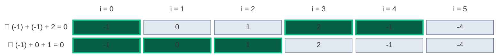
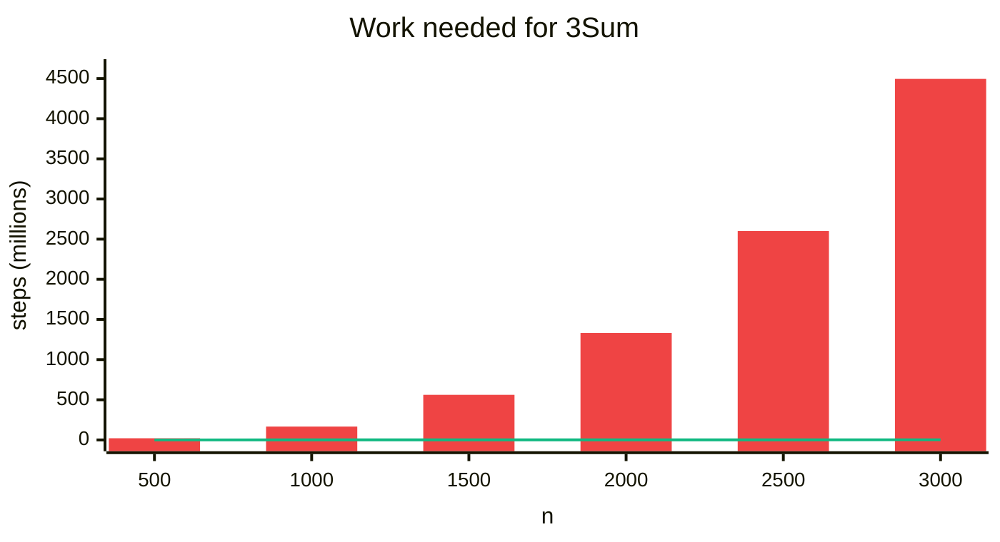
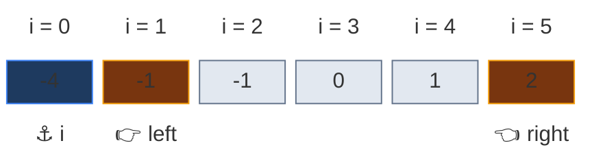
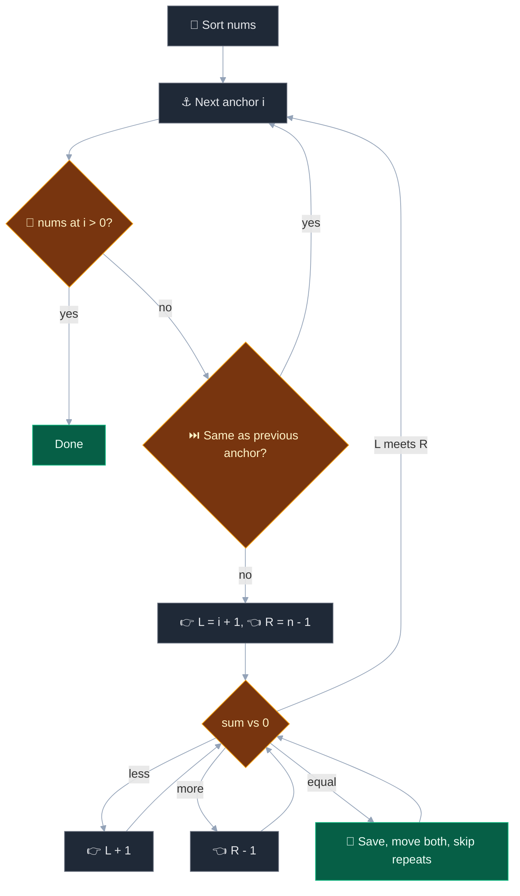
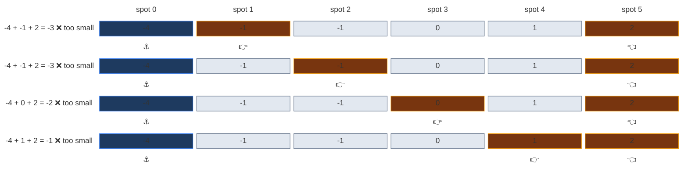
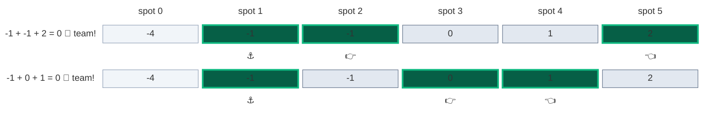
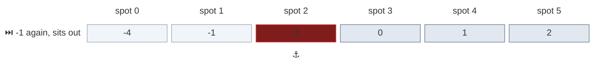
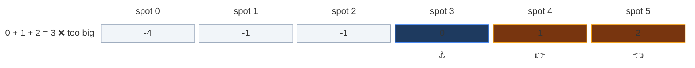

# 02. 15. 3Sum

| Difficulty | Pattern | Key idea | Source | Time | Space | Before / after |
|:---:|:---:|:---|:---:|:---:|:---:|:---:|
| **Medium** | Sorting + Two Pointers | Fix one number, find the other two with two pointers, skip repeats | [15. 3Sum](https://leetcode.com/problems/3sum/) | `O(n^2)` | `O(1)` extra | [1. Two Sum](01.%201.%20Two%20Sum.md) / [18. 4Sum](03.%2018.%204Sum.md) |

## 1. Problem Statement

You get an integer array `nums`.

Return all **unique** triplets `[a, b, c]` from three different positions such that `a + b + c == 0`.

- The same set of values must not appear twice in the answer.
- The order of the triplets, and inside each triplet, does not matter.

### Example

```text
Input:  nums = [-1, 0, 1, 2, -1, -4]
Output: [[-1, -1, 2], [-1, 0, 1]]
```



`[-1, 0, 1]` can be built in two ways (there are two `-1`s), but it is listed only **once**. We use this example in every section below.

Other LeetCode examples:

```text
nums = [0, 1, 1]  -> []
nums = [0, 0, 0]  -> [[0, 0, 0]]
```

### Constraints

- `3 <= nums.length <= 3000`
- `-10^5 <= nums[i] <= 10^5`

### What the constraints tell us (simple theory)

A **constraint** is the biggest input the judge will ever give you. A computer does about **100 million (10^8) simple steps per second**.

| Biggest input `n` | Steps you can afford | Ideas that fit | Steps at the biggest `n` | Time at 10^8 steps/sec |
|:---:|:---:|:---|:---:|:---:|
| up to ~500 | about `n^3` | Three nested loops | 500 × 500 × 500 = 125,000,000 | 1.25 s |
| up to ~5,000 | about `n^2` | One loop with a two-pointer scan inside | 5,000 × 5,000 = 25,000,000 | 0.25 s |
| up to ~1,000,000 | about `n log n` | Sorting, one loop | 1,000,000 × 20 = 20,000,000 | 0.2 s |

**For this problem:** `n` is at most `3000`.

- Brute force checks every group of three: about **4.5 billion** checks for `n = 3000`. Around 45 seconds. Too slow.
- Sort + fix one + two pointers: about **2.3 million** steps. A few hundredths of a second.

So `n <= 3000` is the judge telling you: `O(n^3)` fails, `O(n^2)` passes.

**How the work grows** (counted by running code on `[-n/2, ..., n/2 - 1]`). Red bars = brute force checks, green line = two-pointer steps.



| `n` | Brute force steps | Two-pointer steps | Brute force time at 10^8 steps/sec | Two-pointer time at 10^8 steps/sec | Two-pointer is faster by |
|:---:|:---:|:---:|:---:|:---:|:---:|
| 500 | 20,708,500 | 62,623 | 207.1 ms | 626 µs | about 331× |
| 1,000 | 166,167,000 | 250,248 | 1.7 s | 2.5 ms | about 664× |
| 1,500 | 561,375,500 | 562,873 | 5.6 s | 5.6 ms | about 997× |
| 2,000 | 1,331,334,000 | 1,000,498 | 13.3 s | 10.0 ms | about 1,331× |
| 2,500 | 2,601,042,500 | 1,563,123 | 26.0 s | 15.6 ms | about 1,664× |
| 3,000 | 4,495,501,000 | 2,250,748 | 45.0 s | 22.5 ms | about 1,997× |

## 2. Core Theory

### 🔑 Fix one, find two

- ⚓ Fix the first number `nums[i]` (the **anchor**).
- Now we need two more numbers that add to `-nums[i]`.
- That is Two Sum on the part to the right of the anchor.

### 📏 Why sort first

After sorting, Two Sum on a sorted range is easy with two pointers:

- Sum **too small** → we need a bigger number → 👉 `left` moves right.
- Sum **too big** → we need a smaller number → 👈 `right` moves left.
- Sum **= 0** → 🎯 save it, move both.



Sorting also puts **equal values next to each other**. That makes repeats easy to skip:

1. ⏭️ Skip an anchor equal to the previous anchor.
2. ⏭️ After a hit, skip `left` values equal to the one just used.
3. ⏭️ After a hit, skip `right` values equal to the one just used.

### 🛑 Early stop

If `nums[i] > 0`, every number to its right is also `> 0`. Three positive numbers can never sum to `0`. Stop.



## 3. Edge Cases

| Case | Input | Expected | Why it matters | Code that handles it |
|:---|:---|:---:|:---|:---|
| No answer | `[0, 1, 1]` | `[]` | The only triplet sums to 2 | `while left < right` ends with nothing saved |
| All zeros | `[0, 0, 0]` | `[[0, 0, 0]]` | One triplet | `s == 0` branch saves it |
| Many zeros | `[0, 0, 0, 0]` | `[[0, 0, 0]]` | Skips must collapse repeats; stop only on `> 0`, not `>= 0` | `if nums[i] > 0: break` and the two skip loops |
| All positive | `[1, 2, 3, 4]` | `[]` | Early stop fires at once | `if nums[i] > 0: break` |
| Heavy duplicates | `[-2, 0, 0, 2, 2]` | `[[-2, 0, 2]]` | Both `left` and `right` skips must work | `nums[left] == nums[left - 1]` and `nums[right] == nums[right + 1]` |

## 4. Brute Force: Try Every Triplet

### Idea

Three nested loops. For each triplet that sums to `0`, sort its three values and put them in a set to remove repeats.

### Code

```python
# Import List for type hints
from typing import List


# Brute force: all triplets, set for uniqueness
class SolutionBrute:

    # Main method
    def threeSum(self, nums: List[int]) -> List[List[int]]:

        # Number of elements
        n = len(nums)

        # Unique triplets as sorted tuples
        found = set()

        # First position
        for i in range(n):

            # Second position
            for j in range(i + 1, n):

                # Third position
                for k in range(j + 1, n):

                    # Sum is zero
                    if nums[i] + nums[j] + nums[k] == 0:

                        # Store in sorted form so repeats match
                        found.add(tuple(sorted((nums[i], nums[j], nums[k]))))

        # Turn tuples into lists, in sorted order
        return [list(t) for t in sorted(found)]
```

### Complexity

| Measure | Complexity | Why | At the limit (`n = 3000`) | Compared with brute force |
|:---|:---:|:---|:---:|:---|
| **Time** | `O(n^3)` | Three nested loops try every group of three positions | about 4,500,000,000 checks | This is the baseline |
| **Space** | `O(k)` | The set of `k` unique answers | one entry per unique triplet | This is the baseline |

## 5. Better Approach: Anchor + Hash Set

### Idea

For each anchor `i`, run the hash-set Two Sum (note 01) on the rest:

- For each `j > i`, the third value must be `-(nums[i] + nums[j])`.
- 📖 If it was seen between `i` and `j`, we have a triplet.
- Store sorted triplets in a set to remove repeats.

### Code

```python
# Better: fix one number, use a hash set for the other two
class SolutionBetter:

    # Main method
    def threeSum(self, nums: List[int]) -> List[List[int]]:

        # Number of elements
        n = len(nums)

        # Unique triplets as sorted tuples
        found = set()

        # Fix the first number
        for i in range(n):

            # Values seen after i in this round
            seen = set()

            # Second number
            for j in range(i + 1, n):

                # The value the third number must have
                third = -(nums[i] + nums[j])

                # Third number was seen between i and j
                if third in seen:

                    # Store in sorted form so repeats match
                    found.add(tuple(sorted((nums[i], nums[j], third))))

                # Remember this value for later j
                seen.add(nums[j])

        # Turn tuples into lists, in sorted order
        return [list(t) for t in sorted(found)]
```

### Complexity

| Measure | Complexity | Why | At the limit (`n = 3000`) | Compared with brute force |
|:---|:---:|:---|:---:|:---|
| **Time** | `O(n^2)` | Two loops, `O(1)` set work inside the inner loop | about 4,500,000 steps | About 1,000× fewer steps |
| **Space** | `O(n + k)` | The `seen` set plus the answer set | up to 3,000 values in `seen` | Needs extra memory |

Same speed as the optimal one, but it needs extra memory and a set to remove repeats.

## 6. Optimal Approach: Sort + Two Pointers

### Idea

1. Sort `nums`.
2. For each anchor `i`:
   - 🛑 If `nums[i] > 0`, stop.
   - ⏭️ If `i > 0` and `nums[i] == nums[i - 1]`, skip this anchor.
   - 👉 `left = i + 1`, 👈 `right = n - 1`. While `left < right`:
     - `s = nums[i] + nums[left] + nums[right]`.
     - `s < 0`: `left += 1`. `s > 0`: `right -= 1`.
     - `s == 0`: 🎯 save, move both, then skip repeats on both sides.

### Visual Walkthrough (Story Version)

**The story:** six kids hold number cards `-1, 0, 1, 2, -1, -4`. The teacher wants **teams of three** whose cards add to `0`, and no two teams with the same cards.

- 📏 First the kids line up by card: `-4, -1, -1, 0, 1, 2`.
- ⚓ One kid steps forward as **captain**.
- 👉 **Lefty** starts just right of the captain. 👈 **Righty** starts at the far end.
- Team total too small → Lefty moves right. Too big → Righty moves left.
- 🎯 Total `0` → write the team down, both helpers move, skipping kids with the same card.
- ⏭️ A captain with the same card as the last captain sits out. 🛑 A captain above `0` ends the game.

**How to read the pictures:** blue = captain, orange = Lefty and Righty trying, green = a team that works, grey = still in the line, light = left of the captain (not used this round).

**Round 1: captain `-4` (spot 0).** Every total is below 0, so Lefty keeps moving right until he meets Righty. No team.



**Round 2: captain `-1` (spot 1).** Two teams in a row!

- `-1 + -1 + 2 = 0` → 🎯 team `[-1, -1, 2]`. Lefty moves to `0`, Righty moves to `1`. Neither is a repeat, so no skipping.
- `-1 + 0 + 1 = 0` → 🎯 team `[-1, 0, 1]`. Both move and cross. Round over.



**Round 3: spot 2 has card `-1`, same as the last captain.** ⏭️ Sits out. Its teams would be the same as round 2.



**Round 4: captain `0` (spot 3).** `0 + 1 + 2 = 3` is too big, Righty moves left and meets Lefty. No team. No captain is left with two kids to its right, so the game ends.



**All steps at a glance**

| Step | `i` | `nums[i]` | `left` | `right` | `s` | Move | Teams | Why |
|:---:|:---:|:---:|:---:|:---:|:---:|:---|:---:|:---|
| 1 | 0 | -4 | 1 | 5 | -3 | 👉 left + 1 | 0 | -3 is below 0, we need a bigger number |
| 2 | 0 | -4 | 2 | 5 | -3 | 👉 left + 1 | 0 | still -3 (the second -1), need bigger |
| 3 | 0 | -4 | 3 | 5 | -2 | 👉 left + 1 | 0 | -2 is below 0, need bigger |
| 4 | 0 | -4 | 4 | 5 | -1 | 👉 left + 1, meets right | 0 | -1 is below 0; left reaches right, round ends |
| 5 | 1 | -1 | 2 | 5 | 0 | 🎯 save, left = 3, right = 4 | 1 | sum is 0: a team; next values 0 and 1 are not repeats |
| 6 | 1 | -1 | 3 | 4 | 0 | 🎯 save, left = 4, right = 3 | 2 | sum is 0: a team; the pointers cross |
| – | 2 | -1 | – | – | – | ⏭️ skip repeat anchor | 2 | -1 equals the last anchor, same teams again |
| 7 | 3 | 0 | 4 | 5 | 3 | 👈 right - 1, meets left | 2 | 3 is above 0, need smaller; right reaches left |

**What the story teaches**

| In the story | In the code | Why it matters |
|:---|:---|:---|
| 📏 Line up by card | `nums.sort()` | Makes the sum move in a known direction and groups repeats |
| ⚓ Captain | Anchor `i` | Turns 3Sum into Two Sum on the rest |
| 👉 Lefty, 👈 Righty | `left`, `right` | Scan the rest once per anchor |
| Too small, Lefty moves | `s < 0: left += 1` | A bigger left value is the only way to grow the sum |
| Too big, Righty moves | `s > 0: right -= 1` | A smaller right value is the only way to shrink the sum |
| 🎯 Write the team down | `res.append([...])` | Saves one unique triplet |
| Skip kids with the same card | `while left < right and nums[left] == nums[left - 1]` | Stops the same triplet being saved twice |
| ⏭️ Repeat captain sits out | `if i > 0 and nums[i] == nums[i - 1]: continue` | A repeat anchor would find the same teams |
| 🛑 Captain above 0 ends the game | `if nums[i] > 0: break` | Three positive numbers can never sum to 0 |

### Code

```python
# Solution for 15. 3Sum
class Solution:

    # Main method; trace collects (i, left, right, s) or (i, 'skip')
    def threeSum(self, nums: List[int], trace=None) -> List[List[int]]:

        # Sort so two pointers and duplicate skipping work
        nums.sort()

        # Number of elements
        n = len(nums)

        # The answer list
        res = []

        # Each anchor needs two numbers to its right
        for i in range(n - 2):

            # A positive anchor can never reach zero
            if nums[i] > 0:

                # Stop the whole search
                break

            # Same anchor as before gives the same triplets
            if i > 0 and nums[i] == nums[i - 1]:

                # Record the skip when tracing
                if trace is not None:

                    # Mark this anchor as skipped
                    trace.append((i, "skip"))

                # Skip it
                continue

            # Left pointer just after the anchor
            left = i + 1

            # Right pointer at the end
            right = n - 1

            # Search while the pointers have not met
            while left < right:

                # Sum of the three numbers
                s = nums[i] + nums[left] + nums[right]

                # Record this check when tracing
                if trace is not None:

                    # Save the pointers and the sum
                    trace.append((i, left, right, s))

                # Too small
                if s < 0:

                    # Need a bigger left value
                    left += 1

                # Too big
                elif s > 0:

                    # Need a smaller right value
                    right -= 1

                # Exactly zero
                else:

                    # Save the triplet
                    res.append([nums[i], nums[left], nums[right]])

                    # Move left past the used value
                    left += 1

                    # Move right past the used value
                    right -= 1

                    # Skip repeats on the left
                    while left < right and nums[left] == nums[left - 1]:

                        # Next left
                        left += 1

                    # Skip repeats on the right
                    while left < right and nums[right] == nums[right + 1]:

                        # Next right
                        right -= 1

        # Return all unique triplets
        return res


# Import random for the agreement tests
import random

# Run our example with the trace switched on
steps = []

# The answer from the walkthrough
assert Solution().threeSum([-1, 0, 1, 2, -1, -4], steps) == [[-1, -1, 2], [-1, 0, 1]]

# Every step matches the table above
assert steps == [(0, 1, 5, -3), (0, 2, 5, -3), (0, 3, 5, -2), (0, 4, 5, -1), (1, 2, 5, 0), (1, 3, 4, 0), (2, "skip"), (3, 4, 5, 3)]

# LeetCode example 2: no answer
assert Solution().threeSum([0, 1, 1]) == []

# LeetCode example 3: all zeros
assert Solution().threeSum([0, 0, 0]) == [[0, 0, 0]]

# Many zeros collapse to one triplet
assert Solution().threeSum([0, 0, 0, 0]) == [[0, 0, 0]]

# All positive: early stop
assert Solution().threeSum([1, 2, 3, 4]) == []

# Heavy duplicates on both sides
assert Solution().threeSum([-2, 0, 0, 2, 2]) == [[-2, 0, 2]]

# Fixed seed so the test is repeatable
random.seed(1)

# Many random cases
for _ in range(500):

    # Random small array with many repeats
    data = [random.randint(-6, 6) for _ in range(random.randint(3, 12))]

    # Brute force answer
    expect = SolutionBrute().threeSum(data[:])

    # Better must match
    assert SolutionBetter().threeSum(data[:]) == expect

    # Optimal must match (it returns them in sorted order too)
    assert Solution().threeSum(data[:]) == expect

# Big input at the limit
big = list(range(-1500, 1500))

# Every triplet in the big answer sums to zero
assert all(sum(t) == 0 for t in Solution().threeSum(big))

# All checks passed
print("All tests passed")
```

### Complexity

| Measure | Complexity | Why | At the limit (`n = 3000`) | Compared with brute force |
|:---|:---:|:---|:---:|:---|
| **Time** | `O(n^2)` | Sort is `O(n log n)`. Each anchor does one `O(n)` two-pointer pass | about 2,250,000 steps | About 2,000× fewer steps |
| **Space** | `O(1)` extra | Only pointers (Python's sort may use up to `O(n)` inside) | a few loop variables | No set needed for repeats |

## 7. Common Mistakes

| Mistake | What goes wrong | Fix |
|:---|:---|:---|
| Anchor skip with `nums[i] == nums[i + 1]` | Skips the first `-1`, so `[-1, -1, 2]` is lost | Compare back: `i > 0 and nums[i] == nums[i - 1]` |
| Skip repeats before moving the pointers | Compares a value with itself, never skips | Move `left` and `right` first, then skip |
| No `left < right` in the skip loops | Pointers run past each other, index error | Guard every skip loop |
| Stop on `nums[i] >= 0` | `[0, 0, 0]` is lost | Stop only on `nums[i] > 0` |

## 8. Interview Follow-ups

### Q1. Why move both pointers after a hit?

**Answer:**
- With `left` fixed, any other `right` value gives a different sum, so it cannot be `0` again unless the value repeats.
- The skip loops handle repeats. So both pointers must move to find a new pair.

### Q2. Does the `nums[i] > 0` stop ever lose an answer?

**Answer:**
- No. After sorting, `nums[left]` and `nums[right]` are `>= nums[i] > 0`.
- So every sum from there on is positive.

### Q3. Can you avoid sorting and still get `O(n^2)`?

**Answer:**
- Yes, with the hash set approach.
- But it needs `O(n)` extra space and a set to remove repeats.
- Sorting is `O(n log n)`, smaller than `O(n^2)`, so it costs nothing extra.

### Q4. How does this extend to 4Sum or kSum?

**Answer:**
- Add one more fixed number per level. The base case is always two-pointer Two Sum.
- kSum is `O(n^(k-1))`. See the next note.

### Q5. What if the target is not 0?

**Answer:**
- Compare `s` with `target` instead of `0`.
- The early stop `nums[i] > 0` is only safe when the target is `0`. A safe version: stop when `nums[i] > 0` and `nums[i] > target`.

## 9. Interview Explanation

> I sort the array, fix one number as an anchor, and look for two more numbers that cancel it, using two pointers on the part to its right. If the sum is too small I move the left pointer right, if too big I move the right pointer left, and on a hit I save the triplet and move both. Sorting puts equal values together, so I skip an anchor equal to the previous one and skip repeated values after each hit. That keeps triplets unique without a set. I stop early when the anchor is positive. It is O(n^2) time and O(1) extra space.
