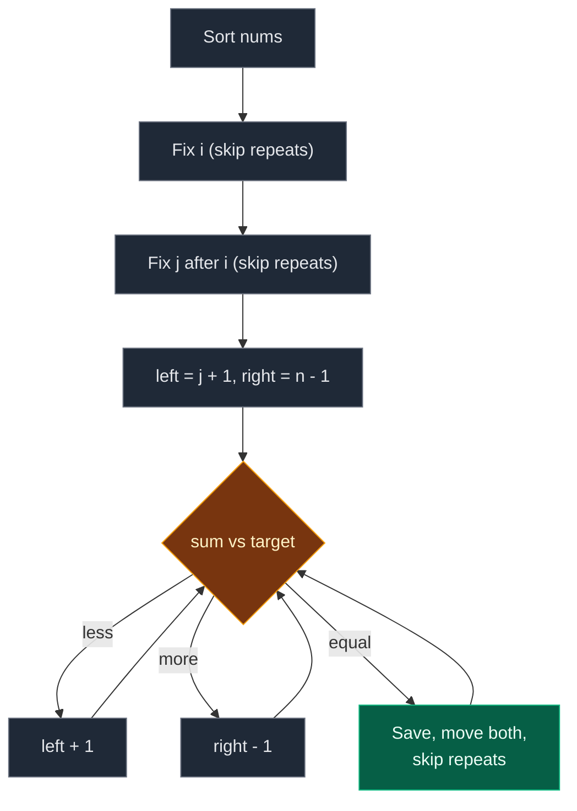

# 03. 18. 4Sum

| Difficulty | Pattern | Source | Time | Space |
|:---:|:---:|:---:|:---:|:---:|
| **Medium** | Sort + Fix Two + Two Pointers | [18. 4Sum](https://leetcode.com/problems/4sum/) | `O(n^3)` | `O(1)` extra |

## 1. Problem Statement

You get an integer array `nums` and an integer `target`.

Return all **unique** quadruplets `[a, b, c, d]` taken from four different positions such that `a + b + c + d == target`.

- The same set of four values must not appear twice in the answer.
- You may return the answer in any order.

### Example

```text
Input:  nums = [1, 0, -1, 0, -2, 2], target = 0
Output: [[-2, -1, 1, 2], [-2, 0, 0, 2], [-1, 0, 0, 1]]

-2 + -1 + 1 + 2 = 0
-2 +  0 + 0 + 2 = 0
-1 +  0 + 0 + 1 = 0
```

We use this same example in every section below.

### Constraints

- `1 <= nums.length <= 200`
- `-10^9 <= nums[i] <= 10^9`
- `-10^9 <= target <= 10^9`

## 2. Core Theory

### What the problem really asks

Pick four positions whose values add to `target`. Report each **set of values** once.

### Same idea as 3Sum, one more level

- 3Sum: fix **one** number, then two pointers.
- 4Sum: fix **two** numbers (`i` and `j`), then two pointers (`left`, `right`) for the last two.

```text
sorted: [-2, -1, 0, 0, 1, 2]
          i   j  L        R

sum < target  -> L moves right (bigger)
sum > target  -> R moves left  (smaller)
sum = target  -> save, move both, skip repeats
```

### Four places to skip repeats

Sorting puts equal values next to each other. We skip a value equal to the one just used at each level:

| Level | Skip rule |
|:---|:---|
| `i` | `i > 0 and nums[i] == nums[i - 1]` |
| `j` | `j > i + 1 and nums[j] == nums[j - 1]` |
| `left` (after a hit) | `nums[left] == nums[left - 1]` |
| `right` (after a hit) | `nums[right] == nums[right + 1]` |

The `j` rule uses `j > i + 1`, not `j > 0`. The first `j` after `i` is always allowed, even if it equals `nums[i]`. Otherwise `[2, 2, 2, 2]` would be lost.

### No `nums[i] > 0` early stop

In 3Sum the target is `0`, so a positive anchor can stop the search. Here the target can be anything, including negative. So that simple stop is not safe.



## 3. Edge Cases

| Case | Input | Expected | Why it matters |
|:---|:---|:---:|:---|
| Fewer than four numbers | `[1]`, `1` | `[]` | Loops must not run |
| Exactly four, hit | `[1, 2, 3, 4]`, `10` | `[[1, 2, 3, 4]]` | Smallest array with an answer |
| All the same | `[2, 2, 2, 2, 2]`, `8` | `[[2, 2, 2, 2]]` | All four skip rules fire. `j > i + 1` is needed |
| Many zeros | `[0, 0, 0, 0, 0]`, `0` | `[[0, 0, 0, 0]]` | No repeats in the answer |
| No answer | `[1, 2, 3, 4]`, `100` | `[]` | Target too big |
| Big values | `[10^9] * 4`, `4 * 10^9` | `[[10^9] * 4]` | Overflows 32-bit `int` in Java/C++ |

## 4. Brute Force: Try Every Quadruplet

### Idea

Four nested loops. For each quadruplet that hits `target`, sort its values and add the tuple to a set.

### Code

```python
# Import List for type hints
from typing import List


# Brute force: all quadruplets, set for uniqueness
class SolutionBrute:

    # Main method
    def fourSum(self, nums: List[int], target: int) -> List[List[int]]:

        # Number of elements
        n = len(nums)

        # Unique answers as sorted tuples
        found = set()

        # First position
        for a in range(n):

            # Second position
            for b in range(a + 1, n):

                # Third position
                for c in range(b + 1, n):

                    # Fourth position
                    for d in range(c + 1, n):

                        # Sum hits the target
                        if nums[a] + nums[b] + nums[c] + nums[d] == target:

                            # Store in sorted form so repeats match
                            found.add(tuple(sorted((nums[a], nums[b], nums[c], nums[d]))))

        # Turn tuples into lists, in sorted order
        return [list(t) for t in sorted(found)]
```

### Complexity

| Measure | Complexity | Why |
|:---|:---:|:---|
| **Time** | `O(n^4)` | Four nested loops |
| **Space** | `O(k)` | The set of `k` answers |

## 5. Better Approach: Fix Three + Hash Set

### Idea

Fix `i` and `j`. Then for each `k > j`, the fourth value must be `target - nums[i] - nums[j] - nums[k]`. Check a set of values seen between `j` and `k`. Store sorted tuples in a set to remove repeats.

### Code

```python
# Better: fix two numbers, hash set for the other two
class SolutionBetter:

    # Main method
    def fourSum(self, nums: List[int], target: int) -> List[List[int]]:

        # Number of elements
        n = len(nums)

        # Unique answers as sorted tuples
        found = set()

        # First number
        for i in range(n):

            # Second number
            for j in range(i + 1, n):

                # Values seen after j in this round
                seen = set()

                # Third number
                for k in range(j + 1, n):

                    # Value the fourth number must have
                    fourth = target - nums[i] - nums[j] - nums[k]

                    # Fourth number was seen between j and k
                    if fourth in seen:

                        # Store in sorted form so repeats match
                        found.add(tuple(sorted((nums[i], nums[j], nums[k], fourth))))

                    # Remember this value for later k
                    seen.add(nums[k])

        # Turn tuples into lists, in sorted order
        return [list(t) for t in sorted(found)]
```

### Complexity

| Measure | Complexity | Why |
|:---|:---:|:---|
| **Time** | `O(n^3)` | Three loops, `O(1)` set work inside |
| **Space** | `O(n + k)` | The `seen` set plus the answer set |

Same speed as the optimal one, but it needs extra memory and a set to remove repeats.

## 6. Optimal Approach: Sort + Fix Two + Two Pointers

### Idea

1. Sort `nums`.
2. For `i` in `0 .. n-4` (skip repeats).
3. For `j` in `i+1 .. n-3` (skip repeats with `j > i + 1`).
4. `left = j + 1`, `right = n - 1`. While `left < right`:
   - `s = nums[i] + nums[j] + nums[left] + nums[right]`.
   - `s < target`: `left += 1`. `s > target`: `right -= 1`.
   - `s == target`: save, move both, skip repeats on both sides.

### Visual Walkthrough (Story Version)

Before the code, let us see the idea as a story.

**The story:** six kids hold number cards: `1, 0, -1, 0, -2, 2`. The teacher wants **teams of four** whose cards add up to `0`. No two teams may have the same cards.

**First, line up by card number:**

```text
spot:  0    1    2    3    4    5
     [-2] [-1] [ 0] [ 0] [ 1] [ 2]
```

**The rules:**

- Two kids step forward: the **captain** (`i`) and the **vice-captain** (`j`, to the right of the captain).
- Two helpers find the last two members: **Lefty** starts just right of the vice-captain (`L`), **Righty** at the far end (`R`).
- Total too small? Lefty moves right. Too big? Righty moves left. Exactly `0`? Write the team down, both helpers move.
- A captain or vice-captain with the same card as the one before them sits out (same teams again).

**How to read the pictures:** `C` = captain, `V` = vice-captain, `L` = Lefty, `R` = Righty.

**Captain `-2`, vice-captain `-1`**

```text
     [-2] [-1] [ 0] [ 0] [ 1] [ 2]
       C    V    L              R     total = -2 -1 +0 +2 = -1   too small, L right
```

```text
     [-2] [-1] [ 0] [ 0] [ 1] [ 2]
       C    V         L         R     total = -2 -1 +0 +2 = -1   too small, L right
```

```text
     [-2] [-1] [ 0] [ 0] [ 1] [ 2]
       C    V              L    R     total = -2 -1 +1 +2 = 0    TEAM [-2,-1,1,2]!
```

Both helpers move and cross. Next vice-captain.

**Captain `-2`, vice-captain `0` (spot 2)**

```text
     [-2] [-1] [ 0] [ 0] [ 1] [ 2]
       C         V    L         R     total = -2 +0 +0 +2 = 0    TEAM [-2,0,0,2]!
```

Both helpers move and meet at spot 4. Next vice-captain.

**Captain `-2`, vice-captain spot 3**

```text
     [-2] [-1] [ 0] [ 0] [ 1] [ 2]
       C              V               card 0 again, same as last vice-captain: sit out
```

**Captain `-1`, vice-captain `0` (spot 2)**

```text
     [-2] [-1] [ 0] [ 0] [ 1] [ 2]
            C    V    L         R     total = -1 +0 +0 +2 = 1    too big, R left
```

```text
     [-2] [-1] [ 0] [ 0] [ 1] [ 2]
            C    V    L    R          total = -1 +0 +0 +1 = 0    TEAM [-1,0,0,1]!
```

Both helpers move and cross. Next vice-captain.

**Captain `-1`, vice-captain spot 3**

```text
     [-2] [-1] [ 0] [ 0] [ 1] [ 2]
            C         V               card 0 again: sit out
```

**Captain `0` (spot 2), vice-captain `0` (spot 3)**

```text
     [-2] [-1] [ 0] [ 0] [ 1] [ 2]
                 C    V    L    R     total = 0 +0 +1 +2 = 3     too big, R left
```

Righty meets Lefty. No more captains (a captain needs three kids to its right). Done.

Teams: `[-2, -1, 1, 2]`, `[-2, 0, 0, 2]`, `[-1, 0, 0, 1]`.

**All steps at a glance**

| Captain | Vice | Lefty | Righty | Total | Move | Teams so far |
|:---:|:---:|:---:|:---:|:---:|:---|:---:|
| -2 | -1 | 0 (spot 2) | 2 | -1 | L right | 0 |
| -2 | -1 | 0 (spot 3) | 2 | -1 | L right | 0 |
| -2 | -1 | 1 | 2 | 0 | Save, cross | 1 |
| -2 | 0 (spot 2) | 0 | 2 | 0 | Save, meet | 2 |
| -2 | 0 (spot 3) | – | – | – | Sit out | 2 |
| -1 | 0 (spot 2) | 0 | 2 | 1 | R left | 2 |
| -1 | 0 (spot 2) | 0 | 1 | 0 | Save, cross | 3 |
| -1 | 0 (spot 3) | – | – | – | Sit out | 3 |
| 0 | 0 | 1 | 2 | 3 | R left, meet | 3 |

**What the story teaches**

| In the story | In the code |
|:---|:---|
| Line up by card | `nums.sort()` |
| Captain | `i` |
| Vice-captain | `j` |
| Lefty, Righty | `left`, `right` |
| Too small / too big | `s < target` / `s > target` |
| Write the team down | `res.append([...])` |
| Repeat vice-captain sits out | `j > i + 1 and nums[j] == nums[j - 1]` |
| Repeat captain sits out | `i > 0 and nums[i] == nums[i - 1]` |

Now the same steps again, this time with the exact variables.

### Step-by-Step Example

```text
nums = [1, 0, -1, 0, -2, 2], target = 0
after sort: [-2, -1, 0, 0, 1, 2]
n = 6, i in 0..2, j in i+1..3
res = []
```

**`i = 0` (`-2`). `i > 0`? No, so no repeat check.**

**`j = 1` (`-1`). `j > i + 1`? No, so no repeat check.**

1. `left = 2`, `right = 5`.
2. `s = -2 + -1 + 0 + 2 = -1`. Less than `0`. `left = 3`.
3. `s = -2 + -1 + 0 + 2 = -1`. Less than `0`. `left = 4`.
4. `s = -2 + -1 + 1 + 2 = 0`. Hit! Save `[-2, -1, 1, 2]`. `left = 5`, `right = 4`.
5. Skip loops do not run (`left < right` is false). Inner loop ends.

```text
res = [[-2, -1, 1, 2]]
```

**`j = 2` (`0`). `j > i + 1` (`2 > 1`) and `nums[2] == nums[1]` (`0 == -1`)? No.**

1. `left = 3`, `right = 5`.
2. `s = -2 + 0 + 0 + 2 = 0`. Hit! Save `[-2, 0, 0, 2]`. `left = 4`, `right = 4`.
3. Inner loop ends (`4 < 4` is false).

```text
res = [[-2, -1, 1, 2], [-2, 0, 0, 2]]
```

**`j = 3` (`0`). `j > i + 1` (`3 > 1`) and `nums[3] == nums[2]` (`0 == 0`)? Yes. Skip.**

**`i = 1` (`-1`). `nums[1] == nums[0]` (`-1 == -2`)? No.**

**`j = 2` (`0`). `j > i + 1` (`2 > 2`)? No, so no skip.**

1. `left = 3`, `right = 5`.
2. `s = -1 + 0 + 0 + 2 = 1`. More than `0`. `right = 4`.
3. `s = -1 + 0 + 0 + 1 = 0`. Hit! Save `[-1, 0, 0, 1]`. `left = 4`, `right = 3`.
4. Inner loop ends.

```text
res = [[-2, -1, 1, 2], [-2, 0, 0, 2], [-1, 0, 0, 1]]
```

**`j = 3` (`0`). `j > i + 1` (`3 > 2`) and `nums[3] == nums[2]`? Yes. Skip.**

**`i = 2` (`0`). `nums[2] == nums[1]` (`0 == -1`)? No.**

**`j = 3` (`0`). `j > i + 1` (`3 > 3`)? No, so no skip.**

1. `left = 4`, `right = 5`.
2. `s = 0 + 0 + 1 + 2 = 3`. More than `0`. `right = 4`.
3. Inner loop ends.

**End:** return `[[-2, -1, 1, 2], [-2, 0, 0, 2], [-1, 0, 0, 1]]`.

| i | j | left | right | s | Action | res size |
|:---:|:---:|:---:|:---:|:---:|:---|:---:|
| 0 | 1 | 2 | 5 | -1 | left+1 | 0 |
| 0 | 1 | 3 | 5 | -1 | left+1 | 0 |
| 0 | 1 | 4 | 5 | 0 | Save, left=5, right=4 | 1 |
| 0 | 2 | 3 | 5 | 0 | Save, left=4, right=4 | 2 |
| 0 | 3 | – | – | – | Skip repeat j | 2 |
| 1 | 2 | 3 | 5 | 1 | right-1 | 2 |
| 1 | 2 | 3 | 4 | 0 | Save, left=4, right=3 | 3 |
| 1 | 3 | – | – | – | Skip repeat j | 3 |
| 2 | 3 | 4 | 5 | 3 | right-1 | 3 |

### Code

```python
# Solution for 18. 4Sum
class Solution:

    # Main method
    def fourSum(self, nums: List[int], target: int) -> List[List[int]]:

        # Sort so two pointers and duplicate skipping work
        nums.sort()

        # Number of elements
        n = len(nums)

        # The answer list
        res = []

        # First fixed number, needs three numbers to its right
        for i in range(n - 3):

            # Same first number as before gives the same answers
            if i > 0 and nums[i] == nums[i - 1]:

                # Skip it
                continue

            # Second fixed number, needs two numbers to its right
            for j in range(i + 1, n - 2):

                # Same second number as before (in this i round)
                if j > i + 1 and nums[j] == nums[j - 1]:

                    # Skip it
                    continue

                # Left pointer just after j
                left = j + 1

                # Right pointer at the end
                right = n - 1

                # Search while the pointers have not met
                while left < right:

                    # Sum of the four numbers
                    s = nums[i] + nums[j] + nums[left] + nums[right]

                    # Too small
                    if s < target:

                        # Need a bigger left value
                        left += 1

                    # Too big
                    elif s > target:

                        # Need a smaller right value
                        right -= 1

                    # Exactly the target
                    else:

                        # Save the quadruplet
                        res.append([nums[i], nums[j], nums[left], nums[right]])

                        # Move left past the used value
                        left += 1

                        # Move right past the used value
                        right -= 1

                        # Skip repeats on the left
                        while left < right and nums[left] == nums[left - 1]:

                            # Next left
                            left += 1

                        # Skip repeats on the right
                        while left < right and nums[right] == nums[right + 1]:

                            # Next right
                            right -= 1

        # Return all unique quadruplets
        return res


# Replay the example step by step and log every comparison
nums, target = sorted([1, 0, -1, 0, -2, 2]), 0

# The sorted array
assert nums == [-2, -1, 0, 0, 1, 2]

# Expected log: (i, j, left, right, s), or (i, j, 'skip') for a skipped j
expected_log = [
    (0, 1, 2, 5, -1),
    (0, 1, 3, 5, -1),
    (0, 1, 4, 5, 0),
    (0, 2, 3, 5, 0),
    (0, 3, "skip"),
    (1, 2, 3, 5, 1),
    (1, 2, 3, 4, 0),
    (1, 3, "skip"),
    (2, 3, 4, 5, 3),
]

# What actually happens
log = []

# Answers found
res = []

# Number of elements
n = len(nums)

# Same outer loop
for i in range(n - 3):

    # Same i skip
    if i > 0 and nums[i] == nums[i - 1]:

        # Record and skip
        log.append((i, "skip"))

        # Next i
        continue

    # Same middle loop
    for j in range(i + 1, n - 2):

        # Same j skip
        if j > i + 1 and nums[j] == nums[j - 1]:

            # Record the skip
            log.append((i, j, "skip"))

            # Next j
            continue

        # Same pointers
        left, right = j + 1, n - 1

        # Same inner loop
        while left < right:

            # Same sum
            s = nums[i] + nums[j] + nums[left] + nums[right]

            # Record this comparison
            log.append((i, j, left, right, s))

            # Too small
            if s < target:

                # Move left
                left += 1

            # Too big
            elif s > target:

                # Move right
                right -= 1

            # Hit
            else:

                # Save it
                res.append([nums[i], nums[j], nums[left], nums[right]])

                # Move both
                left, right = left + 1, right - 1

                # Skip left repeats
                while left < right and nums[left] == nums[left - 1]:

                    # Next left
                    left += 1

                # Skip right repeats
                while left < right and nums[right] == nums[right + 1]:

                    # Next right
                    right -= 1

# Every comparison matches the traced table
assert log == expected_log

# The traced answer
assert res == [[-2, -1, 1, 2], [-2, 0, 0, 2], [-1, 0, 0, 1]]

# Full solution on the example
assert Solution().fourSum([1, 0, -1, 0, -2, 2], 0) == [[-2, -1, 1, 2], [-2, 0, 0, 2], [-1, 0, 0, 1]]

# LeetCode example 2: all the same
assert Solution().fourSum([2, 2, 2, 2, 2], 8) == [[2, 2, 2, 2]]

# Fewer than four numbers
assert Solution().fourSum([1], 1) == []

# Exactly four, hit
assert Solution().fourSum([1, 2, 3, 4], 10) == [[1, 2, 3, 4]]

# Many zeros
assert Solution().fourSum([0, 0, 0, 0, 0], 0) == [[0, 0, 0, 0]]

# No answer
assert Solution().fourSum([1, 2, 3, 4], 100) == []

# Big values
assert Solution().fourSum([10**9] * 4, 4 * 10**9) == [[10**9] * 4]

# Random tests: brute, better and optimal must agree
import random

# Fixed seed so the test is repeatable
random.seed(18)

# Many random cases
for _ in range(200):

    # Small array with many repeats
    data = [random.randint(-4, 4) for _ in range(random.randint(1, 9))]

    # Random target
    t = random.randint(-6, 6)

    # Brute force answer (already sorted)
    want = SolutionBrute().fourSum(list(data), t)

    # Better must match
    assert SolutionBetter().fourSum(list(data), t) == want

    # Optimal must match (its output is in sorted order too)
    assert Solution().fourSum(list(data), t) == want

# All checks passed
print("All tests passed")
```

### Complexity

| Measure | Complexity | Why |
|:---|:---:|:---|
| **Time** | `O(n^3)` | Two fixed loops, each pair does one `O(n)` two-pointer pass |
| **Space** | `O(1)` extra | Only pointers (sorting may use some memory inside Python) |

## 7. Common Mistakes

| Mistake | What goes wrong | Fix |
|:---|:---|:---|
| `j` skip with `j > 0` instead of `j > i + 1` | Skips the first `j` when it equals `nums[i]`. `[2, 2, 2, 2]` is lost | Use `j > i + 1` |
| Copying 3Sum's `nums[i] > 0: break` | Wrong for a negative target | Drop it, or use a safe bound check |
| Not skipping `left`/`right` repeats | The same quadruplet is saved many times | Move both, then skip equal runs |
| 32-bit sums in Java/C++ | Four values near `10^9` overflow | Use `long` / `long long` |
| Not sorting first | The sum does not change in a predictable way | `nums.sort()` first |

## 8. Interview Follow-ups

### Q1. How do you generalize this to kSum?

**Answer:**
- Write a recursive function `kSum(start, k, target)`.
- If `k == 2`, run the two-pointer Two Sum.
- Otherwise fix one number (skip repeats) and call `kSum(i + 1, k - 1, target - nums[i])`.
- Time `O(n^(k-1))`.

### Q2. Can we prune to go faster?

**Answer:**
- Yes. If the smallest possible sum for this `i` (`nums[i] + nums[i+1] + nums[i+2] + nums[i+3]`) is above `target`, stop.
- If the biggest possible sum (`nums[i]` plus the last three) is below `target`, skip this `i`.
- The worst case stays `O(n^3)`, but real runs are faster.

### Q3. Can 4Sum be faster than `O(n^3)`?

**Answer:**
- Using a map of all pair sums gives about `O(n^2)` on average for the "does one exist?" question.
- But listing unique quadruplets with distinct indices gets messy. `O(n^3)` is the normal interview answer.

### Q4. What if we only need the count of index quadruplets (LeetCode 454, four arrays)?

**Answer:**
- Store all sums `a + b` from the first two arrays in a counter.
- For each `c + d`, add `counter[-(c + d)]`.
- `O(n^2)` time and space.

### Q5. Where does overflow matter?

**Answer:**
- In Java/C++, four numbers of size `10^9` add up past the 32-bit limit.
- Use `long`. Python has no limit, so it is safe.

## 9. Interview Explanation

> I sort the array, then fix the first two numbers with two loops and find the last two with two pointers on the rest. If the sum is too small I move the left pointer right, if too big I move the right pointer left, and on a hit I save it and move both. To keep answers unique I skip repeated values at all four levels; for the second number the skip starts only after the first choice, so cases like four equal numbers still work. It is O(n^3) time and O(1) extra space, and in Java or C++ I would use 64-bit sums.
