# 03. 18. 4Sum

| Difficulty | Pattern | Key idea | Source | Time | Space | Before in this folder |
|:---:|:---:|:---|:---:|:---:|:---:|:---:|
| **Medium** | Sort + Fix Two + Two Pointers | Fix two numbers, find the last two with two pointers, skip repeats at all four levels | [18. 4Sum](https://leetcode.com/problems/4sum/) | `O(n^3)` | `O(1)` extra | [15. 3Sum](02.%2015.%203Sum.md) |

## 1. Problem Statement

You get an integer array `nums` and an integer `target`.

Return all **unique** quadruplets `[a, b, c, d]` from four different positions such that `a + b + c + d == target`.

- The same set of four values must not appear twice in the answer.
- You may return the answer in any order.

### Example

```text
Input:  nums = [-3, 0, 1, 0, 0, 4, 4], target = 1
Output: [[-3, 0, 0, 4], [0, 0, 0, 1]]
```

This example has every tricky part of the problem:

- Three `0`s and two `4`s, so the same team can be built in many ways. Each team must be listed **once**.
- The target is **not** 0, so the 3Sum early stop does not apply.

We use this example in every section below. Smaller LeetCode examples:

```text
nums = [1, 0, -1, 0, -2, 2], target = 0   gives [[-2, -1, 1, 2], [-2, 0, 0, 2], [-1, 0, 0, 1]]
nums = [2, 2, 2, 2, 2],      target = 8   gives [[2, 2, 2, 2]]
```

### Constraints, in plain words

| Limit | What it means in plain words | What it tells us |
|:---|:---|:---|
| `1 <= nums.length <= 200` | The list has at most 200 numbers. It can even have fewer than 4 | Three nested loops (about 8 million steps) are fine; four loops are slow. With fewer than 4 numbers the answer is empty |
| `-10^9 <= nums[i] <= 10^9` | Numbers can be negative, and as big as one billion | Four of them add up to four billion. That does not fit in a normal 32-bit `int`. Fine in Python; in Java or C++ use `long` |
| `-10^9 <= target <= 10^9` | The target can be any number, even negative | The 3Sum trick "stop when the first number is above 0" is not safe here |

**How fast is fast enough?**

- The judge gives your code about **1 second**, and a computer does roughly **100 million** simple steps in 1 second.
- **Try every group of four:** 200 numbers make about **65 million** groups, and each one needs sorting and a set insert. Too slow in practice.
- **Sort, fix two numbers, two pointers for the rest:** about **1.1 million** steps. That is about a hundredth of a second.

In the chart, the grey bars are brute force groups and the orange line is the two-pointer method. Every number was counted by running the code on the list `[-n/2, ..., n/2 - 1]` with target 0.

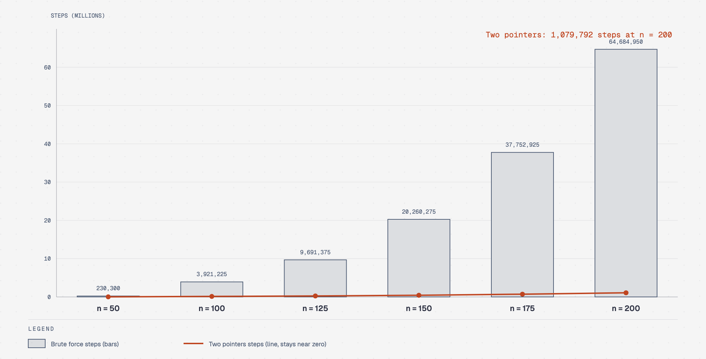

| List size `n` | Brute force groups | Two-pointer steps | Brute force time (at 100 million steps per second) | Two-pointer time | Two pointers are faster by |
|:---:|:---:|:---:|:---:|:---:|:---:|
| 50 | 230,300 | 15,467 | 2.3 milliseconds | 0.15 milliseconds | about 15 times |
| 100 | 3,921,225 | 131,145 | 39 milliseconds | 1.3 milliseconds | about 30 times |
| 125 | 9,691,375 | 259,074 | 97 milliseconds | 2.6 milliseconds | about 37 times |
| 150 | 20,260,275 | 451,198 | 203 milliseconds | 4.5 milliseconds | about 45 times |
| 175 | 37,752,925 | 720,360 | 378 milliseconds | 7.2 milliseconds | about 52 times |
| 200 | 64,684,950 | 1,079,792 | 647 milliseconds | 10.8 milliseconds | about 60 times |

## 2. Core Idea

### Same idea as 3Sum, one more level

- 3Sum: fix **one** number, then two pointers.
- 4Sum: fix **two** numbers (`i` and `j`), then `left` and `right` find the last two.

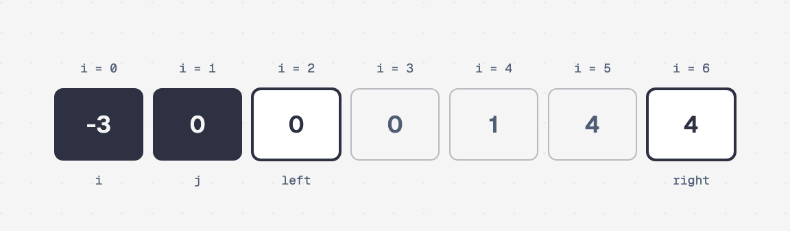

- Sum **smaller than target**: `left` moves right to a bigger number.
- Sum **bigger than target**: `right` moves left to a smaller number.
- Sum **equal to target**: save the team, move both, skip repeats.

### Four places to skip repeats

Sorting puts equal values next to each other. At each level, skip a value equal to the one just used:

| Level | Skip rule | Why | In our example |
|:---|:---|:---|:---|
| `i` | `i > 0 and nums[i] == nums[i - 1]` | A repeated first number finds the same teams again | Fires twice: the `0`s at i = 2 and i = 3 |
| `j` | `j > i + 1 and nums[j] == nums[j - 1]` | A repeated second number (in the same `i` round) finds the same teams | Fires three times: the extra `0`s in rounds 1 and 2 |
| `left` (after a hit) | `nums[left] == nums[left - 1]` | The next left value would build the same team | Fires once: after saving `[-3, 0, 0, 4]`, `left` skips the third `0` |
| `right` (after a hit) | `nums[right] == nums[right + 1]` | The next right value would build the same team | Fires once: after saving `[-3, 0, 0, 4]`, `right` skips the second `4` |

The `j` rule uses `j > i + 1`, not `j > 0`. The **first** `j` after `i` is always allowed, even if it equals `nums[i]`. Otherwise `[2, 2, 2, 2]` would be lost:

![On [2, 2, 2, 2, 2] with target 8, the rule j > i + 1 keeps the first j and finds the team; the rule j > 0 skips it and loses the answer](images/four-sum-j-rule.png)

### No early stop on `nums[i] > 0`

In 3Sum the target is `0`, so a positive first number can stop the search. Here the target can be anything, even negative. So that simple stop is not safe.

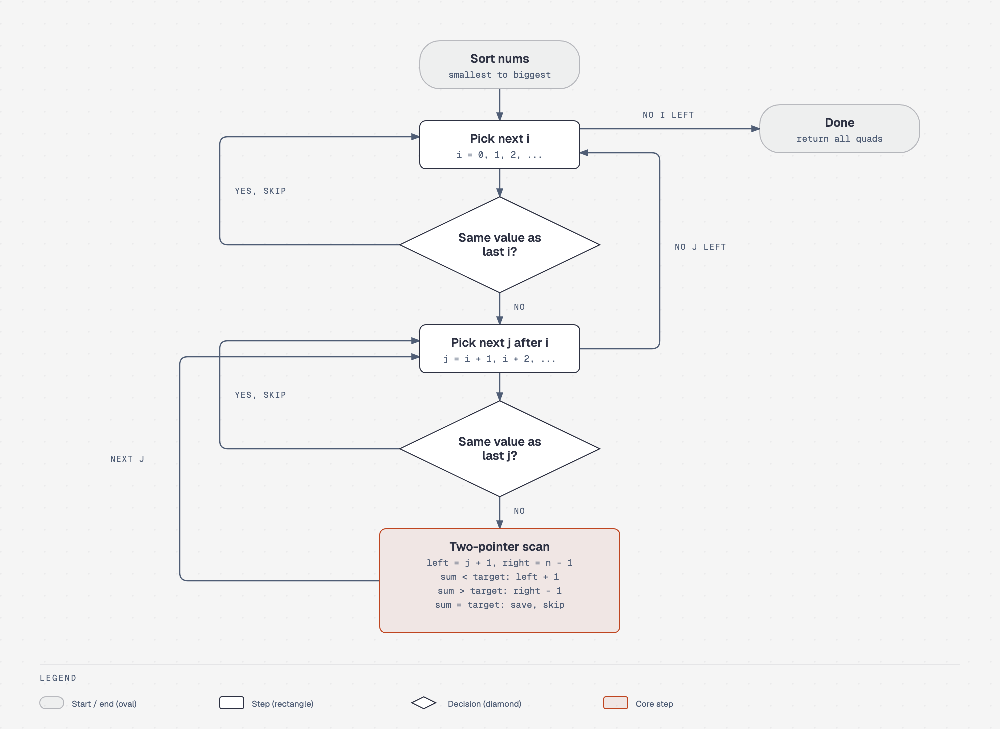

## 3. Edge Cases

| Case | Input | Expected | Why it matters | Code that handles it |
|:---|:---|:---:|:---|:---|
| Fewer than four numbers | `[1]`, `1` | `[]` | The loops must not run at all | `range(n - 3)` is empty |
| Exactly four, hit | `[1, 2, 3, 4]`, `10` | `[[1, 2, 3, 4]]` | Smallest list with an answer | One `i`, one `j`, one check |
| All the same | `[2, 2, 2, 2, 2]`, `8` | `[[2, 2, 2, 2]]` | All four skip rules fire; `j > i + 1` is needed | `if j > i + 1 and nums[j] == nums[j - 1]` |
| No answer | `[1, 2, 3, 4]`, `100` | `[]` | The target is too big for any team | `while left < right` ends with nothing saved |
| Big values | `[10^9] * 4`, `-294967296` | `[]` | In a 32-bit `int` the sum wraps around to `-294967296` and gives a wrong hit | Python integers never wrap; use `long` in Java or C++ |

## 4. Brute Force: Try Every Quadruplet

### Idea

Four nested loops. For each group that hits `target`, sort its values and put them in a set to remove repeats. On our example it checks all 35 groups of four.

### Code

```python
# Import List for type hints
from typing import List


# Brute force: all quadruplets, set for uniqueness
class SolutionBrute:

    # Main method
    def fourSum(self, nums: List[int], target: int) -> List[List[int]]:

        # Number of elements
        n = len(nums)

        # Unique answers as sorted tuples
        found = set()

        # First position
        for a in range(n):

            # Second position
            for b in range(a + 1, n):

                # Third position
                for c in range(b + 1, n):

                    # Fourth position
                    for d in range(c + 1, n):

                        # Sum hits the target
                        if nums[a] + nums[b] + nums[c] + nums[d] == target:

                            # Store in sorted form so repeats match
                            found.add(tuple(sorted((nums[a], nums[b], nums[c], nums[d]))))

        # Turn tuples into lists, in sorted order
        return [list(t) for t in sorted(found)]
```

### Complexity

| Measure | Complexity | Why | At the limit (`n = 200`) | Compared with brute force |
|:---|:---:|:---|:---:|:---|
| **Time** | `O(n^4)` | Four nested loops try every group of four positions | about 65,000,000 groups | This is the baseline |
| **Space** | `O(k)` | The set of `k` unique answers, stored as sorted tuples | one entry per unique quadruplet | This is the baseline |

## 5. Better Approach: Fix Three + Hash Set

### Idea

Fix `i` and `j`. For each `k > j`, the fourth value must be `target - nums[i] - nums[j] - nums[k]`. Check a set of the values seen between `j` and `k`. Store sorted tuples in a set to remove repeats.

It is as fast as the optimal method, but it needs extra memory and a set to remove repeats.

### Code

```python
# Better: fix two numbers, hash set for the other two
class SolutionBetter:

    # Main method
    def fourSum(self, nums: List[int], target: int) -> List[List[int]]:

        # Number of elements
        n = len(nums)

        # Unique answers as sorted tuples
        found = set()

        # First number
        for i in range(n):

            # Second number
            for j in range(i + 1, n):

                # Values seen after j in this round
                seen = set()

                # Third number
                for k in range(j + 1, n):

                    # Value the fourth number must have
                    fourth = target - nums[i] - nums[j] - nums[k]

                    # Fourth number was seen between j and k
                    if fourth in seen:

                        # Store in sorted form so repeats match
                        found.add(tuple(sorted((nums[i], nums[j], nums[k], fourth))))

                    # Remember this value for later k
                    seen.add(nums[k])

        # Turn tuples into lists, in sorted order
        return [list(t) for t in sorted(found)]
```

### Complexity

| Measure | Complexity | Why | At the limit (`n = 200`) | Compared with brute force |
|:---|:---:|:---|:---:|:---|
| **Time** | `O(n^3)` | Three loops, `O(1)` set work inside the innermost loop | about 1,300,000 steps | About 50 times fewer steps |
| **Space** | `O(n + k)` | The `seen` set plus the answer set | up to 200 values in `seen` | Needs extra memory |

## 6. Optimal Approach: Sort + Fix Two + Two Pointers

### Idea

1. Sort `nums`.
2. For each `i` (skip repeats).
3. For each `j > i` (skip repeats, but only when `j > i + 1`).
4. Set `left = j + 1` and `right = n - 1`. While `left < right`:
   - `s = nums[i] + nums[j] + nums[left] + nums[right]`.
   - `s < target`: `left += 1`. `s > target`: `right -= 1`.
   - `s == target`: save, move both, skip repeats on both sides.

### Run it on our example, step by step

**The array we take:** `nums = [-3, 0, 1, 0, 0, 4, 4]`, `target = 1`.

**Before the steps:** sort it. `sorted = [-3, 0, 0, 0, 1, 4, 4]`. Every step below works on this sorted list.

Think of seven kids holding number cards, lined up by card. A **captain** (`i`) and a **vice-captain** (`j`) step forward. Two helpers, **left** and **right**, look for the last two members so the four cards add up to 1.

**How to read the pictures:** dark boxes = `i` and `j`, bold white boxes = `left` and `right`, orange = a team that adds up to 1, dashed = a repeated value that is skipped, faded = numbers to the left of `i` (they were already used as `i`).

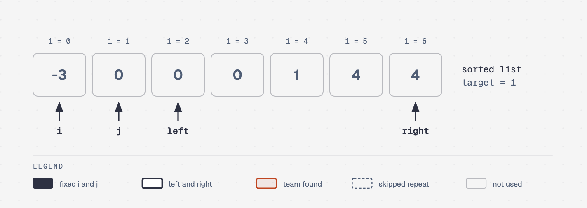

**Step 1: i `-3`, j `0`, left `0`, right `4`**

- Sum: `-3 + 0 + 0 + 4 = 1`. That is exactly the target. Save `[-3, 0, 0, 4]`.
- Move both pointers: `left` goes to i = 3, `right` goes to i = 5.
- `left` now sits on `0` again, the value just used. Skip it: `left` moves to i = 4.
- `right` now sits on `4` again, the value just used. Skip it: `right` moves to i = 4.
- `left` and `right` have met or crossed. This scan is over.
- Teams so far: `[-3, 0, 0, 4]`.

![Step 1: i = -3, j = 0, left = 0, right = 4; -3 + 0 + 0 + 4 = 1, equal to 1; save [-3, 0, 0, 4]](images/four-sum-step-1.png)

**Step 2: i = `-3`, j at index 2 is `0` again, skip**

- The last `j` in this round was also `0`. It would find the same teams again.
- Skip it and go to the next `j`.

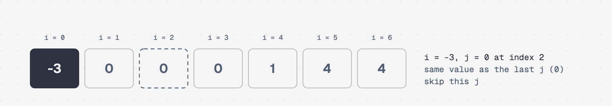

**Step 3: i = `-3`, j at index 3 is `0` again, skip**

- The last `j` in this round was also `0`. It would find the same teams again.
- Skip it and go to the next `j`.


**Step 4: i `-3`, j `1`, left `4`, right `4`**

- Sum: `-3 + 1 + 4 + 4 = 6`. That is bigger than 1.
- We need a smaller sum, so `right` moves one step left, to i = 5.
- `left` and `right` have met. This scan is over.

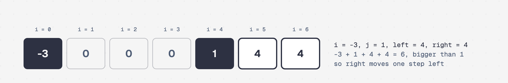

**Step 5: i `0`, j `0`, left `0`, right `4`**

- Sum: `0 + 0 + 0 + 4 = 4`. That is bigger than 1.
- We need a smaller sum, so `right` moves one step left, to i = 5.

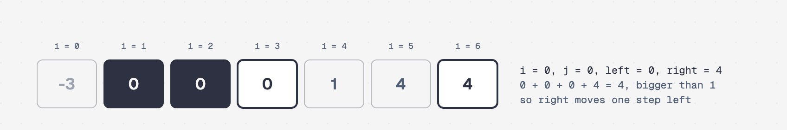

**Step 6: i `0`, j `0`, left `0`, right `4`**

- Sum: `0 + 0 + 0 + 4 = 4`. That is bigger than 1.
- We need a smaller sum, so `right` moves one step left, to i = 4.

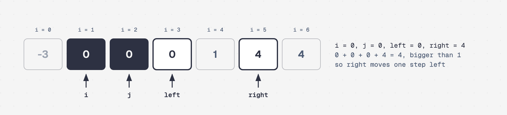

**Step 7: i `0`, j `0`, left `0`, right `1`**

- Sum: `0 + 0 + 0 + 1 = 1`. That is exactly the target. Save `[0, 0, 0, 1]`.
- Move both pointers: `left` goes to i = 4, `right` goes to i = 3.
- `left` and `right` have met or crossed. This scan is over.
- Teams so far: `[-3, 0, 0, 4]`, `[0, 0, 0, 1]`.

![Step 7: i = 0, j = 0, left = 0, right = 1; 0 + 0 + 0 + 1 = 1, equal to 1; save [0, 0, 0, 1]](images/four-sum-step-7.png)

**Step 8: i = `0`, j at index 3 is `0` again, skip**

- The last `j` in this round was also `0`. It would find the same teams again.
- Skip it and go to the next `j`.

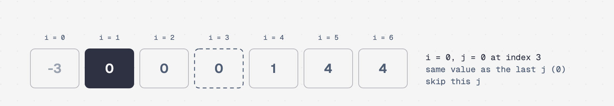

**Step 9: i `0`, j `1`, left `4`, right `4`**

- Sum: `0 + 1 + 4 + 4 = 9`. That is bigger than 1.
- We need a smaller sum, so `right` moves one step left, to i = 5.
- `left` and `right` have met. This scan is over.

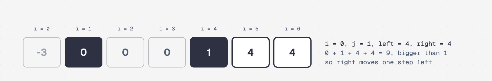

**Step 10: i at i = 2 is `0` again, skip**

- The last i was also `0`. This round would find the same teams again.
- Skip it and go to the next i.

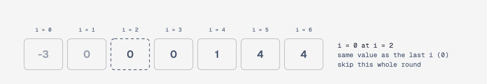

**Step 11: i at i = 3 is `0` again, skip**

- The last i was also `0`. This round would find the same teams again.
- Skip it and go to the next i.

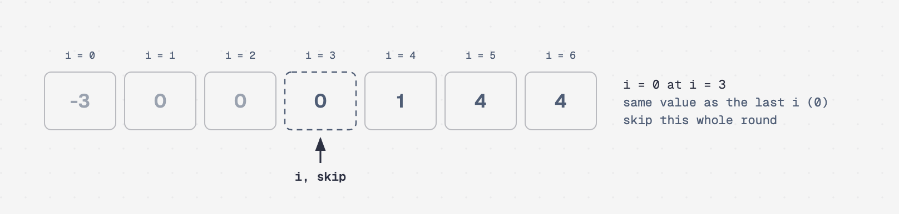

**All steps at a glance**

| Step | `i` | `j` | `left` | `right` | Sum | What happens | Teams so far |
|:---:|:---:|:---:|:---:|:---:|:---:|:---|:---:|
| 1 | 0 | 1 | 2 | 6 | 1 | Save `[-3, 0, 0, 4]`, move both, skip the repeated `0` on the left, skip the repeated `4` on the right | 1 |
| 2 | 0 | 2 | | | | Same value as the last `j`: skip this `j` | 1 |
| 3 | 0 | 3 | | | | Same value as the last `j`: skip this `j` | 1 |
| 4 | 0 | 4 | 5 | 6 | 6 | Too big, `right` moves left | 1 |
| 5 | 1 | 2 | 3 | 6 | 4 | Too big, `right` moves left | 1 |
| 6 | 1 | 2 | 3 | 5 | 4 | Too big, `right` moves left | 1 |
| 7 | 1 | 2 | 3 | 4 | 1 | Save `[0, 0, 0, 1]`, move both | 2 |
| 8 | 1 | 3 | | | | Same value as the last `j`: skip this `j` | 2 |
| 9 | 1 | 4 | 5 | 6 | 9 | Too big, `right` moves left | 2 |
| 10 | 2 |  | | | | Same value as the last `i`: skip the whole round | 2 |
| 11 | 3 |  | | | | Same value as the last `i`: skip the whole round | 2 |

Six sum checks found both teams. Brute force needed 35.

### Code

```python
# Solution for 18. 4Sum
class Solution:

    # Main method
    def fourSum(self, nums: List[int], target: int) -> List[List[int]]:

        # Sort so two pointers and duplicate skipping work
        nums.sort()

        # Number of elements
        n = len(nums)

        # The answer list
        res = []

        # First fixed number, needs three numbers to its right
        for i in range(n - 3):

            # Same first number as before gives the same answers
            if i > 0 and nums[i] == nums[i - 1]:

                # Skip it
                continue

            # Second fixed number, needs two numbers to its right
            for j in range(i + 1, n - 2):

                # Same second number as before (in this i round)
                if j > i + 1 and nums[j] == nums[j - 1]:

                    # Skip it
                    continue

                # Left pointer just after j
                left = j + 1

                # Right pointer at the end
                right = n - 1

                # Search while the pointers have not met
                while left < right:

                    # Sum of the four numbers
                    s = nums[i] + nums[j] + nums[left] + nums[right]

                    # Too small
                    if s < target:

                        # Need a bigger left value
                        left += 1

                    # Too big
                    elif s > target:

                        # Need a smaller right value
                        right -= 1

                    # Exactly the target
                    else:

                        # Save the quadruplet
                        res.append([nums[i], nums[j], nums[left], nums[right]])

                        # Move left past the used value
                        left += 1

                        # Move right past the used value
                        right -= 1

                        # Skip repeats on the left
                        while left < right and nums[left] == nums[left - 1]:

                            # Next left
                            left += 1

                        # Skip repeats on the right
                        while left < right and nums[right] == nums[right + 1]:

                            # Next right
                            right -= 1

        # Return all unique quadruplets
        return res
```

### Complexity

| Measure | Complexity | Why | At the limit (`n = 200`) | Compared with brute force |
|:---|:---:|:---|:---:|:---|
| **Time** | `O(n^3)` | Two fixed loops, each pair does one `O(n)` two-pointer pass | about 1,080,000 steps | About 60 times fewer steps |
| **Space** | `O(1)` extra | Only pointers (Python's sort may use up to `O(n)` inside) | a few loop variables | No set needed for repeats |

## 7. Common Mistakes

| Mistake | What goes wrong | Fix |
|:---|:---|:---|
| `j` skip with `j > 0` instead of `j > i + 1` | Skips the first `j` when it equals `nums[i]`; `[2, 2, 2, 2]` is lost | Use `j > i + 1` |
| Copy 3Sum's `nums[i] > 0: break` | Wrong for a negative target | Drop it, or use a safe bound check |
| Not skipping `left` / `right` repeats | The same quadruplet is saved many times | Move both, then skip equal runs |
| 32-bit sums in Java / C++ | Four values near `10^9` overflow | Use `long` / `long long` |

## 8. Interview Follow-ups

### Q1. How do you generalize this to kSum?

**Answer:**
- Write a recursive function `kSum(start, k, target)`.
- If `k == 2`, run the two-pointer Two Sum.
- Otherwise fix one number (skip repeats) and call `kSum(i + 1, k - 1, target - nums[i])`.
- Time `O(n^(k-1))`.

### Q2. Can we prune to go faster?

**Answer:**
- If the smallest sum for this `i` (`nums[i] + nums[i+1] + nums[i+2] + nums[i+3]`) is above `target`, stop.
- If the biggest sum for this `i` (`nums[i]` plus the last three) is below `target`, skip this `i`.
- The worst case stays `O(n^3)`, but real runs are faster.

### Q3. Can 4Sum be faster than `O(n^3)`?

**Answer:**
- A map of all pair sums answers "does one exist?" in about `O(n^2)` on average.
- But listing unique quadruplets with distinct indices gets messy. `O(n^3)` is the normal interview answer.

### Q4. What if we only need the count of index quadruplets (LeetCode 454, four arrays)?

**Answer:**
- Store all sums `a + b` from the first two arrays in a counter.
- For each `c + d`, add `counter[-(c + d)]`.
- `O(n^2)` time and space.

### Q5. Where does overflow matter?

**Answer:**
- In Java / C++, four numbers of size `10^9` add up past the 32-bit limit.
- Use `long`. Python has no limit, so it is safe.

## 9. Interview Explanation

> I sort the array, fix the first two numbers with two loops, and find the last two with two pointers on the rest. If the sum is too small I move the left pointer right, if too big I move the right pointer left, and on a hit I save it and move both. To keep answers unique I skip repeated values at all four levels; for the second number the skip starts only after the first choice, so cases like four equal numbers still work. It is O(n^3) time and O(1) extra space, and in Java or C++ I would use 64-bit sums.
