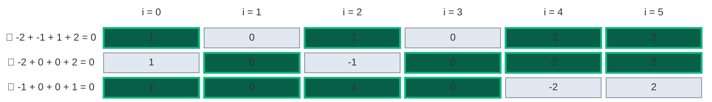
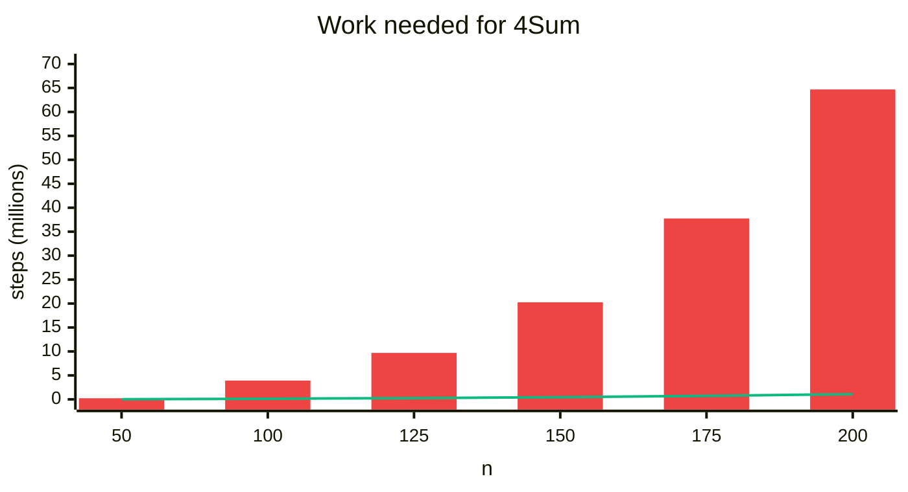
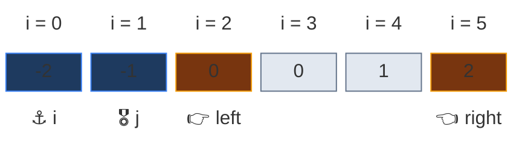
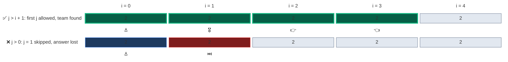
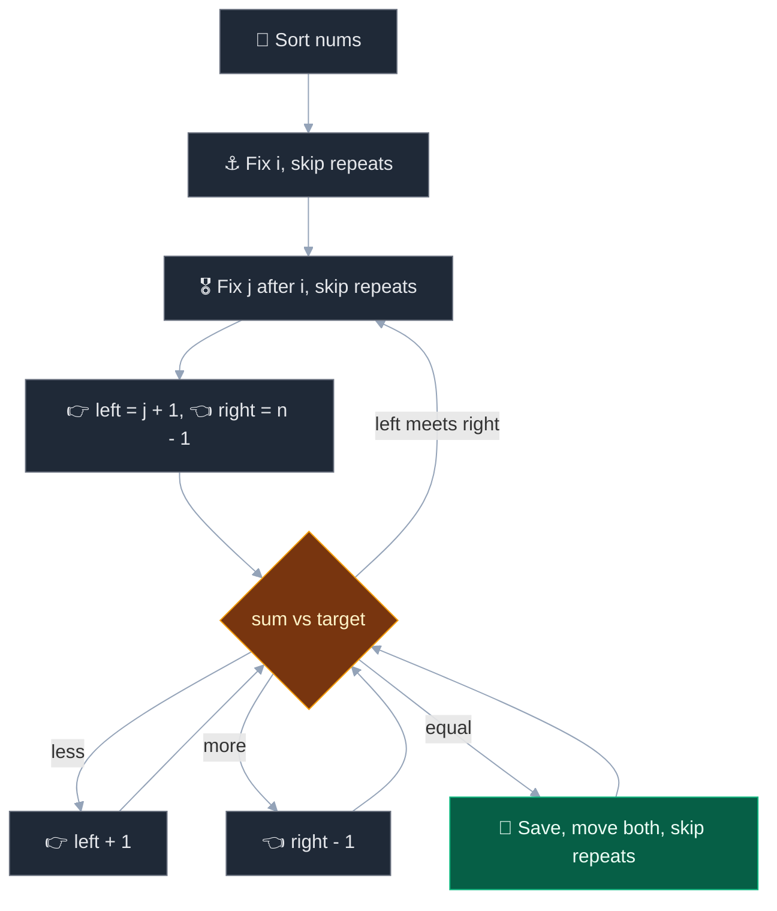
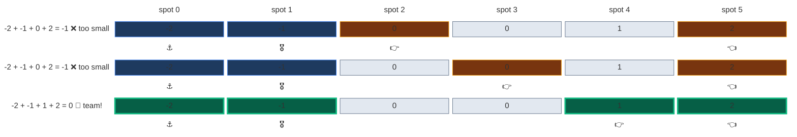
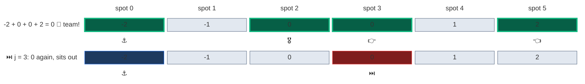
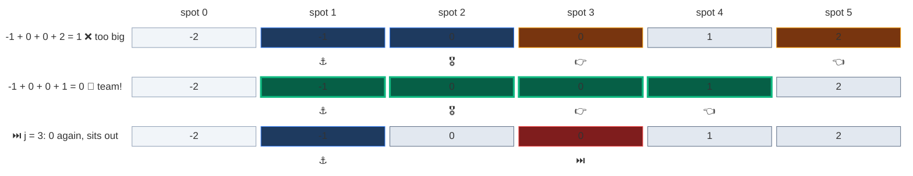
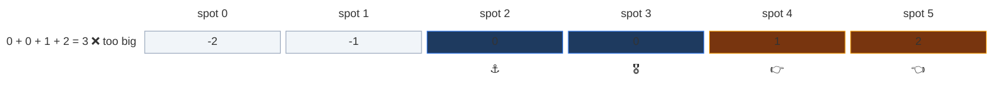

# 03. 18. 4Sum

| Difficulty | Pattern | Key idea | Source | Time | Space | Before in this folder |
|:---:|:---:|:---|:---:|:---:|:---:|:---:|
| **Medium** | Sort + Fix Two + Two Pointers | Fix two numbers, find the last two with two pointers, skip repeats at all four levels | [18. 4Sum](https://leetcode.com/problems/4sum/) | `O(n^3)` | `O(1)` extra | [15. 3Sum](02.%2015.%203Sum.md) |

## 1. Problem Statement

You get an integer array `nums` and an integer `target`.

Return all **unique** quadruplets `[a, b, c, d]` from four different positions such that `a + b + c + d == target`.

- The same set of four values must not appear twice in the answer.
- You may return the answer in any order.

### Example

```text
Input:  nums = [1, 0, -1, 0, -2, 2], target = 0
Output: [[-2, -1, 1, 2], [-2, 0, 0, 2], [-1, 0, 0, 1]]
```



We use this example in every section below. Other LeetCode example:

```text
nums = [2, 2, 2, 2, 2], target = 8  -> [[2, 2, 2, 2]]
```

### Constraints

- `1 <= nums.length <= 200`
- `-10^9 <= nums[i] <= 10^9`
- `-10^9 <= target <= 10^9`

### What the constraints tell us (simple theory)

A **constraint** is the biggest input the judge will ever give you. A computer does about **100 million (10^8) simple steps per second**.

| Biggest input `n` | Steps you can afford | Ideas that fit | Steps at the biggest `n` | Time at 10^8 steps/sec |
|:---:|:---:|:---|:---:|:---:|
| up to ~50 | about `n^4` | Four nested loops | 50 × 50 × 50 × 50 = 6,250,000 | 62.5 ms |
| up to ~500 | about `n^3` | Two loops with a two-pointer scan inside | 500 × 500 × 500 = 125,000,000 | 1.25 s |
| up to ~5,000 | about `n^2` | One loop with a two-pointer scan inside | 5,000 × 5,000 = 25,000,000 | 0.25 s |

**For this problem:** `n` is only `200`, so the judge expects `O(n^3)`.

- Brute force tries every group of four: about **65 million** groups for `n = 200`. Borderline, and each group needs sorting and a set insert, so it is slow.
- Sort + fix two + two pointers: about **1.1 million** steps.

**The values are big:** four numbers of size `10^9` add up to `4 × 10^9`. That does not fit in a 32-bit `int` (max about `2.1 × 10^9`). Python has no limit; in Java / C++ use `long`.

**How the work grows** (counted by running code on `[-n/2, ..., n/2 - 1]`, target 0). Red bars = brute force groups, green line = two-pointer steps.



| `n` | Brute force steps | Two-pointer steps | Brute force time at 10^8 steps/sec | Two-pointer time at 10^8 steps/sec | Two-pointer is faster by |
|:---:|:---:|:---:|:---:|:---:|:---:|
| 50 | 230,300 | 15,467 | 2.3 ms | 155 µs | about 15× |
| 100 | 3,921,225 | 131,145 | 39.2 ms | 1.3 ms | about 30× |
| 125 | 9,691,375 | 259,074 | 96.9 ms | 2.6 ms | about 37× |
| 150 | 20,260,275 | 451,198 | 202.6 ms | 4.5 ms | about 45× |
| 175 | 37,752,925 | 720,360 | 377.5 ms | 7.2 ms | about 52× |
| 200 | 64,684,950 | 1,079,792 | 646.8 ms | 10.8 ms | about 60× |

## 2. Core Theory

### 🔑 Same idea as 3Sum, one more level

- 3Sum: fix **one** number, then two pointers.
- 4Sum: fix **two** numbers (⚓ `i` and 🎖️ `j`), then 👉 `left` and 👈 `right` for the last two.



- Sum **< target** → 👉 `left` moves right (bigger).
- Sum **> target** → 👈 `right` moves left (smaller).
- Sum **= target** → 🎯 save, move both, skip repeats.

### ⏭️ Four places to skip repeats

Sorting puts equal values next to each other. At each level, skip a value equal to the one just used:

| Level | Skip rule | Why | In our example `[-2, -1, 0, 0, 1, 2]` |
|:---|:---|:---|:---|
| ⚓ `i` | `i > 0 and nums[i] == nums[i - 1]` | A repeat first number finds the same teams again | Never fires: `-2, -1, 0` are all different |
| 🎖️ `j` | `j > i + 1 and nums[j] == nums[j - 1]` | A repeat second number (in the same `i` round) finds the same teams | Fires twice: the second `0` at spot 3 |
| 👉 `left` (after a hit) | `nums[left] == nums[left - 1]` | The next left value would build the same team | Never fires here; in `[-3, -2, 2, 2, 3, 3, 3]` with target 0 it skips one repeat |
| 👈 `right` (after a hit) | `nums[right] == nums[right + 1]` | The next right value would build the same team | Never fires here; in `[-3, -2, 2, 2, 3, 3, 3]` with target 0 it skips one repeat |

⚠️ The `j` rule uses `j > i + 1`, not `j > 0`. The **first** `j` after `i` is always allowed, even if it equals `nums[i]`. Otherwise `[2, 2, 2, 2]` would be lost:



### 🚫 No `nums[i] > 0` early stop

In 3Sum the target is `0`, so a positive anchor can stop the search. Here the target can be anything, even negative. So that simple stop is not safe.



## 3. Edge Cases

| Case | Input | Expected | Why it matters |
|:---|:---|:---:|:---|
| Fewer than four numbers | `[1]`, `1` | `[]` | Loops must not run |
| Exactly four, hit | `[1, 2, 3, 4]`, `10` | `[[1, 2, 3, 4]]` | Smallest array with an answer |
| All the same | `[2, 2, 2, 2, 2]`, `8` | `[[2, 2, 2, 2]]` | All four skip rules fire; `j > i + 1` is needed |
| No answer | `[1, 2, 3, 4]`, `100` | `[]` | Target too big |
| Big values | `[10^9] * 4`, `-294967296` | `[]` | In 32-bit `int` the sum wraps to `-294967296` and gives a wrong hit |

## 4. Brute Force: Try Every Quadruplet

### Idea

Four nested loops. For each group that hits `target`, sort its values and put them in a set to remove repeats.

### Code

```python
# Import List for type hints
from typing import List


# Brute force: all quadruplets, set for uniqueness
class SolutionBrute:

    # Main method
    def fourSum(self, nums: List[int], target: int) -> List[List[int]]:

        # Number of elements
        n = len(nums)

        # Unique answers as sorted tuples
        found = set()

        # First position
        for a in range(n):

            # Second position
            for b in range(a + 1, n):

                # Third position
                for c in range(b + 1, n):

                    # Fourth position
                    for d in range(c + 1, n):

                        # Sum hits the target
                        if nums[a] + nums[b] + nums[c] + nums[d] == target:

                            # Store in sorted form so repeats match
                            found.add(tuple(sorted((nums[a], nums[b], nums[c], nums[d]))))

        # Turn tuples into lists, in sorted order
        return [list(t) for t in sorted(found)]
```

### Complexity

| Measure | Complexity | Why | At the limit (`n = 200`) | Compared with brute force |
|:---|:---:|:---|:---:|:---|
| **Time** | `O(n^4)` | Four nested loops try every group of four positions | about 65,000,000 groups | This is the baseline |
| **Space** | `O(k)` | The set of `k` unique answers, stored as sorted tuples | one entry per unique quadruplet | This is the baseline |

## 5. Better Approach: Fix Three + Hash Set

### Idea

Fix `i` and `j`. For each `k > j`, the fourth value must be `target - nums[i] - nums[j] - nums[k]`. 📖 Check a set of values seen between `j` and `k`. Store sorted tuples in a set to remove repeats.

### Code

```python
# Better: fix two numbers, hash set for the other two
class SolutionBetter:

    # Main method
    def fourSum(self, nums: List[int], target: int) -> List[List[int]]:

        # Number of elements
        n = len(nums)

        # Unique answers as sorted tuples
        found = set()

        # First number
        for i in range(n):

            # Second number
            for j in range(i + 1, n):

                # Values seen after j in this round
                seen = set()

                # Third number
                for k in range(j + 1, n):

                    # Value the fourth number must have
                    fourth = target - nums[i] - nums[j] - nums[k]

                    # Fourth number was seen between j and k
                    if fourth in seen:

                        # Store in sorted form so repeats match
                        found.add(tuple(sorted((nums[i], nums[j], nums[k], fourth))))

                    # Remember this value for later k
                    seen.add(nums[k])

        # Turn tuples into lists, in sorted order
        return [list(t) for t in sorted(found)]
```

### Complexity

| Measure | Complexity | Why | At the limit (`n = 200`) | Compared with brute force |
|:---|:---:|:---|:---:|:---|
| **Time** | `O(n^3)` | Three loops, `O(1)` set work inside the innermost loop | about 1,300,000 steps | About 50× fewer steps |
| **Space** | `O(n + k)` | The `seen` set plus the answer set | up to 200 values in `seen` | Needs extra memory |

Same speed as the optimal one, but it needs extra memory and a set to remove repeats.

## 6. Optimal Approach: Sort + Fix Two + Two Pointers

### Idea

1. Sort `nums`.
2. ⚓ For each `i` (skip repeats).
3. 🎖️ For each `j > i` (skip repeats with `j > i + 1`).
4. 👉 `left = j + 1`, 👈 `right = n - 1`. While `left < right`:
   - `s = nums[i] + nums[j] + nums[left] + nums[right]`.
   - `s < target`: `left += 1`. `s > target`: `right -= 1`.
   - `s == target`: 🎯 save, move both, skip repeats on both sides.

### Visual Walkthrough (Story Version)

**The story:** six kids hold number cards `1, 0, -1, 0, -2, 2`. The teacher wants **teams of four** whose cards add up to `0`, and no two teams with the same cards.

- 📏 The kids line up by card: `-2, -1, 0, 0, 1, 2`.
- ⚓ A **captain** and 🎖️ a **vice-captain** (to the captain's right) step forward.
- 👉 **Lefty** starts just right of the vice-captain. 👈 **Righty** starts at the far end.
- Total too small → Lefty moves right. Too big → Righty moves left. 🎯 Exactly `0` → write the team down, both helpers move.
- ⏭️ A captain or vice-captain with the same card as the one before them sits out.

**How to read the pictures:** blue = captain and vice-captain, orange = Lefty and Righty trying, green = a team that works, red = a kid who sits out, grey = still in the line, light = not used this round.

**Captain `-2`, vice-captain `-1`.** Two misses, then a team.

- `-2 - 1 + 0 + 2 = -1` → too small. Lefty moves.
- `-2 - 1 + 0 + 2 = -1` → still too small (the second `0`). Lefty moves.
- `-2 - 1 + 1 + 2 = 0` → 🎯 team `[-2, -1, 1, 2]`. Both move and cross.



**Captain `-2`, vice-captain `0` (spot 2), then vice-captain `0` (spot 3) sits out.**

- `-2 + 0 + 0 + 2 = 0` → 🎯 team `[-2, 0, 0, 2]`. Both move and meet.
- ⏭️ Spot 3 is another `0`, same as the last vice-captain. It sits out.



**Captain `-1`, vice-captain `0` (spot 2), then spot 3 sits out.**

- `-1 + 0 + 0 + 2 = 1` → too big. Righty moves.
- `-1 + 0 + 0 + 1 = 0` → 🎯 team `[-1, 0, 0, 1]`.
- ⏭️ Spot 3 is another `0`. It sits out.



**Captain `0` (spot 2), vice-captain `0` (spot 3).** `0 + 0 + 1 + 2 = 3` is too big, Righty moves and meets Lefty. No more captains have three kids to their right. Game over.



**All steps at a glance**

| Step | `i` | `j` | `left` | `right` | `s` | Move | Teams | Why |
|:---:|:---:|:---:|:---:|:---:|:---:|:---|:---:|:---|
| 1 | 0 | 1 | 2 | 5 | -1 | 👉 left + 1 | 0 | -1 is below 0, we need a bigger number |
| 2 | 0 | 1 | 3 | 5 | -1 | 👉 left + 1 | 0 | still -1 (the second 0), need bigger |
| 3 | 0 | 1 | 4 | 5 | 0 | 🎯 save, cross | 1 | sum is 0: a team; the pointers cross |
| 4 | 0 | 2 | 3 | 5 | 0 | 🎯 save, meet | 2 | sum is 0: a team; the pointers meet |
| – | 0 | 3 | – | – | – | ⏭️ skip repeat `j` | 2 | the second 0 equals the last `j`, same teams again |
| 5 | 1 | 2 | 3 | 5 | 1 | 👈 right - 1 | 2 | 1 is above 0, we need a smaller number |
| 6 | 1 | 2 | 3 | 4 | 0 | 🎯 save, cross | 3 | sum is 0: a team; the pointers cross |
| – | 1 | 3 | – | – | – | ⏭️ skip repeat `j` | 3 | the second 0 equals the last `j` again |
| 7 | 2 | 3 | 4 | 5 | 3 | 👈 right - 1, meet | 3 | 3 is above 0, need smaller; right reaches left |

**What the story teaches**

| In the story | In the code | Why it matters |
|:---|:---|:---|
| 📏 Line up by card | `nums.sort()` | Makes the sum move in a known direction and groups repeats together |
| ⚓ Captain, 🎖️ vice-captain | Loops over `i` and `j` | Turns 4Sum into Two Sum on the rest |
| 👉 Lefty, 👈 Righty | `left`, `right` | Scan the rest once per `(i, j)` pair |
| Too small / too big | `s < target` / `s > target` | Each check throws away one value for good |
| 🎯 Write the team down | `res.append([...])` | Saves one unique quadruplet |
| ⏭️ Repeat vice-captain sits out | `if j > i + 1 and nums[j] == nums[j - 1]: continue` | The first `j` is always allowed, so `[2, 2, 2, 2]` still works |
| ⏭️ Repeat captain sits out | `if i > 0 and nums[i] == nums[i - 1]: continue` | A repeat captain would find the same teams |

### Code

```python
# Solution for 18. 4Sum
class Solution:

    # Main method
    def fourSum(self, nums: List[int], target: int) -> List[List[int]]:

        # Sort so two pointers and duplicate skipping work
        nums.sort()

        # Number of elements
        n = len(nums)

        # The answer list
        res = []

        # First fixed number, needs three numbers to its right
        for i in range(n - 3):

            # Same first number as before gives the same answers
            if i > 0 and nums[i] == nums[i - 1]:

                # Skip it
                continue

            # Second fixed number, needs two numbers to its right
            for j in range(i + 1, n - 2):

                # Same second number as before (in this i round)
                if j > i + 1 and nums[j] == nums[j - 1]:

                    # Skip it
                    continue

                # Left pointer just after j
                left = j + 1

                # Right pointer at the end
                right = n - 1

                # Search while the pointers have not met
                while left < right:

                    # Sum of the four numbers
                    s = nums[i] + nums[j] + nums[left] + nums[right]

                    # Too small
                    if s < target:

                        # Need a bigger left value
                        left += 1

                    # Too big
                    elif s > target:

                        # Need a smaller right value
                        right -= 1

                    # Exactly the target
                    else:

                        # Save the quadruplet
                        res.append([nums[i], nums[j], nums[left], nums[right]])

                        # Move left past the used value
                        left += 1

                        # Move right past the used value
                        right -= 1

                        # Skip repeats on the left
                        while left < right and nums[left] == nums[left - 1]:

                            # Next left
                            left += 1

                        # Skip repeats on the right
                        while left < right and nums[right] == nums[right + 1]:

                            # Next right
                            right -= 1

        # Return all unique quadruplets
        return res
```

### Complexity

| Measure | Complexity | Why | At the limit (`n = 200`) | Compared with brute force |
|:---|:---:|:---|:---:|:---|
| **Time** | `O(n^3)` | Two fixed loops, each pair does one `O(n)` two-pointer pass | about 1,080,000 steps | About 60× fewer steps |
| **Space** | `O(1)` extra | Only pointers (Python's sort may use up to `O(n)` inside) | a few loop variables | No set needed for repeats |

## 7. Common Mistakes

| Mistake | What goes wrong | Fix |
|:---|:---|:---|
| `j` skip with `j > 0` instead of `j > i + 1` | Skips the first `j` when it equals `nums[i]`; `[2, 2, 2, 2]` is lost | Use `j > i + 1` |
| Copy 3Sum's `nums[i] > 0: break` | Wrong for a negative target | Drop it, or use a safe bound check |
| Not skipping `left` / `right` repeats | The same quadruplet is saved many times | Move both, then skip equal runs |
| 32-bit sums in Java / C++ | Four values near `10^9` overflow | Use `long` / `long long` |

## 8. Interview Follow-ups

### Q1. How do you generalize this to kSum?

**Answer:**
- Write a recursive function `kSum(start, k, target)`.
- If `k == 2`, run the two-pointer Two Sum.
- Otherwise fix one number (skip repeats) and call `kSum(i + 1, k - 1, target - nums[i])`.
- Time `O(n^(k-1))`.

### Q2. Can we prune to go faster?

**Answer:**
- If the smallest sum for this `i` (`nums[i] + nums[i+1] + nums[i+2] + nums[i+3]`) is above `target`, stop.
- If the biggest sum for this `i` (`nums[i]` plus the last three) is below `target`, skip this `i`.
- The worst case stays `O(n^3)`, but real runs are faster.

### Q3. Can 4Sum be faster than `O(n^3)`?

**Answer:**
- A map of all pair sums answers "does one exist?" in about `O(n^2)` on average.
- But listing unique quadruplets with distinct indices gets messy. `O(n^3)` is the normal interview answer.

### Q4. What if we only need the count of index quadruplets (LeetCode 454, four arrays)?

**Answer:**
- Store all sums `a + b` from the first two arrays in a counter.
- For each `c + d`, add `counter[-(c + d)]`.
- `O(n^2)` time and space.

### Q5. Where does overflow matter?

**Answer:**
- In Java / C++, four numbers of size `10^9` add up past the 32-bit limit.
- Use `long`. Python has no limit, so it is safe.

## 9. Interview Explanation

> I sort the array, fix the first two numbers with two loops, and find the last two with two pointers on the rest. If the sum is too small I move the left pointer right, if too big I move the right pointer left, and on a hit I save it and move both. To keep answers unique I skip repeated values at all four levels; for the second number the skip starts only after the first choice, so cases like four equal numbers still work. It is O(n^3) time and O(1) extra space, and in Java or C++ I would use 64-bit sums.
