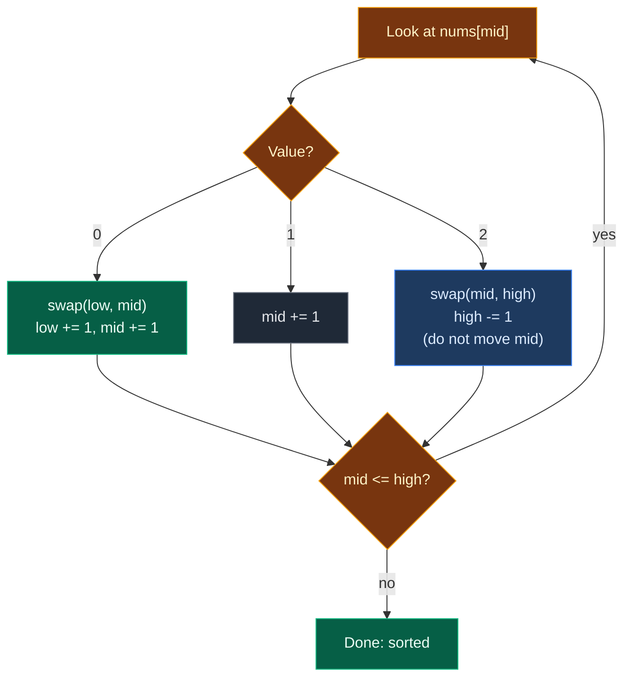

# 01. 75. Sort Colors

| Difficulty | Pattern | Source | Time | Space |
|:---:|:---:|:---:|:---:|:---:|
| **Medium** | Dutch National Flag / Three Pointers | [75. Sort Colors](https://leetcode.com/problems/sort-colors/) | `O(n)` | `O(1)` |

## 1. Problem Statement

You get an array `nums`. Each value is a color:

- `0` = red
- `1` = white
- `2` = blue

Sort the array **in place** so that all `0`s come first, then all `1`s, then all `2`s.

You must not use the library sort function.

This is the famous **Dutch National Flag** problem.

### Example

```text
Input:  nums = [2, 0, 2, 1, 1, 0]
Output:        [0, 0, 1, 1, 2, 2]
```

We use this same example in every section below.

(LeetCode also has `nums = [2, 0, 1]` -> `[0, 1, 2]`. We test it in the code.)

### Constraints

- `n == nums.length`
- `1 <= n <= 300`
- `nums[i]` is `0`, `1`, or `2`
- **Follow up:** can you do it in one pass with `O(1)` extra space?

## 2. Core Theory

### What the problem really asks

There are only three kinds of values. So "sort" really means: **put each value into one of three zones**.

```text
[ 0 0 0 | 1 1 1 | 2 2 2 ]
  zeros   ones    twos
```

### Why three pointers fit

We keep three pointers: `low`, `mid`, `high`. They cut the array into four parts:

```text
 index:  0 ... low-1 | low ... mid-1 | mid ... high | high+1 ... n-1
 holds:     all 0    |     all 1     |   unknown    |     all 2
```

- `mid` looks at the first unknown value.
- If it is `0`, swap it to the `low` side. Move `low` and `mid`.
- If it is `1`, it is already in the right zone. Move `mid`.
- If it is `2`, swap it to the `high` side. Move only `high`.
- Stop when the unknown part is empty: `mid > high`.



### Why we do not move `mid` after the `2` swap

- When `nums[mid] == 0`, we swap with `low`. The value that comes back to `mid` was in the `1` zone (or it is the same cell). We already checked it. So moving `mid` is safe.
- When `nums[mid] == 2`, we swap with `high`. The value that comes back to `mid` comes from the **unknown** zone. Nobody has checked it yet. It could be `0`, `1` or `2`. So we must look at `mid` again.

## 3. Edge Cases

| Case | Input | Expected | Why it matters |
|:---|:---|:---:|:---|
| Single `0` | `[0]` | `[0]` | Loop runs once. Swap with itself is harmless |
| Single `2` | `[2]` | `[2]` | `high` drops to `-1`, loop ends, no index error |
| All ones | `[1, 1, 1]` | `[1, 1, 1]` | Only `mid` moves. `low` and `high` stay |
| All twos | `[2, 2, 2]` | `[2, 2, 2]` | `mid` never moves, only `high` goes down. Loop still ends |
| Already sorted | `[0, 1, 2]` | `[0, 1, 2]` | Must not break correct input |
| Reverse sorted | `[2, 1, 0]` | `[0, 1, 2]` | Uses both swap branches |
| No ones | `[2, 2, 0, 0]` | `[0, 0, 2, 2]` | The `1` zone stays empty, `low == mid` all the time |
| Trap after `2` swap | `[1, 2, 0]` | `[0, 1, 2]` | If `mid` moves after the `2` swap, the `0` is skipped and you get `[1, 0, 2]` |

## 4. Brute Force: Library Sort

### Idea

Just sort the list. It works, but the problem says **do not** use the library sort. It is only a baseline to compare against.

### Code

```python
# Import List for type hints
from typing import List


# Brute force: use the built-in sort
class SolutionBrute:

    # Main method, changes nums in place
    def sortColors(self, nums: List[int]) -> None:

        # Sort the list in place
        nums.sort()
```

### Complexity

| Measure | Complexity | Why |
|:---|:---:|:---|
| **Time** | `O(n log n)` | General sorting |
| **Space** | `O(1)` to `O(n)` | Depends on the sort. Also breaks the "no library sort" rule |

## 5. Better Approach: Count Then Rewrite

### Idea

1. Count how many `0`s, `1`s and `2`s there are.
2. Write that many `0`s, then `1`s, then `2`s back into `nums`.

It is `O(n)`, but it needs **two passes**. The follow-up asks for one.

### Code

```python
# Better: count each color, then write them back in order
class SolutionBetter:

    # Main method, changes nums in place
    def sortColors(self, nums: List[int]) -> None:

        # count[c] = how many times color c appears
        count = [0, 0, 0]

        # First pass: count every color
        for value in nums:

            # Add one to this color's count
            count[value] += 1

        # Position where we write next
        index = 0

        # Go through colors 0, 1, 2 in order
        for color in range(3):

            # Write this color as many times as we counted it
            for _ in range(count[color]):

                # Put the color at the write position
                nums[index] = color

                # Move the write position forward
                index += 1
```

### Complexity

| Measure | Complexity | Why |
|:---|:---:|:---|
| **Time** | `O(n)` | Two passes over the array |
| **Space** | `O(1)` | Only 3 counters |

## 6. Optimal Approach: Dutch National Flag

### Idea

1. `low = 0`, `mid = 0`, `high = n - 1`.
2. While `mid <= high`:
   - `nums[mid] == 0`: swap `nums[low]` and `nums[mid]`, then `low += 1`, `mid += 1`.
   - `nums[mid] == 1`: `mid += 1`.
   - `nums[mid] == 2`: swap `nums[mid]` and `nums[high]`, then `high -= 1`.

### Visual Walkthrough (Story Version)

Before the code, let us see the idea as a story.

**The story:** six balls sit in a row on a shelf. Some are red (`0`), some are white (`1`), some are blue (`2`). A helper named **Mid** walks along the shelf. Two friends guard the ends:

- **Low** stands at the left. Red balls go to Low.
- **High** stands at the right. Blue balls go to High.
- White balls stay in the middle.

**The rules:**

- Mid picks up the ball in front of him.
- Red: swap it with the ball at Low. Low and Mid both step right.
- White: leave it. Mid steps right.
- Blue: swap it with the ball at High. High steps left. **Mid stays**, because the ball he just got is new and unchecked.
- When Mid walks past High, every ball is sorted.

**How to read the pictures:** `L` = Low, `M` = Mid, `H` = High. Balls left of `L` are done red. Balls right of `H` are done blue.

**Start**

```text
 [2][0][2][1][1][0]
  L              H
  M
```

**Step 1: Mid sees blue (`2`)**

Swap with High's ball (`0`). High steps left. Mid stays.

```text
 [0][0][2][1][1][2]
  L           H
  M
```

**Step 2: Mid sees red (`0`)**

Swap with Low's ball (it is the same ball). Low and Mid step right.

```text
 [0][0][2][1][1][2]
     L        H
     M
```

**Step 3: Mid sees red (`0`)**

Swap with Low's ball (same ball again). Low and Mid step right.

```text
 [0][0][2][1][1][2]
        L     H
        M
```

**Step 4: Mid sees blue (`2`)**

Swap with High's ball (`1`). High steps left. Mid stays.

```text
 [0][0][1][1][2][2]
        L  H
        M
```

**Step 5: Mid sees white (`1`)**

Leave it. Mid steps right.

```text
 [0][0][1][1][2][2]
        L  H
           M
```

**Step 6: Mid sees white (`1`)**

Leave it. Mid steps right. Now Mid is past High. Stop.

```text
 [0][0][1][1][2][2]
        L  H  M
```

All reds left, whites middle, blues right.

**All steps at a glance**

| Step | Mid sees | Action | Shelf after | Low | Mid | High |
|:---:|:---:|:---|:---|:---:|:---:|:---:|
| start | – | – | `[2,0,2,1,1,0]` | 0 | 0 | 5 |
| 1 | blue `2` | swap with High, High left | `[0,0,2,1,1,2]` | 0 | 0 | 4 |
| 2 | red `0` | swap with Low, both right | `[0,0,2,1,1,2]` | 1 | 1 | 4 |
| 3 | red `0` | swap with Low, both right | `[0,0,2,1,1,2]` | 2 | 2 | 4 |
| 4 | blue `2` | swap with High, High left | `[0,0,1,1,2,2]` | 2 | 2 | 3 |
| 5 | white `1` | Mid right | `[0,0,1,1,2,2]` | 2 | 3 | 3 |
| 6 | white `1` | Mid right, stop | `[0,0,1,1,2,2]` | 2 | 4 | 3 |

**What the story teaches**

| In the story | In the code |
|:---|:---|
| Ball | `nums[i]` |
| Red / white / blue | `0` / `1` / `2` |
| Low friend | `low` pointer, end of the `0` zone |
| Mid helper | `mid` pointer, first unchecked value |
| High friend | `high` pointer, start of the `2` zone (from the right) |
| Mid stays after a blue swap | No `mid += 1` in the `2` branch |
| Mid walks past High | Loop ends when `mid > high` |

Now the same steps again, this time with the exact values.

### Step-by-Step Example

```text
nums = [2, 0, 2, 1, 1, 0]
n = 6
```

**Start:** `low = 0`, `mid = 0`, `high = 5`.

```text
index:  0 1 2 3 4 5
nums:   2 0 2 1 1 0
```

**Step 1:** check `mid <= high`: `0 <= 5`, yes.

1. `nums[mid] = nums[0] = 2`.
2. It is `2`. Swap `nums[0]` and `nums[5]`: `2` and `0` trade places.
3. `high = 5 - 1 = 4`. `mid` stays `0`.

```text
nums:   0 0 2 1 1 2      low = 0, mid = 0, high = 4
```

**Step 2:** check `0 <= 4`, yes.

1. `nums[0] = 0`.
2. It is `0`. Swap `nums[0]` and `nums[0]`: no change.
3. `low = 1`, `mid = 1`.

```text
nums:   0 0 2 1 1 2      low = 1, mid = 1, high = 4
```

**Step 3:** check `1 <= 4`, yes.

1. `nums[1] = 0`.
2. It is `0`. Swap `nums[1]` and `nums[1]`: no change.
3. `low = 2`, `mid = 2`.

```text
nums:   0 0 2 1 1 2      low = 2, mid = 2, high = 4
```

**Step 4:** check `2 <= 4`, yes.

1. `nums[2] = 2`.
2. It is `2`. Swap `nums[2]` and `nums[4]`: `2` and `1` trade places.
3. `high = 3`. `mid` stays `2`.

```text
nums:   0 0 1 1 2 2      low = 2, mid = 2, high = 3
```

**Step 5:** check `2 <= 3`, yes.

1. `nums[2] = 1`.
2. It is `1`. Only `mid = 3`.

```text
nums:   0 0 1 1 2 2      low = 2, mid = 3, high = 3
```

**Step 6:** check `3 <= 3`, yes.

1. `nums[3] = 1`.
2. It is `1`. Only `mid = 4`.

```text
nums:   0 0 1 1 2 2      low = 2, mid = 4, high = 3
```

**Step 7:** check `4 <= 3`, no. Loop ends.

**Answer:** `[0, 0, 1, 1, 2, 2]`.

### Code

```python
# Optimal: Dutch National Flag with three pointers
class Solution:

    # Main method, changes nums in place
    def sortColors(self, nums: List[int]) -> None:

        # End of the 0 zone
        low = 0

        # First unchecked value
        mid = 0

        # Start of the 2 zone, counted from the right
        high = len(nums) - 1

        # Keep going while there are unchecked values
        while mid <= high:

            # Red: send it to the left zone
            if nums[mid] == 0:

                # Swap the 0 into the low position
                nums[low], nums[mid] = nums[mid], nums[low]

                # The 0 zone grew by one
                low += 1

                # The value now at mid was already checked
                mid += 1

            # White: it is already in the right zone
            elif nums[mid] == 1:

                # Just move on
                mid += 1

            # Blue: send it to the right zone
            else:

                # Swap the 2 into the high position
                nums[mid], nums[high] = nums[high], nums[mid]

                # The 2 zone grew by one; mid stays because the new value is unchecked
                high -= 1


# Same algorithm, but it records (nums, low, mid, high) after every step
def trace_sort_colors(nums: List[int]) -> List[tuple]:

    # Start pointers
    low, mid, high = 0, 0, len(nums) - 1

    # List of states after each step
    states = []

    # Same loop as the solution
    while mid <= high:

        # Red branch
        if nums[mid] == 0:

            # Swap with low
            nums[low], nums[mid] = nums[mid], nums[low]

            # Move both pointers
            low, mid = low + 1, mid + 1

        # White branch
        elif nums[mid] == 1:

            # Move mid only
            mid += 1

        # Blue branch
        else:

            # Swap with high
            nums[mid], nums[high] = nums[high], nums[mid]

            # Move high only
            high -= 1

        # Save a snapshot of this step
        states.append((nums[:], low, mid, high))

    # Return all snapshots
    return states


# Trace the example from this note
states = trace_sort_colors([2, 0, 2, 1, 1, 0])

# Six steps in total
assert len(states) == 6

# Step 1: saw 2, swapped with high
assert states[0] == ([0, 0, 2, 1, 1, 2], 0, 0, 4)

# Step 2: saw 0, swapped with itself
assert states[1] == ([0, 0, 2, 1, 1, 2], 1, 1, 4)

# Step 3: saw 0, swapped with itself
assert states[2] == ([0, 0, 2, 1, 1, 2], 2, 2, 4)

# Step 4: saw 2, swapped with high
assert states[3] == ([0, 0, 1, 1, 2, 2], 2, 2, 3)

# Step 5: saw 1, mid moves
assert states[4] == ([0, 0, 1, 1, 2, 2], 2, 3, 3)

# Step 6: saw 1, mid moves past high
assert states[5] == ([0, 0, 1, 1, 2, 2], 2, 4, 3)

# Helper: run a solution on a copy and return the result
def run(solver, nums):

    # Copy so the caller's list is safe
    arr = nums[:]

    # Sort in place
    solver.sortColors(arr)

    # Return the sorted copy
    return arr


# LeetCode example 1 (our example)
assert run(Solution(), [2, 0, 2, 1, 1, 0]) == [0, 0, 1, 1, 2, 2]

# LeetCode example 2
assert run(Solution(), [2, 0, 1]) == [0, 1, 2]

# Edge case: single 0
assert run(Solution(), [0]) == [0]

# Edge case: single 2
assert run(Solution(), [2]) == [2]

# Edge case: all ones
assert run(Solution(), [1, 1, 1]) == [1, 1, 1]

# Edge case: all twos
assert run(Solution(), [2, 2, 2]) == [2, 2, 2]

# Edge case: already sorted
assert run(Solution(), [0, 1, 2]) == [0, 1, 2]

# Edge case: reverse sorted
assert run(Solution(), [2, 1, 0]) == [0, 1, 2]

# Edge case: no ones
assert run(Solution(), [2, 2, 0, 0]) == [0, 0, 2, 2]

# Edge case: the trap after a 2 swap
assert run(Solution(), [1, 2, 0]) == [0, 1, 2]

# Import product to build every small input
from itertools import product

# Try every array of length 1 to 6
for size in range(1, 7):

    # Every way to fill the array with 0, 1, 2
    for combo in product([0, 1, 2], repeat=size):

        # Brute, better and optimal all agree
        assert run(Solution(), list(combo)) == run(SolutionBrute(), list(combo)) == run(SolutionBetter(), list(combo))

# All checks passed
print("All tests passed")
```

### Complexity

| Measure | Complexity | Why |
|:---|:---:|:---|
| **Time** | `O(n)` | Every step moves `mid` up or `high` down, so the unknown zone shrinks by one each time |
| **Space** | `O(1)` | Only three pointers |

## 7. Common Mistakes

| Mistake | What goes wrong | Fix |
|:---|:---|:---|
| Moving `mid` after the `2` swap | The new value at `mid` is never checked. `[1, 2, 0]` ends as `[1, 0, 2]` | In the `2` branch only do `high -= 1` |
| Loop `while mid < high` | The last unknown cell is never checked. `[1, 0]` stays `[1, 0]` | Use `while mid <= high` |
| Moving only `mid` after the `0` swap | `low` stops marking the end of the `0` zone. Zeros overwrite each other | Move both `low` and `mid` |
| `high = len(nums)` | First `2` swap goes out of range | `high = len(nums) - 1` |
| Returning a new list | LeetCode reads the original `nums`, so the answer is lost | Change `nums` in place, return nothing |

## 8. Interview Follow-ups

### Q1. What if there were `k` colors instead of 3?

**Answer:**
- Three pointers do not grow nicely to `k` zones.
- Use counting sort: count each color, then write them back.
- Time `O(n + k)`, space `O(k)`.

### Q2. Is this algorithm stable?

**Answer:**
- No. Swaps jump over other values, so equal items can change order.
- For plain numbers it does not matter.
- For objects with a color key, use a stable counting sort.

### Q3. Why does the loop always end?

**Answer:**
- Every step does `mid += 1` or `high -= 1`.
- So `high - mid` gets smaller by one each step.
- When it goes below zero, the loop stops. At most `n` steps.

### Q4. Where else is this three-way split used?

**Answer:**
- In quicksort with many equal keys: split into "less", "equal", "greater".
- Then recurse only on "less" and "greater". This avoids `O(n^2)` on many duplicates.
- Also in "move zeros / negatives to one side" problems.

### Q5. Can you do it in two passes without a count array?

**Answer:**
- Yes. Pass 1: move all `0`s to the front with one write pointer.
- Pass 2: move all `2`s to the back the same way.
- The `1`s end up in the middle. Still `O(n)` and `O(1)`, but two passes.

## 9. Interview Explanation

> I use the Dutch National Flag idea with three pointers. Everything before `low` is 0, everything from `low` to `mid - 1` is 1, everything after `high` is 2, and `mid` to `high` is still unknown. If `nums[mid]` is 0, I swap it with `low` and move both `low` and `mid`. If it is 1, I just move `mid`. If it is 2, I swap it with `high` and move only `high`, because the value I got back has not been checked yet. The loop runs while `mid <= high`, so it is one pass, O(n) time and O(1) space.
