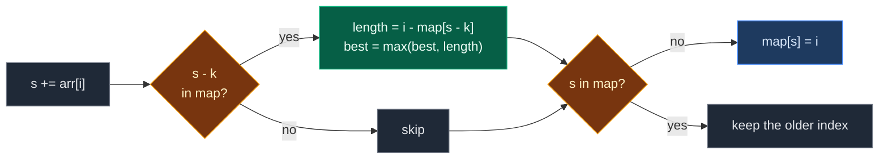

# 01. Longest Subarray with Sum K

| Difficulty | Pattern | Source | Time | Space |
|:---:|:---:|:---:|:---:|:---:|
| **Medium** | Prefix Sum + Hash Map | [Longest Sub-Array with Sum K](https://www.geeksforgeeks.org/problems/longest-sub-array-with-sum-k0809/1) | `O(n)` | `O(n)` |

## 1. Problem Statement

You get an array `arr` of integers and a number `k`.

Find the **length** of the longest subarray whose sum is exactly `k`.

A subarray is a part of the array with no gaps, like `arr[2..5]`.

If no subarray has sum `k`, return `0`.

The array can have **negative numbers** and **zeros**.

### Example

```text
Input:  arr = [10, 5, 2, 7, 1, -10], k = 15
Output: 6

Subarrays with sum 15:
  [10, 5]                 length 2
  [5, 2, 7, 1]            length 4
  [10, 5, 2, 7, 1, -10]   length 6   <- longest
```

We use this same example in every section below.

(GfG also has `[-5, 8, -14, 2, 4, 12], k = -5` -> `5` and `[10, -10, 20, 30], k = 5` -> `0`. We test them in the code.)

### Constraints

- `1 <= arr.size() <= 10^5`
- `-10^4 <= arr[i] <= 10^4`
- `-10^9 <= k <= 10^9`

## 2. Core Theory

### What the problem really asks

For every pair `(start, end)`, is `sum(arr[start..end]) == k`? Keep the biggest `end - start + 1`.

Checking every pair is slow. We want one pass.

### Prefix sums

`prefix[i]` = sum of `arr[0..i]`.

```text
index:    0   1   2   3   4    5
arr:     10   5   2   7   1  -10
prefix:  10  15  17  24  25   15
```

The sum of a middle part is a difference of two prefix sums:

```text
sum(arr[j+1..i]) = prefix[i] - prefix[j]
```

So `sum(arr[j+1..i]) == k` means:

```text
prefix[j] == prefix[i] - k
```

### Why a hash map fits

- Walk left to right. Keep the running sum `s`.
- Ask the map: "Did I see the sum `s - k` before? At which index?"
- If yes, the part after that index sums to `k`.
- Store each prefix sum the **first** time we see it. The earliest start gives the longest part.
- Put `{0: -1}` in the map at the start. It means "sum 0 before the array starts". It lets us find parts that start at index `0`.



### Why not sliding window?

Sliding window needs all numbers positive. With negatives, a bigger window can have a smaller sum. Shrinking the window can throw away the real answer. Example: `[1, -1, 5, -2, 3], k = 3`. The answer is `4` (`[1, -1, 5, -2]`), but a sliding window misses it.

## 3. Edge Cases

| Case | Input | Expected | Why it matters |
|:---|:---|:---:|:---|
| Single element equal to `k` | `[5], k = 5` | `1` | Needs the `{0: -1}` seed |
| Single element not equal to `k` | `[5], k = 3` | `0` | Must return `0` |
| No valid answer | `[10, -10, 20, 30], k = 5` | `0` | Default answer is `0` |
| Negatives present | `[1, -1, 5, -2, 3], k = 3` | `4` | Sliding window fails here |
| Repeated prefix sum | `[10, 5, 2, 7, 1, -10], k = 15` | `6` | Prefix `15` appears twice. Keep the first index |
| Negative `k` | `[-5, 8, -14, 2, 4, 12], k = -5` | `5` | `s - k` must keep the sign |
| All zeros, `k = 0` | `[0, 0, 0], k = 0` | `3` | Seed `-1` gives the full length |
| `k = 0`, no zero part | `[1, 2, 3], k = 0` | `0` | Empty subarray does not count |

## 4. Brute Force: Try Every Start

### Idea

For each start index, extend the end one step at a time and keep a running sum. When the sum is `k`, record the length.

### Code

```python
# Import List for type hints
from typing import List


# Brute force: try every start and every end
class SolutionBrute:

    # Main method
    def longestSubarray(self, arr: List[int], k: int) -> int:

        # Best length found so far
        best = 0

        # Pick every start index
        for start in range(len(arr)):

            # Sum of arr[start..end]
            total = 0

            # Extend the end one step at a time
            for end in range(start, len(arr)):

                # Add the new element
                total += arr[end]

                # Check if this part sums to k
                if total == k:

                    # Keep the longer length
                    best = max(best, end - start + 1)

        # Return the best length
        return best
```

### Complexity

| Measure | Complexity | Why |
|:---|:---:|:---|
| **Time** | `O(n^2)` | Two nested loops |
| **Space** | `O(1)` | Only a few variables |

With `n = 10^5`, that is about `5 * 10^9` steps. Too slow.

## 5. Optimal Approach: Prefix Sum + Hash Map

### Idea

1. `first = {0: -1}`, `s = 0`, `best = 0`.
2. For each index `i`:
   - `s += arr[i]`.
   - If `s - k` is in `first`, then `best = max(best, i - first[s - k])`.
   - If `s` is not in `first`, store `first[s] = i`.
3. Return `best`.

### Visual Walkthrough (Story Version)

Before the code, let us see the idea as a story.

**The story:** you walk along a road with 6 stops. At each stop you pick up (or drop) some coins. You carry a **notebook**. In it you write: "the first time my bag held X coins, I was at stop Y."

You want the **longest** stretch of road where you picked up exactly `15` coins.

**The trick:** if your bag has `s` coins now, and at some earlier stop it had `s - 15` coins, then between those stops you picked up exactly `15`. To make the stretch long, you want the **earliest** such stop. That is why the notebook keeps only the first time.

Before you start walking, you write "0 coins at stop -1" (the start line).

**How to read the pictures:** `[ ]` = one stop with its coins. `^` = where you stand. `|---|` = the stretch that sums to 15.

**Start**

```text
stop:     0    1    2    3    4    5
coins:  [10] [ 5] [ 2] [ 7] [ 1] [-10]
bag = 0     notebook: {0: -1}     best = 0
```

**Step 1: stop 0, pick up 10**

Bag = 10. Look for `10 - 15 = -5` in the notebook. Not there. Write "10 at stop 0".

```text
        [10] [ 5] [ 2] [ 7] [ 1] [-10]
          ^
bag = 10    notebook: {0:-1, 10:0}    best = 0
```

**Step 2: stop 1, pick up 5**

Bag = 15. Look for `15 - 15 = 0`. Found at stop -1. Stretch = `1 - (-1) = 2`. Best = 2. Write "15 at stop 1".

```text
        [10] [ 5] [ 2] [ 7] [ 1] [-10]
        |-------|
               ^
bag = 15    notebook: {0:-1, 10:0, 15:1}    best = 2
```

**Step 3: stop 2, pick up 2**

Bag = 17. Look for `2`. Not there. Write "17 at stop 2".

```text
        [10] [ 5] [ 2] [ 7] [ 1] [-10]
                    ^
bag = 17    notebook: {0:-1, 10:0, 15:1, 17:2}    best = 2
```

**Step 4: stop 3, pick up 7**

Bag = 24. Look for `9`. Not there. Write "24 at stop 3".

```text
        [10] [ 5] [ 2] [ 7] [ 1] [-10]
                         ^
bag = 24    notebook: {0:-1, 10:0, 15:1, 17:2, 24:3}    best = 2
```

**Step 5: stop 4, pick up 1**

Bag = 25. Look for `10`. Found at stop 0. Stretch = `4 - 0 = 4` (stops 1 to 4). Best = 4. Write "25 at stop 4".

```text
        [10] [ 5] [ 2] [ 7] [ 1] [-10]
             |-------------------|
                              ^
bag = 25    notebook: {0:-1, 10:0, 15:1, 17:2, 24:3, 25:4}    best = 4
```

**Step 6: stop 5, drop 10 coins**

Bag = 15. Look for `0`. Found at stop -1. Stretch = `5 - (-1) = 6` (the whole road). Best = 6. The notebook already has "15 at stop 1". Keep the old one.

```text
        [10] [ 5] [ 2] [ 7] [ 1] [-10]
        |----------------------------|
                                   ^
bag = 15    notebook: unchanged    best = 6
```

**All steps at a glance**

| Stop | Coins | Bag `s` | Look for `s - 15` | Found at | Stretch | Best | Notebook change |
|:---:|:---:|:---:|:---:|:---:|:---:|:---:|:---|
| start | – | 0 | – | – | – | 0 | `0: -1` |
| 0 | 10 | 10 | -5 | no | – | 0 | add `10: 0` |
| 1 | 5 | 15 | 0 | -1 | 2 | 2 | add `15: 1` |
| 2 | 2 | 17 | 2 | no | – | 2 | add `17: 2` |
| 3 | 7 | 24 | 9 | no | – | 2 | add `24: 3` |
| 4 | 1 | 25 | 10 | 0 | 4 | 4 | add `25: 4` |
| 5 | -10 | 15 | 0 | -1 | 6 | 6 | keep `15: 1` |

**What the story teaches**

| In the story | In the code |
|:---|:---|
| Stop | Index `i` |
| Coins at a stop | `arr[i]` |
| Bag total | Running prefix sum `s` |
| Notebook | Hash map `first` |
| "0 coins at stop -1" | Seed `{0: -1}` |
| Look for `s - 15` | `s - k in first` |
| Stretch length | `i - first[s - k]` |
| Keep the first time only | `if s not in first: first[s] = i` |

Now the same steps again, this time with the exact values.

### Step-by-Step Example

```text
arr = [10, 5, 2, 7, 1, -10], k = 15
```

**Start:** `first = {0: -1}`, `s = 0`, `best = 0`.

**Step 1 (`i = 0`, `arr[0] = 10`):**

1. `s = 0 + 10 = 10`.
2. `s - k = -5`. Is `-5` in `first`? No.
3. Is `10` in `first`? No. Store `first[10] = 0`.

```text
s = 10, best = 0, first = {0: -1, 10: 0}
```

**Step 2 (`i = 1`, `arr[1] = 5`):**

1. `s = 10 + 5 = 15`.
2. `s - k = 0`. Is `0` in `first`? Yes, at `-1`.
3. Length `= 1 - (-1) = 2`. `best = max(0, 2) = 2`.
4. Is `15` in `first`? No. Store `first[15] = 1`.

```text
s = 15, best = 2, first = {0: -1, 10: 0, 15: 1}
```

**Step 3 (`i = 2`, `arr[2] = 2`):**

1. `s = 15 + 2 = 17`.
2. `s - k = 2`. In `first`? No.
3. `17` in `first`? No. Store `first[17] = 2`.

```text
s = 17, best = 2, first = {0: -1, 10: 0, 15: 1, 17: 2}
```

**Step 4 (`i = 3`, `arr[3] = 7`):**

1. `s = 17 + 7 = 24`.
2. `s - k = 9`. In `first`? No.
3. `24` in `first`? No. Store `first[24] = 3`.

```text
s = 24, best = 2, first = {0: -1, 10: 0, 15: 1, 17: 2, 24: 3}
```

**Step 5 (`i = 4`, `arr[4] = 1`):**

1. `s = 24 + 1 = 25`.
2. `s - k = 10`. In `first`? Yes, at `0`.
3. Length `= 4 - 0 = 4` (that is `[5, 2, 7, 1]`). `best = max(2, 4) = 4`.
4. `25` in `first`? No. Store `first[25] = 4`.

```text
s = 25, best = 4, first = {0: -1, 10: 0, 15: 1, 17: 2, 24: 3, 25: 4}
```

**Step 6 (`i = 5`, `arr[5] = -10`):**

1. `s = 25 - 10 = 15`.
2. `s - k = 0`. In `first`? Yes, at `-1`.
3. Length `= 5 - (-1) = 6` (the whole array). `best = max(4, 6) = 6`.
4. `15` in `first`? Yes (index `1`). Do **not** overwrite.

```text
s = 15, best = 6, first = {0: -1, 10: 0, 15: 1, 17: 2, 24: 3, 25: 4}
```

**Answer:** `6`.

### Code

```python
# Optimal: prefix sum + hash map of first positions
class Solution:

    # Main method (GfG signature)
    def longestSubarray(self, arr: List[int], k: int) -> int:

        # first[sum] = first index where the prefix sum was this value
        first = {0: -1}

        # Running prefix sum
        s = 0

        # Best length found so far
        best = 0

        # Walk through the array
        for i, value in enumerate(arr):

            # Add the current element
            s += value

            # If s - k was seen before, the part after it sums to k
            if s - k in first:

                # Keep the longer length
                best = max(best, i - first[s - k])

            # Save only the first time we see this sum
            if s not in first:

                # Remember where this sum first appeared
                first[s] = i

        # Return the best length
        return best


# Same algorithm, but it records (s, best, map copy) after every step
def trace_longest(arr: List[int], k: int) -> List[tuple]:

    # Same start values
    first, s, best = {0: -1}, 0, 0

    # Snapshots after each step
    states = []

    # Same loop as the solution
    for i, value in enumerate(arr):

        # Add the element
        s += value

        # Look up s - k
        if s - k in first:

            # Update best
            best = max(best, i - first[s - k])

        # Store first time only
        if s not in first:

            # Save the index
            first[s] = i

        # Save a snapshot
        states.append((s, best, dict(first)))

    # Return all snapshots
    return states


# Trace the example from this note
states = trace_longest([10, 5, 2, 7, 1, -10], 15)

# Step 1: s = 10, nothing found
assert states[0] == (10, 0, {0: -1, 10: 0})

# Step 2: s = 15, found 0 at -1, length 2
assert states[1] == (15, 2, {0: -1, 10: 0, 15: 1})

# Step 3: s = 17, nothing found
assert states[2] == (17, 2, {0: -1, 10: 0, 15: 1, 17: 2})

# Step 4: s = 24, nothing found
assert states[3] == (24, 2, {0: -1, 10: 0, 15: 1, 17: 2, 24: 3})

# Step 5: s = 25, found 10 at 0, length 4
assert states[4] == (25, 4, {0: -1, 10: 0, 15: 1, 17: 2, 24: 3, 25: 4})

# Step 6: s = 15, found 0 at -1, length 6, map unchanged
assert states[5] == (15, 6, {0: -1, 10: 0, 15: 1, 17: 2, 24: 3, 25: 4})

# GfG example 1 (our example)
assert Solution().longestSubarray([10, 5, 2, 7, 1, -10], 15) == 6

# GfG example 2: negative k
assert Solution().longestSubarray([-5, 8, -14, 2, 4, 12], -5) == 5

# GfG example 3: no answer
assert Solution().longestSubarray([10, -10, 20, 30], 5) == 0

# Edge case: single element equal to k
assert Solution().longestSubarray([5], 5) == 1

# Edge case: single element not equal to k
assert Solution().longestSubarray([5], 3) == 0

# Edge case: sliding window would fail
assert Solution().longestSubarray([1, -1, 5, -2, 3], 3) == 4

# Edge case: all zeros, k = 0
assert Solution().longestSubarray([0, 0, 0], 0) == 3

# Edge case: k = 0 with no zero part
assert Solution().longestSubarray([1, 2, 3], 0) == 0

# Import random for cross-checks
import random

# Fixed seed so the test is repeatable
random.seed(7)

# Compare brute force and optimal on many random arrays
for _ in range(500):

    # Random array with negatives and zeros
    arr = [random.randint(-5, 5) for _ in range(random.randint(1, 12))]

    # Random target
    k = random.randint(-8, 8)

    # Both must agree
    assert Solution().longestSubarray(arr, k) == SolutionBrute().longestSubarray(arr, k)

# All checks passed
print("All tests passed")
```

### Complexity

| Measure | Complexity | Why |
|:---|:---:|:---|
| **Time** | `O(n)` | One pass, each map lookup is `O(1)` on average |
| **Space** | `O(n)` | The map can hold up to `n + 1` different prefix sums |

## 6. Common Mistakes

| Mistake | What goes wrong | Fix |
|:---|:---|:---|
| Overwriting a prefix sum's index | A later index replaces the earliest one, so lengths come out too short. Our example would give `4`, not `6` | Store only `if s not in first` |
| Forgetting the `{0: -1}` seed | Parts that start at index `0` are missed. `[5], k = 5` returns `0` | Start with `first = {0: -1}` |
| Seeding `{0: 0}` | Every length from index `0` is one short | The empty prefix sits at index `-1` |
| Storing `s` before the lookup | With `k = 0`, `s` matches itself and gives length `0` | Look up `s - k` first, then store |
| Using sliding window with negatives | Shrinking drops parts a later negative would fix | Use prefix sum + map when negatives exist |

## 7. Interview Follow-ups

### Q1. What if all numbers are positive?

**Answer:**
- Then prefix sums only go up, so a sliding window works.
- Grow `right`, shrink `left` while the sum is too big, record when it equals `k`.
- Time `O(n)`, space `O(1)`.

### Q2. What if we want the count of subarrays with sum `k`?

**Answer:**
- Same idea, but store **how many times** each prefix sum appeared.
- Seed with `{0: 1}`.
- Add `count[s - k]` to the answer at every step. That is LeetCode 560.

### Q3. How do you return the subarray itself?

**Answer:**
- When `best` grows, save `start = first[s - k] + 1` and `end = i`.
- At the end return `arr[start : end + 1]`.

### Q4. Why store the first index and not the last?

**Answer:**
- Length is `i - first[s - k]`.
- A smaller stored index gives a bigger length.
- So the earliest index is always the best one to keep.

### Q5. Can the prefix sum overflow?

**Answer:**
- Not in Python, integers grow as needed.
- In Java or C++, `10^5 * 10^4 = 10^9` fits in `int`, but `long` is safer.

## 8. Interview Explanation

> I keep a running prefix sum and a hash map from each prefix sum to the first index where it appeared, seeded with sum 0 at index -1. At index i, if the sum s - k was seen before, then the part after that index sums to k, so I update the best length with i minus that index. I store a prefix sum only the first time, because the earliest start gives the longest part. This works with negatives, runs in O(n) time and uses O(n) space.
