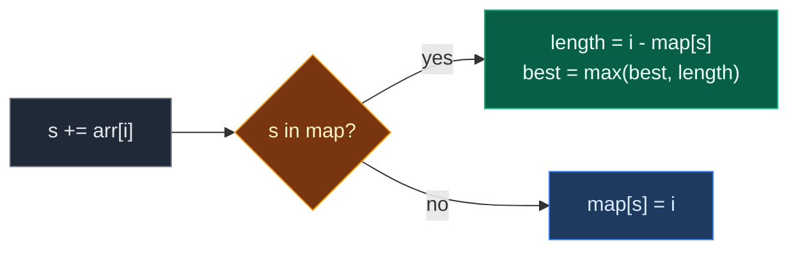

# 02. Largest subarray with 0 sum

| Difficulty | Pattern | Source | Time | Space |
|:---:|:---:|:---:|:---:|:---:|
| **Medium** | Prefix Sum + Hash Map | [Largest subarray with 0 sum](https://www.geeksforgeeks.org/problems/largest-subarray-with-0-sum/1) | `O(n)` | `O(n)` |

## 1. Problem Statement

You get an array `arr` with positive and negative integers.

Find the **length** of the longest subarray whose sum is `0`.

A subarray is a part of the array with no gaps (one or more elements next to each other).

If there is no such subarray, return `0`.

### Example

```text
Input:  arr = [15, -2, 2, -8, 1, 7, 10, 23]
Output: 5

The longest zero-sum part is [-2, 2, -8, 1, 7] (index 1 to 5).
-2 + 2 - 8 + 1 + 7 = 0
```

We use this same example in every section below.

(GfG also has `[2, 10, 4]` -> `0` and `[1, 0, -4, 3, 1, 0]` -> `5`. We test them in the code.)

### Constraints

- `1 <= arr.size() <= 10^6`
- `-10^3 <= arr[i] <= 10^3`

## 2. Core Theory

### What the problem really asks

Find two positions where "everything in between adds up to nothing". Make them as far apart as possible.

### The key fact: same prefix sum twice means a zero part

`prefix[i]` = sum of `arr[0..i]`.

```text
index:    0   1   2   3   4   5   6   7
arr:     15  -2   2  -8   1   7  10  23
prefix:  15  13  15   7   8  15  25  48
         ^^       ^^          ^^
```

- If `prefix[j] == prefix[i]` and `j < i`, then `sum(arr[j+1..i]) = prefix[i] - prefix[j] = 0`.
- Prefix `15` shows up at index `0`, `2` and `5`.
- Index `0` and index `5` are farthest apart: the part `arr[1..5]` has sum `0`, length `5 - 0 = 5`.

### Why a hash map fits

- Walk left to right with a running sum `s`.
- The map stores the **first** index of each prefix sum.
- If `s` is already in the map, the part after that first index sums to `0`.
- Seed the map with `{0: -1}`. It handles zero parts that start at index `0` (like `[1, -1]`).

This is the same as "Longest Subarray with Sum K" with `k = 0`. Then `s - k` is just `s`.



## 3. Edge Cases

| Case | Input | Expected | Why it matters |
|:---|:---|:---:|:---|
| Single zero | `[0]` | `1` | Only the `{0: -1}` seed gives length `1` |
| Single non-zero | `[7]` | `0` | No zero part exists |
| No valid answer | `[2, 10, 4]` | `0` | Must return `0` |
| All zeros | `[0, 0, 0]` | `3` | Prefix stays `0`. Seed `-1` gives the full length |
| Zero part from index 0 | `[1, 2, -3, 3]` | `3` | Without the seed you get `2` |
| Repeated prefix sum | `[15, -2, 2, -8, 1, 7, 10, 23]` | `5` | Keep the first index `0`. Overwriting gives `3` |
| Zeros inside | `[1, 0, -4, 3, 1, 0]` | `5` | Zeros make the part longer |
| Alternating signs | `[-1, 1, -1, 1]` | `4` | Sliding window cannot do this |

## 4. Brute Force: Try Every Start

### Idea

For each start, extend the end and keep a running sum. When the sum is `0`, record the length.

### Code

```python
# Import List for type hints
from typing import List


# Brute force: try every start and every end
class SolutionBrute:

    # Main method (GfG signature)
    def maxLen(self, arr: List[int]) -> int:

        # Best length found so far
        best = 0

        # Pick every start index
        for start in range(len(arr)):

            # Sum of arr[start..end]
            total = 0

            # Extend the end one step at a time
            for end in range(start, len(arr)):

                # Add the new element
                total += arr[end]

                # Zero sum found
                if total == 0:

                    # Keep the longer length
                    best = max(best, end - start + 1)

        # Return the best length
        return best
```

### Complexity

| Measure | Complexity | Why |
|:---|:---:|:---|
| **Time** | `O(n^2)` | Two nested loops. Too slow for `n = 10^6` |
| **Space** | `O(1)` | Only a few variables |

## 5. Optimal Approach: Prefix Sum + Hash Map

### Idea

1. `first = {0: -1}`, `s = 0`, `best = 0`.
2. For each index `i`:
   - `s += arr[i]`.
   - If `s` is in `first`: `best = max(best, i - first[s])`.
   - Else: `first[s] = i`.
3. Return `best`.

### Visual Walkthrough (Story Version)

Before the code, let us see the idea as a story.

**The story:** a hiker walks on a mountain path with 8 steps. Each number says how many meters the hiker goes up (plus) or down (minus). The hiker keeps a **notebook**: "the first time I was at height H, I was at step Y."

We want the **longest** part of the walk where the hiker ends at the **same height** as before it began. Up and down cancel out, so that part adds to `0`.

**The trick:** if the hiker is at a height that is already in the notebook, the walk since that first time went nowhere. The earliest note gives the longest walk.

Before walking, the hiker writes "height 0 at step -1" (the start line).

**How to read the pictures:** `[ ]` = one step. `^` = where the hiker is. `|---|` = the zero-sum part.

**Start**

```text
step:     0    1    2    3    4    5    6    7
move:   [15] [-2] [ 2] [-8] [ 1] [ 7] [10] [23]
height = 0    notebook: {0:-1}    best = 0
```

**Step 1: step 0, go up 15**

Height 15. Not in notebook. Write "15 at step 0".

```text
        [15] [-2] [ 2] [-8] [ 1] [ 7] [10] [23]
          ^
height = 15   notebook: {0:-1, 15:0}   best = 0
```

**Step 2: step 1, go down 2**

Height 13. Not in notebook. Write "13 at step 1".

```text
        [15] [-2] [ 2] [-8] [ 1] [ 7] [10] [23]
               ^
height = 13   notebook: {0:-1, 15:0, 13:1}   best = 0
```

**Step 3: step 2, go up 2**

Height 15. **Seen before** at step 0. Walk from step 1 to 2 went nowhere. Length `2 - 0 = 2`. Best = 2. Do not rewrite.

```text
        [15] [-2] [ 2] [-8] [ 1] [ 7] [10] [23]
             |-------|
                    ^
height = 15   notebook: {0:-1, 15:0, 13:1}   best = 2
```

**Step 4: step 3, go down 8**

Height 7. New. Write "7 at step 3".

```text
        [15] [-2] [ 2] [-8] [ 1] [ 7] [10] [23]
                         ^
height = 7    notebook: {0:-1, 15:0, 13:1, 7:3}   best = 2
```

**Step 5: step 4, go up 1**

Height 8. New. Write "8 at step 4".

```text
        [15] [-2] [ 2] [-8] [ 1] [ 7] [10] [23]
                              ^
height = 8    notebook: {0:-1, 15:0, 13:1, 7:3, 8:4}   best = 2
```

**Step 6: step 5, go up 7**

Height 15. **Seen before** at step 0. Length `5 - 0 = 5`. Best = 5.

```text
        [15] [-2] [ 2] [-8] [ 1] [ 7] [10] [23]
             |------------------------|
                                   ^
height = 15   notebook: unchanged   best = 5
```

**Step 7: step 6, go up 10**

Height 25. New. Write "25 at step 6".

```text
        [15] [-2] [ 2] [-8] [ 1] [ 7] [10] [23]
                                        ^
height = 25   notebook: {..., 25:6}   best = 5
```

**Step 8: step 7, go up 23**

Height 48. New. Write "48 at step 7". The walk is over.

```text
        [15] [-2] [ 2] [-8] [ 1] [ 7] [10] [23]
                                             ^
height = 48   notebook: {..., 25:6, 48:7}   best = 5
```

**All steps at a glance**

| Step | Move | Height `s` | Seen before? | Length | Best | Notebook change |
|:---:|:---:|:---:|:---:|:---:|:---:|:---|
| start | – | 0 | – | – | 0 | `0: -1` |
| 0 | +15 | 15 | no | – | 0 | add `15: 0` |
| 1 | -2 | 13 | no | – | 0 | add `13: 1` |
| 2 | +2 | 15 | yes, at 0 | 2 | 2 | none |
| 3 | -8 | 7 | no | – | 2 | add `7: 3` |
| 4 | +1 | 8 | no | – | 2 | add `8: 4` |
| 5 | +7 | 15 | yes, at 0 | 5 | 5 | none |
| 6 | +10 | 25 | no | – | 5 | add `25: 6` |
| 7 | +23 | 48 | no | – | 5 | add `48: 7` |

**What the story teaches**

| In the story | In the code |
|:---|:---|
| Step of the walk | Index `i` |
| Up or down move | `arr[i]` |
| Current height | Running prefix sum `s` |
| Notebook | Hash map `first` |
| "Height 0 at step -1" | Seed `{0: -1}` |
| Same height again | `s in first`, so the part sums to `0` |
| Walk length | `i - first[s]` |
| Never rewrite a note | Store only the first index |

Now the same steps again, this time with the exact values.

### Step-by-Step Example

```text
arr = [15, -2, 2, -8, 1, 7, 10, 23]
```

**Start:** `first = {0: -1}`, `s = 0`, `best = 0`.

**Step 1 (`i = 0`, `arr[0] = 15`):**

1. `s = 0 + 15 = 15`.
2. Is `15` in `first`? No.
3. Store `first[15] = 0`.

```text
s = 15, best = 0, first = {0: -1, 15: 0}
```

**Step 2 (`i = 1`, `arr[1] = -2`):**

1. `s = 15 - 2 = 13`.
2. Is `13` in `first`? No.
3. Store `first[13] = 1`.

```text
s = 13, best = 0, first = {0: -1, 15: 0, 13: 1}
```

**Step 3 (`i = 2`, `arr[2] = 2`):**

1. `s = 13 + 2 = 15`.
2. Is `15` in `first`? Yes, at `0`.
3. Length `= 2 - 0 = 2` (part `[-2, 2]`). `best = max(0, 2) = 2`.

```text
s = 15, best = 2, first = {0: -1, 15: 0, 13: 1}
```

**Step 4 (`i = 3`, `arr[3] = -8`):**

1. `s = 15 - 8 = 7`.
2. Is `7` in `first`? No.
3. Store `first[7] = 3`.

```text
s = 7, best = 2, first = {0: -1, 15: 0, 13: 1, 7: 3}
```

**Step 5 (`i = 4`, `arr[4] = 1`):**

1. `s = 7 + 1 = 8`.
2. Is `8` in `first`? No.
3. Store `first[8] = 4`.

```text
s = 8, best = 2, first = {0: -1, 15: 0, 13: 1, 7: 3, 8: 4}
```

**Step 6 (`i = 5`, `arr[5] = 7`):**

1. `s = 8 + 7 = 15`.
2. Is `15` in `first`? Yes, at `0`.
3. Length `= 5 - 0 = 5` (part `[-2, 2, -8, 1, 7]`). `best = max(2, 5) = 5`.

```text
s = 15, best = 5, first = {0: -1, 15: 0, 13: 1, 7: 3, 8: 4}
```

**Step 7 (`i = 6`, `arr[6] = 10`):**

1. `s = 15 + 10 = 25`.
2. Is `25` in `first`? No.
3. Store `first[25] = 6`.

```text
s = 25, best = 5, first = {0: -1, 15: 0, 13: 1, 7: 3, 8: 4, 25: 6}
```

**Step 8 (`i = 7`, `arr[7] = 23`):**

1. `s = 25 + 23 = 48`.
2. Is `48` in `first`? No.
3. Store `first[48] = 7`.

```text
s = 48, best = 5, first = {0: -1, 15: 0, 13: 1, 7: 3, 8: 4, 25: 6, 48: 7}
```

**Answer:** `5`.

### Code

```python
# Optimal: prefix sum + hash map of first positions
class Solution:

    # Main method (GfG signature)
    def maxLen(self, arr: List[int]) -> int:

        # first[sum] = first index where the prefix sum was this value
        first = {0: -1}

        # Running prefix sum
        s = 0

        # Best length found so far
        best = 0

        # Walk through the array
        for i, value in enumerate(arr):

            # Add the current element
            s += value

            # Same sum seen before: the part after it sums to 0
            if s in first:

                # Keep the longer length
                best = max(best, i - first[s])

            # New sum: remember its first index
            else:

                # Save the index
                first[s] = i

        # Return the best length
        return best


# Same algorithm, but it records (s, best, map copy) after every step
def trace_max_len(arr: List[int]) -> List[tuple]:

    # Same start values
    first, s, best = {0: -1}, 0, 0

    # Snapshots after each step
    states = []

    # Same loop as the solution
    for i, value in enumerate(arr):

        # Add the element
        s += value

        # Seen before
        if s in first:

            # Update best
            best = max(best, i - first[s])

        # New sum
        else:

            # Save the index
            first[s] = i

        # Save a snapshot
        states.append((s, best, dict(first)))

    # Return all snapshots
    return states


# Trace the example from this note
states = trace_max_len([15, -2, 2, -8, 1, 7, 10, 23])

# Step 1: s = 15, new
assert states[0] == (15, 0, {0: -1, 15: 0})

# Step 2: s = 13, new
assert states[1] == (13, 0, {0: -1, 15: 0, 13: 1})

# Step 3: s = 15 again, length 2
assert states[2] == (15, 2, {0: -1, 15: 0, 13: 1})

# Step 4: s = 7, new
assert states[3] == (7, 2, {0: -1, 15: 0, 13: 1, 7: 3})

# Step 5: s = 8, new
assert states[4] == (8, 2, {0: -1, 15: 0, 13: 1, 7: 3, 8: 4})

# Step 6: s = 15 again, length 5
assert states[5] == (15, 5, {0: -1, 15: 0, 13: 1, 7: 3, 8: 4})

# Step 7: s = 25, new
assert states[6] == (25, 5, {0: -1, 15: 0, 13: 1, 7: 3, 8: 4, 25: 6})

# Step 8: s = 48, new
assert states[7] == (48, 5, {0: -1, 15: 0, 13: 1, 7: 3, 8: 4, 25: 6, 48: 7})

# GfG example 1 (our example)
assert Solution().maxLen([15, -2, 2, -8, 1, 7, 10, 23]) == 5

# GfG example 2: no answer
assert Solution().maxLen([2, 10, 4]) == 0

# GfG example 3: zeros inside
assert Solution().maxLen([1, 0, -4, 3, 1, 0]) == 5

# Edge case: single zero
assert Solution().maxLen([0]) == 1

# Edge case: single non-zero
assert Solution().maxLen([7]) == 0

# Edge case: all zeros
assert Solution().maxLen([0, 0, 0]) == 3

# Edge case: zero part from index 0
assert Solution().maxLen([1, 2, -3, 3]) == 3

# Edge case: alternating signs
assert Solution().maxLen([-1, 1, -1, 1]) == 4

# Import random for cross-checks
import random

# Fixed seed so the test is repeatable
random.seed(11)

# Compare brute force and optimal on many random arrays
for _ in range(500):

    # Random array with negatives and zeros
    arr = [random.randint(-4, 4) for _ in range(random.randint(1, 12))]

    # Both must agree
    assert Solution().maxLen(arr) == SolutionBrute().maxLen(arr)

# All checks passed
print("All tests passed")
```

### Complexity

| Measure | Complexity | Why |
|:---|:---:|:---|
| **Time** | `O(n)` | One pass, each map lookup is `O(1)` on average |
| **Space** | `O(n)` | Up to `n + 1` different prefix sums in the map |

## 6. Common Mistakes

| Mistake | What goes wrong | Fix |
|:---|:---|:---|
| Overwriting the index of a repeated sum | Later index wins, lengths shrink. Our example gives `3` instead of `5` | Store only in the `else` branch |
| Forgetting the `{0: -1}` seed | Zero parts from index `0` are missed. `[1, -1]` gives `0` | Start with `first = {0: -1}` |
| Checking only `arr[i] == 0` | Finds single zeros, not longer zero parts | Compare prefix sums |
| Using sliding window | Needs all positive numbers. Fails with negatives | Use prefix sum + map |
| Using `{0: 0}` as the seed | Every length from index `0` is one short | Seed index must be `-1` |

## 7. Interview Follow-ups

### Q1. How do you return the subarray itself?

**Answer:**
- When `best` grows, save `start = first[s] + 1` and `end = i`.
- Return `arr[start : end + 1]` at the end.

### Q2. How do you count all zero-sum subarrays?

**Answer:**
- Store how many times each prefix sum appeared, seeded `{0: 1}`.
- At each step add `count[s]` to the answer, then do `count[s] += 1`.

### Q3. What if the target is `k` instead of `0`?

**Answer:**
- Look for `s - k` instead of `s`.
- Everything else stays the same.

### Q4. Can we do it without a hash map?

**Answer:**
- Sort pairs `(prefix, index)` and look at groups of equal prefix.
- That is `O(n log n)` time. The map is faster.

### Q5. Why is the earliest index the right one to keep?

**Answer:**
- Length is `i - first[s]`.
- Smaller stored index means a longer part.
- A later index can never give a longer answer.

## 8. Interview Explanation

> Two equal prefix sums mean the part between them adds up to zero. So I walk once with a running sum and a hash map from each sum to the first index where it appeared, seeded with sum 0 at index -1. If the current sum is already in the map, the part after that first index sums to zero, and I update the best length with i minus that index. Otherwise I store the sum. It is O(n) time and O(n) space.
