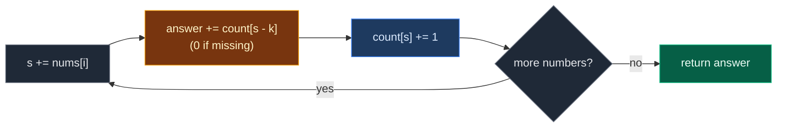

# 03. 560. Subarray Sum Equals K

| Difficulty | Pattern | Source | Time | Space |
|:---:|:---:|:---:|:---:|:---:|
| **Medium** | Prefix Sum + Hash Map | [560. Subarray Sum Equals K](https://leetcode.com/problems/subarray-sum-equals-k/) | `O(n)` | `O(n)` |

## 1. Problem Statement

You get an array of integers `nums` and a number `k`.

Return **how many** subarrays have a sum equal to `k`.

A subarray is a non-empty part of the array with no gaps.

The array can have negative numbers and zeros.

### Example

```text
Input:  nums = [3, 4, 7, 2, -3, 1, 4, 2], k = 7
Output: 4

The four subarrays with sum 7:
  [3, 4]           index 0..1
  [7]              index 2..2
  [7, 2, -3, 1]    index 2..5
  [1, 4, 2]        index 5..7
```

We use this same example in every section below.

(LeetCode has `[1, 1, 1], k = 2` -> `2` and `[1, 2, 3], k = 3` -> `2`. We test them in the code.)

### Constraints

- `1 <= nums.length <= 2 * 10^4`
- `-1000 <= nums[i] <= 1000`
- `-10^7 <= k <= 10^7`

## 2. Core Theory

### What the problem really asks

Count every pair `(start, end)` with `sum(nums[start..end]) == k`.

### Prefix sums turn a sum into a subtraction

`prefix[i]` = sum of `nums[0..i]`.

```text
index:    0   1   2   3   4   5   6   7
nums:     3   4   7   2  -3   1   4   2
prefix:   3   7  14  16  13  14  18  20
```

```text
sum(nums[j+1..i]) = prefix[i] - prefix[j]
```

So a part ending at `i` sums to `k` exactly when some earlier prefix equals `prefix[i] - k`.

### Why we store counts, not indices

- Every earlier prefix equal to `prefix[i] - k` gives **one** subarray ending at `i`.
- If that prefix appeared 2 times, there are 2 subarrays.
- So the map stores **how many times** each prefix sum appeared.

### Why the map starts as `{0: 1}`

- It means "the empty prefix, sum 0, appeared once".
- It counts subarrays that start at index `0`. Example: `[3, 4]` has prefix `7`, and `7 - 7 = 0` must be found.



### Why not sliding window?

Negatives break it. Adding a number can make the sum smaller. So "shrink when too big" can skip real answers.

## 3. Edge Cases

| Case | Input | Expected | Why it matters |
|:---|:---|:---:|:---|
| Single element equal to `k` | `[3], k = 3` | `1` | Only the `{0: 1}` seed finds it |
| Single element not equal to `k` | `[1], k = 3` | `0` | No match anywhere |
| Whole array sums to `k` | `[1, 2, 3], k = 6` | `1` | Uses the seed again |
| Negatives, `k = 0` | `[1, -1, 0], k = 0` | `3` | Needs counts, not just yes/no |
| All zeros, `k = 0` | `[0, 0, 0], k = 0` | `6` | Every subarray counts. Counts must stack |
| Leading zeros | `[0, 0, 1], k = 1` | `3` | Each zero makes one more valid subarray |
| No valid subarray | `[1, 2, 3], k = 100` | `0` | Lookups never hit |
| All negative | `[-1, -1, -1], k = -2` | `2` | Sign does not matter to the formula |

## 4. Brute Force: Try Every Start

### Idea

For each start, extend the end and keep a running sum. Every time the sum is `k`, add one.

### Code

```python
# Import List for type hints
from typing import List


# Brute force: try every start and every end
class SolutionBrute:

    # Main method
    def subarraySum(self, nums: List[int], k: int) -> int:

        # Number of subarrays found
        answer = 0

        # Pick every start index
        for start in range(len(nums)):

            # Sum of nums[start..end]
            total = 0

            # Extend the end one step at a time
            for end in range(start, len(nums)):

                # Add the new element
                total += nums[end]

                # This part sums to k
                if total == k:

                    # Count it
                    answer += 1

        # Return the count
        return answer
```

### Complexity

| Measure | Complexity | Why |
|:---|:---:|:---|
| **Time** | `O(n^2)` | Two nested loops, about `2 * 10^8` steps at the limit |
| **Space** | `O(1)` | Only a few variables |

## 5. Optimal Approach: Prefix Sum + Count Map

### Idea

1. `count = {0: 1}`, `s = 0`, `answer = 0`.
2. For each number:
   - `s += number`.
   - `answer += count.get(s - k, 0)`.
   - `count[s] += 1`.
3. Return `answer`.

Look up first, then store. Otherwise with `k = 0` the current prefix would match itself.

### Visual Walkthrough (Story Version)

Before the code, let us see the idea as a story.

**The story:** a kid walks past 8 boxes in a row. Each box has a number of candies (a minus number means the kid has to give candies back). The kid carries a bag and a **tally sheet**. The tally sheet says "how many times my bag has held exactly X candies".

The kid wants to count every stretch of boxes that gives **exactly 7** candies.

**The trick:** if the bag has `s` candies now, then every earlier moment when the bag had `s - 7` candies is the start of a stretch that gave exactly 7. The tally sheet tells how many such moments there were. So the kid adds that tally to the answer.

Before starting, the tally sheet says "0 candies: 1 time".

**How to read the pictures:** `[ ]` = one box. `^` = where the kid is. `|---|` = a stretch worth 7 found at this step.

**Start**

```text
box:      0    1    2    3    4    5    6    7
candy:  [ 3] [ 4] [ 7] [ 2] [-3] [ 1] [ 4] [ 2]
bag = 0    tally: {0:1}    answer = 0
```

**Step 1: box 0, +3**

Bag = 3. Look for `3 - 7 = -4`: tally 0. Answer stays 0. Tally 3 once.

```text
        [ 3] [ 4] [ 7] [ 2] [-3] [ 1] [ 4] [ 2]
          ^
bag = 3    tally: {0:1, 3:1}    answer = 0
```

**Step 2: box 1, +4**

Bag = 7. Look for `0`: tally 1. Answer = 1. Tally 7 once.

```text
        [ 3] [ 4] [ 7] [ 2] [-3] [ 1] [ 4] [ 2]
        |-------|
               ^
bag = 7    tally: {0:1, 3:1, 7:1}    answer = 1
```

**Step 3: box 2, +7**

Bag = 14. Look for `7`: tally 1. Answer = 2. Tally 14 once.

```text
        [ 3] [ 4] [ 7] [ 2] [-3] [ 1] [ 4] [ 2]
                  |--|
                    ^
bag = 14   tally: {0:1, 3:1, 7:1, 14:1}    answer = 2
```

**Step 4: box 3, +2**

Bag = 16. Look for `9`: tally 0. Answer stays 2. Tally 16 once.

```text
        [ 3] [ 4] [ 7] [ 2] [-3] [ 1] [ 4] [ 2]
                         ^
bag = 16   tally: {0:1, 3:1, 7:1, 14:1, 16:1}    answer = 2
```

**Step 5: box 4, -3**

Bag = 13. Look for `6`: tally 0. Answer stays 2. Tally 13 once.

```text
        [ 3] [ 4] [ 7] [ 2] [-3] [ 1] [ 4] [ 2]
                              ^
bag = 13   tally: {0:1, 3:1, 7:1, 14:1, 16:1, 13:1}    answer = 2
```

**Step 6: box 5, +1**

Bag = 14. Look for `7`: tally 1. Answer = 3. Tally 14 is now **2** times.

```text
        [ 3] [ 4] [ 7] [ 2] [-3] [ 1] [ 4] [ 2]
                  |--------------------|
                                   ^
bag = 14   tally: {0:1, 3:1, 7:1, 14:2, 16:1, 13:1}    answer = 3
```

**Step 7: box 6, +4**

Bag = 18. Look for `11`: tally 0. Answer stays 3. Tally 18 once.

```text
        [ 3] [ 4] [ 7] [ 2] [-3] [ 1] [ 4] [ 2]
                                        ^
bag = 18   tally: {..., 14:2, 16:1, 13:1, 18:1}    answer = 3
```

**Step 8: box 7, +2**

Bag = 20. Look for `13`: tally 1. Answer = 4. Tally 20 once.

```text
        [ 3] [ 4] [ 7] [ 2] [-3] [ 1] [ 4] [ 2]
                                  |-------------|
                                             ^
bag = 20   tally: {..., 13:1, 18:1, 20:1}    answer = 4
```

**All steps at a glance**

| Box | Candy | Bag `s` | Look for `s - 7` | Tally of it | Answer | Tally change |
|:---:|:---:|:---:|:---:|:---:|:---:|:---|
| start | – | 0 | – | – | 0 | `0: 1` |
| 0 | 3 | 3 | -4 | 0 | 0 | `3: 1` |
| 1 | 4 | 7 | 0 | 1 | 1 | `7: 1` |
| 2 | 7 | 14 | 7 | 1 | 2 | `14: 1` |
| 3 | 2 | 16 | 9 | 0 | 2 | `16: 1` |
| 4 | -3 | 13 | 6 | 0 | 2 | `13: 1` |
| 5 | 1 | 14 | 7 | 1 | 3 | `14: 2` |
| 6 | 4 | 18 | 11 | 0 | 3 | `18: 1` |
| 7 | 2 | 20 | 13 | 1 | 4 | `20: 1` |

**What the story teaches**

| In the story | In the code |
|:---|:---|
| Box | Index `i` |
| Candies in a box | `nums[i]` |
| Bag total | Running prefix sum `s` |
| Tally sheet | Hash map `count` |
| "0 candies: 1 time" | Seed `{0: 1}` |
| Look for `s - 7` | `count.get(s - k, 0)` |
| Add the tally to the answer | `answer += ...` |
| Mark the bag total | `count[s] += 1` |

Now the same steps again, this time with the exact values.

### Step-by-Step Example

```text
nums = [3, 4, 7, 2, -3, 1, 4, 2], k = 7
```

**Start:** `count = {0: 1}`, `s = 0`, `answer = 0`.

**Step 1 (`i = 0`, `nums[0] = 3`):**

1. `s = 0 + 3 = 3`.
2. `s - k = -4`. `count[-4] = 0`. `answer = 0 + 0 = 0`.
3. `count[3] = 1`.

```text
s = 3, answer = 0, count = {0: 1, 3: 1}
```

**Step 2 (`i = 1`, `nums[1] = 4`):**

1. `s = 3 + 4 = 7`.
2. `s - k = 0`. `count[0] = 1`. `answer = 0 + 1 = 1` (subarray `[3, 4]`).
3. `count[7] = 1`.

```text
s = 7, answer = 1, count = {0: 1, 3: 1, 7: 1}
```

**Step 3 (`i = 2`, `nums[2] = 7`):**

1. `s = 7 + 7 = 14`.
2. `s - k = 7`. `count[7] = 1`. `answer = 1 + 1 = 2` (subarray `[7]`).
3. `count[14] = 1`.

```text
s = 14, answer = 2, count = {0: 1, 3: 1, 7: 1, 14: 1}
```

**Step 4 (`i = 3`, `nums[3] = 2`):**

1. `s = 14 + 2 = 16`.
2. `s - k = 9`. `count[9] = 0`. `answer = 2`.
3. `count[16] = 1`.

```text
s = 16, answer = 2, count = {0: 1, 3: 1, 7: 1, 14: 1, 16: 1}
```

**Step 5 (`i = 4`, `nums[4] = -3`):**

1. `s = 16 - 3 = 13`.
2. `s - k = 6`. `count[6] = 0`. `answer = 2`.
3. `count[13] = 1`.

```text
s = 13, answer = 2, count = {0: 1, 3: 1, 7: 1, 14: 1, 16: 1, 13: 1}
```

**Step 6 (`i = 5`, `nums[5] = 1`):**

1. `s = 13 + 1 = 14`.
2. `s - k = 7`. `count[7] = 1`. `answer = 2 + 1 = 3` (subarray `[7, 2, -3, 1]`).
3. `count[14] = 1 + 1 = 2`.

```text
s = 14, answer = 3, count = {0: 1, 3: 1, 7: 1, 14: 2, 16: 1, 13: 1}
```

**Step 7 (`i = 6`, `nums[6] = 4`):**

1. `s = 14 + 4 = 18`.
2. `s - k = 11`. `count[11] = 0`. `answer = 3`.
3. `count[18] = 1`.

```text
s = 18, answer = 3, count = {0: 1, 3: 1, 7: 1, 14: 2, 16: 1, 13: 1, 18: 1}
```

**Step 8 (`i = 7`, `nums[7] = 2`):**

1. `s = 18 + 2 = 20`.
2. `s - k = 13`. `count[13] = 1`. `answer = 3 + 1 = 4` (subarray `[1, 4, 2]`).
3. `count[20] = 1`.

```text
s = 20, answer = 4, count = {0: 1, 3: 1, 7: 1, 14: 2, 16: 1, 13: 1, 18: 1, 20: 1}
```

**Answer:** `4`.

### Code

```python
# Optimal: prefix sum + hash map of counts
class Solution:

    # Main method
    def subarraySum(self, nums: List[int], k: int) -> int:

        # count[sum] = how many prefixes had this sum; the empty prefix has sum 0
        count = {0: 1}

        # Running prefix sum
        s = 0

        # Number of subarrays found
        answer = 0

        # Walk through the array
        for value in nums:

            # Add the current element
            s += value

            # Every earlier prefix equal to s - k starts one valid subarray
            answer += count.get(s - k, 0)

            # Record the current prefix sum
            count[s] = count.get(s, 0) + 1

        # Return the count
        return answer


# Same algorithm, but it records (s, answer, map copy) after every step
def trace_subarray_sum(nums: List[int], k: int) -> List[tuple]:

    # Same start values
    count, s, answer = {0: 1}, 0, 0

    # Snapshots after each step
    states = []

    # Same loop as the solution
    for value in nums:

        # Add the element
        s += value

        # Add matches
        answer += count.get(s - k, 0)

        # Record this sum
        count[s] = count.get(s, 0) + 1

        # Save a snapshot
        states.append((s, answer, dict(count)))

    # Return all snapshots
    return states


# Trace the example from this note
states = trace_subarray_sum([3, 4, 7, 2, -3, 1, 4, 2], 7)

# Step 1: s = 3, no match
assert states[0] == (3, 0, {0: 1, 3: 1})

# Step 2: s = 7, matches the seed 0
assert states[1] == (7, 1, {0: 1, 3: 1, 7: 1})

# Step 3: s = 14, matches 7
assert states[2] == (14, 2, {0: 1, 3: 1, 7: 1, 14: 1})

# Step 4: s = 16, no match
assert states[3] == (16, 2, {0: 1, 3: 1, 7: 1, 14: 1, 16: 1})

# Step 5: s = 13, no match
assert states[4] == (13, 2, {0: 1, 3: 1, 7: 1, 14: 1, 16: 1, 13: 1})

# Step 6: s = 14, matches 7, count[14] becomes 2
assert states[5] == (14, 3, {0: 1, 3: 1, 7: 1, 14: 2, 16: 1, 13: 1})

# Step 7: s = 18, no match
assert states[6] == (18, 3, {0: 1, 3: 1, 7: 1, 14: 2, 16: 1, 13: 1, 18: 1})

# Step 8: s = 20, matches 13
assert states[7] == (20, 4, {0: 1, 3: 1, 7: 1, 14: 2, 16: 1, 13: 1, 18: 1, 20: 1})

# Our example
assert Solution().subarraySum([3, 4, 7, 2, -3, 1, 4, 2], 7) == 4

# LeetCode example 1
assert Solution().subarraySum([1, 1, 1], 2) == 2

# LeetCode example 2
assert Solution().subarraySum([1, 2, 3], 3) == 2

# Edge case: single element equal to k
assert Solution().subarraySum([3], 3) == 1

# Edge case: single element not equal to k
assert Solution().subarraySum([1], 3) == 0

# Edge case: whole array sums to k
assert Solution().subarraySum([1, 2, 3], 6) == 1

# Edge case: negatives with k = 0
assert Solution().subarraySum([1, -1, 0], 0) == 3

# Edge case: all zeros with k = 0
assert Solution().subarraySum([0, 0, 0], 0) == 6

# Edge case: leading zeros
assert Solution().subarraySum([0, 0, 1], 1) == 3

# Edge case: no valid subarray
assert Solution().subarraySum([1, 2, 3], 100) == 0

# Edge case: all negative
assert Solution().subarraySum([-1, -1, -1], -2) == 2

# Import random for cross-checks
import random

# Fixed seed so the test is repeatable
random.seed(5)

# Compare brute force and optimal on many random arrays
for _ in range(500):

    # Random array with negatives and zeros
    nums = [random.randint(-4, 4) for _ in range(random.randint(1, 12))]

    # Random target
    k = random.randint(-6, 6)

    # Both must agree
    assert Solution().subarraySum(nums, k) == SolutionBrute().subarraySum(nums, k)

# All checks passed
print("All tests passed")
```

### Complexity

| Measure | Complexity | Why |
|:---|:---:|:---|
| **Time** | `O(n)` | One pass, each map lookup is `O(1)` on average |
| **Space** | `O(n)` | Up to `n + 1` different prefix sums in the map |

## 6. Common Mistakes

| Mistake | What goes wrong | Fix |
|:---|:---|:---|
| Forgetting `{0: 1}` | Subarrays that start at index `0` are missed. `[3], k = 3` gives `0` | Seed `count = {0: 1}` |
| Storing a set or a yes/no flag | Repeated prefix sums count only once. `[0, 0, 0], k = 0` gives too few | Store how many times each sum appeared |
| Storing `s` before the lookup | With `k = 0`, `s` matches itself and adds fake subarrays | Look up `s - k` first, then add `s` |
| Looking up `k - s` | Wrong sign, wrong matches | The earlier prefix is `s - k` |
| Using sliding window | Fails with negative numbers | Use prefix sum + count map |

## 7. Interview Follow-ups

### Q1. Why does this work with negative numbers?

**Answer:**
- The formula `prefix[i] - prefix[j] = k` is just subtraction.
- It does not care if numbers are positive or negative.
- Only sliding window needs positives.

### Q2. How do you get the longest such subarray instead?

**Answer:**
- Store the **first index** of each prefix sum, seeded `{0: -1}`.
- Length is `i - first[s - k]`. Keep the max.

### Q3. What if all numbers are positive?

**Answer:**
- Then a sliding window works in `O(1)` space.
- Grow the right end, shrink the left end while the sum is too big, count when it equals `k`.

### Q4. How about counting subarrays with XOR equal to `k`?

**Answer:**
- Same pattern. Use prefix XOR instead of prefix sum.
- Look up `x ^ k` instead of `s - k`.

### Q5. How about subarrays whose sum is divisible by `k`?

**Answer:**
- Store counts of `prefix % k` instead of `prefix`.
- Two equal remainders mean the part between them is divisible by `k`. That is LeetCode 974.

## 8. Interview Explanation

> The sum of a subarray ending at i equals k when some earlier prefix sum equals the current prefix minus k. So I walk once, keep a running sum, and keep a hash map that counts how many times each prefix sum has appeared, starting with 0 seen once for the empty prefix. At each step I add count[s - k] to the answer, then record s. Counts matter because the same prefix sum can appear many times, each one giving a different subarray. It is O(n) time and O(n) space and works with negatives.
