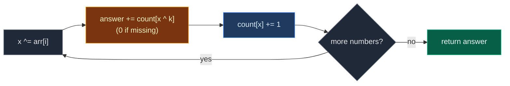

# 01. Count Subarrays with given XOR

| Difficulty | Pattern | Source | Time | Space |
|:---:|:---:|:---:|:---:|:---:|
| **Medium** | Prefix XOR + Hash Map | [Count Subarrays with given XOR](https://www.geeksforgeeks.org/problems/count-subarray-with-given-xor/1) | `O(n)` | `O(n)` |

## 1. Problem Statement

You get an array of integers `arr` and a number `k`.

Count how many subarrays have an **XOR** of all their elements equal to `k`.

A subarray is a non-empty part of the array with no gaps.

The answer fits in a 32-bit integer.

### Example

```text
Input:  arr = [4, 2, 2, 6, 4], k = 6
Output: 4

The four subarrays with XOR 6:
  [4, 2]            4 ^ 2 = 6
  [2, 2, 6]         2 ^ 2 ^ 6 = 6
  [6]               6
  [4, 2, 2, 6, 4]   4 ^ 2 ^ 2 ^ 6 ^ 4 = 6
```

We use this same example in every section below.

(GfG also has `[5, 6, 7, 8, 9], k = 5` -> `2` and `[1, 1, 1, 1], k = 0` -> `4`. We test them in the code.)

### Constraints

- `1 <= arr.size() <= 10^5`
- `0 <= arr[i] <= 10^5`
- `0 <= k <= 10^5`

## 2. Core Theory

### XOR in one minute

`a ^ b` compares bits. Same bits give `0`, different bits give `1`.

```text
4 = 100
2 = 010
4 ^ 2 = 110 = 6
```

Three facts we need:

| Fact | Meaning |
|:---|:---|
| `a ^ 0 = a` | XOR with 0 changes nothing |
| `a ^ a = 0` | A number cancels itself |
| order does not matter | `a ^ b ^ c = c ^ a ^ b` |

### Prefix XOR

`px[i]` = XOR of `arr[0..i]`.

```text
index:   0  1  2  3  4
arr:     4  2  2  6  4
px:      4  6  4  2  6
```

The XOR of a middle part is:

```text
xor(arr[j+1..i]) = px[i] ^ px[j]
```

Why? `px[i]` has every element from `0` to `i`. `px[j]` has every element from `0` to `j`. XOR them and the shared part `0..j` cancels itself (`a ^ a = 0`).

### Turning it into a lookup

We want `px[i] ^ px[j] == k`. XOR both sides with `k` and with `px[j]`:

```text
px[j] == px[i] ^ k
```

So at each index, ask the map: "How many earlier prefixes equal `x ^ k`?" Add that number.

- The map stores **counts**, because one prefix value can appear many times.
- Seed `{0: 1}`: the empty prefix has XOR `0`. It counts parts that start at index `0`.

This is the same pattern as LeetCode 560 (Subarray Sum Equals K). Only `+` becomes `^` and `s - k` becomes `x ^ k`.



## 3. Edge Cases

| Case | Input | Expected | Why it matters |
|:---|:---|:---:|:---|
| Single element, match | `[6], k = 6` | `1` | Only the `{0: 1}` seed finds it |
| Single element, no match | `[5], k = 6` | `0` | Lookup misses cleanly |
| `k = 0`, all equal | `[1, 1, 1, 1], k = 0` | `4` | Counts parts where equal prefixes repeat |
| All zeros, `k = 0` | `[0, 0, 0], k = 0` | `6` | Every subarray counts: `n(n+1)/2` |
| Whole array matches | `[5, 6, 7, 8, 9], k = 5` | `2` | `[5]` and the whole array both count |
| No valid answer | `[1, 2, 3], k = 100` | `0` | `x ^ k` is never in the map |
| One step adds 2 | `[4, 2, 2, 6, 4]`, at `i = 3` | adds `2` | Prefix `4` was seen twice, so two parts end here |

## 4. Brute Force: Try Every Start

### Idea

For each start, extend the end and keep a running XOR. Every time it equals `k`, add one.

### Code

```python
# Import List for type hints
from typing import List


# Brute force: try every start and every end
class SolutionBrute:

    # Main method (GfG signature)
    def subarrayXor(self, arr: List[int], k: int) -> int:

        # Number of subarrays found
        answer = 0

        # Pick every start index
        for start in range(len(arr)):

            # XOR of arr[start..end]
            x = 0

            # Extend the end one step at a time
            for end in range(start, len(arr)):

                # XOR in the new element
                x ^= arr[end]

                # This part has XOR k
                if x == k:

                    # Count it
                    answer += 1

        # Return the count
        return answer
```

### Complexity

| Measure | Complexity | Why |
|:---|:---:|:---|
| **Time** | `O(n^2)` | Two nested loops. About `5 * 10^9` steps at `n = 10^5` |
| **Space** | `O(1)` | Only a few variables |

## 5. Optimal Approach: Prefix XOR + Count Map

### Idea

1. `count = {0: 1}`, `x = 0`, `answer = 0`.
2. For each number:
   - `x ^= number`.
   - `answer += count.get(x ^ k, 0)`.
   - `count[x] += 1`.
3. Return `answer`.

### Visual Walkthrough (Story Version)

Before the code, let us see the idea as a story.

**The story:** a room has a row of light bulbs. All bulbs start **off**. Five kids walk in one by one. Each kid flips some switches (a number tells which ones, using its bits). Flipping a switch twice puts the bulb back.

We want to count every group of kids standing next to each other who, together, flip exactly the pattern `6` (`110`).

**The trick:** the bulbs on the wall right now show `x` (the XOR so far). If at some earlier moment the wall showed `x ^ 6`, then the kids since then flipped exactly pattern `6`. A **tally sheet** says how many times the wall showed each pattern. Add that tally.

Before anyone walks in, the tally says "pattern 0 (all off): 1 time".

**How to read the pictures:** `[ ]` = one kid's number. `^` = the kid who just walked in. Wall shows the bulbs as bits. `|--|` = a group found at this step.

**Start**

```text
kid:      0    1    2    3    4
flips:  [ 4] [ 2] [ 2] [ 6] [ 4]
wall = 000 (0)    tally: {0:1}    answer = 0
```

**Step 1: kid 0 flips 4 (`100`)**

Wall = `100` (4). Look for `4 ^ 6 = 2`: tally 0. Answer 0. Tally 4 once.

```text
        [ 4] [ 2] [ 2] [ 6] [ 4]
          ^
wall = 100 (4)    tally: {0:1, 4:1}    answer = 0
```

**Step 2: kid 1 flips 2 (`010`)**

Wall = `110` (6). Look for `6 ^ 6 = 0`: tally 1. Answer 1 (kids 0 to 1). Tally 6 once.

```text
        [ 4] [ 2] [ 2] [ 6] [ 4]
        |-------|
               ^
wall = 110 (6)    tally: {0:1, 4:1, 6:1}    answer = 1
```

**Step 3: kid 2 flips 2 (`010`)**

Wall = `100` (4). Look for `4 ^ 6 = 2`: tally 0. Answer 1. Tally 4 is now **2** times.

```text
        [ 4] [ 2] [ 2] [ 6] [ 4]
                    ^
wall = 100 (4)    tally: {0:1, 4:2, 6:1}    answer = 1
```

**Step 4: kid 3 flips 6 (`110`)**

Wall = `010` (2). Look for `2 ^ 6 = 4`: tally **2**. Answer 3. Two groups found: kids 1 to 3, and kid 3 alone. Tally 2 once.

```text
        [ 4] [ 2] [ 2] [ 6] [ 4]
             |------------|
                       |--|
                         ^
wall = 010 (2)    tally: {0:1, 4:2, 6:1, 2:1}    answer = 3
```

**Step 5: kid 4 flips 4 (`100`)**

Wall = `110` (6). Look for `0`: tally 1. Answer 4 (all five kids). Tally 6 is now 2 times.

```text
        [ 4] [ 2] [ 2] [ 6] [ 4]
        |----------------------|
                              ^
wall = 110 (6)    tally: {0:1, 4:2, 6:2, 2:1}    answer = 4
```

**All steps at a glance**

| Kid | Flips | Wall `x` | Look for `x ^ 6` | Tally of it | Answer | Tally change |
|:---:|:---:|:---:|:---:|:---:|:---:|:---|
| start | – | 0 | – | – | 0 | `0: 1` |
| 0 | 4 | 4 | 2 | 0 | 0 | `4: 1` |
| 1 | 2 | 6 | 0 | 1 | 1 | `6: 1` |
| 2 | 2 | 4 | 2 | 0 | 1 | `4: 2` |
| 3 | 6 | 2 | 4 | 2 | 3 | `2: 1` |
| 4 | 4 | 6 | 0 | 1 | 4 | `6: 2` |

**What the story teaches**

| In the story | In the code |
|:---|:---|
| Kid | Index `i` |
| Switches a kid flips | `arr[i]` |
| Flipping (twice cancels) | XOR `^` |
| Bulbs on the wall | Running prefix XOR `x` |
| Tally sheet | Hash map `count` |
| "All off: 1 time" | Seed `{0: 1}` |
| Look for `x ^ 6` | `count.get(x ^ k, 0)` |
| Mark the wall pattern | `count[x] += 1` |

Now the same steps again, this time with the exact values.

### Step-by-Step Example

```text
arr = [4, 2, 2, 6, 4], k = 6
```

**Start:** `count = {0: 1}`, `x = 0`, `answer = 0`.

**Step 1 (`i = 0`, `arr[0] = 4`):**

1. `x = 0 ^ 4 = 4`.
2. `x ^ k = 4 ^ 6 = 2`. `count[2] = 0`. `answer = 0`.
3. `count[4] = 1`.

```text
x = 4, answer = 0, count = {0: 1, 4: 1}
```

**Step 2 (`i = 1`, `arr[1] = 2`):**

1. `x = 4 ^ 2 = 6`.
2. `x ^ k = 6 ^ 6 = 0`. `count[0] = 1`. `answer = 0 + 1 = 1` (subarray `[4, 2]`).
3. `count[6] = 1`.

```text
x = 6, answer = 1, count = {0: 1, 4: 1, 6: 1}
```

**Step 3 (`i = 2`, `arr[2] = 2`):**

1. `x = 6 ^ 2 = 4`.
2. `x ^ k = 4 ^ 6 = 2`. `count[2] = 0`. `answer = 1`.
3. `count[4] = 1 + 1 = 2`.

```text
x = 4, answer = 1, count = {0: 1, 4: 2, 6: 1}
```

**Step 4 (`i = 3`, `arr[3] = 6`):**

1. `x = 4 ^ 6 = 2`.
2. `x ^ k = 2 ^ 6 = 4`. `count[4] = 2`. `answer = 1 + 2 = 3`.
   - Prefix `4` at index `0` gives `[2, 2, 6]`.
   - Prefix `4` at index `2` gives `[6]`.
3. `count[2] = 1`.

```text
x = 2, answer = 3, count = {0: 1, 4: 2, 6: 1, 2: 1}
```

**Step 5 (`i = 4`, `arr[4] = 4`):**

1. `x = 2 ^ 4 = 6`.
2. `x ^ k = 6 ^ 6 = 0`. `count[0] = 1`. `answer = 3 + 1 = 4` (the whole array).
3. `count[6] = 1 + 1 = 2`.

```text
x = 6, answer = 4, count = {0: 1, 4: 2, 6: 2, 2: 1}
```

**Answer:** `4`.

### Code

```python
# Optimal: prefix XOR + hash map of counts
class Solution:

    # Main method (GfG signature)
    def subarrayXor(self, arr: List[int], k: int) -> int:

        # count[value] = how many prefixes had this XOR; the empty prefix has XOR 0
        count = {0: 1}

        # Running prefix XOR
        x = 0

        # Number of subarrays found
        answer = 0

        # Walk through the array
        for value in arr:

            # XOR in the current element
            x ^= value

            # Every earlier prefix equal to x ^ k starts one valid subarray
            answer += count.get(x ^ k, 0)

            # Record the current prefix XOR
            count[x] = count.get(x, 0) + 1

        # Return the count
        return answer


# Same algorithm, but it records (x, answer, map copy) after every step
def trace_xor(arr: List[int], k: int) -> List[tuple]:

    # Same start values
    count, x, answer = {0: 1}, 0, 0

    # Snapshots after each step
    states = []

    # Same loop as the solution
    for value in arr:

        # XOR in the element
        x ^= value

        # Add matches
        answer += count.get(x ^ k, 0)

        # Record this prefix
        count[x] = count.get(x, 0) + 1

        # Save a snapshot
        states.append((x, answer, dict(count)))

    # Return all snapshots
    return states


# Trace the example from this note
states = trace_xor([4, 2, 2, 6, 4], 6)

# Step 1: x = 4, no match
assert states[0] == (4, 0, {0: 1, 4: 1})

# Step 2: x = 6, matches the seed
assert states[1] == (6, 1, {0: 1, 4: 1, 6: 1})

# Step 3: x = 4, no match, count[4] becomes 2
assert states[2] == (4, 1, {0: 1, 4: 2, 6: 1})

# Step 4: x = 2, matches 4 twice
assert states[3] == (2, 3, {0: 1, 4: 2, 6: 1, 2: 1})

# Step 5: x = 6, matches the seed
assert states[4] == (6, 4, {0: 1, 4: 2, 6: 2, 2: 1})

# GfG example 1 (our example)
assert Solution().subarrayXor([4, 2, 2, 6, 4], 6) == 4

# GfG example 2
assert Solution().subarrayXor([5, 6, 7, 8, 9], 5) == 2

# GfG example 3
assert Solution().subarrayXor([1, 1, 1, 1], 0) == 4

# Edge case: single element match
assert Solution().subarrayXor([6], 6) == 1

# Edge case: single element no match
assert Solution().subarrayXor([5], 6) == 0

# Edge case: all zeros with k = 0
assert Solution().subarrayXor([0, 0, 0], 0) == 6

# Edge case: no valid answer
assert Solution().subarrayXor([1, 2, 3], 100) == 0

# Import random for cross-checks
import random

# Fixed seed so the test is repeatable
random.seed(3)

# Compare brute force and optimal on many random arrays
for _ in range(500):

    # Random small values so XOR matches happen often
    arr = [random.randint(0, 7) for _ in range(random.randint(1, 12))]

    # Random target
    k = random.randint(0, 7)

    # Both must agree
    assert Solution().subarrayXor(arr, k) == SolutionBrute().subarrayXor(arr, k)

# All checks passed
print("All tests passed")
```

### Complexity

| Measure | Complexity | Why |
|:---|:---:|:---|
| **Time** | `O(n)` | One pass, each map lookup is `O(1)` on average |
| **Space** | `O(n)` | Up to `n + 1` different prefix XORs in the map |

## 6. Common Mistakes

| Mistake | What goes wrong | Fix |
|:---|:---|:---|
| Forgetting `{0: 1}` | Parts that start at index `0` are missed. `[6], k = 6` gives `0` | Seed `count = {0: 1}` |
| Storing a set instead of counts | Step 4 adds `1` instead of `2` | Store how many times each prefix appeared |
| Storing `x` before the lookup | With `k = 0`, `x` matches itself and adds fake parts | Look up first, then store |
| Using `x - k` like the sum version | Subtraction is not the undo of XOR | XOR undoes XOR: look up `x ^ k` |
| Trying a sliding window | XOR does not grow or shrink in order, so there is no rule to move the window | Use prefix XOR + map |

## 7. Interview Follow-ups

### Q1. Why does `px[i] ^ px[j]` give the XOR of the middle part?

**Answer:**
- Both prefixes contain `arr[0..j]`.
- XOR of the same thing twice is `0`, so that shared part cancels.
- Only `arr[j+1..i]` is left.

### Q2. How do you find the longest subarray with XOR `k`?

**Answer:**
- Store the **first index** of each prefix XOR, seeded `{0: -1}`.
- Length is `i - first[x ^ k]`. Keep the max.

### Q3. Can values be negative?

**Answer:**
- Here they are not. Python XOR still works on negatives.
- The idea does not change. Only the bit patterns look different.

### Q4. Can we avoid the hash map?

**Answer:**
- Values are at most `10^5 < 2^17`, so every prefix XOR is below `2^17`.
- Use an array of size `2^17` instead of a map. Same `O(n)` time, fixed memory.

### Q5. How is this related to Subarray Sum Equals K?

**Answer:**
- Same pattern: prefix value + count map + seed.
- Sum uses `s - k`. XOR uses `x ^ k`, because XOR is its own undo.

## 8. Interview Explanation

> The XOR of a subarray from j+1 to i is prefix XOR at i XOR prefix XOR at j, because the shared part cancels itself. So the subarray has XOR k when an earlier prefix equals x ^ k. I walk once, keep a running XOR, and a hash map counting how many times each prefix XOR has appeared, starting with 0 seen once. At each step I add count[x ^ k] to the answer, then record x. It is O(n) time and O(n) space.
