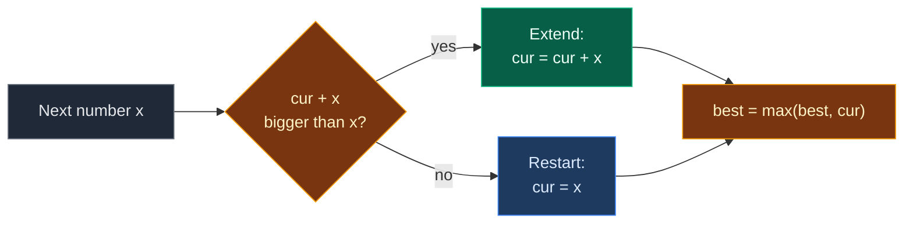

# 01. 53. Maximum Subarray

| Difficulty | Pattern | Source | Time | Space |
|:---:|:---:|:---:|:---:|:---:|
| **Medium** | Kadane's Algorithm | [53. Maximum Subarray](https://leetcode.com/problems/maximum-subarray/) | `O(n)` | `O(1)` |

## 1. Problem Statement

You get an integer array `nums`.

Find the subarray with the **largest sum** and return that sum.

A subarray is a non-empty part of the array with no gaps. You must pick at least one element.

### Example

```text
Input:  nums = [-2, 1, -3, 4, -1, 2, 1, -5, 4]
Output: 6

The best part is [4, -1, 2, 1] (index 3 to 6).
4 - 1 + 2 + 1 = 6
```

We use this same example in every section below.

(LeetCode also has `[1]` -> `1` and `[5, 4, -1, 7, 8]` -> `23`. We test them in the code.)

### Constraints

- `1 <= nums.length <= 10^5`
- `-10^4 <= nums[i] <= 10^4`
- **Follow up:** try a divide and conquer solution too.

## 2. Core Theory

### What the problem really asks

Among all `(start, end)` pairs, which part has the biggest sum?

### The smart question: best part that **ends here**

Let `cur` = the best sum of a part that ends exactly at index `i`.

A part that ends at `i` is one of two things:

1. Just `nums[i]` alone (start fresh).
2. The best part ending at `i - 1`, plus `nums[i]` (keep going).

```text
cur = max(nums[i], cur + nums[i])
```

The answer is the biggest `cur` we ever see. Keep it in `best`.

### Extend or restart?

- If the old `cur` is positive, adding it helps. Extend.
- If the old `cur` is zero or negative, it only drags us down. Throw it away and restart.
- Rule to remember: **a negative running sum can never help the future.**



### Why start with `nums[0]`, not `0`

If we start `best = 0`, an all-negative array like `[-3, -2, -5]` returns `0`. That means "pick nothing", which is not allowed. The real answer is `-2`. So start `cur = best = nums[0]`.

## 3. Edge Cases

| Case | Input | Expected | Why it matters |
|:---|:---|:---:|:---|
| Single element | `[1]` | `1` | Loop never runs. Start value is the answer |
| Single negative | `[-5]` | `-5` | Empty part is not allowed |
| All negative | `[-3, -2, -5]` | `-2` | Starting `best = 0` gives a wrong `0` |
| All positive | `[5, 4, 7, 8]` | `24` | Never restarts. Whole array wins |
| Dip worth crossing | `[5, 4, -1, 7, 8]` | `23` | Keeps the `-1` because the running sum stays positive |
| All zeros | `[0, 0, 0]` | `0` | A real `0` answer |
| Negative then positive | `[-2, 1]` | `1` | Restart beats extending to `-1` |

## 4. Brute Force: Try Every Start

### Idea

For each start, extend the end and keep a running sum. Keep the biggest sum seen.

### Code

```python
# Import List for type hints
from typing import List


# Brute force: try every start and every end
class SolutionBrute:

    # Main method
    def maxSubArray(self, nums: List[int]) -> int:

        # Best sum so far; start with the first element
        best = nums[0]

        # Pick every start index
        for start in range(len(nums)):

            # Sum of nums[start..end]
            total = 0

            # Extend the end one step at a time
            for end in range(start, len(nums)):

                # Add the new element
                total += nums[end]

                # Keep the bigger sum
                best = max(best, total)

        # Return the best sum
        return best
```

### Complexity

| Measure | Complexity | Why |
|:---|:---:|:---|
| **Time** | `O(n^2)` | Two nested loops. About `5 * 10^9` steps at `n = 10^5` |
| **Space** | `O(1)` | Only a few variables |

## 5. Optimal Approach: Kadane's Algorithm

### Idea

1. `cur = best = nums[0]`.
2. For each `i` from `1` to `n - 1`:
   - `cur = max(nums[i], cur + nums[i])`.
   - `best = max(best, cur)`.
3. Return `best`.

### Visual Walkthrough (Story Version)

Before the code, let us see the idea as a story.

**The story:** a kid walks down a street with 9 houses. At each house the kid gets candies (plus) or must give some away (minus). The kid holds a **basket** that holds the candies of the current streak of houses. The kid also has a **trophy shelf** where the biggest basket ever is written.

**The rules:**

- At each house, the kid asks: "Is my basket plus this house better than this house alone?"
- If yes, keep the basket and add the house. (**Extend**)
- If no, the basket is a burden. Empty it and start fresh with this house. (**Restart**)
- After each house, if the basket beats the trophy, update the trophy.

**How to read the pictures:** `[ ]` = one house. `^` = where the kid is. `|---|` = houses in the basket now.

**Start: house 0**

The kid must take at least one house. Basket = `-2`. Trophy = `-2`.

```text
house:   0    1    2    3    4    5    6    7    8
       [-2] [ 1] [-3] [ 4] [-1] [ 2] [ 1] [-5] [ 4]
       |--|
         ^
basket = -2    trophy = -2
```

**Step 1: house 1 (`+1`)**

Basket + 1 = `-1`. House alone = `1`. Alone is better. **Restart.** Basket = 1. Trophy = 1.

```text
       [-2] [ 1] [-3] [ 4] [-1] [ 2] [ 1] [-5] [ 4]
            |--|
              ^
basket = 1    trophy = 1
```

**Step 2: house 2 (`-3`)**

Basket - 3 = `-2`. House alone = `-3`. Basket is better. **Extend.** Basket = -2. Trophy stays 1.

```text
       [-2] [ 1] [-3] [ 4] [-1] [ 2] [ 1] [-5] [ 4]
            |-------|
                   ^
basket = -2    trophy = 1
```

**Step 3: house 3 (`+4`)**

Basket + 4 = `2`. House alone = `4`. Alone is better. **Restart.** Basket = 4. Trophy = 4.

```text
       [-2] [ 1] [-3] [ 4] [-1] [ 2] [ 1] [-5] [ 4]
                      |--|
                        ^
basket = 4    trophy = 4
```

**Step 4: house 4 (`-1`)**

Basket - 1 = `3`. House alone = `-1`. **Extend.** Basket = 3. Trophy stays 4.

```text
       [-2] [ 1] [-3] [ 4] [-1] [ 2] [ 1] [-5] [ 4]
                      |-------|
                             ^
basket = 3    trophy = 4
```

**Step 5: house 5 (`+2`)**

Basket + 2 = `5`. Alone = `2`. **Extend.** Basket = 5. Trophy = 5.

```text
       [-2] [ 1] [-3] [ 4] [-1] [ 2] [ 1] [-5] [ 4]
                      |------------|
                                  ^
basket = 5    trophy = 5
```

**Step 6: house 6 (`+1`)**

Basket + 1 = `6`. Alone = `1`. **Extend.** Basket = 6. Trophy = 6.

```text
       [-2] [ 1] [-3] [ 4] [-1] [ 2] [ 1] [-5] [ 4]
                      |-----------------|
                                       ^
basket = 6    trophy = 6
```

**Step 7: house 7 (`-5`)**

Basket - 5 = `1`. Alone = `-5`. **Extend.** Basket = 1. Trophy stays 6.

```text
       [-2] [ 1] [-3] [ 4] [-1] [ 2] [ 1] [-5] [ 4]
                      |----------------------|
                                            ^
basket = 1    trophy = 6
```

**Step 8: house 8 (`+4`)**

Basket + 4 = `5`. Alone = `4`. **Extend.** Basket = 5. Trophy stays 6.

```text
       [-2] [ 1] [-3] [ 4] [-1] [ 2] [ 1] [-5] [ 4]
                      |---------------------------|
                                                 ^
basket = 5    trophy = 6
```

The street ends. The trophy says `6`.

**All steps at a glance**

| House | Candy | Basket + house | House alone | Choice | Basket | Trophy |
|:---:|:---:|:---:|:---:|:---|:---:|:---:|
| 0 | -2 | – | -2 | start | -2 | -2 |
| 1 | 1 | -1 | 1 | restart | 1 | 1 |
| 2 | -3 | -2 | -3 | extend | -2 | 1 |
| 3 | 4 | 2 | 4 | restart | 4 | 4 |
| 4 | -1 | 3 | -1 | extend | 3 | 4 |
| 5 | 2 | 5 | 2 | extend | 5 | 5 |
| 6 | 1 | 6 | 1 | extend | 6 | 6 |
| 7 | -5 | 1 | -5 | extend | 1 | 6 |
| 8 | 4 | 5 | 4 | extend | 5 | 6 |

**What the story teaches**

| In the story | In the code |
|:---|:---|
| House | Index `i` |
| Candies at a house | `nums[i]` |
| Basket | `cur`, best sum ending here |
| Trophy shelf | `best`, best sum anywhere |
| Extend | `cur = cur + nums[i]` |
| Restart | `cur = nums[i]` |
| Must take at least one house | Start with `nums[0]`, not `0` |

Now the same steps again, this time with the exact values.

### Step-by-Step Example

```text
nums = [-2, 1, -3, 4, -1, 2, 1, -5, 4]
```

**Start:** `cur = nums[0] = -2`, `best = -2`.

**Step 1 (`i = 1`, `nums[1] = 1`):**

1. `cur + nums[1] = -2 + 1 = -1`.
2. `cur = max(1, -1) = 1`. Restart.
3. `best = max(-2, 1) = 1`.

```text
cur = 1, best = 1
```

**Step 2 (`i = 2`, `nums[2] = -3`):**

1. `cur + nums[2] = 1 - 3 = -2`.
2. `cur = max(-3, -2) = -2`. Extend.
3. `best = max(1, -2) = 1`.

```text
cur = -2, best = 1
```

**Step 3 (`i = 3`, `nums[3] = 4`):**

1. `cur + nums[3] = -2 + 4 = 2`.
2. `cur = max(4, 2) = 4`. Restart.
3. `best = max(1, 4) = 4`.

```text
cur = 4, best = 4
```

**Step 4 (`i = 4`, `nums[4] = -1`):**

1. `cur + nums[4] = 4 - 1 = 3`.
2. `cur = max(-1, 3) = 3`. Extend.
3. `best = max(4, 3) = 4`.

```text
cur = 3, best = 4
```

**Step 5 (`i = 5`, `nums[5] = 2`):**

1. `cur + nums[5] = 3 + 2 = 5`.
2. `cur = max(2, 5) = 5`. Extend.
3. `best = max(4, 5) = 5`.

```text
cur = 5, best = 5
```

**Step 6 (`i = 6`, `nums[6] = 1`):**

1. `cur + nums[6] = 5 + 1 = 6`.
2. `cur = max(1, 6) = 6`. Extend.
3. `best = max(5, 6) = 6`.

```text
cur = 6, best = 6
```

**Step 7 (`i = 7`, `nums[7] = -5`):**

1. `cur + nums[7] = 6 - 5 = 1`.
2. `cur = max(-5, 1) = 1`. Extend.
3. `best = max(6, 1) = 6`.

```text
cur = 1, best = 6
```

**Step 8 (`i = 8`, `nums[8] = 4`):**

1. `cur + nums[8] = 1 + 4 = 5`.
2. `cur = max(4, 5) = 5`. Extend.
3. `best = max(6, 5) = 6`.

```text
cur = 5, best = 6
```

**Answer:** `6`.

### Code

```python
# Optimal: Kadane's algorithm
class Solution:

    # Main method
    def maxSubArray(self, nums: List[int]) -> int:

        # Best sum of a part that ends at the current index
        cur = nums[0]

        # Best sum seen anywhere
        best = nums[0]

        # Walk from the second element
        for i in range(1, len(nums)):

            # Extend the old part, or restart at nums[i]
            cur = max(nums[i], cur + nums[i])

            # Keep the biggest sum seen
            best = max(best, cur)

        # Return the best sum
        return best


# Same algorithm, but it records (cur, best) after every step
def trace_kadane(nums: List[int]) -> List[tuple]:

    # Same start values
    cur = best = nums[0]

    # Snapshots after each step
    states = []

    # Same loop as the solution
    for i in range(1, len(nums)):

        # Extend or restart
        cur = max(nums[i], cur + nums[i])

        # Update best
        best = max(best, cur)

        # Save a snapshot
        states.append((cur, best))

    # Return all snapshots
    return states


# Trace the example from this note: one (cur, best) pair per step
assert trace_kadane([-2, 1, -3, 4, -1, 2, 1, -5, 4]) == [(1, 1), (-2, 1), (4, 4), (3, 4), (5, 5), (6, 6), (1, 6), (5, 6)]

# LeetCode example 1 (our example)
assert Solution().maxSubArray([-2, 1, -3, 4, -1, 2, 1, -5, 4]) == 6

# LeetCode example 2
assert Solution().maxSubArray([1]) == 1

# LeetCode example 3: dip worth crossing
assert Solution().maxSubArray([5, 4, -1, 7, 8]) == 23

# Edge case: single negative
assert Solution().maxSubArray([-5]) == -5

# Edge case: all negative
assert Solution().maxSubArray([-3, -2, -5]) == -2

# Edge case: all positive
assert Solution().maxSubArray([5, 4, 7, 8]) == 24

# Edge case: all zeros
assert Solution().maxSubArray([0, 0, 0]) == 0

# Edge case: negative then positive
assert Solution().maxSubArray([-2, 1]) == 1

# Import random for cross-checks
import random

# Fixed seed so the test is repeatable
random.seed(53)

# Compare brute force and optimal on many random arrays
for _ in range(500):

    # Random array with negatives
    nums = [random.randint(-10, 10) for _ in range(random.randint(1, 12))]

    # Both must agree
    assert Solution().maxSubArray(nums) == SolutionBrute().maxSubArray(nums)

# All checks passed
print("All tests passed")
```

### Complexity

| Measure | Complexity | Why |
|:---|:---:|:---|
| **Time** | `O(n)` | One pass |
| **Space** | `O(1)` | Only `cur` and `best` |

## 6. Common Mistakes

| Mistake | What goes wrong | Fix |
|:---|:---|:---|
| Starting `best = 0` | All-negative input returns `0` instead of the biggest element | Start `cur = best = nums[0]` |
| Resetting `cur = 0` before adding | Same problem: an empty part sneaks in | Use `cur = max(nums[i], cur + nums[i])` |
| Updating `best` before `cur` | `best` misses the newest part | Update `cur` first, then `best` |
| Starting the loop at `0` after seeding with `nums[0]` | `nums[0]` is counted twice | Loop from index `1` |
| Returning `cur` at the end | `cur` is only the best part ending at the last index | Return `best` |

## 7. Interview Follow-ups

### Q1. How do you return the subarray itself?

**Answer:**
- Keep `start` for the current part. On a restart, set `start = i`.
- When `best` grows, save `best_start = start` and `best_end = i`.
- For our example that gives index `3` to `6`: `[4, -1, 2, 1]`.

### Q2. What is the divide and conquer solution?

**Answer:**
- Split the array in half. The best part is in the left half, the right half, or crosses the middle.
- The crossing part = best suffix of the left + best prefix of the right.
- Time `O(n log n)`. Slower than Kadane, but it is the follow-up.

### Q3. What about a circular array (LeetCode 918)?

**Answer:**
- Answer is the bigger of: normal Kadane max, or `total - (min subarray)`.
- If all numbers are negative, use the normal max only.

### Q4. What if empty subarray was allowed?

**Answer:**
- Then start `best = 0` and `cur = 0`.
- All-negative input returns `0`.

### Q5. Why is Kadane a DP?

**Answer:**
- `dp[i]` = best sum ending at `i`. `dp[i] = max(nums[i], dp[i-1] + nums[i])`.
- `dp[i]` only needs `dp[i-1]`, so one variable is enough.

## 8. Interview Explanation

> I use Kadane's algorithm. At each index I keep the best sum of a part that ends exactly there: either I extend the previous part or I restart at the current number, whichever is bigger. A negative running sum can never help later, so restarting drops it. I also keep the best sum seen anywhere. I start both values with nums[0] so an all-negative array returns its largest element, not zero. It is O(n) time and O(1) space.
