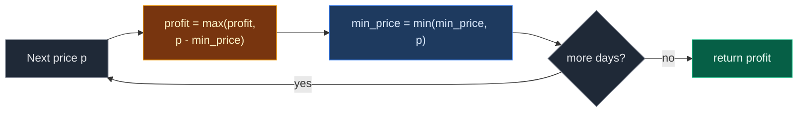

# 02. 121. Best Time to Buy and Sell Stock

| Difficulty | Pattern | Source | Time | Space |
|:---:|:---:|:---:|:---:|:---:|
| **Easy** | Running Minimum / One Pass (Kadane variant) | [121. Best Time to Buy and Sell Stock](https://leetcode.com/problems/best-time-to-buy-and-sell-stock/) | `O(n)` | `O(1)` |

## 1. Problem Statement

You get an array `prices`. `prices[i]` is the price of a stock on day `i`.

Pick **one day to buy** and **a later day to sell**.

Return the biggest profit you can make. If you cannot make any profit, return `0`.

You must buy before you sell.

### Example

```text
Input:  prices = [7, 1, 5, 3, 6, 4]
Output: 5

Buy on day 1 (price 1), sell on day 4 (price 6).
Profit = 6 - 1 = 5
```

We use this same example in every section below.

(LeetCode also has `[7, 6, 4, 3, 1]` -> `0`. We test it in the code.)

### Constraints

- `1 <= prices.length <= 10^5`
- `0 <= prices[i] <= 10^4`

## 2. Core Theory

### What the problem really asks

Find `max(prices[j] - prices[i])` with `i < j`. If every pair loses money, answer `0`.

### Fix the selling day

Think of each day as a possible **selling day**. To sell today with the most profit, you want to have bought at the **cheapest price before today**.

```text
best profit if I sell today = prices[today] - cheapest price so far
```

So walk left to right and keep two numbers:

- `min_price`: cheapest price seen so far.
- `profit`: best profit seen so far.



### Why this is Kadane in disguise

Make a list of daily changes: `d[i] = prices[i] - prices[i-1]`.

```text
prices = [7,  1,  5,  3,  6,  4]
d      =    [-6, +4, -2, +3, -2]
```

Buying on day `i` and selling on day `j` gives `d[i+1] + ... + d[j]`, a part of `d`. So the best trade is the **maximum subarray** of `d` (with `0` allowed for "no trade"). Here: `+4 - 2 + 3 = 5`.

## 3. Edge Cases

| Case | Input | Expected | Why it matters |
|:---|:---|:---:|:---|
| Single day | `[5]` | `0` | Cannot buy and sell on the same day |
| Two days, rising | `[1, 5]` | `4` | Smallest profitable case |
| Two days, falling | `[5, 1]` | `0` | Selling before buying is not allowed |
| Always falling | `[7, 6, 4, 3, 1]` | `0` | Never return a negative profit |
| Always rising | `[1, 2, 3, 4, 5]` | `4` | Buy first day, sell last day |
| All the same | `[3, 3, 3, 3]` | `0` | Profit is `0`, not negative |
| Max comes first | `[9, 1, 2]` | `1` | The highest price is before the lowest, so it is useless |
| Zero prices | `[0, 0, 10]` | `10` | `0` is a real price, not a "missing" marker |
| Best pair before the lowest price | `[3, 8, 1, 4]` | `5` | The answer `3 -> 8` comes before the global minimum `1` |

## 4. Brute Force: Try Every Pair

### Idea

Try every buy day `i` and every later sell day `j`. Keep the biggest `prices[j] - prices[i]`.

### Code

```python
# Import List for type hints
from typing import List


# Brute force: try every buy day and every later sell day
class SolutionBrute:

    # Main method
    def maxProfit(self, prices: List[int]) -> int:

        # Best profit so far; doing nothing gives 0
        profit = 0

        # Pick a buy day
        for i in range(len(prices)):

            # Pick a later sell day
            for j in range(i + 1, len(prices)):

                # Keep the bigger profit
                profit = max(profit, prices[j] - prices[i])

        # Return the best profit
        return profit
```

### Complexity

| Measure | Complexity | Why |
|:---|:---:|:---|
| **Time** | `O(n^2)` | Every pair of days |
| **Space** | `O(1)` | Only a few variables |

## 5. Optimal Approach: One Pass with Running Minimum

### Idea

1. `min_price = prices[0]`, `profit = 0`.
2. For each day from `1` to `n - 1`:
   - `profit = max(profit, prices[i] - min_price)`.
   - `min_price = min(min_price, prices[i])`.
3. Return `profit`.

### Visual Walkthrough (Story Version)

Before the code, let us see the idea as a story.

**The story:** a kid sells lemonade, and lemons cost a different price every day for 6 days. The kid can buy one bag of lemons once, and sell it once on a later day. The kid keeps a **sticky note** with the cheapest lemon price seen so far, and a **piggy bank note** with the best profit so far.

**The rules:**

- Each new day, the kid asks: "If I had bought at the cheapest day so far and sold today, how much would I make?"
- If that beats the piggy bank note, update it.
- Then, if today's price is cheaper than the sticky note, update the sticky note.

**How to read the pictures:** `[ ]` = price on a day. `B` = the cheapest day so far (the buy day). `^` = today.

**Start: day 0**

Sticky note = 7. Piggy bank = 0.

```text
day:     0   1   2   3   4   5
       [7] [1] [5] [3] [6] [4]
        B
        ^
cheapest = 7    profit = 0
```

**Step 1: day 1, price 1**

Sell today? `1 - 7 = -6`. Worse than 0. Profit stays 0. Price 1 is cheaper than 7. New sticky note: 1.

```text
       [7] [1] [5] [3] [6] [4]
            B
            ^
cheapest = 1    profit = 0
```

**Step 2: day 2, price 5**

Sell today? `5 - 1 = 4`. Better than 0. Profit = 4. Price 5 is not cheaper.

```text
       [7] [1] [5] [3] [6] [4]
            B   ^
cheapest = 1    profit = 4
```

**Step 3: day 3, price 3**

Sell today? `3 - 1 = 2`. Not better than 4. Price 3 is not cheaper.

```text
       [7] [1] [5] [3] [6] [4]
            B       ^
cheapest = 1    profit = 4
```

**Step 4: day 4, price 6**

Sell today? `6 - 1 = 5`. Better than 4. Profit = 5. Price 6 is not cheaper.

```text
       [7] [1] [5] [3] [6] [4]
            B           ^
cheapest = 1    profit = 5
```

**Step 5: day 5, price 4**

Sell today? `4 - 1 = 3`. Not better than 5. Price 4 is not cheaper.

```text
       [7] [1] [5] [3] [6] [4]
            B               ^
cheapest = 1    profit = 5
```

The days are over. Best profit: `5`.

**All steps at a glance**

| Day | Price | Sell today = price - cheapest | Profit after | Cheapest after |
|:---:|:---:|:---:|:---:|:---:|
| 0 | 7 | – | 0 | 7 |
| 1 | 1 | -6 | 0 | 1 |
| 2 | 5 | 4 | 4 | 1 |
| 3 | 3 | 2 | 4 | 1 |
| 4 | 6 | 5 | 5 | 1 |
| 5 | 4 | 3 | 5 | 1 |

**What the story teaches**

| In the story | In the code |
|:---|:---|
| Day | Index `i` |
| Lemon price | `prices[i]` |
| Sticky note (cheapest so far) | `min_price` |
| Piggy bank note (best profit) | `profit` |
| "Sell today" check | `prices[i] - min_price` |
| Buy before sell | Check profit first, then update `min_price` |
| Never lose money | `profit` starts at `0` |

Now the same steps again, this time with the exact values.

### Step-by-Step Example

```text
prices = [7, 1, 5, 3, 6, 4]
```

**Start:** `min_price = prices[0] = 7`, `profit = 0`.

**Step 1 (`i = 1`, price `1`):**

1. Sell today: `1 - 7 = -6`. `profit = max(0, -6) = 0`.
2. `min_price = min(7, 1) = 1`.

```text
min_price = 1, profit = 0
```

**Step 2 (`i = 2`, price `5`):**

1. Sell today: `5 - 1 = 4`. `profit = max(0, 4) = 4`.
2. `min_price = min(1, 5) = 1`.

```text
min_price = 1, profit = 4
```

**Step 3 (`i = 3`, price `3`):**

1. Sell today: `3 - 1 = 2`. `profit = max(4, 2) = 4`.
2. `min_price = min(1, 3) = 1`.

```text
min_price = 1, profit = 4
```

**Step 4 (`i = 4`, price `6`):**

1. Sell today: `6 - 1 = 5`. `profit = max(4, 5) = 5`.
2. `min_price = min(1, 6) = 1`.

```text
min_price = 1, profit = 5
```

**Step 5 (`i = 5`, price `4`):**

1. Sell today: `4 - 1 = 3`. `profit = max(5, 3) = 5`.
2. `min_price = min(1, 4) = 1`.

```text
min_price = 1, profit = 5
```

**Answer:** `5`.

### Code

```python
# Optimal: one pass with the cheapest price so far
class Solution:

    # Main method
    def maxProfit(self, prices: List[int]) -> int:

        # Cheapest price seen so far
        min_price = prices[0]

        # Best profit so far; doing nothing gives 0
        profit = 0

        # Treat every later day as a selling day
        for i in range(1, len(prices)):

            # Profit if we bought at the cheapest day and sell today
            profit = max(profit, prices[i] - min_price)

            # Today might be the new cheapest buying day
            min_price = min(min_price, prices[i])

        # Return the best profit
        return profit


# Same algorithm, but it records (min_price, profit) after every step
def trace_stock(prices: List[int]) -> List[tuple]:

    # Same start values
    min_price, profit = prices[0], 0

    # Snapshots after each step
    states = []

    # Same loop as the solution
    for i in range(1, len(prices)):

        # Sell today check
        profit = max(profit, prices[i] - min_price)

        # Update cheapest price
        min_price = min(min_price, prices[i])

        # Save a snapshot
        states.append((min_price, profit))

    # Return all snapshots
    return states


# Trace the example from this note: one (min_price, profit) pair per step
assert trace_stock([7, 1, 5, 3, 6, 4]) == [(1, 0), (1, 4), (1, 4), (1, 5), (1, 5)]

# LeetCode example 1 (our example)
assert Solution().maxProfit([7, 1, 5, 3, 6, 4]) == 5

# LeetCode example 2: always falling
assert Solution().maxProfit([7, 6, 4, 3, 1]) == 0

# Edge case: single day
assert Solution().maxProfit([5]) == 0

# Edge case: two days rising
assert Solution().maxProfit([1, 5]) == 4

# Edge case: two days falling
assert Solution().maxProfit([5, 1]) == 0

# Edge case: always rising
assert Solution().maxProfit([1, 2, 3, 4, 5]) == 4

# Edge case: all the same
assert Solution().maxProfit([3, 3, 3, 3]) == 0

# Edge case: max comes first
assert Solution().maxProfit([9, 1, 2]) == 1

# Edge case: zero prices
assert Solution().maxProfit([0, 0, 10]) == 10

# Edge case: best pair before the lowest price
assert Solution().maxProfit([3, 8, 1, 4]) == 5

# Import random for cross-checks
import random

# Fixed seed so the test is repeatable
random.seed(121)

# Compare brute force and optimal on many random arrays
for _ in range(500):

    # Random prices
    prices = [random.randint(0, 20) for _ in range(random.randint(1, 12))]

    # Both must agree
    assert Solution().maxProfit(prices) == SolutionBrute().maxProfit(prices)

# All checks passed
print("All tests passed")
```

### Complexity

| Measure | Complexity | Why |
|:---|:---:|:---|
| **Time** | `O(n)` | One pass |
| **Space** | `O(1)` | Only `min_price` and `profit` |

## 6. Common Mistakes

| Mistake | What goes wrong | Fix |
|:---|:---|:---|
| Starting `profit = -inf` | Falling prices return a negative number | Start `profit = 0` |
| Using global max minus global min | `[9, 1, 2]` gives `8`, but you cannot sell before buying | Only look at the cheapest price **before** today |
| Starting `min_price = 0` | Every price looks like profit. `[3, 5]` gives `5` | Start with `prices[0]` (or infinity) |
| Stopping at the first profit | `[1, 2, 100]` returns `1` | Scan all days |
| Reading `prices[1]` without a check | `[5]` crashes | The loop from `1` handles one day by itself |

## 7. Interview Follow-ups

### Q1. What if you can trade many times (LeetCode 122)?

**Answer:**
- Add up every rise: `sum(max(0, prices[i] - prices[i-1]))`.
- Every upward step is profit you can grab.
- Still `O(n)` time, `O(1)` space.

### Q2. What about at most 2 trades (LeetCode 123)?

**Answer:**
- Keep 4 numbers: `buy1`, `sell1`, `buy2`, `sell2`.
- Update each day: `buy1 = max(buy1, -p)`, `sell1 = max(sell1, buy1 + p)`, `buy2 = max(buy2, sell1 - p)`, `sell2 = max(sell2, buy2 + p)`.
- Return `sell2`.

### Q3. How do you return the buy and sell days?

**Answer:**
- Keep `min_index` next to `min_price`.
- When `profit` grows, save `buy = min_index`, `sell = i`.
- For our example: buy day `1`, sell day `4`.

### Q4. How is this the same as Maximum Subarray?

**Answer:**
- Build daily changes `d[i] = prices[i] - prices[i-1]`.
- A trade's profit is a sum of a part of `d`.
- So the answer is Kadane on `d`, with `0` as the floor.

### Q5. Does it work on a live stream of prices?

**Answer:**
- Yes. It only keeps two numbers.
- Each new price is used once and then forgotten.

## 8. Interview Explanation

> I treat each day as a possible selling day. The best buy for that day is the cheapest price before it, so I keep the minimum price seen so far. For each day I compute price minus that minimum and keep the biggest value as the profit, starting from zero so I never return a loss. Then I update the minimum. It is one pass, O(n) time and O(1) space, and it is really Kadane's algorithm on the daily price changes.
