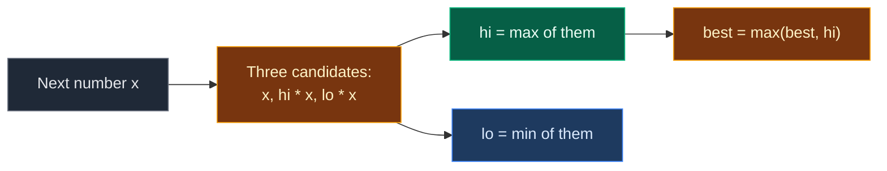

# 03. 152. Maximum Product Subarray

| Difficulty | Pattern | Source | Time | Space |
|:---:|:---:|:---:|:---:|:---:|
| **Hard** | Modified Kadane (Min/Max Tracking) | [152. Maximum Product Subarray](https://leetcode.com/problems/maximum-product-subarray/) | `O(n)` | `O(1)` |

## 1. Problem Statement

You get an integer array `nums`.

Find the subarray with the **largest product** and return that product.

A subarray is a non-empty part of the array with no gaps. A single element's product is the element itself.

The answer fits in a 32-bit integer.

### Example

```text
Input:  nums = [2, 3, -2, 4, -1]
Output: 48

The whole array: 2 * 3 * (-2) * 4 * (-1) = 48
The two negatives cancel each other out.
```

We use this same example in every section below.

(LeetCode has `[2, 3, -2, 4]` -> `6` and `[-2, 0, -1]` -> `0`. We test them in the code.)

### Constraints

- `1 <= nums.length <= 2 * 10^4`
- `-10 <= nums[i] <= 10`
- The product of any subarray fits in a 32-bit integer

## 2. Core Theory

### Why plain Kadane is not enough

For sums, the best part ending here only needs the best part ending one step before.

For products, a **negative number flips everything**:

- The biggest product times a negative becomes the smallest.
- The smallest (most negative) product times a negative becomes the biggest.

So the smallest product is not junk. It is a "future winner" waiting for a negative number.

### Track two values

At each index keep:

- `hi` = biggest product of a part ending here.
- `lo` = smallest product of a part ending here.

Each comes from three choices:

```text
candidates = nums[i],  hi * nums[i],  lo * nums[i]
hi = max(candidates)
lo = min(candidates)
best = max(best, hi)
```

- `nums[i]` alone means "start fresh".
- Both old values are used **before** they are changed. Save them first.



### Zeros need no special code

A zero makes all three candidates `0`. So `hi = lo = 0`. The next number starts fresh through the "`x` alone" candidate.

## 3. Edge Cases

| Case | Input | Expected | Why it matters |
|:---|:---|:---:|:---|
| Single element | `[5]` | `5` | Loop never runs. Answer is `nums[0]` |
| Single negative | `[-5]` | `-5` | Do not start `best = 0` |
| Zero breaks the chain | `[0, 2]` | `2` | Fresh start after the zero |
| Zero is the max | `[-2, 0, -1]` | `0` | `[-2, -1]` is not a subarray |
| Two negatives flip | `[-2, 3, -4]` | `24` | The tracked minimum becomes the maximum |
| All negative, odd count | `[-1, -2, -3]` | `6` | Best drops one negative: `[-2, -3]` |
| All negative, even count | `[-1, -2, -3, -4]` | `24` | Whole array works |
| Leading zeros | `[0, 0, -3]` | `0` | `0` beats `-3` |
| One negative in the middle | `[2, 3, -2, 4]` | `6` | `[2, 3]` beats the whole array `-48` |

## 4. Brute Force: Try Every Start

### Idea

For each start, extend the end and keep a running product. Keep the biggest product seen.

### Code

```python
# Import List for type hints
from typing import List


# Brute force: try every start and every end
class SolutionBrute:

    # Main method
    def maxProduct(self, nums: List[int]) -> int:

        # Best product so far; start with the first element
        best = nums[0]

        # Pick every start index
        for start in range(len(nums)):

            # Product of nums[start..end]
            product = 1

            # Extend the end one step at a time
            for end in range(start, len(nums)):

                # Multiply in the new element
                product *= nums[end]

                # Keep the bigger product
                best = max(best, product)

        # Return the best product
        return best
```

### Complexity

| Measure | Complexity | Why |
|:---|:---:|:---|
| **Time** | `O(n^2)` | Two nested loops |
| **Space** | `O(1)` | Only a few variables |

## 5. Optimal Approach: Kadane with Max and Min

### Idea

1. `hi = lo = best = nums[0]`.
2. For each `x` in `nums[1:]`:
   - `a, b, c = x, hi * x, lo * x`.
   - `hi = max(a, b, c)`, `lo = min(a, b, c)`.
   - `best = max(best, hi)`.
3. Return `best`.

### Visual Walkthrough (Story Version)

Before the code, let us see the idea as a story.

**The story:** a kid walks past 5 magic doors. Each door has a number card. When the kid walks through, every score the kid holds gets **multiplied** by that card. A **minus card** is a mirror: it turns big into small and small into big.

The kid carries two jars:

- **Big jar**: the biggest score of a run of doors ending here.
- **Small jar**: the smallest (most negative) score of a run ending here.

And a **trophy** for the biggest score ever.

**The rules at each door:**

- Three choices: start fresh with this card, big jar times the card, small jar times the card.
- The biggest choice goes in the big jar. The smallest goes in the small jar.
- If the big jar beats the trophy, update the trophy.

**How to read the pictures:** `[ ]` = a door card. `^` = the door the kid just went through.

**Start: door 0 (card 2)**

Big jar = 2. Small jar = 2. Trophy = 2.

```text
door:    0    1    2    3    4
       [ 2] [ 3] [-2] [ 4] [-1]
         ^
big = 2    small = 2    trophy = 2
```

**Step 1: door 1 (card 3)**

Choices: `3`, `2 * 3 = 6`, `2 * 3 = 6`. Big = 6, small = 3. Trophy = 6.

```text
       [ 2] [ 3] [-2] [ 4] [-1]
              ^
big = 6    small = 3    trophy = 6
```

**Step 2: door 2 (card -2, a mirror)**

Choices: `-2`, `6 * -2 = -12`, `3 * -2 = -6`. Big = -2, small = -12. The big jar fell, the small jar got very negative. Trophy stays 6.

```text
       [ 2] [ 3] [-2] [ 4] [-1]
                   ^
big = -2    small = -12    trophy = 6
```

**Step 3: door 3 (card 4)**

Choices: `4`, `-2 * 4 = -8`, `-12 * 4 = -48`. Big = 4, small = -48. Trophy stays 6.

```text
       [ 2] [ 3] [-2] [ 4] [-1]
                        ^
big = 4    small = -48    trophy = 6
```

**Step 4: door 4 (card -1, a mirror)**

Choices: `-1`, `4 * -1 = -4`, `-48 * -1 = 48`. The small jar flips into the winner. Big = 48, small = -4. Trophy = 48.

```text
       [ 2] [ 3] [-2] [ 4] [-1]
                             ^
big = 48    small = -4    trophy = 48
```

The doors are done. Trophy: `48`.

**All steps at a glance**

| Door | Card | Fresh | Big x card | Small x card | Big | Small | Trophy |
|:---:|:---:|:---:|:---:|:---:|:---:|:---:|:---:|
| 0 | 2 | – | – | – | 2 | 2 | 2 |
| 1 | 3 | 3 | 6 | 6 | 6 | 3 | 6 |
| 2 | -2 | -2 | -12 | -6 | -2 | -12 | 6 |
| 3 | 4 | 4 | -8 | -48 | 4 | -48 | 6 |
| 4 | -1 | -1 | -4 | 48 | 48 | -4 | 48 |

**What the story teaches**

| In the story | In the code |
|:---|:---|
| Door card | `nums[i]` |
| Big jar | `hi` |
| Small jar | `lo` |
| Trophy | `best` |
| Mirror (minus card) | A negative `x` swaps which jar wins |
| Start fresh | Candidate `x` alone |
| Small jar turning into the winner | `lo * x` becomes the new `hi` |

Now the same steps again, this time with the exact values.

### Step-by-Step Example

```text
nums = [2, 3, -2, 4, -1]
```

**Start:** `hi = 2`, `lo = 2`, `best = 2`.

**Step 1 (`i = 1`, `x = 3`):**

1. Candidates: `x = 3`, `hi * x = 2 * 3 = 6`, `lo * x = 2 * 3 = 6`.
2. `hi = max(3, 6, 6) = 6`.
3. `lo = min(3, 6, 6) = 3`.
4. `best = max(2, 6) = 6`.

```text
hi = 6, lo = 3, best = 6
```

**Step 2 (`i = 2`, `x = -2`):**

1. Candidates: `-2`, `6 * -2 = -12`, `3 * -2 = -6`.
2. `hi = max(-2, -12, -6) = -2`.
3. `lo = min(-2, -12, -6) = -12`.
4. `best = max(6, -2) = 6`.

```text
hi = -2, lo = -12, best = 6
```

**Step 3 (`i = 3`, `x = 4`):**

1. Candidates: `4`, `-2 * 4 = -8`, `-12 * 4 = -48`.
2. `hi = max(4, -8, -48) = 4`.
3. `lo = min(4, -8, -48) = -48`.
4. `best = max(6, 4) = 6`.

```text
hi = 4, lo = -48, best = 6
```

**Step 4 (`i = 4`, `x = -1`):**

1. Candidates: `-1`, `4 * -1 = -4`, `-48 * -1 = 48`.
2. `hi = max(-1, -4, 48) = 48`.
3. `lo = min(-1, -4, 48) = -4`.
4. `best = max(6, 48) = 48`.

```text
hi = 48, lo = -4, best = 48
```

**Answer:** `48`.

### Code

```python
# Optimal: Kadane that tracks both the biggest and smallest product
class Solution:

    # Main method
    def maxProduct(self, nums: List[int]) -> int:

        # Biggest product of a part ending here
        hi = nums[0]

        # Smallest product of a part ending here
        lo = nums[0]

        # Biggest product seen anywhere
        best = nums[0]

        # Walk from the second element
        for x in nums[1:]:

            # Three choices: start fresh, extend the biggest, extend the smallest
            a, b, c = x, hi * x, lo * x

            # New biggest product ending here
            hi = max(a, b, c)

            # New smallest product ending here
            lo = min(a, b, c)

            # Keep the biggest product seen
            best = max(best, hi)

        # Return the best product
        return best


# Same algorithm, but it records (hi, lo, best) after every step
def trace_product(nums: List[int]) -> List[tuple]:

    # Same start values
    hi = lo = best = nums[0]

    # Snapshots after each step
    states = []

    # Same loop as the solution
    for x in nums[1:]:

        # Three choices
        a, b, c = x, hi * x, lo * x

        # Update both jars
        hi, lo = max(a, b, c), min(a, b, c)

        # Update the trophy
        best = max(best, hi)

        # Save a snapshot
        states.append((hi, lo, best))

    # Return all snapshots
    return states


# Trace the example from this note: one (hi, lo, best) per step
assert trace_product([2, 3, -2, 4, -1]) == [(6, 3, 6), (-2, -12, 6), (4, -48, 6), (48, -4, 48)]

# Our example
assert Solution().maxProduct([2, 3, -2, 4, -1]) == 48

# LeetCode example 1
assert Solution().maxProduct([2, 3, -2, 4]) == 6

# LeetCode example 2
assert Solution().maxProduct([-2, 0, -1]) == 0

# Edge case: single element
assert Solution().maxProduct([5]) == 5

# Edge case: single negative
assert Solution().maxProduct([-5]) == -5

# Edge case: zero breaks the chain
assert Solution().maxProduct([0, 2]) == 2

# Edge case: two negatives flip
assert Solution().maxProduct([-2, 3, -4]) == 24

# Edge case: all negative, odd count
assert Solution().maxProduct([-1, -2, -3]) == 6

# Edge case: all negative, even count
assert Solution().maxProduct([-1, -2, -3, -4]) == 24

# Edge case: leading zeros
assert Solution().maxProduct([0, 0, -3]) == 0

# Import random for cross-checks
import random

# Fixed seed so the test is repeatable
random.seed(152)

# Compare brute force and optimal on many random arrays
for _ in range(500):

    # Random small values with negatives and zeros
    nums = [random.randint(-3, 3) for _ in range(random.randint(1, 10))]

    # Both must agree
    assert Solution().maxProduct(nums) == SolutionBrute().maxProduct(nums)

# All checks passed
print("All tests passed")
```

### Complexity

| Measure | Complexity | Why |
|:---|:---:|:---|
| **Time** | `O(n)` | One pass |
| **Space** | `O(1)` | Only `hi`, `lo` and `best` |

## 6. Common Mistakes

| Mistake | What goes wrong | Fix |
|:---|:---|:---|
| Tracking only the max | `[-2, 3, -4]` returns `3` instead of `24` | Track `lo` too |
| Updating `hi` and then using the new `hi` for `lo` | `lo` is built from a wrong value | Compute all three candidates first, then update both |
| Starting `best = 0` | `[-5]` returns `0` | Start with `nums[0]` |
| Special code for zero that skips it | `[-2, 0, -1]` must return `0`, skipping zero loses it | No special case. Zero resets both jars by itself |
| Forgetting the "`x` alone" choice | After a zero, the chain can never restart | Always include `x` as a candidate |

## 7. Interview Follow-ups

### Q1. Is there a version that swaps instead of using three candidates?

**Answer:**
- Yes. If `x < 0`, swap `hi` and `lo` first.
- Then `hi = max(x, hi * x)` and `lo = min(x, lo * x)`.
- Same result, same `O(n)`.

### Q2. Is there another `O(n)` idea?

**Answer:**
- Yes: scan the prefix product from the left and from the right. Reset to `1` after a zero.
- The answer is the biggest value seen in either scan.
- It works because the best part drops either the first or the last negative.

### Q3. What if the product could overflow?

**Answer:**
- Python has no overflow.
- In Java or C++ use `long`, or use logs of absolute values and track the sign separately.

### Q4. How do you return the subarray itself?

**Answer:**
- Keep a start index for both `hi` and `lo`.
- When a jar takes "`x` alone", its start becomes `i`. When jars swap roles, swap the starts too.

### Q5. Why is this still "Kadane"?

**Answer:**
- Same shape: best value ending here, extend or restart, keep a global best.
- The only change: products need the minimum too, because negatives flip order.

## 8. Interview Explanation

> This is Kadane's algorithm adapted for products. A negative number turns the smallest product into the biggest, so at each index I keep both the biggest and the smallest product of a part ending there. Each comes from three choices: the number alone, the old biggest times it, or the old smallest times it. I update the global best with the biggest. Zeros reset both values on their own. It is one pass, O(n) time and O(1) space.
