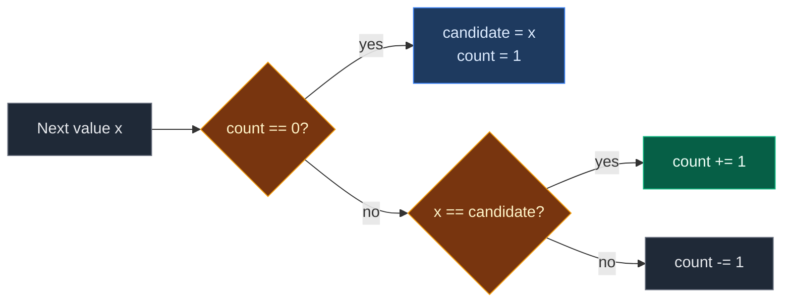

# 01. 169. Majority Element

| Difficulty | Pattern | Source | Time | Space |
|:---:|:---:|:---:|:---:|:---:|
| **Easy** | Boyer-Moore Voting | [169. Majority Element](https://leetcode.com/problems/majority-element/) | `O(n)` | `O(1)` |

## 1. Problem Statement

You get an array `nums` of size `n`.

Return the **majority element**: the value that appears **more than** `n / 2` times (rounded down).

You may assume the majority element always exists.

### Example

```text
Input:  nums = [2, 2, 1, 1, 1, 2, 2]
Output: 2

n = 7, so the majority must appear more than 3 times.
2 appears 4 times. 1 appears 3 times.
```

We use this same example in every section below.

(LeetCode also has `[3, 2, 3]` -> `3`. We test it in the code.)

### Constraints

- `n == nums.length`
- `1 <= n <= 5 * 10^4`
- `-10^9 <= nums[i] <= 10^9`
- A majority element always exists
- **Follow up:** solve it in `O(n)` time and `O(1)` space

## 2. Core Theory

### What the problem really asks

Find the one value that is more than half of the array. There can only be one such value.

### The pairing idea

- Take two **different** values and remove them both. Do it again and again.
- Each removal takes away at most one copy of the majority, and one other value.
- The majority has more copies than **all the others together**.
- So the others run out first. What is left must be the majority.

```text
nums = [2, 2, 1, 1, 1, 2, 2]

pair off:  2-1   2-1   2-1     three pairs removed
left:      2                   -> the majority
```

### Boyer-Moore does this pairing in one pass

Keep a `candidate` and a `count`:

| Situation | Action | Meaning |
|:---|:---|:---|
| `count == 0` | `candidate = x`, `count = 1` | Nobody is leading, `x` takes the lead |
| `x == candidate` | `count += 1` | One more vote for the leader |
| `x != candidate` | `count -= 1` | One leader vote and `x` cancel out |

`count` is **not** how often the candidate appears. It is how far the candidate is ahead right now.



### When do you need a second pass?

Boyer-Moore always returns **some** value. For `[1, 2, 3]` it returns `3`, which is not a majority. Here the problem promises a majority, so one pass is enough. If there is no promise, count the candidate again to check.

## 3. Edge Cases

| Case | Input | Expected | Why it matters |
|:---|:---|:---:|:---|
| Single element | `[1]` | `1` | The only value is the majority |
| All the same | `[5, 5, 5]` | `5` | `count` only goes up |
| Tightest majority | `[1, 2, 1]` | `1` | Appears 2 times out of 3 |
| Majority at the end | `[1, 2, 3, 3, 3]` | `3` | Candidate changes before it settles |
| `count` hits 0 twice | `[2, 2, 1, 1, 1, 2, 2]` | `2` | The leader changes, but the answer still comes out |
| Negative values | `[-1, -1, -2]` | `-1` | Values are only compared |
| Two elements | `[2, 2]` | `2` | Even length |

## 4. Brute Force: Count Every Value

### Idea

For each value, count how many times it appears. Return the one with count more than `n / 2`.

### Code

```python
# Import List for type hints
from typing import List


# Brute force: count each value with a full scan
class SolutionBrute:

    # Main method
    def majorityElement(self, nums: List[int]) -> int:

        # Number of elements
        n = len(nums)

        # Try every value as the answer
        for x in nums:

            # Count how many times x appears
            if nums.count(x) > n // 2:

                # x is the majority
                return x
```

### Complexity

| Measure | Complexity | Why |
|:---|:---:|:---|
| **Time** | `O(n^2)` | A full count for each value |
| **Space** | `O(1)` | No extra storage |

## 5. Better Approach: Hash Map Counts

### Idea

Count every value once with a hash map. Return the value whose count goes above `n / 2`.

### Code

```python
# Better: count with a hash map
class SolutionBetter:

    # Main method
    def majorityElement(self, nums: List[int]) -> int:

        # count[x] = how many times x appeared so far
        count = {}

        # Go through every value
        for x in nums:

            # Add one to x's count
            count[x] = count.get(x, 0) + 1

            # Stop as soon as x is more than half
            if count[x] > len(nums) // 2:

                # x is the majority
                return x
```

### Complexity

| Measure | Complexity | Why |
|:---|:---:|:---|
| **Time** | `O(n)` | One pass |
| **Space** | `O(n)` | The map can hold up to `n / 2` different values |

## 6. Optimal Approach: Boyer-Moore Voting

### Idea

1. `candidate = None`, `count = 0`.
2. For each `x`:
   - If `count == 0`: `candidate = x`.
   - If `x == candidate`: `count += 1`, else `count -= 1`.
3. Return `candidate`.

### Visual Walkthrough (Story Version)

Before the code, let us see the idea as a story.

**The story:** 7 kids walk onto a playground one by one. Each kid wears a team shirt: team **2** or team **1**. There is one **hill**. The rule of the hill:

- If the hill is empty, the new kid climbs it. Their team owns the hill.
- If the new kid is on the hill's team, they climb up too. The team gets stronger.
- If the new kid is on the other team, one kid from the hill and the new kid both walk away together (they cancel).

The team that holds the hill at the end is the biggest team, because it had more kids than everyone else together.

**How to read the pictures:** `[ ]` = kids in line. `^` = the kid who just arrived. `Hill:` = who stands on the hill.

**Start**

```text
kids:  [2] [2] [1] [1] [1] [2] [2]
Hill: empty    leader = none    count = 0
```

**Step 1: kid 0 (team 2) arrives**

Hill is empty. Kid 0 climbs. Team 2 owns the hill.

```text
       [2] [2] [1] [1] [1] [2] [2]
        ^
Hill: 2        leader = 2    count = 1
```

**Step 2: kid 1 (team 2) arrives**

Same team. Climbs up too.

```text
       [2] [2] [1] [1] [1] [2] [2]
            ^
Hill: 2 2      leader = 2    count = 2
```

**Step 3: kid 2 (team 1) arrives**

Other team. One team-2 kid and this kid walk away together.

```text
       [2] [2] [1] [1] [1] [2] [2]
                ^
Hill: 2        leader = 2    count = 1
```

**Step 4: kid 3 (team 1) arrives**

Other team. The last team-2 kid and this kid walk away. Hill is empty.

```text
       [2] [2] [1] [1] [1] [2] [2]
                    ^
Hill: empty    leader = 2 (no one left)    count = 0
```

**Step 5: kid 4 (team 1) arrives**

Hill is empty. Kid 4 climbs. Team 1 owns the hill now.

```text
       [2] [2] [1] [1] [1] [2] [2]
                        ^
Hill: 1        leader = 1    count = 1
```

**Step 6: kid 5 (team 2) arrives**

Other team. Both walk away. Hill is empty.

```text
       [2] [2] [1] [1] [1] [2] [2]
                            ^
Hill: empty    leader = 1 (no one left)    count = 0
```

**Step 7: kid 6 (team 2) arrives**

Hill is empty. Kid 6 climbs. Team 2 owns the hill. The line is over.

```text
       [2] [2] [1] [1] [1] [2] [2]
                                ^
Hill: 2        leader = 2    count = 1
```

Team 2 holds the hill. Answer: `2`.

**All steps at a glance**

| Kid | Team | Hill empty? | Same team? | Action | Leader | Count |
|:---:|:---:|:---:|:---:|:---|:---:|:---:|
| 0 | 2 | yes | – | climbs, new leader | 2 | 1 |
| 1 | 2 | no | yes | climbs up | 2 | 2 |
| 2 | 1 | no | no | both leave | 2 | 1 |
| 3 | 1 | no | no | both leave | 2 | 0 |
| 4 | 1 | yes | – | climbs, new leader | 1 | 1 |
| 5 | 2 | no | no | both leave | 1 | 0 |
| 6 | 2 | yes | – | climbs, new leader | 2 | 1 |

**What the story teaches**

| In the story | In the code |
|:---|:---|
| Kid | `nums[i]` |
| Team shirt | The value |
| Team on the hill | `candidate` |
| Kids on the hill | `count` |
| Empty hill, new kid climbs | `count == 0`: `candidate = x` |
| Same team climbs up | `count += 1` |
| Two kids walk away together | `count -= 1` |
| Team left at the end | The majority |

Now the same steps again, this time with the exact values.

### Step-by-Step Example

```text
nums = [2, 2, 1, 1, 1, 2, 2]
```

**Start:** `candidate = None`, `count = 0`.

**Step 1 (`i = 0`, `x = 2`):**

1. `count == 0`? Yes. `candidate = 2`.
2. `x == candidate`? `2 == 2`, yes. `count = 1`.

```text
candidate = 2, count = 1
```

**Step 2 (`i = 1`, `x = 2`):**

1. `count == 0`? No.
2. `2 == 2`? Yes. `count = 2`.

```text
candidate = 2, count = 2
```

**Step 3 (`i = 2`, `x = 1`):**

1. `count == 0`? No.
2. `1 == 2`? No. `count = 1`.

```text
candidate = 2, count = 1
```

**Step 4 (`i = 3`, `x = 1`):**

1. `count == 0`? No.
2. `1 == 2`? No. `count = 0`.

```text
candidate = 2, count = 0
```

**Step 5 (`i = 4`, `x = 1`):**

1. `count == 0`? Yes. `candidate = 1`.
2. `1 == 1`? Yes. `count = 1`.

```text
candidate = 1, count = 1
```

**Step 6 (`i = 5`, `x = 2`):**

1. `count == 0`? No.
2. `2 == 1`? No. `count = 0`.

```text
candidate = 1, count = 0
```

**Step 7 (`i = 6`, `x = 2`):**

1. `count == 0`? Yes. `candidate = 2`.
2. `2 == 2`? Yes. `count = 1`.

```text
candidate = 2, count = 1
```

**Answer:** `2`.

### Code

```python
# Optimal: Boyer-Moore voting
class Solution:

    # Main method
    def majorityElement(self, nums: List[int]) -> int:

        # Current leader
        candidate = None

        # How far the leader is ahead
        count = 0

        # Go through every value
        for x in nums:

            # Nobody is leading, so x takes the lead
            if count == 0:

                # x becomes the leader
                candidate = x

            # A vote for the leader
            if x == candidate:

                # Leader gets stronger
                count += 1

            # A vote against the leader
            else:

                # One leader vote and x cancel out
                count -= 1

        # The leader left at the end is the majority
        return candidate


# Same algorithm, but it records (candidate, count) after every step
def trace_vote(nums: List[int]) -> List[tuple]:

    # Same start values
    candidate, count = None, 0

    # Snapshots after each step
    states = []

    # Same loop as the solution
    for x in nums:

        # Empty hill
        if count == 0:

            # New leader
            candidate = x

        # Same team
        if x == candidate:

            # Count up
            count += 1

        # Other team
        else:

            # Count down
            count -= 1

        # Save a snapshot
        states.append((candidate, count))

    # Return all snapshots
    return states


# Trace the example from this note: one (candidate, count) per step
assert trace_vote([2, 2, 1, 1, 1, 2, 2]) == [(2, 1), (2, 2), (2, 1), (2, 0), (1, 1), (1, 0), (2, 1)]

# LeetCode example 2 (our example)
assert Solution().majorityElement([2, 2, 1, 1, 1, 2, 2]) == 2

# LeetCode example 1
assert Solution().majorityElement([3, 2, 3]) == 3

# Edge case: single element
assert Solution().majorityElement([1]) == 1

# Edge case: all the same
assert Solution().majorityElement([5, 5, 5]) == 5

# Edge case: tightest majority
assert Solution().majorityElement([1, 2, 1]) == 1

# Edge case: majority at the end
assert Solution().majorityElement([1, 2, 3, 3, 3]) == 3

# Edge case: negative values
assert Solution().majorityElement([-1, -1, -2]) == -1

# Edge case: two elements
assert Solution().majorityElement([2, 2]) == 2

# Import random for cross-checks
import random

# Fixed seed so the test is repeatable
random.seed(169)

# Compare all three solutions on random arrays that have a majority
for _ in range(500):

    # Size of the array
    n = random.randint(1, 15)

    # The planted majority value
    major = random.randint(-3, 3)

    # More than half the slots get the majority value
    nums = [major] * (n // 2 + 1) + [random.randint(-3, 3) for _ in range(n - n // 2 - 1)]

    # Shuffle the order
    random.shuffle(nums)

    # All three must agree
    assert Solution().majorityElement(nums) == SolutionBetter().majorityElement(nums) == SolutionBrute().majorityElement(nums) == major

# All checks passed
print("All tests passed")
```

### Complexity

| Measure | Complexity | Why |
|:---|:---:|:---|
| **Time** | `O(n)` | One pass |
| **Space** | `O(1)` | Only `candidate` and `count` |

## 7. Common Mistakes

| Mistake | What goes wrong | Fix |
|:---|:---|:---|
| Thinking `count` is the frequency | You try to use it as "how many times it appears" | It is only the lead. Count again if you need the real number |
| Checking `count == 0` after the vote | The new leader is set one step late | Check `count == 0` before comparing `x` |
| No second pass when a majority is not promised | `[1, 2, 3]` returns `3` | Count the candidate again and check `> n // 2` |
| Using `>= n / 2` | `[1, 2]` would call `1` a majority | Majority is strictly more than `n // 2` |
| Starting `candidate = 0` and skipping the `count == 0` check | `0` can be a real value and wins by mistake | Always set the candidate when `count == 0` |

## 8. Interview Follow-ups

### Q1. What if a majority is not guaranteed?

**Answer:**
- Run the same vote to get a candidate.
- Do a second pass to count it.
- Return it only if the count is more than `n // 2`.

### Q2. Why does sorting also work?

**Answer:**
- After sorting, the majority covers more than half, so it must cover the middle index.
- Return `nums[n // 2]`. Time `O(n log n)`.

### Q3. What about elements more than `n / 3` times (LeetCode 229)?

**Answer:**
- At most two values can pass that bar.
- Keep two candidates and two counts. Then verify both with a second pass.

### Q4. Can this work on a stream of data?

**Answer:**
- Yes. It only keeps two variables.
- Each value is seen once and then forgotten.

### Q5. Why is the answer correct even when `count` hits 0?

**Answer:**
- When `count` hits 0, the part so far has been fully paired off.
- The majority still has more than half of the **rest** of the array.
- So it wins the rest, just like it would win the whole thing.

## 9. Interview Explanation

> I use Boyer-Moore voting. I keep a candidate and a count. When the count is zero, the current number becomes the candidate. A matching number adds one, a different number subtracts one, which is like removing a pair of different values. Because the majority appears more than all other values together, it is the one left at the end. It is O(n) time and O(1) space. If the problem did not promise a majority, I would add a second pass to count the candidate.
