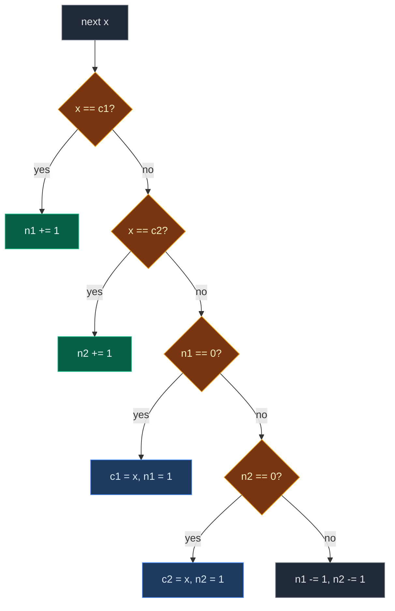

# 02. 229. Majority Element II

| Difficulty | Pattern | Source | Time | Space |
|:---:|:---:|:---:|:---:|:---:|
| **Medium** | Boyer-Moore (n/3) | [229. Majority Element II](https://leetcode.com/problems/majority-element-ii/) | `O(n)` | `O(1)` |

## 1. Problem Statement

You get an integer array `nums` of size `n`.

Return **all** values that appear **more than** `n / 3` times (rounded down).

Unlike Majority Element I, there may be zero, one or two such values.

### Example

```text
Input:  nums = [1, 1, 1, 3, 3, 2, 2, 2]
Output: [1, 2]

n = 8, n // 3 = 2, so a value must appear more than 2 times.
1 appears 3 times   -> yes
2 appears 3 times   -> yes
3 appears 2 times   -> no
```

We use this same example in every section below.

(LeetCode has `[3, 2, 3]` -> `[3]`, `[1]` -> `[1]`, `[1, 2]` -> `[1, 2]`. We test them in the code.)

### Constraints

- `1 <= nums.length <= 5 * 10^4`
- `-10^9 <= nums[i] <= 10^9`
- **Follow up:** solve it in `O(n)` time and `O(1)` space

## 2. Core Theory

### At most two answers

If three different values each appeared more than `n / 3` times, together they would have more than `n` elements. That is impossible. So there are **at most two** answers. That is why we keep **two** candidates.

```text
n = 9, need more than 3

value A: ####     4
value B: ####     4
value C: #        1   <- no room for a third winner
```

### Cancel three different values at once

- In Majority Element I, we cancel **two** different values.
- Here we cancel **three** different values: one copy of candidate 1, one of candidate 2, and the new value.
- A value with more than `n / 3` copies has more copies than there can be such groups. So it survives in a slot.

### Branch order matters

For each value `x`:

1. `x == c1`: `n1 += 1`.
2. `x == c2`: `n2 += 1`.
3. `n1 == 0`: `c1 = x`, `n1 = 1`.
4. `n2 == 0`: `c2 = x`, `n2 = 1`.
5. Else: `n1 -= 1`, `n2 -= 1` (cancel three different values).

Check the matches **before** the empty slots. Otherwise the same value could sit in both slots.



### The second pass is required

Nothing promises an answer exists. `[1, 2, 3, 4]` still leaves two candidates, but none qualifies. So after the vote, **count both candidates again** and keep only those with count `> n // 3`.

## 3. Edge Cases

| Case | Input | Expected | Why it matters |
|:---|:---|:---:|:---|
| Single element | `[1]` | `[1]` | `n // 3 = 0`, and `1 > 0` |
| Two elements | `[1, 2]` | `[1, 2]` | Both pass a bar of `0` |
| All the same | `[2, 2, 2, 2]` | `[2]` | Second slot never fills |
| No valid answer | `[1, 2, 3, 4]` | `[]` | Candidates fail the second pass |
| Exactly `n / 3` | `[1, 1, 2, 2, 3, 3]` | `[]` | Must be strictly more than `n // 3` |
| Negatives | `[-1, -1, -1, 2]` | `[-1]` | `None` as "empty" must not clash with real values |
| Two winners | `[1, 1, 1, 3, 3, 2, 2, 2]` | `[1, 2]` | Slots must hold two different values |

## 4. Brute Force: Count Every Value

### Idea

For each value, count it with a full scan. Add it if the count is more than `n // 3` and it is not already in the answer.

### Code

```python
# Import List for type hints
from typing import List


# Brute force: count each value with a full scan
class SolutionBrute:

    # Main method
    def majorityElement(self, nums: List[int]) -> List[int]:

        # The values that pass
        result = []

        # Try every value
        for x in nums:

            # Skip values already added; count the rest
            if x not in result and nums.count(x) > len(nums) // 3:

                # x passes the bar
                result.append(x)

        # Return the values that pass
        return result
```

### Complexity

| Measure | Complexity | Why |
|:---|:---:|:---|
| **Time** | `O(n^2)` | A full count for each value |
| **Space** | `O(1)` | `result` holds at most 2 values |

## 5. Better Approach: Hash Map Counts

### Idea

Count every value once with a hash map. Return the values with count `> n // 3`.

### Code

```python
# Better: count with a hash map
class SolutionBetter:

    # Main method
    def majorityElement(self, nums: List[int]) -> List[int]:

        # count[x] = how many times x appears
        count = {}

        # Go through every value
        for x in nums:

            # Add one to x's count
            count[x] = count.get(x, 0) + 1

        # Keep the values above the bar
        return [x for x, c in count.items() if c > len(nums) // 3]
```

### Complexity

| Measure | Complexity | Why |
|:---|:---:|:---|
| **Time** | `O(n)` | One pass to count |
| **Space** | `O(n)` | The map can hold `n` different values |

## 6. Optimal Approach: Extended Boyer-Moore Voting

### Idea

1. Vote pass with two candidates `c1`, `c2` and counts `n1`, `n2`, using the five branches above.
2. Check pass: count `c1` and `c2` for real. Keep those with count `> n // 3`.

### Visual Walkthrough (Story Version)

Before the code, let us see the idea as a story.

**The story:** 8 kids walk into a playground one by one. Each wears a team shirt: team **1**, **2** or **3**. The playground has **two hills**. Each hill can be held by one team.

**The rules for a new kid:**

- If the kid's team holds a hill, the kid climbs that hill.
- Else, if a hill is empty, the kid's team takes that hill.
- Else (both hills belong to other teams), one kid from each hill and the new kid walk away together. Three different teams, all gone.

At the end, the teams on the hills are only **suspects**. A referee counts their real shirts to be sure.

**How to read the pictures:** `[ ]` = kids in line. `^` = the kid who just arrived. `Hill A` and `Hill B` show the team and how many kids stand on it.

**Start**

```text
kids:  [1] [1] [1] [3] [3] [2] [2] [2]
Hill A: empty (0)     Hill B: empty (0)
```

**Step 1: kid 0 (team 1)**

No hill is team 1. Hill A is empty. Team 1 takes Hill A.

```text
       [1] [1] [1] [3] [3] [2] [2] [2]
        ^
Hill A: team 1 (1)    Hill B: empty (0)
```

**Step 2: kid 1 (team 1)**

Team 1 holds Hill A. Climb it.

```text
       [1] [1] [1] [3] [3] [2] [2] [2]
            ^
Hill A: team 1 (2)    Hill B: empty (0)
```

**Step 3: kid 2 (team 1)**

Climb Hill A.

```text
       [1] [1] [1] [3] [3] [2] [2] [2]
                ^
Hill A: team 1 (3)    Hill B: empty (0)
```

**Step 4: kid 3 (team 3)**

No hill is team 3. Hill A is not empty. Hill B is empty. Team 3 takes Hill B.

```text
       [1] [1] [1] [3] [3] [2] [2] [2]
                    ^
Hill A: team 1 (3)    Hill B: team 3 (1)
```

**Step 5: kid 4 (team 3)**

Team 3 holds Hill B. Climb it.

```text
       [1] [1] [1] [3] [3] [2] [2] [2]
                        ^
Hill A: team 1 (3)    Hill B: team 3 (2)
```

**Step 6: kid 5 (team 2)**

No hill is team 2. No hill is empty. One kid from each hill and kid 5 walk away.

```text
       [1] [1] [1] [3] [3] [2] [2] [2]
                            ^
Hill A: team 1 (2)    Hill B: team 3 (1)
```

**Step 7: kid 6 (team 2)**

Same again. Three kids walk away. Hill B is now empty.

```text
       [1] [1] [1] [3] [3] [2] [2] [2]
                                ^
Hill A: team 1 (1)    Hill B: team 3 (0) -> empty
```

**Step 8: kid 7 (team 2)**

No hill is team 2. Hill A is not empty. Hill B is empty. Team 2 takes Hill B.

```text
       [1] [1] [1] [3] [3] [2] [2] [2]
                                    ^
Hill A: team 1 (1)    Hill B: team 2 (1)
```

**Referee check**

Suspects: team 1 and team 2. Need more than `8 // 3 = 2` shirts.

```text
team 1 shirts: [1] [1] [1]  = 3  > 2  yes
team 2 shirts: [2] [2] [2]  = 3  > 2  yes
```

Answer: `[1, 2]`.

**All steps at a glance**

| Kid | Team | What happens | Hill A | Hill B |
|:---:|:---:|:---|:---:|:---:|
| 0 | 1 | takes empty Hill A | 1 (1) | – (0) |
| 1 | 1 | climbs Hill A | 1 (2) | – (0) |
| 2 | 1 | climbs Hill A | 1 (3) | – (0) |
| 3 | 3 | takes empty Hill B | 1 (3) | 3 (1) |
| 4 | 3 | climbs Hill B | 1 (3) | 3 (2) |
| 5 | 2 | three kids walk away | 1 (2) | 3 (1) |
| 6 | 2 | three kids walk away | 1 (1) | 3 (0) |
| 7 | 2 | takes empty Hill B | 1 (1) | 2 (1) |
| check | – | count teams 1 and 2: 3 and 3 | keep | keep |

**What the story teaches**

| In the story | In the code |
|:---|:---|
| Two hills | Two slots `c1`, `c2` |
| Kids on a hill | `n1`, `n2` |
| Climb your team's hill | `x == c1` or `x == c2`: count up |
| Take an empty hill | `n1 == 0` or `n2 == 0`: new candidate |
| Three kids walk away | `n1 -= 1`, `n2 -= 1` |
| At most two hills | At most two answers |
| Referee check | Second pass: real count `> n // 3` |

Now the same steps again, this time with the exact values.

### Step-by-Step Example

```text
nums = [1, 1, 1, 3, 3, 2, 2, 2], n = 8, n // 3 = 2
```

**Start:** `c1 = None, n1 = 0`, `c2 = None, n2 = 0`.

**Step 1 (`x = 1`):** `1 == c1 (None)`? No. `1 == c2 (None)`? No. `n1 == 0`? Yes. `c1 = 1`, `n1 = 1`.

```text
c1 = 1, n1 = 1    c2 = None, n2 = 0
```

**Step 2 (`x = 1`):** `1 == c1`? Yes. `n1 = 2`.

```text
c1 = 1, n1 = 2    c2 = None, n2 = 0
```

**Step 3 (`x = 1`):** `1 == c1`? Yes. `n1 = 3`.

```text
c1 = 1, n1 = 3    c2 = None, n2 = 0
```

**Step 4 (`x = 3`):** `3 == 1`? No. `3 == None`? No. `n1 == 0`? No (`3`). `n2 == 0`? Yes. `c2 = 3`, `n2 = 1`.

```text
c1 = 1, n1 = 3    c2 = 3, n2 = 1
```

**Step 5 (`x = 3`):** `3 == 1`? No. `3 == 3`? Yes. `n2 = 2`.

```text
c1 = 1, n1 = 3    c2 = 3, n2 = 2
```

**Step 6 (`x = 2`):** `2 == 1`? No. `2 == 3`? No. `n1 == 0`? No. `n2 == 0`? No. Cancel: `n1 = 2`, `n2 = 1`.

```text
c1 = 1, n1 = 2    c2 = 3, n2 = 1
```

**Step 7 (`x = 2`):** `2 == 1`? No. `2 == 3`? No. `n1 == 0`? No. `n2 == 0`? No. Cancel: `n1 = 1`, `n2 = 0`.

```text
c1 = 1, n1 = 1    c2 = 3, n2 = 0
```

**Step 8 (`x = 2`):** `2 == 1`? No. `2 == 3`? No. `n1 == 0`? No. `n2 == 0`? Yes. `c2 = 2`, `n2 = 1`.

```text
c1 = 1, n1 = 1    c2 = 2, n2 = 1
```

**Check pass:**

1. Count of `c1 = 1` in `nums`: `3`. `3 > 2`? Yes. Keep `1`.
2. Count of `c2 = 2` in `nums`: `3`. `3 > 2`? Yes. Keep `2`.

**Answer:** `[1, 2]`.

### Code

```python
# Optimal: Boyer-Moore voting with two candidates
class Solution:

    # Main method
    def majorityElement(self, nums: List[int]) -> List[int]:

        # First candidate and its lead
        c1, n1 = None, 0

        # Second candidate and its lead
        c2, n2 = None, 0

        # Vote pass
        for x in nums:

            # Vote for candidate 1
            if x == c1:

                # Candidate 1 gets stronger
                n1 += 1

            # Vote for candidate 2
            elif x == c2:

                # Candidate 2 gets stronger
                n2 += 1

            # Slot 1 is empty
            elif n1 == 0:

                # x takes slot 1
                c1, n1 = x, 1

            # Slot 2 is empty
            elif n2 == 0:

                # x takes slot 2
                c2, n2 = x, 1

            # x differs from both, and both slots are full
            else:

                # Cancel one of each candidate and x
                n1, n2 = n1 - 1, n2 - 1

        # The bar a value must beat
        bar = len(nums) // 3

        # The values that pass
        result = []

        # Check each candidate for real
        for c in (c1, c2):

            # Keep it if it is set, not already added, and above the bar
            if c is not None and c not in result and nums.count(c) > bar:

                # c passes the check
                result.append(c)

        # Return the values that pass
        return result


# Same vote pass, but it records (c1, n1, c2, n2) after every step
def trace_vote2(nums: List[int]) -> List[tuple]:

    # Same start values
    c1, n1, c2, n2 = None, 0, None, 0

    # Snapshots after each step
    states = []

    # Same loop as the solution
    for x in nums:

        # Match slot 1
        if x == c1:

            # Count up
            n1 += 1

        # Match slot 2
        elif x == c2:

            # Count up
            n2 += 1

        # Empty slot 1
        elif n1 == 0:

            # Take slot 1
            c1, n1 = x, 1

        # Empty slot 2
        elif n2 == 0:

            # Take slot 2
            c2, n2 = x, 1

        # Cancel three different values
        else:

            # Both count down
            n1, n2 = n1 - 1, n2 - 1

        # Save a snapshot
        states.append((c1, n1, c2, n2))

    # Return all snapshots
    return states


# Trace the example from this note
states = trace_vote2([1, 1, 1, 3, 3, 2, 2, 2])

# Steps 1 to 3: team 1 takes slot 1 and grows
assert states[0:3] == [(1, 1, None, 0), (1, 2, None, 0), (1, 3, None, 0)]

# Steps 4 and 5: team 3 takes slot 2 and grows
assert states[3:5] == [(1, 3, 3, 1), (1, 3, 3, 2)]

# Steps 6 and 7: two cancels
assert states[5:7] == [(1, 2, 3, 1), (1, 1, 3, 0)]

# Step 8: team 2 takes the empty slot 2
assert states[7] == (1, 1, 2, 1)

# Our example
assert sorted(Solution().majorityElement([1, 1, 1, 3, 3, 2, 2, 2])) == [1, 2]

# LeetCode example 1
assert Solution().majorityElement([3, 2, 3]) == [3]

# LeetCode example 2
assert Solution().majorityElement([1]) == [1]

# LeetCode example 3
assert sorted(Solution().majorityElement([1, 2])) == [1, 2]

# Edge case: all the same
assert Solution().majorityElement([2, 2, 2, 2]) == [2]

# Edge case: no valid answer
assert Solution().majorityElement([1, 2, 3, 4]) == []

# Edge case: exactly n / 3 does not count
assert Solution().majorityElement([1, 1, 2, 2, 3, 3]) == []

# Edge case: negatives
assert Solution().majorityElement([-1, -1, -1, 2]) == [-1]

# Import random for cross-checks
import random

# Fixed seed so the test is repeatable
random.seed(229)

# Compare all three solutions on random arrays
for _ in range(500):

    # Random small values so repeats are common
    nums = [random.randint(-2, 3) for _ in range(random.randint(1, 15))]

    # All three must agree (order does not matter)
    assert sorted(Solution().majorityElement(nums)) == sorted(SolutionBetter().majorityElement(nums)) == sorted(SolutionBrute().majorityElement(nums))

# All checks passed
print("All tests passed")
```

### Complexity

| Measure | Complexity | Why |
|:---|:---:|:---|
| **Time** | `O(n)` | One vote pass and one check pass |
| **Space** | `O(1)` | Two candidates, two counts, at most two results |

## 7. Common Mistakes

| Mistake | What goes wrong | Fix |
|:---|:---|:---|
| Skipping the check pass | `[1, 2, 3, 4]` returns two wrong values | Always count both candidates again |
| Checking empty slots before matches | The same value can fill both slots | Check `x == c1` and `x == c2` first |
| Using `>= n // 3` | `[1, 1, 2, 2, 3, 3]` returns all three | Must be strictly `> n // 3` |
| Decreasing only one count | Cancels two values, not three. Wrong winners survive | Decrease both `n1` and `n2` together |
| Using `0` as the "empty" value | `0` can be a real value and gets confused | Use `None` and check `is not None` |
| Adding the same candidate twice | `[2, 2]` style inputs give `[2, 2]` | Skip a candidate already in `result` |

## 8. Interview Follow-ups

### Q1. Why at most two answers?

**Answer:**
- Three values each above `n / 3` would need more than `n` elements.
- The array only has `n`. So at most two.

### Q2. How do you generalize to `n / k`?

**Answer:**
- Keep `k - 1` candidates and counts.
- Cancel when a value matches none and all slots are full.
- Check all candidates at the end. Time `O(n * k)`, space `O(k)`.

### Q3. Why is the check pass needed here but not in 169?

**Answer:**
- 169 promises a majority exists, so the survivor is the answer.
- Here nothing is promised. Slots always hold something, even when no value passes.

### Q4. Can we skip the check if we know two answers exist?

**Answer:**
- Yes, if the problem promises it.
- Without a promise, a candidate is only a suspect.

### Q5. Does the order of the result matter?

**Answer:**
- No. LeetCode accepts any order.

## 9. Interview Explanation

> At most two values can appear more than n/3 times, so I run Boyer-Moore voting with two candidate slots. A value that matches a candidate adds to its count, a value that finds an empty slot takes it, and a value that matches neither when both are full cancels one copy of each candidate along with itself. After this pass the candidates are only suspects, so I do a second pass to count them and keep those above n/3. It is O(n) time and O(1) space.
