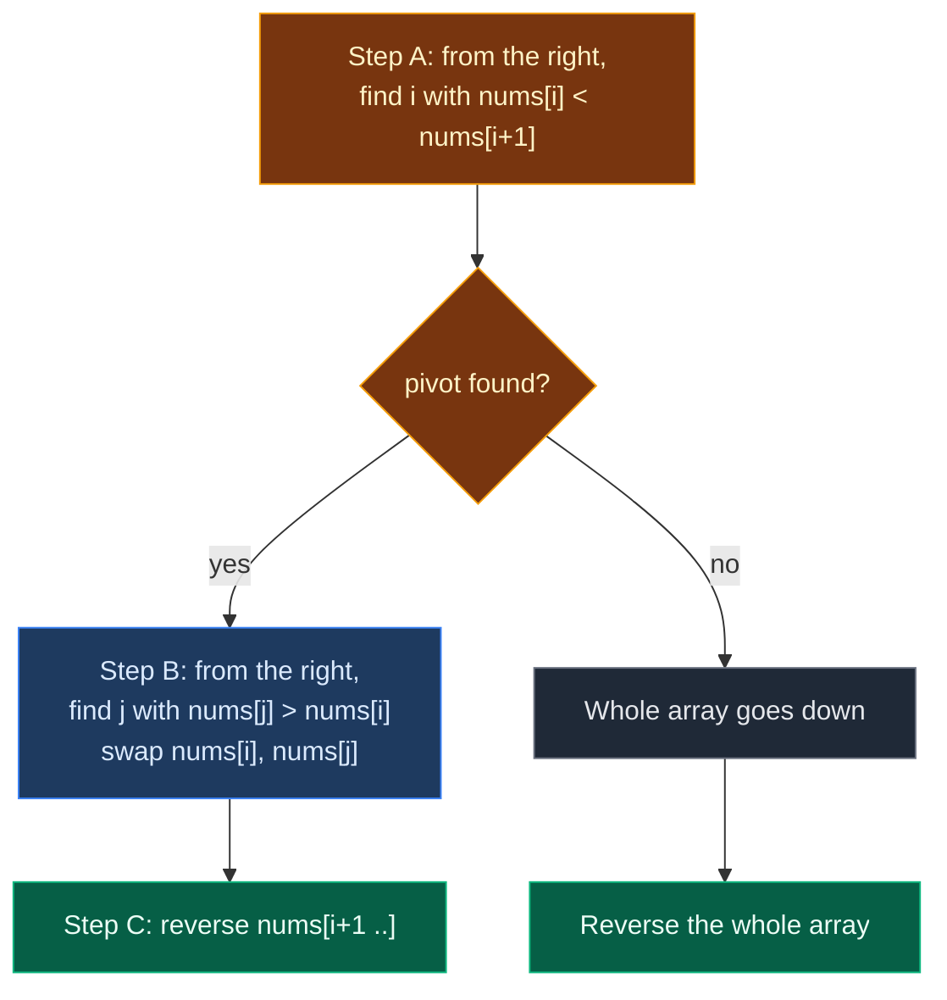

# 01. 31. Next Permutation

| Difficulty | Pattern | Source | Time | Space |
|:---:|:---:|:---:|:---:|:---:|
| **Medium** | Array Scan + Reverse | [31. Next Permutation](https://leetcode.com/problems/next-permutation/) | `O(n)` | `O(1)` |

## 1. Problem Statement

A **permutation** is one way to order the same numbers. For `[1, 2, 3]`, all permutations in dictionary (lexicographic) order are:

```text
[1, 2, 3]  [1, 3, 2]  [2, 1, 3]  [2, 3, 1]  [3, 1, 2]  [3, 2, 1]
```

The **next permutation** is the one that comes right after the current one in that list.

If the current one is the last (biggest), wrap around to the first (smallest, sorted ascending).

Change `nums` **in place** using only constant extra memory.

### Example

```text
Input:  nums = [1, 5, 8, 4, 7, 6, 5, 3, 1]
Output:        [1, 5, 8, 5, 1, 3, 4, 6, 7]
```

Think of it as a number: `158476531` -> the next bigger number using the same digits is `158513467`.

We use this same example in every section below.

(LeetCode has `[1, 2, 3]` -> `[1, 3, 2]`, `[3, 2, 1]` -> `[1, 2, 3]`, `[1, 1, 5]` -> `[1, 5, 1]`. We test them in the code.)

### Constraints

- `1 <= nums.length <= 100`
- `0 <= nums[i] <= 100`

## 2. Core Theory

### What the problem really asks

Make the array **a little bigger**, as little as possible. Change things as far to the right as you can, because the right side matters least (like the last digits of a number).

### Three steps

**Step A: find the pivot.** Walk from the right. Stop at the first `i` where `nums[i] < nums[i + 1]`.

- Everything to the right of `i` goes down (or stays equal). That right part is already the **biggest** order of its numbers. It cannot grow by itself.
- So `nums[i]` is the rightmost spot that can grow.

**Step B: find the swap partner.** From the right, find the first `j` with `nums[j] > nums[i]`. Swap them.

- The right part goes down, so the first bigger value from the right is the **smallest** value that is still bigger than `nums[i]`.
- That makes the increase as small as possible.

**Step C: reverse the right part.** After the swap, the right part still goes down. Reverse it so it goes up. That makes it as **small** as possible.

If there is no pivot, the whole array goes down. It is the last permutation. Reverse everything to wrap to the first one.

```text
nums = [1, 5, 8, 4, 7, 6, 5, 3, 1]
                 ^  \___________/
             pivot 4  goes down: 7 6 5 3 1

Step B: first value > 4 from the right is 5   -> swap
        [1, 5, 8, 5, 7, 6, 4, 3, 1]
Step C: reverse after the pivot
        [1, 5, 8, 5, 1, 3, 4, 6, 7]
```



## 3. Edge Cases

| Case | Input | Expected | Why it matters |
|:---|:---|:---:|:---|
| Single element | `[1]` | `[1]` | No pivot. Reversing one element changes nothing |
| Last permutation | `[3, 2, 1]` | `[1, 2, 3]` | No pivot. Must wrap around by reversing all |
| All the same | `[2, 2, 2]` | `[2, 2, 2]` | `>=` in Step A skips equal values, so no pivot |
| Duplicates | `[1, 1, 5]` | `[1, 5, 1]` | Step B must pick a strictly bigger value |
| Ascending | `[1, 2, 3]` | `[1, 3, 2]` | Pivot is next to the end. Swap alone is enough |
| Reverse is needed | `[1, 3, 2]` | `[2, 1, 3]` | Swap alone gives `[2, 3, 1]`, which is too big |
| Partner equals pivot | `[1, 5, 1]` | `[5, 1, 1]` | Step B skips the `1` that equals the pivot and picks `5` |

## 4. Brute Force: List All Permutations

### Idea

1. Make every distinct permutation and sort them.
2. Find the current one.
3. Take the next one. If it is the last, take the first.

### Code

```python
# Import permutations to list every order
from itertools import permutations

# Import List for type hints
from typing import List


# Brute force: list every permutation and pick the next one
class SolutionBrute:

    # Main method, changes nums in place
    def nextPermutation(self, nums: List[int]) -> None:

        # Every distinct order, sorted
        all_orders = sorted(set(permutations(nums)))

        # Where the current order sits in the list
        pos = all_orders.index(tuple(nums))

        # The next order, wrapping to the first after the last
        nxt = all_orders[(pos + 1) % len(all_orders)]

        # Copy it back into nums
        nums[:] = list(nxt)
```

### Complexity

| Measure | Complexity | Why |
|:---|:---:|:---|
| **Time** | `O(n! * n)` | There are up to `n!` orders, each of length `n` |
| **Space** | `O(n! * n)` | All orders are stored |

With `n = 100`, this is hopeless. It is only useful for checking small cases.

## 5. Optimal Approach: Pivot, Swap, Reverse

### Idea

1. `i = n - 2`. While `i >= 0` and `nums[i] >= nums[i + 1]`: `i -= 1`.
2. If `i >= 0`: `j = n - 1`. While `nums[j] <= nums[i]`: `j -= 1`. Swap `nums[i]` and `nums[j]`.
3. Reverse `nums[i + 1 :]` (when `i = -1`, that is the whole array).

### Visual Walkthrough (Story Version)

Before the code, let us see the idea as a story.

**The story:** 9 kids stand in a line. Each holds a number card. Read left to right, the cards make a big number: `158476531`. The teacher says: "Make the **next bigger** number using the same cards. Change as little as you can."

**The plan:**

- The kids on the right are the "small digits". Changing them makes the smallest change. So we start from the right.
- **Find the stuck kid:** walk from the right while each kid's card is bigger than or equal to the card of the kid on their right. The first kid whose card is **smaller** than their right neighbour is the pivot. Everyone to their right is already in the biggest order.
- **Find the helper:** from the right end, find the first kid whose card is bigger than the pivot's card. Swap their cards.
- **Tidy up:** the kids right of the pivot flip their order (first becomes last), so their cards go up from small to big.

**How to read the pictures:** `[ ]` = a kid's card. `P` = pivot. `j` = helper being checked. `i` = kid being checked.

**Start**

```text
pos:    0   1   2   3   4   5   6   7   8
       [1] [5] [8] [4] [7] [6] [5] [3] [1]
```

**Step 1: check kid 7 against kid 8**

`3 >= 1`? Yes. Kid 7 is not the pivot. Move left.

```text
       [1] [5] [8] [4] [7] [6] [5] [3] [1]
                                    i
```

**Step 2: check kid 6 against kid 7**

`5 >= 3`? Yes. Move left.

```text
       [1] [5] [8] [4] [7] [6] [5] [3] [1]
                                i
```

**Step 3: check kid 5 against kid 6**

`6 >= 5`? Yes. Move left.

```text
       [1] [5] [8] [4] [7] [6] [5] [3] [1]
                            i
```

**Step 4: check kid 4 against kid 5**

`7 >= 6`? Yes. Move left.

```text
       [1] [5] [8] [4] [7] [6] [5] [3] [1]
                        i
```

**Step 5: check kid 3 against kid 4**

`4 >= 7`? No. `4 < 7`. Kid 3 is the **pivot**.

```text
       [1] [5] [8] [4] [7] [6] [5] [3] [1]
                    P   \_______________/
                         biggest order already
```

**Step 6: helper check at kid 8**

`1 <= 4`? Yes, too small. Move left.

```text
       [1] [5] [8] [4] [7] [6] [5] [3] [1]
                    P                   j
```

**Step 7: helper check at kid 7**

`3 <= 4`? Yes, too small. Move left.

```text
       [1] [5] [8] [4] [7] [6] [5] [3] [1]
                    P               j
```

**Step 8: helper check at kid 6**

`5 <= 4`? No. `5 > 4`. Kid 6 is the **helper**. Swap cards of kid 3 and kid 6.

```text
       [1] [5] [8] [5] [7] [6] [4] [3] [1]
                    P           j
```

**Step 9: tidy up, swap the ends of the right part (kid 4 and kid 8)**

`7` and `1` trade.

```text
       [1] [5] [8] [5] [1] [6] [4] [3] [7]
                    P   ^               ^
```

**Step 10: tidy up, swap kid 5 and kid 7**

`6` and `3` trade.

```text
       [1] [5] [8] [5] [1] [3] [4] [6] [7]
                    P       ^       ^
```

**Step 11: tidy up, the pointers meet at kid 6**

Nothing left to swap. Done.

```text
       [1] [5] [8] [5] [1] [3] [4] [6] [7]
                    P           ^
```

The new number is `158513467`, the next bigger one.

**All steps at a glance**

| Step | Phase | Check / action | Line after |
|:---:|:---|:---|:---|
| 1 | find pivot | `3 >= 1` yes, move left | `[1,5,8,4,7,6,5,3,1]` |
| 2 | find pivot | `5 >= 3` yes, move left | same |
| 3 | find pivot | `6 >= 5` yes, move left | same |
| 4 | find pivot | `7 >= 6` yes, move left | same |
| 5 | find pivot | `4 >= 7` no, pivot = 3 | same |
| 6 | find helper | `1 <= 4` yes, move left | same |
| 7 | find helper | `3 <= 4` yes, move left | same |
| 8 | find helper | `5 <= 4` no, helper = 6, swap | `[1,5,8,5,7,6,4,3,1]` |
| 9 | reverse | swap pos 4 and 8 | `[1,5,8,5,1,6,4,3,7]` |
| 10 | reverse | swap pos 5 and 7 | `[1,5,8,5,1,3,4,6,7]` |
| 11 | reverse | pointers meet, stop | `[1,5,8,5,1,3,4,6,7]` |

**What the story teaches**

| In the story | In the code |
|:---|:---|
| Kid's card | `nums[k]` |
| Right side = small digits | Change as far right as possible |
| Stuck kid (pivot) | First `i` from the right with `nums[i] < nums[i + 1]` |
| Helper | First `j` from the right with `nums[j] > nums[i]` |
| Swap cards | `nums[i], nums[j] = nums[j], nums[i]` |
| Tidy up by flipping order | Reverse `nums[i + 1:]` |
| No stuck kid at all | Last permutation: reverse the whole array |

Now the same steps again, this time with the exact values.

### Step-by-Step Example

```text
nums = [1, 5, 8, 4, 7, 6, 5, 3, 1], n = 9
```

**Step A: find the pivot.** Start `i = n - 2 = 7`.

1. `i = 7`: `nums[7] = 3`, `nums[8] = 1`. `3 >= 1`? Yes. `i = 6`.
2. `i = 6`: `nums[6] = 5`, `nums[7] = 3`. `5 >= 3`? Yes. `i = 5`.
3. `i = 5`: `nums[5] = 6`, `nums[6] = 5`. `6 >= 5`? Yes. `i = 4`.
4. `i = 4`: `nums[4] = 7`, `nums[5] = 6`. `7 >= 6`? Yes. `i = 3`.
5. `i = 3`: `nums[3] = 4`, `nums[4] = 7`. `4 >= 7`? No. Stop. **Pivot `i = 3`**.

```text
nums = [1, 5, 8, 4, 7, 6, 5, 3, 1]    i = 3
```

**Step B: find the swap partner.** `i >= 0`, so start `j = n - 1 = 8`.

6. `j = 8`: `nums[8] = 1`. `1 <= 4`? Yes. `j = 7`.
7. `j = 7`: `nums[7] = 3`. `3 <= 4`? Yes. `j = 6`.
8. `j = 6`: `nums[6] = 5`. `5 <= 4`? No. Stop. **Partner `j = 6`**. Swap `nums[3]` and `nums[6]`.

```text
nums = [1, 5, 8, 5, 7, 6, 4, 3, 1]    i = 3, j = 6
```

**Step C: reverse `nums[4..8]`.** `left = 4`, `right = 8`.

9. `left = 4 < right = 8`. Swap `nums[4] = 7` and `nums[8] = 1`. `left = 5`, `right = 7`.

```text
nums = [1, 5, 8, 5, 1, 6, 4, 3, 7]
```

10. `left = 5 < right = 7`. Swap `nums[5] = 6` and `nums[7] = 3`. `left = 6`, `right = 6`.

```text
nums = [1, 5, 8, 5, 1, 3, 4, 6, 7]
```

11. `left = 6 < right = 6`? No. Stop.

**Answer:** `[1, 5, 8, 5, 1, 3, 4, 6, 7]`.

### Code

```python
# Optimal: find pivot, swap with the next bigger value, reverse the right part
class Solution:

    # Main method, changes nums in place
    def nextPermutation(self, nums: List[int]) -> None:

        # Number of elements
        n = len(nums)

        # Start checking from the second last index
        i = n - 2

        # Walk left while the right part keeps going down
        while i >= 0 and nums[i] >= nums[i + 1]:

            # Move one step left
            i -= 1

        # A pivot was found
        if i >= 0:

            # Start the partner search at the last index
            j = n - 1

            # Skip values that are not bigger than the pivot
            while nums[j] <= nums[i]:

                # Move one step left
                j -= 1

            # Swap the pivot with its partner
            nums[i], nums[j] = nums[j], nums[i]

        # Left end of the part to reverse
        left = i + 1

        # Right end of the part to reverse
        right = n - 1

        # Reverse the right part with two pointers
        while left < right:

            # Swap the two ends
            nums[left], nums[right] = nums[right], nums[left]

            # Move the left end right
            left += 1

            # Move the right end left
            right -= 1


# Same algorithm, but it records what happens at every step
def trace_next(nums: List[int]) -> List[tuple]:

    # Snapshots of every step
    steps = []

    # Number of elements
    n = len(nums)

    # Start the pivot search
    i = n - 2

    # Pivot search loop
    while i >= 0 and nums[i] >= nums[i + 1]:

        # Record a "move left" check
        steps.append(("pivot-left", i))

        # Move left
        i -= 1

    # Record where the pivot search stopped
    steps.append(("pivot", i))

    # A pivot exists
    if i >= 0:

        # Start the partner search
        j = n - 1

        # Partner search loop
        while nums[j] <= nums[i]:

            # Record a "too small" check
            steps.append(("partner-left", j))

            # Move left
            j -= 1

        # Swap pivot and partner
        nums[i], nums[j] = nums[j], nums[i]

        # Record the swap
        steps.append(("swap", j, nums[:]))

    # Two pointers for the reverse
    left, right = i + 1, n - 1

    # Reverse loop
    while left < right:

        # Swap the ends
        nums[left], nums[right] = nums[right], nums[left]

        # Record the reverse swap
        steps.append(("reverse", left, right, nums[:]))

        # Move both ends inward
        left, right = left + 1, right - 1

    # Return all snapshots
    return steps


# Trace the example from this note
steps = trace_next([1, 5, 8, 4, 7, 6, 5, 3, 1])

# Steps 1 to 4: indices 7, 6, 5, 4 are not the pivot
assert steps[0:4] == [("pivot-left", 7), ("pivot-left", 6), ("pivot-left", 5), ("pivot-left", 4)]

# Step 5: the pivot is index 3
assert steps[4] == ("pivot", 3)

# Steps 6 and 7: indices 8 and 7 are too small to be the partner
assert steps[5:7] == [("partner-left", 8), ("partner-left", 7)]

# Step 8: partner is index 6, swap gives this array
assert steps[7] == ("swap", 6, [1, 5, 8, 5, 7, 6, 4, 3, 1])

# Step 9: reverse swap of index 4 and 8
assert steps[8] == ("reverse", 4, 8, [1, 5, 8, 5, 1, 6, 4, 3, 7])

# Step 10: reverse swap of index 5 and 7
assert steps[9] == ("reverse", 5, 7, [1, 5, 8, 5, 1, 3, 4, 6, 7])

# Step 11: pointers meet, no more steps
assert len(steps) == 10

# Helper: run a solution on a copy and return the result
def run(solver, nums):

    # Copy so the caller's list is safe
    arr = nums[:]

    # Change it in place
    solver.nextPermutation(arr)

    # Return the changed copy
    return arr


# Our example
assert run(Solution(), [1, 5, 8, 4, 7, 6, 5, 3, 1]) == [1, 5, 8, 5, 1, 3, 4, 6, 7]

# LeetCode example 1
assert run(Solution(), [1, 2, 3]) == [1, 3, 2]

# LeetCode example 2: last permutation wraps around
assert run(Solution(), [3, 2, 1]) == [1, 2, 3]

# LeetCode example 3: duplicates
assert run(Solution(), [1, 1, 5]) == [1, 5, 1]

# Edge case: single element
assert run(Solution(), [1]) == [1]

# Edge case: all the same
assert run(Solution(), [2, 2, 2]) == [2, 2, 2]

# Edge case: reverse is needed
assert run(Solution(), [1, 3, 2]) == [2, 1, 3]

# Edge case: partner equals pivot value
assert run(Solution(), [1, 5, 1]) == [5, 1, 1]

# Import product to build every small input
from itertools import product

# Try every array of length 1 to 5 with values 0 to 2
for size in range(1, 6):

    # Every way to fill the array
    for combo in product([0, 1, 2], repeat=size):

        # Brute force and optimal must agree
        assert run(Solution(), list(combo)) == run(SolutionBrute(), list(combo))

# All checks passed
print("All tests passed")
```

### Complexity

| Measure | Complexity | Why |
|:---|:---:|:---|
| **Time** | `O(n)` | Each of the three steps walks the array at most once |
| **Space** | `O(1)` | Only a few index variables |

## 6. Common Mistakes

| Mistake | What goes wrong | Fix |
|:---|:---|:---|
| Using `>` instead of `>=` in Step A | `[2, 2, 2]` stops at a fake pivot, then Step B runs off the left end | Walk left while `nums[i] >= nums[i + 1]` |
| Using `<` instead of `<=` in Step B | It can pick a value **equal** to the pivot. The swap changes nothing | Skip while `nums[j] <= nums[i]` |
| Searching for the partner from the left | Picks the **biggest** bigger value, so the result jumps too far | Search from the right |
| Skipping the reverse when there is no pivot | `[3, 2, 1]` stays the same instead of `[1, 2, 3]` | Reverse `nums[i + 1:]` always. With `i = -1` it is the whole array |
| Sorting the right part instead of reversing | Correct, but `O(n log n)` | It already goes down, so reversing is enough |
| Returning a new list | LeetCode reads the original `nums` | Change `nums` in place |

## 7. Interview Follow-ups

### Q1. How do you find the previous permutation?

**Answer:**
- Flip every comparison.
- Pivot: first `i` from the right with `nums[i] > nums[i + 1]`.
- Partner: first `j` from the right with `nums[j] < nums[i]`. Swap, then reverse the right part.

### Q2. How do you list all permutations in order?

**Answer:**
- Sort the array first.
- Call `nextPermutation` again and again until it wraps back to sorted.
- Duplicates are handled: each distinct order appears once.

### Q3. Can you jump straight to the k-th permutation?

**Answer:**
- Yes, with factorials.
- At each position, the block size is `(remaining - 1)!`. Pick digit number `k // block`, then `k %= block`.
- `O(n^2)` with a list, no stepping needed.

### Q4. Does it work for letters or other objects?

**Answer:**
- Yes. It only compares and swaps.
- Any type that can be ordered works. C++ `std::next_permutation` is the same idea.

### Q5. Why is reversing enough to make the right part smallest?

**Answer:**
- Before the swap, the right part goes down.
- The swap puts the old pivot value in a spot where it still fits that "going down" shape.
- A part that goes down becomes "going up" (smallest order) when reversed.

## 8. Interview Explanation

> I scan from the right to find the first index where nums[i] is smaller than nums[i + 1]. Everything right of it is in decreasing order, so it is already the biggest arrangement, and i is the rightmost spot that can grow. Then from the right I find the first value bigger than nums[i] and swap them, which makes the smallest possible increase. Finally I reverse the part after i so it becomes the smallest arrangement. If there is no such i, the array is the last permutation, so I reverse the whole thing. It is O(n) time and O(1) space.
