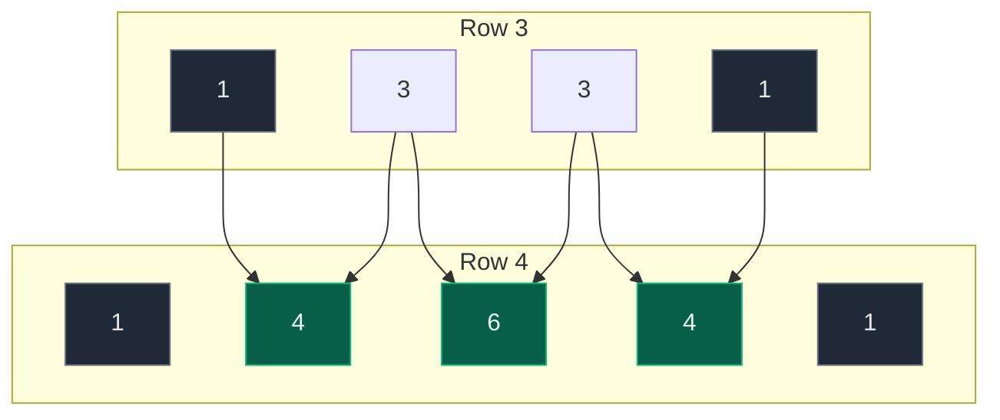

# 01. 118. Pascal's Triangle

| Difficulty | Pattern | Source | Time | Space |
|:---:|:---:|:---:|:---:|:---:|
| **Easy** | Row-by-Row Construction | [118. Pascal's Triangle](https://leetcode.com/problems/pascals-triangle/) | `O(numRows^2)` | `O(1)` extra |

## 1. Problem Statement

You get an integer `numRows`.

Return the first `numRows` rows of **Pascal's triangle**.

In Pascal's triangle, every number is the sum of the two numbers just above it. The first and last number of every row is `1`.

### Example

```text
numRows = 5

        1
       1 1
      1 2 1
     1 3 3 1
    1 4 6 4 1

Output: [[1], [1,1], [1,2,1], [1,3,3,1], [1,4,6,4,1]]
```

We use this same example in every section below.

### Constraints

- `1 <= numRows <= 30`

## 2. Core Theory

### What the problem really asks

Build the triangle one row at a time. Each row only needs the row just above it.

### The three rules

```text
row[0]    = 1                          first value is always 1
row[last] = 1                          last value is always 1
row[j]    = prev[j - 1] + prev[j]      every middle value
```

Here is where each value of row 4 comes from:



### Useful facts

| Fact | Value | What it means for the code |
|:---|:---|:---|
| Length of row `i` | `i + 1` | Make the row with `[1] * (i + 1)` |
| First and last | always `1` | Only middle spots need work |
| Middle spots in row `i` | `i - 1` | Rows 0 and 1 have no middle at all |
| Total numbers | `n(n + 1) / 2` | We must write all of them, so `O(n^2)` time is the best possible |

### Why not use the formula?

Every value is also `C(r, c) = r! / (c! * (r - c)!)`. That works, but factorials get huge and we redo a lot of work. The row rule needs just one addition per number.

## 3. Edge Cases

| Case | Input | Expected | Why it matters |
|:---|:---|:---:|:---|
| Smallest input | `numRows = 1` | `[[1]]` | The middle loop must not run |
| Two rows | `numRows = 2` | `[[1],[1,1]]` | Still no middle values |
| First middle value | `numRows = 3` | `[[1],[1,1],[1,2,1]]` | First time the sum rule is used |
| Biggest input | `numRows = 30` | 30 rows | Largest value is `C(29,14) = 77558760`. Fits in a normal int |
| Row length | row `i` | `i + 1` values | Off-by-one here is the most common bug |

## 4. Brute Force: Combination Formula

### Idea

The value at row `r`, column `c` is `C(r, c) = r! / (c! * (r - c)!)`. Compute it for every cell.

### Code

```python
# Import math for factorial
import math

# Import List for type hints
from typing import List


# Brute force: compute every cell with the nCr formula
class SolutionBrute:

    # Main method
    def generate(self, numRows: int) -> List[List[int]]:

        # The full triangle
        triangle = []

        # Go through every row
        for r in range(numRows):

            # Values of this row
            row = []

            # Go through every column of this row
            for c in range(r + 1):

                # nCr = r! / (c! * (r - c)!)
                value = math.factorial(r) // (math.factorial(c) * math.factorial(r - c))

                # Add the value to the row
                row.append(value)

            # Add the row to the triangle
            triangle.append(row)

        # Return the triangle
        return triangle
```

### Complexity

| Measure | Complexity | Why |
|:---|:---:|:---|
| **Time** | `O(numRows^3)` | About `numRows^2` cells, and each factorial takes up to `numRows` steps |
| **Space** | `O(numRows^2)` | The output triangle |

## 5. Optimal Approach: Build Each Row from the Row Above

### Idea

1. For row `i`, make a list of `i + 1` ones.
2. For every middle spot `j` (from `1` to `i - 1`), set `row[j] = prev[j - 1] + prev[j]`.
3. Add the row to the triangle.

### Visual Walkthrough (Story Version)

**The story:** we are building a pyramid of bricks. Each brick has a number painted on it.

**The rules:**

- The two bricks at the ends of every layer always get the number `1`.
- A middle brick sits on two bricks below it in the picture (here, the layer above in the triangle). Its number is the sum of those two bricks.
- We build one layer at a time, from the top down.

**How to read the pictures:** `[1]` is a brick. `(2)` is a new middle brick we just painted.

**Layer 0: one brick**

```text
        [1]
```

Only one brick. It is an end brick, so it is `1`.

**Layer 1: two bricks**

```text
        [1]
      [1] [1]
```

Both bricks are end bricks, so both are `1`. No middle brick yet.

**Layer 2: three bricks**

```text
        [1]
      [1] [1]
     [1] (2) [1]
```

- Ends are `1`.
- The middle brick touches `1` and `1` above it. `1 + 1 = 2`.

**Layer 3: four bricks**

```text
        [1]
      [1] [1]
     [1] [2] [1]
   [1] (3) (3) [1]
```

- Ends are `1`.
- First middle brick: touches `1` and `2`. `1 + 2 = 3`.
- Second middle brick: touches `2` and `1`. `2 + 1 = 3`.

**Layer 4: five bricks**

```text
        [1]
      [1] [1]
     [1] [2] [1]
   [1] [3] [3] [1]
 [1] (4) (6) (4) [1]
```

- Ends are `1`.
- First middle: `1 + 3 = 4`.
- Second middle: `3 + 3 = 6`.
- Third middle: `3 + 1 = 4`.

The pyramid is done.

**All layers at a glance**

| Layer | Bricks | Middle sums | Layer values |
|:---:|:---:|:---|:---|
| 0 | 1 | none | `[1]` |
| 1 | 2 | none | `[1, 1]` |
| 2 | 3 | `1+1=2` | `[1, 2, 1]` |
| 3 | 4 | `1+2=3`, `2+1=3` | `[1, 3, 3, 1]` |
| 4 | 5 | `1+3=4`, `3+3=6`, `3+1=4` | `[1, 4, 6, 4, 1]` |

**What the story teaches**

| In the story | In the code |
|:---|:---|
| Layer of bricks | `row` |
| Layer number | `row_index` |
| End bricks are 1 | `row = [1] * (row_index + 1)` |
| Middle brick | `row[col_index]` for `col_index` in `1 .. row_index - 1` |
| The two bricks it touches | `prev[col_index - 1]` and `prev[col_index]` |
| Finished pyramid | `triangle` |

Now the same steps again, with the exact lists.

### Step-by-Step Example

```text
numRows = 5
triangle = []
```

**row_index = 0**

1. Make `row = [1] * 1 = [1]`.
2. Middle loop is `range(1, 0)`. It is empty. Nothing to fill.
3. Append. `triangle = [[1]]`.

**row_index = 1**

1. Make `row = [1] * 2 = [1, 1]`.
2. Middle loop is `range(1, 1)`. Empty.
3. Append. `triangle = [[1], [1, 1]]`.

**row_index = 2**

1. Make `row = [1, 1, 1]`.
2. `prev = triangle[1] = [1, 1]`.
3. `col_index = 1`: `row[1] = prev[0] + prev[1] = 1 + 1 = 2`. Now `row = [1, 2, 1]`.
4. Append. `triangle = [[1], [1, 1], [1, 2, 1]]`.

**row_index = 3**

1. Make `row = [1, 1, 1, 1]`.
2. `prev = triangle[2] = [1, 2, 1]`.
3. `col_index = 1`: `row[1] = prev[0] + prev[1] = 1 + 2 = 3`. Now `row = [1, 3, 1, 1]`.
4. `col_index = 2`: `row[2] = prev[1] + prev[2] = 2 + 1 = 3`. Now `row = [1, 3, 3, 1]`.
5. Append. `triangle = [[1], [1, 1], [1, 2, 1], [1, 3, 3, 1]]`.

**row_index = 4**

1. Make `row = [1, 1, 1, 1, 1]`.
2. `prev = triangle[3] = [1, 3, 3, 1]`.
3. `col_index = 1`: `row[1] = prev[0] + prev[1] = 1 + 3 = 4`. Now `row = [1, 4, 1, 1, 1]`.
4. `col_index = 2`: `row[2] = prev[1] + prev[2] = 3 + 3 = 6`. Now `row = [1, 4, 6, 1, 1]`.
5. `col_index = 3`: `row[3] = prev[2] + prev[3] = 3 + 1 = 4`. Now `row = [1, 4, 6, 4, 1]`.
6. Append.

**Final answer**

```text
[[1], [1, 1], [1, 2, 1], [1, 3, 3, 1], [1, 4, 6, 4, 1]]
```

### Code

```python
# Import List for type hints
from typing import List


# Solution for 118. Pascal's Triangle
class Solution:

    # Main method
    def generate(self, numRows: int) -> List[List[int]]:

        # The full triangle
        triangle = []

        # Build each row one by one
        for row_index in range(numRows):

            # Start the row with all 1s (this sets both ends)
            row = [1] * (row_index + 1)

            # Fill only the middle spots
            for col_index in range(1, row_index):

                # Middle value = sum of the two values above it
                row[col_index] = triangle[row_index - 1][col_index - 1] + triangle[row_index - 1][col_index]

            # Add the finished row
            triangle.append(row)

        # Return the triangle
        return triangle


# Check the example from this note, row by row
result = Solution().generate(5)

# Row 0: one brick
assert result[0] == [1]

# Row 1: no middle
assert result[1] == [1, 1]

# Row 2: 1 + 1 = 2
assert result[2] == [1, 2, 1]

# Row 3: 1 + 2 = 3, 2 + 1 = 3
assert result[3] == [1, 3, 3, 1]

# Row 4: 1 + 3 = 4, 3 + 3 = 6, 3 + 1 = 4
assert result[4] == [1, 4, 6, 4, 1]

# LeetCode example 2
assert Solution().generate(1) == [[1]]

# Two rows: still no middle
assert Solution().generate(2) == [[1], [1, 1]]

# Biggest value at the max input
assert max(Solution().generate(30)[-1]) == 77558760

# Brute force gives the same answers for every allowed input
for n in range(1, 31):

    # Compare both versions
    assert SolutionBrute().generate(n) == Solution().generate(n)

# Every row i sums to 2^i
for i, row in enumerate(Solution().generate(30)):

    # Check the row sum
    assert sum(row) == 2 ** i

# All checks passed
print("All tests passed")
```

### Complexity

| Measure | Complexity | Why |
|:---|:---:|:---|
| **Time** | `O(numRows^2)` | We write `1 + 2 + ... + numRows = numRows(numRows + 1) / 2` values, one addition each |
| **Space** | `O(1)` extra | Only the output triangle. No helper arrays |

## 6. Common Mistakes

| Mistake | What goes wrong | Fix |
|:---|:---|:---|
| `row = [1] * row_index` | Row is one value short | Use `[1] * (row_index + 1)` |
| Middle loop `range(1, row_index + 1)` | Overwrites the last `1` and reads past the end of `prev` | Use `range(1, row_index)` |
| Reading `triangle[row_index]` as the previous row | That row does not exist yet, `IndexError` | Use `triangle[row_index - 1]` |
| `row[j] = row[j - 1] + row[j]` | Reads the half-built current row | Always read from the previous row |
| Making one list outside the loop | Every row points to the same list | Make a fresh `row` inside the loop |

## 7. Interview Follow-ups

### Q1. Can you return only the k-th row in O(k) space? (LeetCode 119)

**Answer:**
- Keep one list `row = [1]`.
- For each new row, append `1`, then go **right to left**: `row[j] += row[j - 1]`.
- Going right to left means `row[j - 1]` still holds the old value when we read it.

### Q2. How do you get one value C(r, c) without the triangle?

**Answer:**
- Start with `result = 1`.
- For `i` from `0` to `c - 1`: `result = result * (r - i) // (i + 1)`.
- This is `O(c)` time and every step stays a whole number.

### Q3. Can the time be better than O(n^2)?

**Answer:**
- No. The answer itself has `n(n + 1) / 2` numbers.
- We must write every one of them.

### Q4. What is the sum of row i?

**Answer:**
- It is `2^i`.
- Each value is added into two values in the next row, so the sum doubles every row.
- Check: `1 + 4 + 6 + 4 + 1 = 16 = 2^4`.

### Q5. Should we use recursion?

**Answer:**
- We can, but it only adds stack depth.
- Without memo it redoes rows again and again.
- The simple loop is better.

## 8. Interview Explanation

> Every row of Pascal's triangle starts and ends with 1, and every middle value is the sum of the two values above it. So I build the triangle row by row. For row i, I make a list of i + 1 ones, then fill each middle spot j with prev[j - 1] + prev[j] from the row above. The triangle has about n squared over 2 numbers, so the time is O(n^2), which is the best possible because we must write all of them, and there is no extra space beyond the output.
