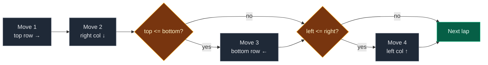

# 04. 54. Spiral Matrix

| Difficulty | Pattern | Source | Time | Space |
|:---:|:---:|:---:|:---:|:---:|
| **Medium** | Four Boundaries | [54. Spiral Matrix](https://leetcode.com/problems/spiral-matrix/) | `O(m*n)` | `O(1)` extra |

## 1. Problem Statement

You get an `m x n` matrix.

Return all its values in **spiral order**: go right along the top, down the right side, left along the bottom, up the left side, and keep circling inward.

### Example

```text
matrix = [[1,2,3,4],[5,6,7,8],[9,10,11,12]]

  1 -> 2 -> 3 -> 4
                 |
  5 -> 6 -> 7    8
  ^              |
  9 <- 10 <- 11 <- 12

Output: [1,2,3,4,8,12,11,10,9,5,6,7]
```

We use this same example in every section below. It is not square, and its inner part is a single row, so it shows why the extra checks are needed.

LeetCode example 1:

```text
[[1,2,3],[4,5,6],[7,8,9]] -> [1,2,3,6,9,8,7,4,5]
```

### Constraints

- `m == matrix.length`, `n == matrix[i].length`
- `1 <= m, n <= 10`
- `-100 <= matrix[i][j] <= 100`

## 2. Core Theory

### What the problem really asks

The spiral is the **same four moves** done again and again on a rectangle that keeps getting smaller.

### Four walls

We keep four numbers that describe the part not visited yet:

```text
top    = first row not visited
bottom = last row not visited
left   = first column not visited
right  = last column not visited
```

### One lap = four moves

| Move | Walk | Then |
|:---:|:---|:---|
| 1 | top row, left to right | `top += 1` |
| 2 | right column, top to bottom | `right -= 1` |
| 3 | bottom row, right to left | `bottom -= 1` |
| 4 | left column, bottom to top | `left += 1` |

Keep going while `top <= bottom and left <= right`.



### Why moves 3 and 4 need their own check

The `while` check runs only at the start of a lap. But moves 1 and 2 change the walls. After them, there may be nothing left.

```text
Only one row left: [6, 7]   top = bottom = 1

Move 1: take 6, 7  -> top = 2
Move 3 without a check: walks row 1 again -> takes 7, 6 again (wrong!)
With the check: top (2) > bottom (1), skip.
```

## 3. Edge Cases

| Case | Input | Expected | Why it matters |
|:---|:---|:---:|:---|
| One cell | `[[5]]` | `[5]` | Only move 1 does work |
| One row | `[[1,2,3]]` | `[1,2,3]` | Move 3 must be skipped |
| One column | `[[1],[2],[3]]` | `[1,2,3]` | Move 4 must be skipped |
| Square, odd size | `3 x 3` | `[1,2,3,6,9,8,7,4,5]` | Center cell is taken last |
| Wide rectangle | our example | `[1,2,3,4,8,12,11,10,9,5,6,7]` | Inner part is one row |
| Tall rectangle | `[[1,2],[3,4],[5,6]]` | `[1,2,4,6,5,3]` | Inner part is one column |

## 4. Brute Force: Walk and Turn with a Visited Grid

### Idea

Walk like a robot. Keep a `visited` grid. Go in the current direction. If the next cell is outside or already visited, turn right. Stop after `m * n` cells.

### Code

```python
# Import List for type hints
from typing import List


# Brute force: robot walk with a visited grid
class SolutionBrute:

    # Main method
    def spiralOrder(self, matrix: List[List[int]]) -> List[int]:

        # Number of rows
        rows = len(matrix)

        # Number of columns
        cols = len(matrix[0])

        # Mark cells we have already taken
        visited = [[False] * cols for _ in range(rows)]

        # Row steps for right, down, left, up
        dr = [0, 1, 0, -1]

        # Column steps for right, down, left, up
        dc = [1, 0, -1, 0]

        # Start at the top-left cell
        r, c = 0, 0

        # Start facing right
        d = 0

        # The answer
        result = []

        # Take exactly rows * cols cells
        for _ in range(rows * cols):

            # Take the current cell
            result.append(matrix[r][c])

            # Mark it as taken
            visited[r][c] = True

            # Where we would go next
            nr, nc = r + dr[d], c + dc[d]

            # Next cell is outside or already taken
            if not (0 <= nr < rows and 0 <= nc < cols and not visited[nr][nc]):

                # Turn right
                d = (d + 1) % 4

                # Recompute the next cell
                nr, nc = r + dr[d], c + dc[d]

            # Move
            r, c = nr, nc

        # Return the spiral
        return result
```

### Complexity

| Measure | Complexity | Why |
|:---|:---:|:---|
| **Time** | `O(m*n)` | Each cell once |
| **Space** | `O(m*n)` | The `visited` grid |

## 5. Optimal Approach: Four Shrinking Walls

### Idea

1. Set `top = 0`, `bottom = m - 1`, `left = 0`, `right = n - 1`.
2. While `top <= bottom and left <= right`, do the four moves, moving one wall in after each move.
3. Check `top <= bottom` before move 3 and `left <= right` before move 4.

### Visual Walkthrough (Story Version)

**The story:** a snail lives in a garden of 12 lettuce squares, in 3 rows and 4 columns. The garden has four fences. The snail eats along a fence, and after each fence it eats along, the gardener moves that fence **one step inward**, so the snail never eats the same square twice.

**How to read the pictures:** `[ 5]` = lettuce still there. ` .. ` = eaten. `T B L R` show where the fences are.

**Start: fences around the whole garden**

```text
            L               R
  T     [ 1] [ 2] [ 3] [ 4]
        [ 5] [ 6] [ 7] [ 8]
  B     [ 9] [10] [11] [12]

top=0  bottom=2  left=0  right=3
eaten: []
```

**Lap 1, move 1: eat the top row left to right, then top fence moves down**

```text
            L               R
         ..   ..   ..   ..
  T     [ 5] [ 6] [ 7] [ 8]
  B     [ 9] [10] [11] [12]

top=1
eaten: [1, 2, 3, 4]
```

**Lap 1, move 2: eat the right column top to bottom, then right fence moves left**

```text
            L          R
         ..   ..   ..   ..
  T     [ 5] [ 6] [ 7]  ..
  B     [ 9] [10] [11]  ..

right=2
eaten: [1, 2, 3, 4, 8, 12]
```

**Lap 1, move 3: top (1) <= bottom (2), so eat the bottom row right to left, then bottom fence moves up**

```text
            L          R
         ..   ..   ..   ..
 T,B    [ 5] [ 6] [ 7]  ..
         ..   ..   ..   ..

bottom=1
eaten: [1, 2, 3, 4, 8, 12, 11, 10, 9]
```

**Lap 1, move 4: left (0) <= right (2), so eat the left column bottom to top, then left fence moves right**

```text
                 L     R
         ..   ..   ..   ..
 T,B     ..  [ 6] [ 7]  ..
         ..   ..   ..   ..

left=1
eaten: [1, 2, 3, 4, 8, 12, 11, 10, 9, 5]
```

**Lap 2: top (1) <= bottom (1) and left (1) <= right (2). Still lettuce. Go again.**

**Lap 2, move 1: eat the top row from left to right, then top fence moves down**

```text
         ..   ..   ..   ..
         ..   ..   ..   ..
         ..   ..   ..   ..

top=2
eaten: [1, 2, 3, 4, 8, 12, 11, 10, 9, 5, 6, 7]
```

**Lap 2, move 2: right column from row 2 to row 1. That is empty. Right fence moves left.**

`right=1`. Nothing eaten.

**Lap 2, move 3: top (2) > bottom (1). The fences crossed. Skip!**

Without this check, the snail would walk row 1 again and "eat" `7, 6` a second time.

**Lap 2, move 4: left (1) <= right (1), so walk the left column from row 1 up to row 2. That is empty. Left fence moves right.**

`left=2`. Nothing eaten.

**Stop: top (2) > bottom (1).** The garden is empty.

**All moves at a glance**

| Lap | Move | Check | Eaten this move | Fence after |
|:---:|:---:|:---|:---|:---|
| 1 | 1 | – | `1, 2, 3, 4` | top = 1 |
| 1 | 2 | – | `8, 12` | right = 2 |
| 1 | 3 | 1 <= 2 yes | `11, 10, 9` | bottom = 1 |
| 1 | 4 | 0 <= 2 yes | `5` | left = 1 |
| 2 | 1 | – | `6, 7` | top = 2 |
| 2 | 2 | – | nothing | right = 1 |
| 2 | 3 | 2 <= 1 **no** | skipped | – |
| 2 | 4 | 1 <= 1 yes | nothing | left = 2 |

**What the story teaches**

| In the story | In the code |
|:---|:---|
| Lettuce square | `matrix[r][c]` |
| Four fences | `top`, `bottom`, `left`, `right` |
| Fence moves in after eating along it | `top += 1`, `right -= 1`, `bottom -= 1`, `left += 1` |
| Fences crossed | `top > bottom` or `left > right` |
| Check before eating the bottom / left side | `if top <= bottom`, `if left <= right` |
| What the snail ate, in order | `result` |

Now the same steps again, with exact loop values.

### Step-by-Step Example

```text
matrix = [[1, 2, 3, 4],
          [5, 6, 7, 8],
          [9, 10, 11, 12]]
top = 0, bottom = 2, left = 0, right = 3, result = []
```

**Lap 1** (`0 <= 2` and `0 <= 3`, enter)

1. Move 1: `c` in `range(0, 4)` on row 0: take `1, 2, 3, 4`. `top = 1`.
   `result = [1, 2, 3, 4]`
2. Move 2: `r` in `range(1, 3)` on column 3: take `8, 12`. `right = 2`.
   `result = [1, 2, 3, 4, 8, 12]`
3. Check `top <= bottom`: `1 <= 2`, yes.
   Move 3: `c` in `range(2, -1, -1)` on row 2: take `11, 10, 9`. `bottom = 1`.
   `result = [1, 2, 3, 4, 8, 12, 11, 10, 9]`
4. Check `left <= right`: `0 <= 2`, yes.
   Move 4: `r` in `range(1, 0, -1)` on column 0: take `5`. `left = 1`.
   `result = [1, 2, 3, 4, 8, 12, 11, 10, 9, 5]`

**Lap 2** (`1 <= 1` and `1 <= 2`, enter)

5. Move 1: `c` in `range(1, 3)` on row 1: take `6, 7`. `top = 2`.
   `result = [1, 2, 3, 4, 8, 12, 11, 10, 9, 5, 6, 7]`
6. Move 2: `r` in `range(2, 2)`: empty. `right = 1`.
7. Check `top <= bottom`: `2 <= 1`, **no**. Skip move 3.
8. Check `left <= right`: `1 <= 1`, yes.
   Move 4: `r` in `range(1, 1, -1)`: empty. `left = 2`.

**Loop check:** `top = 2 > bottom = 1`. Stop.

**Answer:** `[1, 2, 3, 4, 8, 12, 11, 10, 9, 5, 6, 7]`

### Code

```python
# Solution for 54. Spiral Matrix
class Solution:

    # Main method
    def spiralOrder(self, matrix: List[List[int]], trace: list = None) -> List[int]:

        # The answer
        result = []

        # First row not visited
        top = 0

        # Last row not visited
        bottom = len(matrix) - 1

        # First column not visited
        left = 0

        # Last column not visited
        right = len(matrix[0]) - 1

        # Keep going while something is left
        while top <= bottom and left <= right:

            # Move 1: walk the top row left to right
            for c in range(left, right + 1):

                # Take the cell
                result.append(matrix[top][c])

            # Top row is done
            top += 1

            # Move 2: walk the right column top to bottom
            for r in range(top, bottom + 1):

                # Take the cell
                result.append(matrix[r][right])

            # Right column is done
            right -= 1

            # Move 3 only if a row is still left
            if top <= bottom:

                # Walk the bottom row right to left
                for c in range(right, left - 1, -1):

                    # Take the cell
                    result.append(matrix[bottom][c])

                # Bottom row is done
                bottom -= 1

            # Move 4 only if a column is still left
            if left <= right:

                # Walk the left column bottom to top
                for r in range(bottom, top - 1, -1):

                    # Take the cell
                    result.append(matrix[r][left])

                # Left column is done
                left += 1

            # Save the walls and the result after this lap (only for tests)
            if trace is not None:

                # Record the lap state
                trace.append((top, bottom, left, right, result[:]))

        # Return the spiral
        return result


# The example from this note
example = [[1, 2, 3, 4], [5, 6, 7, 8], [9, 10, 11, 12]]

# Collect the state after each lap
laps = []

# Run with tracing
answer = Solution().spiralOrder(example, laps)

# After lap 1: walls and result
assert laps[0] == (1, 1, 1, 2, [1, 2, 3, 4, 8, 12, 11, 10, 9, 5])

# After lap 2: walls crossed and result complete
assert laps[1] == (2, 1, 2, 1, [1, 2, 3, 4, 8, 12, 11, 10, 9, 5, 6, 7])

# Only two laps
assert len(laps) == 2

# Final answer
assert answer == [1, 2, 3, 4, 8, 12, 11, 10, 9, 5, 6, 7]

# LeetCode example 1
assert Solution().spiralOrder([[1, 2, 3], [4, 5, 6], [7, 8, 9]]) == [1, 2, 3, 6, 9, 8, 7, 4, 5]

# One cell
assert Solution().spiralOrder([[5]]) == [5]

# One row
assert Solution().spiralOrder([[1, 2, 3]]) == [1, 2, 3]

# One column
assert Solution().spiralOrder([[1], [2], [3]]) == [1, 2, 3]

# Tall rectangle
assert Solution().spiralOrder([[1, 2], [3, 4], [5, 6]]) == [1, 2, 4, 6, 5, 3]

# Brute force == optimal for every shape up to 6 x 6
for m in range(1, 7):

    # Every column count
    for n in range(1, 7):

        # Build an m x n grid
        grid = [[r * n + c for c in range(n)] for r in range(m)]

        # Compare both versions
        assert Solution().spiralOrder(grid) == SolutionBrute().spiralOrder(grid)

# All checks passed
print("All tests passed")
```

The `trace` argument is only there so the tests can check each lap. LeetCode calls `spiralOrder(matrix)` and it works the same.

### Complexity

| Measure | Complexity | Why |
|:---|:---:|:---|
| **Time** | `O(m*n)` | Each cell is taken once |
| **Space** | `O(1)` extra | Only four wall numbers. The `result` list is the required output |

## 6. Common Mistakes

| Mistake | What goes wrong | Fix |
|:---|:---|:---|
| No `if top <= bottom` before move 3 | A single row is taken twice | Add the check |
| No `if left <= right` before move 4 | A single column is taken twice | Add the check |
| Moving all four walls at the end of the lap | Later moves use old walls | Move each wall right after its move |
| `range(right, left, -1)` for the bottom row | Misses the `left` cell | Use `range(right, left - 1, -1)` |
| `while top < bottom` | Misses the last row or column | Walls are inclusive, use `<=` |
| Using `len(matrix)` for columns | Wrong for non-square matrices | Columns are `len(matrix[0])` |

## 7. Interview Follow-ups

### Q1. Why are the two extra checks needed if the while loop already checks?

**Answer:**
- The `while` check runs once per lap.
- Moves 1 and 2 change `top` and `right` inside the lap.
- So the rectangle can run out in the middle of a lap.

### Q2. How do you build a spiral matrix instead? (LeetCode 59)

**Answer:**
- Use the same four walls.
- Write a counter `1, 2, 3, ...` into the cells instead of reading them.

### Q3. How do you go anticlockwise?

**Answer:**
- Change the move order: down the left column, right along the bottom, up the right column, left along the top.
- Still move each wall right after its move, and still check before the last two moves.

### Q4. What is the space really?

**Answer:**
- Extra space is `O(1)`: four integers.
- The output list is `O(m*n)`, but it is the answer, not helper memory.

### Q5. Can it be done with recursion?

**Answer:**
- Yes: take the outer ring, then recurse on the inner rectangle.
- It adds `O(min(m, n))` stack depth for no gain.

## 8. Interview Explanation

> I keep four walls: top, bottom, left and right, which mark the part of the matrix not visited yet. In each lap I walk the top row left to right, the right column down, the bottom row right to left, and the left column up, and I move each wall inward right after walking it. Before the bottom row and the left column I check that the walls have not crossed, because a single leftover row or column would otherwise be taken twice. Every cell is taken once, so it is O(m*n) time and O(1) extra space.
