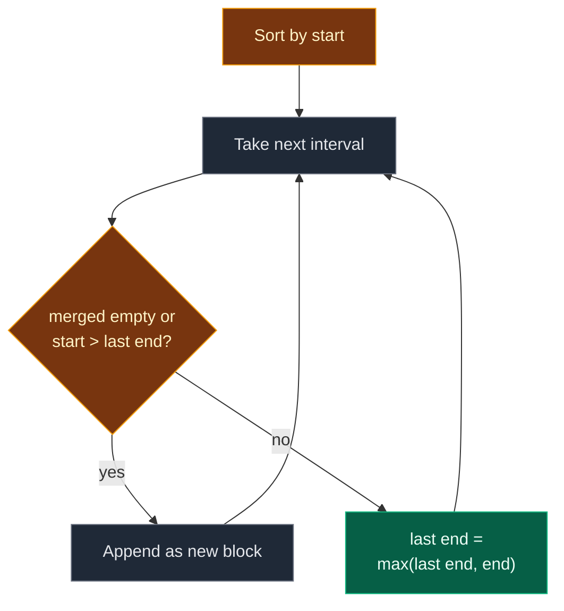

# 01. 56. Merge Intervals

| Difficulty | Pattern | Source | Time | Space |
|:---:|:---:|:---:|:---:|:---:|
| **Medium** | Sort + Sweep | [56. Merge Intervals](https://leetcode.com/problems/merge-intervals/) | `O(n log n)` | `O(n)` |

## 1. Problem Statement

You get a list `intervals`. Each `intervals[i] = [start, end]`.

Merge all intervals that overlap. Return the list of intervals that do not overlap and cover the same points.

Two intervals that only **touch** (like `[1,4]` and `[4,5]`) also count as overlapping.

### Example

```text
intervals = [[8,10], [1,3], [2,6], [15,18], [3,5]]

Sorted by start: [1,3] [2,6] [3,5] [8,10] [15,18]

0    2    4    6    8    10   12   14   16   18
|----|----|----|----|----|----|----|----|----|
 [==]                                            [1,3]
   [=======]                                     [2,6]
     [===]                                       [3,5]  (inside [2,6])
                [===]                            [8,10]
                                   [=====]       [15,18]

Output: [[1,6], [8,10], [15,18]]
```

We use this same example in every section below. It is **not sorted**, and `[3,5]` sits **inside** a block that already reaches `6`. Both details matter.

LeetCode examples:

```text
[[1,3],[2,6],[8,10],[15,18]] -> [[1,6],[8,10],[15,18]]
[[1,4],[4,5]]                -> [[1,5]]
[[4,7],[1,4]]                -> [[1,7]]
```

### Constraints

- `1 <= intervals.length <= 10^4`
- `intervals[i].length == 2`
- `0 <= start_i <= end_i <= 10^4`

## 2. Core Theory

### Why sort by start

In random order, an interval can overlap something far away in the list. After sorting by start, every new interval starts at or after every interval we have seen. So the **only** block it can join is the **last** block we built. One pass is enough.

### The overlap test

```text
current_start <= last_end      -> overlap, grow the last block
current_start >  last_end      -> no overlap, start a new block
```

We use `<=` because touching counts as overlap.

### Why `max` for the new end

Sorting orders the **starts**, not the ends. A small interval can come after a big one, like `[3,5]` after `[1,6]`. If we set `last_end = 5`, the block shrinks and we lose `5..6`. So we use `last_end = max(last_end, current_end)`.



## 3. Edge Cases

| Case | Input | Expected | Why it matters |
|:---|:---|:---:|:---|
| One interval | `[[1,4]]` | `[[1,4]]` | First interval is just added |
| Touching | `[[1,4],[4,5]]` | `[[1,5]]` | Needs `<=`, not `<` |
| Fully inside | `[[1,10],[2,3]]` | `[[1,10]]` | Needs `max` for the end |
| No overlaps | `[[1,2],[3,4],[5,6]]` | same | Nothing merges |
| Unsorted | `[[4,7],[1,4]]` | `[[1,7]]` | Must sort first |
| All the same | `[[2,5],[2,5],[2,5]]` | `[[2,5]]` | Duplicates collapse |
| Zero width | `[[1,1],[1,3]]` | `[[1,3]]` | `start == end` is allowed |
| Chain | `[[1,4],[2,5],[3,6]]` | `[[1,6]]` | One block keeps growing |

## 4. Brute Force: Merge Any Overlapping Pair Until None Left

### Idea

Look at every pair. If two intervals overlap, replace them by one merged interval and start over. Stop when no pair overlaps. Sort the result at the end.

### Code

```python
# Import List for type hints
from typing import List


# Brute force: keep merging any overlapping pair
class SolutionBrute:

    # Main method
    def merge(self, intervals: List[List[int]]) -> List[List[int]]:

        # Work on a copy of the intervals
        items = [list(x) for x in intervals]

        # Keep going while a merge happened
        changed = True

        # Repeat until a full scan makes no merge
        while changed:

            # Assume no merge this round
            changed = False

            # Try every first interval
            for i in range(len(items)):

                # Try every second interval after it
                for j in range(i + 1, len(items)):

                    # The two intervals overlap (or touch)
                    if items[i][0] <= items[j][1] and items[j][0] <= items[i][1]:

                        # Grow interval i to cover both
                        items[i] = [min(items[i][0], items[j][0]), max(items[i][1], items[j][1])]

                        # Remove interval j
                        items.pop(j)

                        # Remember that we merged
                        changed = True

                        # Stop the inner loop and rescan
                        break

                # A merge happened in this row
                if changed:

                    # Restart the scan from the top
                    break

        # Return in sorted order
        return sorted(items)
```

### Complexity

| Measure | Complexity | Why |
|:---|:---:|:---|
| **Time** | `O(n^3)` | Up to `n` merges, each after an `O(n^2)` pair scan |
| **Space** | `O(n)` | The working copy |

## 5. Optimal Approach: Sort, then One Sweep

### Idea

1. Sort intervals by start.
2. For each interval:
   - If `merged` is empty or `start > merged[-1][1]`, append a copy.
   - Otherwise set `merged[-1][1] = max(merged[-1][1], end)`.
3. Return `merged`.

### Visual Walkthrough (Story Version)

**The story:** five kids booked the playground. Each booking is a time `[start, end]`. The caretaker wants a short list of **busy blocks**, so she knows when the gate must be open. If two bookings overlap or touch, the gate just stays open; they become one block.

The kids handed in their notes in a messy order, so first she **sorts the notes by start time**. Then she reads them one by one and only ever looks at the **last block** she wrote.

**How to read the pictures:** each `=` is one hour on the clock line. `{ }` is the block being built. `<-` points to the note being read.

**Step 0: sort the notes**

```text
messy:   [8,10] [1,3] [2,6] [15,18] [3,5]
sorted:  [1,3]  [2,6] [3,5] [8,10]  [15,18]
```

**Step 1: note `[1,3]`**

No blocks yet. Write a new block.

```text
0    2    4    6    8    10   12   14   16   18
|----|----|----|----|----|----|----|----|----|
 {==}                                            <- [1,3]

blocks: [1,3]
```

**Step 2: note `[2,6]`**

Starts at 2. The last block ends at 3. `2 <= 3`, so they overlap. The gate stays open until `max(3, 6) = 6`.

```text
0    2    4    6    8    10   12   14   16   18
|----|----|----|----|----|----|----|----|----|
 {=========}                                     <- [2,6] joined

blocks: [1,6]
```

**Step 3: note `[3,5]`**

Starts at 3. The last block ends at 6. `3 <= 6`, overlap. New end is `max(6, 5) = 6`. The block does **not** shrink.

```text
0    2    4    6    8    10   12   14   16   18
|----|----|----|----|----|----|----|----|----|
 {=========}                                     <- [3,5] fits inside

blocks: [1,6]
```

**Step 4: note `[8,10]`**

Starts at 8. The last block ends at 6. `8 > 6`, there is a gap. Write a new block.

```text
0    2    4    6    8    10   12   14   16   18
|----|----|----|----|----|----|----|----|----|
 {=========}    {===}                            <- [8,10] new block

blocks: [1,6] [8,10]
```

**Step 5: note `[15,18]`**

Starts at 15. The last block ends at 10. `15 > 10`, gap. Write a new block.

```text
0    2    4    6    8    10   12   14   16   18
|----|----|----|----|----|----|----|----|----|
 {=========}    {===}              {=====}       <- [15,18] new block

blocks: [1,6] [8,10] [15,18]
```

**All notes at a glance**

| Step | Note | Last block end | Start <= end? | Action | Blocks |
|:---:|:---:|:---:|:---:|:---|:---|
| 1 | `[1,3]` | – | – | new block | `[1,3]` |
| 2 | `[2,6]` | 3 | 2 <= 3 yes | end = max(3,6) = 6 | `[1,6]` |
| 3 | `[3,5]` | 6 | 3 <= 6 yes | end = max(6,5) = 6 | `[1,6]` |
| 4 | `[8,10]` | 6 | 8 <= 6 no | new block | `[1,6] [8,10]` |
| 5 | `[15,18]` | 10 | 15 <= 10 no | new block | `[1,6] [8,10] [15,18]` |

**What the story teaches**

| In the story | In the code |
|:---|:---|
| Booking note | `interval = [start, end]` |
| Sort the notes by start time | `sorted(intervals, key=lambda x: x[0])` |
| List of busy blocks | `merged` |
| Last block written | `merged[-1]` |
| Booking starts before the gate closes | `start <= merged[-1][1]` |
| Gate stays open longer | `merged[-1][1] = max(merged[-1][1], end)` |
| Gap, so a new block | `merged.append([start, end])` |

Now the same steps again, with exact values.

### Step-by-Step Example

```text
intervals = [[8,10], [1,3], [2,6], [15,18], [3,5]]
```

**Sort by start:** `[[1,3], [2,6], [3,5], [8,10], [15,18]]`. `merged = []`.

1. `[1,3]`: `merged` is empty. Append `[1,3]`.
   `merged = [[1,3]]`
2. `[2,6]`: `merged[-1][1] = 3`. Is `2 > 3`? No. Overlap.
   `merged[-1][1] = max(3, 6) = 6`.
   `merged = [[1,6]]`
3. `[3,5]`: `merged[-1][1] = 6`. Is `3 > 6`? No. Overlap.
   `merged[-1][1] = max(6, 5) = 6`.
   `merged = [[1,6]]`
4. `[8,10]`: `merged[-1][1] = 6`. Is `8 > 6`? Yes. Append `[8,10]`.
   `merged = [[1,6], [8,10]]`
5. `[15,18]`: `merged[-1][1] = 10`. Is `15 > 10`? Yes. Append `[15,18]`.
   `merged = [[1,6], [8,10], [15,18]]`

**Answer:** `[[1,6], [8,10], [15,18]]`

### Code

```python
# Solution for 56. Merge Intervals
class Solution:

    # Main method
    def merge(self, intervals: List[List[int]], trace: list = None) -> List[List[int]]:

        # Sort by start (a new list, the input is not changed)
        ordered = sorted(intervals, key=lambda x: x[0])

        # The merged blocks
        merged = []

        # Go through the intervals in sorted order
        for start, end in ordered:

            # No block yet, or a gap after the last block
            if not merged or start > merged[-1][1]:

                # Start a new block (a copy, so the input is safe)
                merged.append([start, end])

            # It overlaps or touches the last block
            else:

                # Grow the last block, never shrink it
                merged[-1][1] = max(merged[-1][1], end)

            # Save the blocks after this step (only for tests)
            if trace is not None:

                # Record a copy of the blocks
                trace.append([b[:] for b in merged])

        # Return the merged blocks
        return merged


# The example from this note
example = [[8, 10], [1, 3], [2, 6], [15, 18], [3, 5]]

# Collect the blocks after every step
steps = []

# Run with tracing
answer = Solution().merge(example, steps)

# Step 1: [1,3] starts the first block
assert steps[0] == [[1, 3]]

# Step 2: [2,6] overlaps, end becomes 6
assert steps[1] == [[1, 6]]

# Step 3: [3,5] is inside, end stays 6
assert steps[2] == [[1, 6]]

# Step 4: [8,10] starts a new block
assert steps[3] == [[1, 6], [8, 10]]

# Step 5: [15,18] starts a new block
assert steps[4] == [[1, 6], [8, 10], [15, 18]]

# Final answer
assert answer == [[1, 6], [8, 10], [15, 18]]

# The input list was not changed
assert example == [[8, 10], [1, 3], [2, 6], [15, 18], [3, 5]]

# LeetCode examples
assert Solution().merge([[1, 3], [2, 6], [8, 10], [15, 18]]) == [[1, 6], [8, 10], [15, 18]]

# Touching intervals
assert Solution().merge([[1, 4], [4, 5]]) == [[1, 5]]

# Unsorted input
assert Solution().merge([[4, 7], [1, 4]]) == [[1, 7]]

# Edge cases from the table
cases = [
    ([[1, 4]], [[1, 4]]),
    ([[1, 10], [2, 3]], [[1, 10]]),
    ([[1, 2], [3, 4], [5, 6]], [[1, 2], [3, 4], [5, 6]]),
    ([[2, 5], [2, 5], [2, 5]], [[2, 5]]),
    ([[1, 1], [1, 3]], [[1, 3]]),
    ([[1, 4], [2, 5], [3, 6]], [[1, 6]]),
]

# Check each edge case with both versions
for given, expected in cases:

    # Optimal
    assert Solution().merge(given) == expected

    # Brute force
    assert SolutionBrute().merge(given) == expected

# Random tests: brute force == optimal
import random

# Try many random lists
for _ in range(300):

    # Random intervals with small values
    data = [sorted([random.randint(0, 20), random.randint(0, 20)]) for _ in range(random.randint(1, 8))]

    # Compare
    assert Solution().merge(data) == SolutionBrute().merge(data)

# All checks passed
print("All tests passed")
```

The `trace` argument is only there for the step checks. LeetCode calls `merge(intervals)` and it works the same.

### Complexity

| Measure | Complexity | Why |
|:---|:---:|:---|
| **Time** | `O(n log n)` | Sorting. The sweep is `O(n)` |
| **Space** | `O(n)` | The sorted copy and the output |

## 6. Common Mistakes

| Mistake | What goes wrong | Fix |
|:---|:---|:---|
| Using `<` for the overlap test | `[1,4]` and `[4,5]` stay apart | Overlap is `start <= last_end` |
| `merged[-1][1] = end` | `[1,10]` then `[2,3]` shrinks to `[1,3]` | Use `max(last_end, end)` |
| Forgetting to sort | Overlapping intervals are not next to each other | Sort by start first |
| Sorting by end | The "only the last block" rule breaks | Sort by start |
| Appending the input list itself | Growing the block changes the caller's data | Append `[start, end]` as a new list |
| Comparing with `merged[0]` | Only the last block can still grow | Use `merged[-1]` |

## 7. Interview Follow-ups

### Q1. Why is checking only the last block enough?

**Answer:**
- After sorting, every new start is at least every old start.
- Older blocks end before the last block starts.
- If we cannot reach the last block, we cannot reach any older one.

### Q2. Can we beat O(n log n)?

**Answer:**
- Not with comparison sorting.
- Here values are at most `10^4`, so a counting sort or a difference array over `0..10^4` gives `O(n + M)`.

### Q3. How do you insert one new interval into an already merged list? (LeetCode 57)

**Answer:**
- Add all blocks that end before the new one starts.
- Merge all blocks that overlap it into one.
- Add the rest.
- `O(n)` time.

### Q4. What is the fewest intervals to remove so none overlap? (LeetCode 435)

**Answer:**
- Sort by **end**.
- Keep an interval if its start is at least the last kept end. Otherwise remove it.
- This is the case where sorting by end is the right choice.

### Q5. How many intervals overlap at the busiest moment?

**Answer:**
- Make events `(start, +1)` and `(end, -1)`.
- Sort them and keep a running count. The max count is the answer.
- This is "Meeting Rooms II".

## 8. Interview Explanation

> I sort the intervals by start. After that, a new interval can only overlap the last block I built, because every older block ends before the last one starts. So I sweep once: if the merged list is empty or the start is greater than the last block's end, I start a new block. Otherwise I grow the last block's end to the max of the two ends, so a small interval inside a big one never shrinks it. Sorting costs O(n log n), the sweep is O(n), and the output takes O(n) space.
