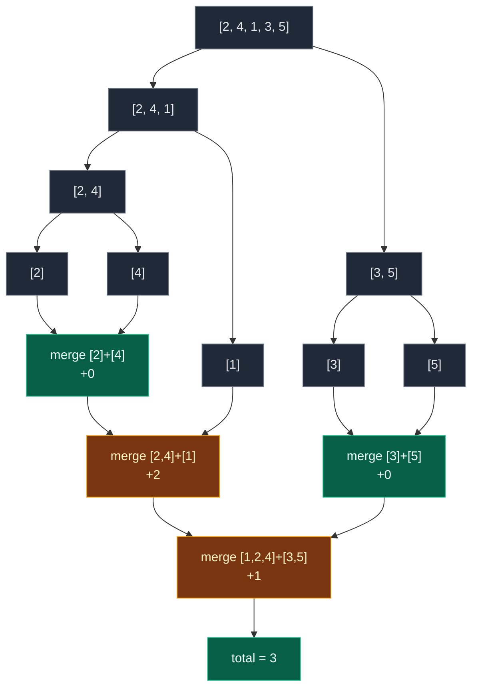

# 01. Count Inversions

| Difficulty | Pattern | Source | Time | Space |
|:---:|:---:|:---:|:---:|:---:|
| **Hard** | Merge Sort | [Count Inversions](https://www.geeksforgeeks.org/problems/inversion-of-array-1587115620/1) | `O(n log n)` | `O(n)` |

## 1. Problem Statement

You get an array of integers `arr`.

Return the **inversion count**: the number of pairs `(i, j)` with `i < j` and `arr[i] > arr[j]`.

In plain words: count the pairs where a bigger number stands **before** a smaller number.

### Example

```text
arr = [2, 4, 1, 3, 5]

index:  0  1  2  3  4
value: [2][4][1][3][5]

Inversions:
  (2, 1)   2 is before 1 and 2 > 1
  (4, 1)   4 is before 1 and 4 > 1
  (4, 3)   4 is before 3 and 4 > 3

Output: 3
```

We use this same example in every section below.

GfG examples:

```text
[2, 4, 1, 3, 5] -> 3
[2, 3, 4, 5, 6] -> 0   (already sorted)
[10, 10, 10]    -> 0   (equal values are not inversions)
```

### Constraints

- `1 <= arr.size() <= 10^5`
- `1 <= arr[i] <= 10^4`

## 2. Core Theory

### What the count means

The inversion count says how far the array is from sorted.

- Sorted array: `0`.
- Reverse sorted array: the maximum, `n(n - 1) / 2`.

### Why checking every pair is too slow

There are about `n^2 / 2` pairs. For `n = 10^5` that is `5 * 10^9` checks. Too slow.

### Why merge sort helps

Merge sort splits the array in half, sorts each half, then merges two **sorted** halves.

While merging, say we compare `left[i]` with `right[j]` and find `left[i] > right[j]`.

- The left half is sorted.
- So **every** element from `i` to the end of the left half is also bigger than `right[j]`.
- That is `mid - i + 1` inversions found in **one** step.

```text
left  = [2, 4]        right = [1]
         ^                     ^
         i                     j

2 > 1, and 4 >= 2, so 4 > 1 too.
count += (mid - i + 1) = 2       pairs (2,1) and (4,1) at once
```

Every pair `(i, j)` is counted exactly once: at the merge where `i` is in the left half and `j` is in the right half.



## 3. Edge Cases

| Case | Input | Expected | Why it matters |
|:---|:---|:---:|:---|
| One element | `[7]` | `0` | Base case, no pairs |
| Two, sorted | `[1, 2]` | `0` | Smallest merge |
| Two, reversed | `[2, 1]` | `1` | Smallest real inversion |
| All equal | `[10, 10, 10]` | `0` | Needs `<=` in the merge so equal values are not counted |
| Sorted | `[2, 3, 4, 5, 6]` | `0` | Left side always wins |
| Reverse sorted | `[5, 4, 3, 2, 1]` | `10` | Maximum `5 * 4 / 2` |
| Duplicates | `[2, 2, 1, 1]` | `4` | Each `2` is before each `1` |
| Big `n` | `10^5` values | fast | Answer can be about `5 * 10^9`. Python is fine. In Java/C++ use `long` |

## 4. Brute Force: Check Every Pair

### Idea

For every `i`, for every `j > i`, add `1` if `arr[i] > arr[j]`.

### Code

```python
# Import List for type hints
from typing import List


# Brute force: check every pair
class SolutionBrute:

    # Main method
    def inversionCount(self, arr: List[int]) -> int:

        # Number of elements
        n = len(arr)

        # Count of inversions
        count = 0

        # Pick the first element of the pair
        for i in range(n):

            # Pick the second element, to the right of the first
            for j in range(i + 1, n):

                # Bigger number stands before a smaller number
                if arr[i] > arr[j]:

                    # One more inversion
                    count += 1

        # Return the count
        return count
```

### Complexity

| Measure | Complexity | Why |
|:---|:---:|:---|
| **Time** | `O(n^2)` | Every pair is checked |
| **Space** | `O(1)` | Only a counter |

## 5. Optimal Approach: Count While Merge Sorting

### Idea

1. Split the range `[low, high]` at `mid = (low + high) // 2`.
2. Count inversions inside the left half and inside the right half (recursion). Both halves come back **sorted**.
3. Merge them with two pointers `left` and `right`:
   - `arr[left] <= arr[right]`: take the left value. No inversion.
   - `arr[left] > arr[right]`: take the right value and add `mid - left + 1`.
4. Copy the merged values back into `arr`.

### Visual Walkthrough (Story Version)

**The story:** five kids stand in a line with height cards `2, 4, 1, 3, 5`. A **rude pair** is a taller kid standing in front of a shorter kid (the shorter kid cannot see). We want to count the rude pairs.

The teacher splits the line into small teams, sorts each team by height, then joins teams two at a time. When she joins two sorted teams, she uses one rule:

- If the next kid in the **right** team is shorter than the next kid in the **left** team, then that right kid is shorter than **everyone still waiting** in the left team. All of them were in front of him. That is many rude pairs at once.

**How to read the pictures:** `L:` is the left team, `R:` is the right team. `^` marks who is at the front of each team. `out:` is the joined team so far.

**Split into teams**

```text
[2][4][1][3][5]
 \_____/  \__/
[2][4][1] [3][5]
 \__/  |   |  |
[2][4] [1] [3] [5]
 |  |
[2] [4]
```

**Join 1: `[2]` and `[4]`**

```text
L: [2]     R: [4]
    ^          ^
2 <= 4  -> take 2        out: [2]
L empty -> take 4        out: [2][4]

rude pairs found: 0      total: 0
```

**Join 2: `[2, 4]` and `[1]`**

```text
L: [2][4]     R: [1]
    ^              ^
2 > 1 -> kid 1 is shorter than 2 AND 4.
         Both stood in front of him: +2
         take 1                     out: [1]
R empty -> take 2, 4                out: [1][2][4]

rude pairs found: 2  (2,1) (4,1)     total: 2
```

**Join 3: `[3]` and `[5]`**

```text
L: [3]     R: [5]
    ^          ^
3 <= 5  -> take 3        out: [3]
L empty -> take 5        out: [3][5]

rude pairs found: 0      total: 2
```

**Join 4: `[1, 2, 4]` and `[3, 5]`**

```text
L: [1][2][4]     R: [3][5]
    ^                ^
1 <= 3 -> take 1                    out: [1]

L: [1][2][4]     R: [3][5]
       ^             ^
2 <= 3 -> take 2                    out: [1][2]

L: [1][2][4]     R: [3][5]
          ^          ^
4 > 3 -> kid 3 is shorter than 4 (the only one left in L): +1
         take 3                     out: [1][2][3]

L: [1][2][4]     R: [3][5]
          ^             ^
4 <= 5 -> take 4                    out: [1][2][3][4]
L empty -> take 5                   out: [1][2][3][4][5]

rude pairs found: 1  (4,3)          total: 3
```

The line is now sorted, and we counted **3** rude pairs.

**All joins at a glance**

| Join | Left team | Right team | Rude pairs added | Total |
|:---:|:---|:---|:---:|:---:|
| 1 | `[2]` | `[4]` | 0 | 0 |
| 2 | `[2, 4]` | `[1]` | 2 | 2 |
| 3 | `[3]` | `[5]` | 0 | 2 |
| 4 | `[1, 2, 4]` | `[3, 5]` | 1 | 3 |

**What the story teaches**

| In the story | In the code |
|:---|:---|
| Kid's height card | `arr[k]` |
| Rude pair | inversion: `i < j` and `arr[i] > arr[j]` |
| Split into teams | `merge_sort(low, mid)` and `merge_sort(mid + 1, high)` |
| Front of left team | `arr[left]` |
| Front of right team | `arr[right]` |
| Kids still waiting in the left team | `mid - left + 1` |
| Joined team | `temp`, then copied back into `arr` |

Now the same steps again, with exact indexes.

### Step-by-Step Example

```text
arr = [2, 4, 1, 3, 5]    (indexes 0..4)
```

**Split** (`mid = (low + high) // 2`):

```text
(0,4) mid=2 -> (0,2) and (3,4)
(0,2) mid=1 -> (0,1) and (2,2)
(0,1) mid=0 -> (0,0) and (1,1)
(3,4) mid=3 -> (3,3) and (4,4)
Ranges of size 1 return 0.
```

**Merge 1: `low=0, mid=0, high=1`, halves `[2]` and `[4]`**

1. `left=0, right=1`: `arr[0]=2 <= arr[1]=4`. Take `2`. `left=1`.
2. Left half done. Take `4` from the right.
3. `temp = [2, 4]`. Copy back. `arr = [2, 4, 1, 3, 5]`. Added `0`.

**Merge 2: `low=0, mid=1, high=2`, halves `[2, 4]` and `[1]`**

1. `left=0, right=2`: `arr[0]=2 > arr[2]=1`. Add `mid - left + 1 = 1 - 0 + 1 = 2`. Take `1`. `right=3`.
2. Right half done. Take `2` and `4` from the left.
3. `temp = [1, 2, 4]`. Copy back. `arr = [1, 2, 4, 3, 5]`. Added `2`.

**Merge 3: `low=3, mid=3, high=4`, halves `[3]` and `[5]`**

1. `left=3, right=4`: `arr[3]=3 <= arr[4]=5`. Take `3`. `left=4`.
2. Left half done. Take `5`.
3. `temp = [3, 5]`. `arr = [1, 2, 4, 3, 5]`. Added `0`.

**Merge 4: `low=0, mid=2, high=4`, halves `[1, 2, 4]` and `[3, 5]`**

1. `left=0, right=3`: `1 <= 3`. Take `1`. `left=1`.
2. `left=1, right=3`: `2 <= 3`. Take `2`. `left=2`.
3. `left=2, right=3`: `4 > 3`. Add `mid - left + 1 = 2 - 2 + 1 = 1`. Take `3`. `right=4`.
4. `left=2, right=4`: `4 <= 5`. Take `4`. `left=3`.
5. Left half done. Take `5`.
6. `temp = [1, 2, 3, 4, 5]`. `arr = [1, 2, 3, 4, 5]`. Added `1`.

**Total:** `0 + 2 + 0 + 1 = 3`.

### Code

```python
# Solution for GfG Count Inversions
class Solution:

    # Main method (trace is only for tests)
    def inversionCount(self, arr: List[int], trace: list = None) -> int:

        # Merge arr[low..mid] and arr[mid+1..high], return the inversions across them
        def merge(low: int, mid: int, high: int) -> int:

            # Merged values go here
            temp = []

            # Pointer into the left half
            left = low

            # Pointer into the right half
            right = mid + 1

            # Inversions found in this merge
            count = 0

            # While both halves have values
            while left <= mid and right <= high:

                # Left value is not bigger: no inversion
                if arr[left] <= arr[right]:

                    # Take the left value
                    temp.append(arr[left])

                    # Move the left pointer
                    left += 1

                # Left value is bigger: inversions found
                else:

                    # Every value still waiting in the left half is bigger
                    count += mid - left + 1

                    # Take the right value
                    temp.append(arr[right])

                    # Move the right pointer
                    right += 1

            # Take what is left in the left half
            temp.extend(arr[left:mid + 1])

            # Take what is left in the right half
            temp.extend(arr[right:high + 1])

            # Copy the sorted values back
            arr[low:high + 1] = temp

            # Save this merge (only for tests)
            if trace is not None:

                # Record range, count and array state
                trace.append((low, mid, high, count, arr[:]))

            # Return the inversions of this merge
            return count

        # Sort arr[low..high] and return its inversion count
        def merge_sort(low: int, high: int) -> int:

            # One value or none
            if low >= high:

                # No pairs, so no inversions
                return 0

            # Middle index
            mid = (low + high) // 2

            # Inversions inside the left half
            total = merge_sort(low, mid)

            # Inversions inside the right half
            total += merge_sort(mid + 1, high)

            # Inversions across the two halves
            total += merge(low, mid, high)

            # Return the total for this range
            return total

        # Run on the whole array
        return merge_sort(0, len(arr) - 1)


# The example from this note
arr = [2, 4, 1, 3, 5]

# Collect each merge
merges = []

# Run with tracing
answer = Solution().inversionCount(arr, merges)

# Merge 1: [2] + [4], no inversions
assert merges[0] == (0, 0, 1, 0, [2, 4, 1, 3, 5])

# Merge 2: [2,4] + [1], adds 2
assert merges[1] == (0, 1, 2, 2, [1, 2, 4, 3, 5])

# Merge 3: [3] + [5], no inversions
assert merges[2] == (3, 3, 4, 0, [1, 2, 4, 3, 5])

# Merge 4: [1,2,4] + [3,5], adds 1
assert merges[3] == (0, 2, 4, 1, [1, 2, 3, 4, 5])

# Total
assert answer == 3

# GfG example 2: sorted
assert Solution().inversionCount([2, 3, 4, 5, 6]) == 0

# GfG example 3: all equal
assert Solution().inversionCount([10, 10, 10]) == 0

# Edge cases from the table
cases = [([7], 0), ([1, 2], 0), ([2, 1], 1), ([5, 4, 3, 2, 1], 10), ([2, 2, 1, 1], 4)]

# Check each edge case
for given, expected in cases:

    # Optimal (on a copy, because it sorts the array)
    assert Solution().inversionCount(given[:]) == expected

    # Brute force
    assert SolutionBrute().inversionCount(given) == expected

# Random tests: brute force == optimal
import random

# Try many random arrays
for _ in range(300):

    # Random array with duplicates
    data = [random.randint(1, 10) for _ in range(random.randint(1, 30))]

    # Compare
    assert Solution().inversionCount(data[:]) == SolutionBrute().inversionCount(data)

# All checks passed
print("All tests passed")
```

The `trace` argument is only for the step checks. GfG calls `inversionCount(arr)` and it works the same.

### Complexity

| Measure | Complexity | Why |
|:---|:---:|:---|
| **Time** | `O(n log n)` | `log n` levels, each level merges `n` values |
| **Space** | `O(n)` | The `temp` lists, plus `O(log n)` recursion stack |

## 6. Common Mistakes

| Mistake | What goes wrong | Fix |
|:---|:---|:---|
| `<` instead of `<=` in the merge | Equal values are counted as inversions | Take the left value when `arr[left] <= arr[right]` |
| `count += 1` when left is bigger | Misses the other waiting left values | `count += mid - left + 1` |
| `mid - left` without `+ 1` | Forgets `arr[left]` itself | Range `left..mid` has `mid - left + 1` values |
| Not copying `temp` back | Halves are not sorted for later merges | `arr[low:high + 1] = temp` |
| Counting in the leftover loops | No pairs are left to form there | Count only in the main loop |
| Expecting `arr` to stay the same | Merge sort sorts it | Pass a copy if you still need it |

## 7. Interview Follow-ups

### Q1. Why can we add mid - left + 1 in one step?

**Answer:**
- The left half is sorted.
- If `arr[left] > arr[right]`, every value from `left` to `mid` is at least `arr[left]`, so all are bigger than `arr[right]`.
- Counting them one by one would bring back `O(n^2)`.

### Q2. How big can the answer be?

**Answer:**
- At most `n(n - 1) / 2`. For `n = 10^5` that is about `5 * 10^9`.
- That overflows a 32-bit int. Use `long` in Java or C++.

### Q3. Can we do it without merge sort?

**Answer:**
- Yes, with a Fenwick tree (BIT) over the values.
- Go right to left. For each value, ask "how many smaller values are already seen?" and add it.
- Also `O(n log n)`, and the array is not changed.

### Q4. How is this linked to sorting?

**Answer:**
- The inversion count equals the number of swaps bubble sort makes.
- Insertion sort runs in `O(n + inversions)`, so it is fast on nearly sorted data.

### Q5. Does it work with negative numbers and duplicates?

**Answer:**
- Yes. Only the order of values matters.
- Duplicates are handled by `<=`.

## 8. Interview Explanation

> I count inversions while doing merge sort. When I merge two sorted halves and the left value is bigger than the right value, the left half is sorted, so every value from the left pointer to mid is also bigger than that right value. That gives mid - left + 1 inversions in one step. If the left value is smaller or equal, there is no inversion and I take it. Each pair is counted once, at the merge where its two values first sit in different halves. The time is O(n log n) and the extra space is O(n).
