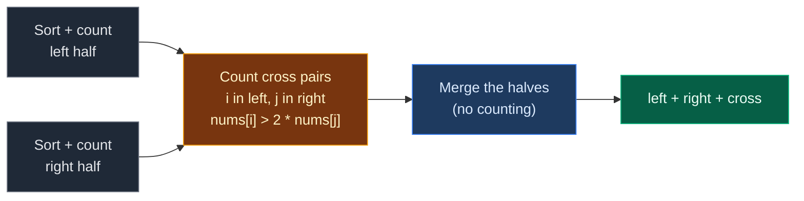

# 02. 493. Reverse Pairs

| Difficulty | Pattern | Source | Time | Space |
|:---:|:---:|:---:|:---:|:---:|
| **Hard** | Modified Merge Sort | [493. Reverse Pairs](https://leetcode.com/problems/reverse-pairs/) | `O(n log n)` | `O(n)` |

## 1. Problem Statement

You get an integer array `nums`.

Return the number of **reverse pairs**.

A reverse pair is a pair `(i, j)` with:

- `0 <= i < j < nums.length`, and
- `nums[i] > 2 * nums[j]`.

In plain words: a number that is **more than double** a number standing somewhere after it.

### Example

```text
nums = [2, 4, 3, 5, 1]

index:  0  1  2  3  4
value: [2][4][3][5][1]

Reverse pairs:
  (1, 4)   4 > 2 * 1 = 2
  (2, 4)   3 > 2 * 1 = 2
  (3, 4)   5 > 2 * 1 = 2

Not a pair: (0, 4) because 2 > 2 is false.

Output: 3
```

We use this same example in every section below.

LeetCode example 1:

```text
[1, 3, 2, 3, 1] -> 2
```

### Constraints

- `1 <= nums.length <= 5 * 10^4`
- `-2^31 <= nums[i] <= 2^31 - 1`

## 2. Core Theory

### How it differs from Count Inversions

| | Count Inversions | Reverse Pairs |
|:---|:---|:---|
| Pair rule | `nums[i] > nums[j]` | `nums[i] > 2 * nums[j]` |
| Example `5, 3` | counts | does not count (`5 > 6` is false) |

Every reverse pair is an inversion. Not every inversion is a reverse pair.

### Same skeleton: merge sort

1. Sort and count the left half.
2. Sort and count the right half.
3. **Count pairs across the halves.**
4. Merge the halves.

### Why the count is a separate pass

- In Count Inversions, the merge test `left <= right` is the same rule we count, so we count inside the merge.
- Here the rule is `left > 2 * right`. That is a **different** border. The merge pointers move at the wrong times for it.
- So we do a separate counting pass **before** merging, while the two halves are sorted and still apart.

### The counting pass is linear

For each `i` in the left half, move `j` forward in the right half while `nums[i] > 2 * nums[j]`. Then add `j - (mid + 1)`.

`j` **never goes back**. The left half is sorted, so a bigger `nums[i]` can only push `j` further right.

```text
left = [2, 3, 4]        right = [1, 5]
                                 ^
                                 j starts at mid + 1

i -> 2:  2 > 2*1=2? no                     j stays    +0
i -> 3:  3 > 2*1=2? yes, j moves; 3 > 10? no          +1
i -> 4:  j already past 1;    4 > 10? no   j stays    +1
```



### Watch out: negatives and overflow

- `-5 > 2 * -5 = -10` is **true**. Doubling a negative makes it smaller. Just trust the comparison.
- `2 * nums[j]` can overflow a 32-bit int in Java or C++. Use `long`. Python has no overflow.

## 3. Edge Cases

| Case | Input | Expected | Why it matters |
|:---|:---|:---:|:---|
| One element | `[1]` | `0` | Base case |
| Two, no pair | `[1, 2]` | `0` | `1 > 4` is false |
| Two, one pair | `[3, 1]` | `1` | Smallest real pair |
| Equal positives | `[5, 5, 5]` | `0` | `5 > 10` is false |
| Equal negatives | `[-5, -5]` | `1` | `-5 > -10` is true |
| Sorted | `[1, 2, 3, 4, 5]` | `0` | Left values are never bigger |
| Reverse sorted | `[5, 4, 3, 2, 1]` | `4` | Only 4 of the 10 inversions qualify |
| Mixed negatives | `[-5, -1, -3]` | `2` | Sign changes the feel of the rule |
| Exactly double | `[2, 1]` | `0` | Strict `>`, so `2 > 2` does not count |
| Extreme values | `[2^31-1, -2^31]` | `1` | Overflow in other languages |

## 4. Brute Force: Check Every Pair

### Idea

For every `i`, for every `j > i`, add `1` if `nums[i] > 2 * nums[j]`.

### Code

```python
# Import List for type hints
from typing import List


# Brute force: check every pair
class SolutionBrute:

    # Main method
    def reversePairs(self, nums: List[int]) -> int:

        # Number of elements
        n = len(nums)

        # Count of reverse pairs
        count = 0

        # Pick the first element
        for i in range(n):

            # Pick the second element, to the right
            for j in range(i + 1, n):

                # First is more than double the second
                if nums[i] > 2 * nums[j]:

                    # One more reverse pair
                    count += 1

        # Return the count
        return count
```

### Complexity

| Measure | Complexity | Why |
|:---|:---:|:---|
| **Time** | `O(n^2)` | Every pair. Too slow for `5 * 10^4` |
| **Space** | `O(1)` | Only a counter |

## 5. Optimal Approach: Merge Sort with a Separate Count Pass

### Idea

For each range `[low, high]`:

1. Recurse on `[low, mid]` and `[mid + 1, high]`. Both come back sorted.
2. Count: `j = mid + 1`. For each `i` in `low..mid`, move `j` while `j <= high` and `nums[i] > 2 * nums[j]`. Add `j - (mid + 1)`.
3. Merge the two sorted halves.

### Visual Walkthrough (Story Version)

**The story:** five kids stand in a line with strength cards `2, 4, 3, 5, 1`. A kid is a **bully** to someone behind them if the kid's card is **more than double** the other kid's card. We count bully pairs.

The teacher splits the line into teams, sorts each team, and when two teams meet, she does two jobs **in order**:

1. **Count first.** The left team stands in front of the right team. She walks along the left team from weakest to strongest. A finger `j` on the right team points past every kid that the current left kid can bully. The finger never moves back, because the next left kid is stronger.
2. **Then merge.** She joins the two teams into one sorted team.

**How to read the pictures:** `L:` and `R:` are the teams. `i` marks the left kid we are checking. `j` is the finger.

**Split into teams**

```text
[2][4][3][5][1]
[2][4][3]   [5][1]
[2][4] [3]  [5] [1]
[2] [4]
```

**Meeting 1: `[2]` and `[4]`**

```text
Count:  L: [2]    R: [4]
            i         j
        2 > 2*4 = 8? no.  j stays.  +0
Merge:  [2][4]

pairs this meeting: 0      total: 0
```

**Meeting 2: `[2, 4]` and `[3]`**

```text
Count:  L: [2][4]    R: [3]
            i            j
        2 > 6? no.  +0

        L: [2][4]    R: [3]
               i         j
        4 > 6? no.  +0
Merge:  [2][3][4]

pairs this meeting: 0      total: 0
```

**Meeting 3: `[5]` and `[1]`**

```text
Count:  L: [5]    R: [1]
            i         j
        5 > 2*1 = 2? yes -> finger moves past 1.   +1
        L: [5]    R: [1] |
                           j (past the end)
Merge:  [1][5]

pairs this meeting: 1  (5 bullies 1)      total: 1
```

**Meeting 4: `[2, 3, 4]` and `[1, 5]`**

```text
Count:  L: [2][3][4]    R: [1][5]
            i               j
        2 > 2*1 = 2? no.  finger stays.  +0

        L: [2][3][4]    R: [1][5]
               i            j
        3 > 2? yes -> finger moves.
        L: [2][3][4]    R: [1][5]
               i               j
        3 > 2*5 = 10? no.  finger stops.  +1  (3 bullies 1)

        L: [2][3][4]    R: [1][5]
                  i            j
        finger is already past 1 (no going back).
        4 > 10? no.  +1  (4 bullies 1)
Merge:  [1][2][3][4][5]

pairs this meeting: 2      total: 3
```

**All meetings at a glance**

| Meeting | Left team | Right team | Pairs found | Total |
|:---:|:---|:---|:---:|:---:|
| 1 | `[2]` | `[4]` | 0 | 0 |
| 2 | `[2, 4]` | `[3]` | 0 | 0 |
| 3 | `[5]` | `[1]` | 1 | 1 |
| 4 | `[2, 3, 4]` | `[1, 5]` | 2 | 3 |

**What the story teaches**

| In the story | In the code |
|:---|:---|
| Strength card | `nums[k]` |
| Bully pair | `i < j` and `nums[i] > 2 * nums[j]` |
| Left team / right team | `nums[low..mid]` / `nums[mid+1..high]` |
| Finger on the right team | pointer `j` |
| Finger never moves back | `j` is set once per meeting, outside the `for i` loop |
| Kids the current left kid can bully | `j - (mid + 1)` |
| Count first, then merge | count pass before `merge` |

Now the same steps again, with exact indexes.

### Step-by-Step Example

```text
nums = [2, 4, 3, 5, 1]    (indexes 0..4)

Splits: (0,4) mid=2 -> (0,2), (3,4)
        (0,2) mid=1 -> (0,1), (2,2)
        (0,1) mid=0 -> (0,0), (1,1)
        (3,4) mid=3 -> (3,3), (4,4)
```

**Meeting 1: `low=0, mid=0, high=1`, halves `[2] | [4]`**

1. `j = 1`.
2. `i = 0`: `nums[0]=2 > 2*nums[1]=8`? No. `j = 1`. Add `1 - 1 = 0`.
3. Merge: `nums = [2, 4, 3, 5, 1]`. Cross count `0`.

**Meeting 2: `low=0, mid=1, high=2`, halves `[2, 4] | [3]`**

1. `j = 2`.
2. `i = 0`: `2 > 6`? No. Add `2 - 2 = 0`.
3. `i = 1`: `4 > 6`? No. Add `2 - 2 = 0`.
4. Merge: `nums = [2, 3, 4, 5, 1]`. Cross count `0`.

**Meeting 3: `low=3, mid=3, high=4`, halves `[5] | [1]`**

1. `j = 4`.
2. `i = 3`: `5 > 2`? Yes, `j = 5`. `j <= 4` fails, stop. Add `5 - 4 = 1`.
3. Merge: `nums = [2, 3, 4, 1, 5]`. Cross count `1`.

**Meeting 4: `low=0, mid=2, high=4`, halves `[2, 3, 4] | [1, 5]`**

1. `j = 3`.
2. `i = 0`: `2 > 2*1 = 2`? No. Add `3 - 3 = 0`.
3. `i = 1`: `3 > 2`? Yes, `j = 4`. `3 > 2*5 = 10`? No. Add `4 - 3 = 1`.
4. `i = 2`: `4 > 10`? No. Add `4 - 3 = 1`.
5. Merge: `nums = [1, 2, 3, 4, 5]`. Cross count `2`.

**Total:** `0 + 0 + 1 + 2 = 3`.

### Code

```python
# Solution for 493. Reverse Pairs
class Solution:

    # Main method (trace is only for tests)
    def reversePairs(self, nums: List[int], trace: list = None) -> int:

        # Count pairs with i in the left half and j in the right half
        def count_cross(low: int, mid: int, high: int) -> int:

            # Pairs found in this meeting
            count = 0

            # Finger on the right half, set once
            j = mid + 1

            # Walk the left half
            for i in range(low, mid + 1):

                # Move the finger past every value nums[i] can beat
                while j <= high and nums[i] > 2 * nums[j]:

                    # Next right value
                    j += 1

                # All right values before j form a pair with nums[i]
                count += j - (mid + 1)

            # Return the cross count
            return count

        # Merge two sorted halves into one sorted range
        def merge(low: int, mid: int, high: int) -> None:

            # Merged values go here
            temp = []

            # Pointer into the left half
            left = low

            # Pointer into the right half
            right = mid + 1

            # While both halves have values
            while left <= mid and right <= high:

                # Left value is smaller or equal
                if nums[left] <= nums[right]:

                    # Take the left value
                    temp.append(nums[left])

                    # Move the left pointer
                    left += 1

                # Right value is smaller
                else:

                    # Take the right value
                    temp.append(nums[right])

                    # Move the right pointer
                    right += 1

            # Take what is left in the left half
            temp.extend(nums[left:mid + 1])

            # Take what is left in the right half
            temp.extend(nums[right:high + 1])

            # Copy the sorted values back
            nums[low:high + 1] = temp

        # Sort nums[low..high] and return its reverse pair count
        def merge_sort(low: int, high: int) -> int:

            # One value or none
            if low >= high:

                # No pairs possible
                return 0

            # Middle index
            mid = (low + high) // 2

            # Pairs inside the left half
            total = merge_sort(low, mid)

            # Pairs inside the right half
            total += merge_sort(mid + 1, high)

            # Count across the halves first, while they are apart
            cross = count_cross(low, mid, high)

            # Then merge
            merge(low, mid, high)

            # Save this meeting (only for tests)
            if trace is not None:

                # Record range, cross count and array state
                trace.append((low, mid, high, cross, nums[:]))

            # Return the total for this range
            return total + cross

        # Run on the whole array
        return merge_sort(0, len(nums) - 1)


# The example from this note
nums = [2, 4, 3, 5, 1]

# Collect each meeting
meetings = []

# Run with tracing
answer = Solution().reversePairs(nums, meetings)

# Meeting 1: [2] | [4], no pairs
assert meetings[0] == (0, 0, 1, 0, [2, 4, 3, 5, 1])

# Meeting 2: [2,4] | [3], no pairs
assert meetings[1] == (0, 1, 2, 0, [2, 3, 4, 5, 1])

# Meeting 3: [5] | [1], one pair
assert meetings[2] == (3, 3, 4, 1, [2, 3, 4, 1, 5])

# Meeting 4: [2,3,4] | [1,5], two pairs
assert meetings[3] == (0, 2, 4, 2, [1, 2, 3, 4, 5])

# Total
assert answer == 3

# LeetCode example 1
assert Solution().reversePairs([1, 3, 2, 3, 1]) == 2

# Edge cases from the table
cases = [
    ([1], 0), ([1, 2], 0), ([3, 1], 1), ([5, 5, 5], 0), ([-5, -5], 1),
    ([1, 2, 3, 4, 5], 0), ([5, 4, 3, 2, 1], 4), ([-5, -1, -3], 2),
    ([2, 1], 0), ([2**31 - 1, -2**31], 1),
]

# Check each edge case
for given, expected in cases:

    # Optimal (on a copy, because it sorts the array)
    assert Solution().reversePairs(given[:]) == expected

    # Brute force
    assert SolutionBrute().reversePairs(given) == expected

# Random tests: brute force == optimal
import random

# Try many random arrays, with negatives
for _ in range(300):

    # Random array
    data = [random.randint(-10, 10) for _ in range(random.randint(1, 30))]

    # Compare
    assert Solution().reversePairs(data[:]) == SolutionBrute().reversePairs(data)

# All checks passed
print("All tests passed")
```

The `trace` argument is only for the step checks. LeetCode calls `reversePairs(nums)` and it works the same.

### Complexity

| Measure | Complexity | Why |
|:---|:---:|:---|
| **Time** | `O(n log n)` | `log n` levels. Each level does a linear count pass and a linear merge |
| **Space** | `O(n)` | `temp` lists, plus `O(log n)` recursion stack |

## 6. Common Mistakes

| Mistake | What goes wrong | Fix |
|:---|:---|:---|
| Counting inside the merge loop | The merge moves on `<=`, not on `> 2 *`. Pairs are missed or double counted | Separate count pass before merging |
| Counting after merging | Halves are mixed, same-half pairs get counted | Count while the halves are apart |
| Resetting `j` for every `i` | Count pass becomes `O(n^2)` | Set `j` once per meeting |
| `count += j - mid` | Off by one | Right half starts at `mid + 1`: use `j - (mid + 1)` |
| Using `>=` | Counts exact doubles like `(2, 1)` | Strict `>` |
| 32-bit `2 * nums[j]` in Java/C++ | Overflow flips the sign | Use `long` |

## 7. Interview Follow-ups

### Q1. Why not count inside the merge like Count Inversions?

**Answer:**
- In Count Inversions the merge test and the counted rule are the same.
- Here the rule is `> 2 *`, so the border is somewhere else.
- The merge pointers do not stop at that border, so we need our own pass.

### Q2. Why is the count pass linear?

**Answer:**
- `i` moves through the left half once.
- `j` only moves forward through the right half, at most once per value.
- So one meeting costs `O(size of the range)`.

### Q3. What about overflow?

**Answer:**
- Values reach `2^31 - 1`, so `2 * nums[j]` does not fit in a 32-bit int.
- Use `(long) nums[i] > 2L * nums[j]` in Java, `long long` in C++.
- Avoid dividing by `2.0`. Floating point can round wrong.

### Q4. Can a Fenwick tree solve it?

**Answer:**
- Yes. Compress all values `nums[k]` and `2 * nums[k]` to ranks.
- Go left to right. For each `nums[j]`, ask how many seen values are bigger than `2 * nums[j]`, then insert `nums[j]`.
- Also `O(n log n)`, and the array is not changed.

### Q5. What if the rule were nums[i] > f(nums[j]) for some other f?

**Answer:**
- If `f` always grows when its input grows, the same code works.
- That property is what keeps `j` from moving back.

## 8. Interview Explanation

> I use merge sort. For each range, I sort and count the left half and the right half. Then, before merging, I count pairs that cross the halves: for each i in the sorted left half, I move a pointer j in the right half while nums[i] is more than twice nums[j], and add j minus (mid + 1). Because the left half is sorted, j never moves back, so this pass is linear. I count before merging because the merge compares with a different rule and mixes the halves. Total time is O(n log n) and extra space is O(n).
