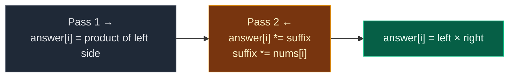

# 01. 238. Product of Array Except Self

| Difficulty | Pattern | Source | Time | Space |
|:---:|:---:|:---:|:---:|:---:|
| **Medium** | Prefix and Suffix Precomputation | [238. Product of Array Except Self](https://leetcode.com/problems/product-of-array-except-self/) | `O(n)` | `O(1)` extra |

## 1. Problem Statement

You get an integer array `nums`.

Return an array `answer` where `answer[i]` is the product of **all** values of `nums` **except** `nums[i]`.

Rules:

- The algorithm must run in `O(n)` time.
- You must **not** use division.

### Example

```text
nums = [1, 2, 3, 4]

answer[0] = 2 * 3 * 4 = 24
answer[1] = 1 * 3 * 4 = 12
answer[2] = 1 * 2 * 4 = 8
answer[3] = 1 * 2 * 3 = 6

Output: [24, 12, 8, 6]
```

We use this same example in every section below.

LeetCode example 2:

```text
[-1, 1, 0, -3, 3] -> [0, 0, 9, 0, 0]
```

### Constraints

- `2 <= nums.length <= 10^5`
- `-30 <= nums[i] <= 30`
- The product of any prefix or suffix fits in a 32-bit integer.

**Follow up:** Can you do it with `O(1)` extra space? (The output array does not count.)

## 2. Core Theory

### What the problem really asks

"Everything except me" = "everything to my **left**" times "everything to my **right**".

```text
nums:      [1]  [2]  [3]  [4]
                      ^
                      i = 2

left of i:  1 * 2     = 2
right of i: 4         = 4
answer[2] = 2 * 4     = 8
```

### Why prefix and suffix

- `left[i]` = product of `nums[0..i-1]`. Each one is the previous one times one more value.
- `right[i]` = product of `nums[i+1..n-1]`. Same idea from the other end.
- So both lists take one pass each.

| i | 0 | 1 | 2 | 3 |
|:---|:---:|:---:|:---:|:---:|
| `nums[i]` | 1 | 2 | 3 | 4 |
| `left[i]` | 1 | 1 | 2 | 6 |
| `right[i]` | 24 | 12 | 4 | 1 |
| `left * right` | 24 | 12 | 8 | 6 |

The empty product is `1`, so `left[0] = 1` and `right[n-1] = 1`.

### Why not divide the total?

- Division is not allowed.
- It also breaks with zeros: you cannot divide by `0`.

### The O(1) trick

Store `left[i]` directly in `answer`. Then walk from the right with one variable `suffix` and multiply it in.



## 3. Edge Cases

| Case | Input | Expected | Why it matters |
|:---|:---|:---:|:---|
| Two values | `[2, 3]` | `[3, 2]` | Smallest input |
| One zero | `[-1, 1, 0, -3, 3]` | `[0, 0, 9, 0, 0]` | Only the zero's spot is non-zero |
| Two zeros | `[0, 2, 0]` | `[0, 0, 0]` | Every spot sees at least one zero |
| Negatives | `[-1, -2, -3]` | `[6, 3, 2]` | Signs multiply normally |
| All ones | `[1, 1, 1, 1]` | `[1, 1, 1, 1]` | Empty-product start of `1` matters |

## 4. Brute Force: Multiply Everyone Else

### Idea

For every `i`, loop over all `j != i` and multiply.

### Code

```python
# Import List for type hints
from typing import List


# Brute force: for each index, multiply all the others
class SolutionBrute:

    # Main method
    def productExceptSelf(self, nums: List[int]) -> List[int]:

        # Number of elements
        n = len(nums)

        # The answer
        answer = []

        # Go through every index
        for i in range(n):

            # Start with the empty product
            product = 1

            # Go through every other index
            for j in range(n):

                # Skip the value itself
                if j != i:

                    # Multiply it in
                    product *= nums[j]

            # Save the product for index i
            answer.append(product)

        # Return the answer
        return answer
```

### Complexity

| Measure | Complexity | Why |
|:---|:---:|:---|
| **Time** | `O(n^2)` | `n` products of `n - 1` values |
| **Space** | `O(1)` extra | Only the output |

## 5. Better Approach: Two Helper Arrays

### Idea

Build `left[]` and `right[]`, then `answer[i] = left[i] * right[i]`.

### Code

```python
# Better: separate prefix and suffix arrays
class SolutionBetter:

    # Main method
    def productExceptSelf(self, nums: List[int]) -> List[int]:

        # Number of elements
        n = len(nums)

        # left[i] = product of everything before i
        left = [1] * n

        # Fill left to right
        for i in range(1, n):

            # One more value than the previous left product
            left[i] = left[i - 1] * nums[i - 1]

        # right[i] = product of everything after i
        right = [1] * n

        # Fill right to left
        for i in range(n - 2, -1, -1):

            # One more value than the next right product
            right[i] = right[i + 1] * nums[i + 1]

        # Multiply the two sides
        return [left[i] * right[i] for i in range(n)]
```

### Complexity

| Measure | Complexity | Why |
|:---|:---:|:---|
| **Time** | `O(n)` | Three passes |
| **Space** | `O(n)` | `left` and `right` |

## 6. Optimal Approach: Prefix in the Answer, Suffix in One Variable

### Idea

1. Pass 1, left to right: `answer[i] = prefix`, then `prefix *= nums[i]`.
2. Pass 2, right to left: `answer[i] *= suffix`, then `suffix *= nums[i]`.

### Visual Walkthrough (Story Version)

**The story:** four kids stand in a line holding number cards `1, 2, 3, 4`. Each kid wants to know: "What do I get if I multiply **everyone else's** card?"

Two messengers help. Each carries a little **basket number** that starts at `1`.

- The **left messenger** walks from left to right. At each kid, he first **writes his basket number on the kid's slate**, then multiplies the kid's card into his basket.
- The **right messenger** walks from right to left. At each kid, he first **multiplies the kid's slate by his basket**, then multiplies the kid's card into his basket.

Because each messenger writes **before** taking the kid's card, no kid ever gets their own card.

**How to read the pictures:** `[1]` is a card. The row under it is the slate. `basket` is what the messenger holds. `^` is where he stands.

**Start**

```text
cards:  [1]  [2]  [3]  [4]
slate:   ?    ?    ?    ?
```

**Left messenger at kid 0**

```text
cards:  [1]  [2]  [3]  [4]
slate:   1    ?    ?    ?
         ^
writes basket 1, then basket = 1 * 1 = 1
```

**Left messenger at kid 1**

```text
cards:  [1]  [2]  [3]  [4]
slate:   1    1    ?    ?
              ^
writes basket 1, then basket = 1 * 2 = 2
```

**Left messenger at kid 2**

```text
cards:  [1]  [2]  [3]  [4]
slate:   1    1    2    ?
                   ^
writes basket 2, then basket = 2 * 3 = 6
```

**Left messenger at kid 3**

```text
cards:  [1]  [2]  [3]  [4]
slate:   1    1    2    6
                        ^
writes basket 6, then basket = 6 * 4 = 24
```

Now each slate holds "the product of everyone to my left".

**Right messenger at kid 3** (basket starts at 1)

```text
cards:  [1]  [2]  [3]  [4]
slate:   1    1    2    6
                        ^
slate = 6 * 1 = 6, then basket = 1 * 4 = 4
```

**Right messenger at kid 2**

```text
cards:  [1]  [2]  [3]  [4]
slate:   1    1    8    6
                   ^
slate = 2 * 4 = 8, then basket = 4 * 3 = 12
```

**Right messenger at kid 1**

```text
cards:  [1]  [2]  [3]  [4]
slate:   1   12    8    6
              ^
slate = 1 * 12 = 12, then basket = 12 * 2 = 24
```

**Right messenger at kid 0**

```text
cards:  [1]  [2]  [3]  [4]
slate:  24   12    8    6
         ^
slate = 1 * 24 = 24, then basket = 24 * 1 = 24
```

Every slate now shows "everyone except me".

**All steps at a glance**

| Walk | Kid | Basket before | Slate after | Basket after |
|:---:|:---:|:---:|:---:|:---:|
| → | 0 | 1 | 1 | 1 |
| → | 1 | 1 | 1 | 2 |
| → | 2 | 2 | 2 | 6 |
| → | 3 | 6 | 6 | 24 |
| ← | 3 | 1 | 6 | 4 |
| ← | 2 | 4 | 8 | 12 |
| ← | 1 | 12 | 12 | 24 |
| ← | 0 | 24 | 24 | 24 |

**What the story teaches**

| In the story | In the code |
|:---|:---|
| Kid's card | `nums[i]` |
| Kid's slate | `answer[i]` |
| Left messenger's basket | `prefix` |
| Right messenger's basket | `suffix` |
| Write first, then take the card | set `answer[i]` before `*= nums[i]` |
| Basket starts at 1 | empty product |

Now the same steps again, with exact values.

### Step-by-Step Example

```text
nums = [1, 2, 3, 4]
answer = [1, 1, 1, 1]
```

**Pass 1 (left to right), `prefix = 1`**

1. `i = 0`: `answer[0] = 1`. `prefix = 1 * 1 = 1`. `answer = [1, 1, 1, 1]`
2. `i = 1`: `answer[1] = 1`. `prefix = 1 * 2 = 2`. `answer = [1, 1, 1, 1]`
3. `i = 2`: `answer[2] = 2`. `prefix = 2 * 3 = 6`. `answer = [1, 1, 2, 1]`
4. `i = 3`: `answer[3] = 6`. `prefix = 6 * 4 = 24`. `answer = [1, 1, 2, 6]`

**Pass 2 (right to left), `suffix = 1`**

5. `i = 3`: `answer[3] = 6 * 1 = 6`. `suffix = 1 * 4 = 4`. `answer = [1, 1, 2, 6]`
6. `i = 2`: `answer[2] = 2 * 4 = 8`. `suffix = 4 * 3 = 12`. `answer = [1, 1, 8, 6]`
7. `i = 1`: `answer[1] = 1 * 12 = 12`. `suffix = 12 * 2 = 24`. `answer = [1, 12, 8, 6]`
8. `i = 0`: `answer[0] = 1 * 24 = 24`. `suffix = 24 * 1 = 24`. `answer = [24, 12, 8, 6]`

**Answer:** `[24, 12, 8, 6]`

### Code

```python
# Solution for 238. Product of Array Except Self
class Solution:

    # Main method (trace is only for tests)
    def productExceptSelf(self, nums: List[int], trace: list = None) -> List[int]:

        # Number of elements
        n = len(nums)

        # The answer, also used to hold the left products
        answer = [1] * n

        # Product of everything to the left so far
        prefix = 1

        # Pass 1: left to right
        for i in range(n):

            # Write the left product before taking nums[i]
            answer[i] = prefix

            # Now include nums[i] for the next index
            prefix *= nums[i]

            # Save the state (only for tests)
            if trace is not None:

                # Record answer and prefix
                trace.append((answer[:], prefix))

        # Product of everything to the right so far
        suffix = 1

        # Pass 2: right to left
        for i in range(n - 1, -1, -1):

            # Multiply in the right product
            answer[i] *= suffix

            # Now include nums[i] for the next index
            suffix *= nums[i]

            # Save the state (only for tests)
            if trace is not None:

                # Record answer and suffix
                trace.append((answer[:], suffix))

        # Return the answer
        return answer


# The example from this note
steps = []

# Run with tracing
answer = Solution().productExceptSelf([1, 2, 3, 4], steps)

# Pass 1, i = 0: write 1, prefix becomes 1
assert steps[0] == ([1, 1, 1, 1], 1)

# Pass 1, i = 1: write 1, prefix becomes 2
assert steps[1] == ([1, 1, 1, 1], 2)

# Pass 1, i = 2: write 2, prefix becomes 6
assert steps[2] == ([1, 1, 2, 1], 6)

# Pass 1, i = 3: write 6, prefix becomes 24
assert steps[3] == ([1, 1, 2, 6], 24)

# Pass 2, i = 3: 6 * 1, suffix becomes 4
assert steps[4] == ([1, 1, 2, 6], 4)

# Pass 2, i = 2: 2 * 4, suffix becomes 12
assert steps[5] == ([1, 1, 8, 6], 12)

# Pass 2, i = 1: 1 * 12, suffix becomes 24
assert steps[6] == ([1, 12, 8, 6], 24)

# Pass 2, i = 0: 1 * 24, suffix stays 24
assert steps[7] == ([24, 12, 8, 6], 24)

# Final answer
assert answer == [24, 12, 8, 6]

# LeetCode example 2
assert Solution().productExceptSelf([-1, 1, 0, -3, 3]) == [0, 0, 9, 0, 0]

# Edge cases from the table
cases = [
    ([2, 3], [3, 2]),
    ([0, 2, 0], [0, 0, 0]),
    ([-1, -2, -3], [6, 3, 2]),
    ([1, 1, 1, 1], [1, 1, 1, 1]),
]

# Check each case with all three versions
for given, expected in cases:

    # Optimal
    assert Solution().productExceptSelf(given) == expected

    # Better
    assert SolutionBetter().productExceptSelf(given) == expected

    # Brute force
    assert SolutionBrute().productExceptSelf(given) == expected

# Random tests: brute force == optimal
import random

# Try many random arrays
for _ in range(300):

    # Random array with zeros and negatives
    data = [random.randint(-5, 5) for _ in range(random.randint(2, 10))]

    # Compare
    assert Solution().productExceptSelf(data) == SolutionBrute().productExceptSelf(data)

# All checks passed
print("All tests passed")
```

The `trace` argument is only for the step checks. LeetCode calls `productExceptSelf(nums)` and it works the same.

### Complexity

| Measure | Complexity | Why |
|:---|:---:|:---|
| **Time** | `O(n)` | Two passes |
| **Space** | `O(1)` extra | Only `prefix` and `suffix`. `answer` is the output |

## 7. Common Mistakes

| Mistake | What goes wrong | Fix |
|:---|:---|:---|
| Dividing the total product by `nums[i]` | Not allowed, and fails on zero | Use left and right products |
| Multiplying `prefix *= nums[i]` before writing | Each spot includes its own value | Write first, then multiply |
| Starting `prefix` or `suffix` at `0` | Everything becomes `0` | Start at `1`, the empty product |
| Second pass going left to right | Suffix is wrong | Go from `n - 1` down to `0` |
| Counting `left[]` and `right[]` as O(1) | They are `O(n)` | Keep the suffix in one variable |

## 8. Interview Follow-ups

### Q1. Why not just divide the total product?

**Answer:**
- The problem forbids division.
- With one zero, the total is `0` and you cannot divide by the zero.
- With two zeros, every answer is `0`. Division logic needs special cases.

### Q2. How would you do it with division if it were allowed?

**Answer:**
- Count zeros and take the product of non-zero values.
- No zeros: `total // nums[i]`.
- One zero: only the zero's spot gets the product, others get `0`.
- Two or more zeros: all `0`.

### Q3. Why does the output array not count as extra space?

**Answer:**
- We must return it anyway.
- Extra space means memory beyond the input and the output.

### Q4. What about overflow?

**Answer:**
- LeetCode says every prefix and suffix fits in 32 bits.
- In general, use a 64-bit type or work with a modulus if the problem gives one.

### Q5. Where else does the left-pass / right-pass idea show up?

**Answer:**
- Trapping Rain Water (max to the left, max to the right).
- Sum of Beauty (max to the left, min to the right).
- Candy (LeetCode 135).

## 9. Interview Explanation

> The product of everything except nums[i] is the product of everything to its left times the product of everything to its right. In a first pass from left to right, I write the running left product into answer[i] before multiplying nums[i] into it. In a second pass from right to left, I keep a running right product in one variable, multiply it into answer[i], then multiply nums[i] into it. Both running products start at 1. That is O(n) time with no division and O(1) extra space besides the output.
