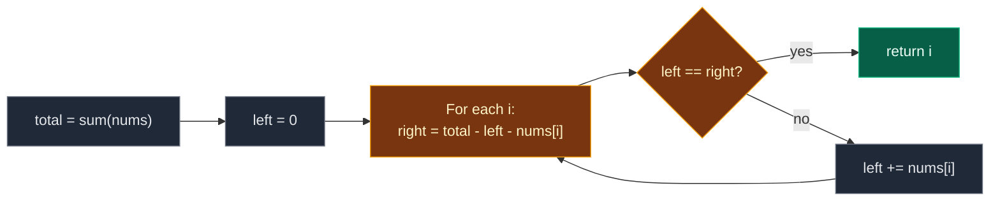

# 02. 724. Find Pivot Index

| Difficulty | Pattern | Source | Time | Space |
|:---:|:---:|:---:|:---:|:---:|
| **Easy** | Prefix and Suffix Precomputation | [724. Find Pivot Index](https://leetcode.com/problems/find-pivot-index/) | `O(n)` | `O(1)` |

## 1. Problem Statement

You get an integer array `nums`.

The **pivot index** is an index where the sum of all numbers **strictly to its left** equals the sum of all numbers **strictly to its right**.

- If the index is `0`, the left sum is `0` (nothing is there).
- If the index is the last one, the right sum is `0`.

Return the **leftmost** pivot index. If there is none, return `-1`.

### Example

```text
nums = [1, 7, 3, 6, 5, 6]

index:  0  1  2  3  4  5
value: [1][7][3][6][5][6]
                ^
             index 3

left of 3:  1 + 7 + 3 = 11
right of 3: 5 + 6     = 11

Output: 3
```

We use this same example in every section below.

LeetCode examples:

```text
[1, 2, 3]   -> -1   (no pivot)
[2, 1, -1]  -> 0    (left sum 0, right sum 1 + (-1) = 0)
```

### Constraints

- `1 <= nums.length <= 10^4`
- `-1000 <= nums[i] <= 1000`

Note: this is the same problem as [1991. Find the Middle Index in Array](https://leetcode.com/problems/find-the-middle-index-in-array/).

## 2. Core Theory

### What the problem really asks

For each index `i`, compare `left_sum` and `right_sum`. Return the first `i` where they match.

### The key formula

The whole array splits into three parts:

```text
total = left_sum + nums[i] + right_sum
```

So:

```text
right_sum = total - left_sum - nums[i]
```

If we know `total` once, and keep a running `left_sum`, we get `right_sum` for free at every index.

```text
nums:   [1] [7] [3] [6] [5] [6]      total = 28
        \_________/  ^  \_____/
         left = 11   6   right = 28 - 11 - 6 = 11
```

### Why it is called prefix / suffix

- `left_sum` is a **prefix** sum (sum of the start of the array).
- `right_sum` is a **suffix** sum (sum of the end of the array).
- We only store one number for each, not whole arrays.



## 3. Edge Cases

| Case | Input | Expected | Why it matters |
|:---|:---|:---:|:---|
| One element | `[5]` | `0` | Both sides are empty, `0 == 0` |
| Pivot at index 0 | `[2, 1, -1]` | `0` | Left sum is `0` |
| Pivot at the end | `[-1, 1, 2]` | `2` | Right sum is `0` |
| No pivot | `[1, 2, 3]` | `-1` | Must return `-1` |
| Many pivots | `[0, 0, 0]` | `0` | Return the **leftmost** |
| Negatives | `[-1, -1, -1, 0, 1, 1]` | `0` | Left `0`, right `-1-1+0+1+1 = 0` |

## 4. Brute Force: Sum Both Sides for Every Index

### Idea

For each `i`, add up `nums[0..i-1]` and `nums[i+1..n-1]` from scratch. Return the first match.

### Code

```python
# Import List for type hints
from typing import List


# Brute force: recompute both sums for every index
class SolutionBrute:

    # Main method
    def pivotIndex(self, nums: List[int]) -> int:

        # Number of elements
        n = len(nums)

        # Try every index
        for i in range(n):

            # Sum of everything to the left
            left_sum = sum(nums[:i])

            # Sum of everything to the right
            right_sum = sum(nums[i + 1:])

            # Both sides balance
            if left_sum == right_sum:

                # This is the leftmost pivot
                return i

        # No pivot found
        return -1
```

### Complexity

| Measure | Complexity | Why |
|:---|:---:|:---|
| **Time** | `O(n^2)` | Each index sums up to `n` values |
| **Space** | `O(n)` | Python slices make copies |

## 5. Optimal Approach: Total Sum and a Running Left Sum

### Idea

1. `total = sum(nums)`.
2. `left = 0`.
3. For each `i`: `right = total - left - nums[i]`. If `left == right`, return `i`. Else `left += nums[i]`.
4. Return `-1`.

### Visual Walkthrough (Story Version)

**The story:** six boxes with weights `1, 7, 3, 6, 5, 6` sit in a row on a long plank. We want to find a box to put our **finger** under so the plank balances: the weight on the left of the finger equals the weight on the right. The box on the finger itself does not count for either side.

First we weigh **all** boxes together: `28`. Then we slide the finger from left to right. We keep a running count of the weight we have passed. The right side is "all of it, minus what we passed, minus the box on the finger".

**How to read the pictures:** `^` is the finger. `L` and `R` are the weights on each side.

**Weigh everything:** `1 + 7 + 3 + 6 + 5 + 6 = 28`.

**Finger under box 0**

```text
 [1] [7] [3] [6] [5] [6]
  ^
L = 0      R = 28 - 0 - 1 = 27      0 != 27  tilts right
then L = 0 + 1 = 1
```

**Finger under box 1**

```text
 [1] [7] [3] [6] [5] [6]
      ^
L = 1      R = 28 - 1 - 7 = 20      1 != 20  tilts right
then L = 1 + 7 = 8
```

**Finger under box 2**

```text
 [1] [7] [3] [6] [5] [6]
          ^
L = 8      R = 28 - 8 - 3 = 17      8 != 17  tilts right
then L = 8 + 3 = 11
```

**Finger under box 3**

```text
 [1] [7] [3] [6] [5] [6]
              ^
L = 11     R = 28 - 11 - 6 = 11     11 == 11  BALANCED!
```

The plank balances on box 3. Answer: `3`.

**All steps at a glance**

| Finger at | Box weight | L | R = 28 - L - box | Balanced? |
|:---:|:---:|:---:|:---:|:---:|
| 0 | 1 | 0 | 27 | no |
| 1 | 7 | 1 | 20 | no |
| 2 | 3 | 8 | 17 | no |
| 3 | 6 | 11 | 11 | **yes** |

**What the story teaches**

| In the story | In the code |
|:---|:---|
| Box weight | `nums[i]` |
| Weigh all boxes | `total = sum(nums)` |
| Weight passed so far | `left` |
| Weight on the right | `total - left - nums[i]` |
| Plank balances | `left == right` |
| Slide the finger on | `left += nums[i]` |

Now the same steps again, with exact values.

### Step-by-Step Example

```text
nums = [1, 7, 3, 6, 5, 6]
total = 28, left = 0
```

1. `i = 0`: `right = 28 - 0 - 1 = 27`. `0 == 27`? No. `left = 0 + 1 = 1`.
2. `i = 1`: `right = 28 - 1 - 7 = 20`. `1 == 20`? No. `left = 1 + 7 = 8`.
3. `i = 2`: `right = 28 - 8 - 3 = 17`. `8 == 17`? No. `left = 8 + 3 = 11`.
4. `i = 3`: `right = 28 - 11 - 6 = 11`. `11 == 11`? **Yes**. Return `3`.

Indexes 4 and 5 are never checked.

### Code

```python
# Solution for 724. Find Pivot Index
class Solution:

    # Main method (trace is only for tests)
    def pivotIndex(self, nums: List[int], trace: list = None) -> int:

        # Sum of the whole array
        total = sum(nums)

        # Sum of everything left of the current index
        left = 0

        # Try every index from the left
        for i in range(len(nums)):

            # Sum of everything right of the current index
            right = total - left - nums[i]

            # Save the check (only for tests)
            if trace is not None:

                # Record index, left and right
                trace.append((i, left, right))

            # Both sides balance
            if left == right:

                # Leftmost pivot found
                return i

            # Move nums[i] to the left side
            left += nums[i]

        # No pivot found
        return -1


# The example from this note
checks = []

# Run with tracing
answer = Solution().pivotIndex([1, 7, 3, 6, 5, 6], checks)

# i = 0: left 0, right 27
assert checks[0] == (0, 0, 27)

# i = 1: left 1, right 20
assert checks[1] == (1, 1, 20)

# i = 2: left 8, right 17
assert checks[2] == (2, 8, 17)

# i = 3: left 11, right 11, balanced
assert checks[3] == (3, 11, 11)

# Stopped at index 3
assert len(checks) == 4 and answer == 3

# LeetCode example 2: no pivot
assert Solution().pivotIndex([1, 2, 3]) == -1

# LeetCode example 3: pivot at index 0
assert Solution().pivotIndex([2, 1, -1]) == 0

# Edge cases from the table
cases = [([5], 0), ([-1, 1, 2], 2), ([0, 0, 0], 0), ([-1, -1, -1, 0, 1, 1], 0)]

# Check each case with both versions
for given, expected in cases:

    # Optimal
    assert Solution().pivotIndex(given) == expected

    # Brute force
    assert SolutionBrute().pivotIndex(given) == expected

# Random tests: brute force == optimal
import random

# Try many random arrays
for _ in range(500):

    # Small values make pivots common
    data = [random.randint(-3, 3) for _ in range(random.randint(1, 8))]

    # Compare
    assert Solution().pivotIndex(data) == SolutionBrute().pivotIndex(data)

# All checks passed
print("All tests passed")
```

The `trace` argument is only for the step checks. LeetCode calls `pivotIndex(nums)` and it works the same.

### Complexity

| Measure | Complexity | Why |
|:---|:---:|:---|
| **Time** | `O(n)` | One pass for `total`, one pass for the search |
| **Space** | `O(1)` | Only `total`, `left`, `right` |

## 6. Common Mistakes

| Mistake | What goes wrong | Fix |
|:---|:---|:---|
| Adding `nums[i]` to `left` before the check | Left side includes the pivot itself | Check first, then `left += nums[i]` |
| `right = total - left` | Right side includes the pivot itself | Subtract `nums[i]` too |
| Returning the last pivot found | Problem wants the leftmost | Return as soon as you find one |
| Forgetting `-1` | Function returns `None` | Return `-1` after the loop |
| Assuming all values are positive | Negatives can make sums go down. No early stop is safe | Check every index |

## 7. Interview Follow-ups

### Q1. Can you stop early when left gets bigger than right?

**Answer:**
- Only if all values are non-negative.
- With negatives, `left` can drop again later.
- So in general, check every index.

### Q2. What if we need all pivot indexes?

**Answer:**
- Do not return early. Add `i` to a list when `left == right`.
- Still `O(n)`.

### Q3. Why not build full prefix and suffix arrays?

**Answer:**
- That works and is also `O(n)` time.
- But it uses `O(n)` space.
- `right = total - left - nums[i]` gives the same number with one variable.

### Q4. What if the array changes and we ask many times?

**Answer:**
- Use a Fenwick tree for prefix sums.
- Updates and prefix queries are `O(log n)`.

### Q5. Which other problem is exactly this one?

**Answer:**
- 1991. Find the Middle Index in Array. Same rule, same code.
- 2574. Left and Right Sum Differences uses the same `total - left - nums[i]` idea.

## 8. Interview Explanation

> The total of the array is left sum plus nums[i] plus right sum, so right sum equals total minus left sum minus nums[i]. I compute the total once, then walk from the left keeping a running left sum. At each index I compute the right sum with that formula and return the index as soon as the two sides are equal, which gives the leftmost pivot. After the check I add nums[i] to the left sum. If nothing matches I return -1. That is O(n) time and O(1) space.
