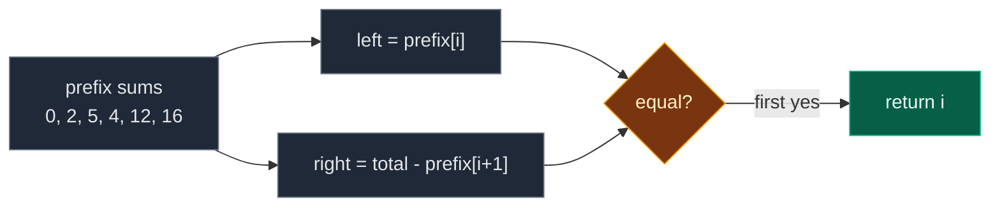

# 03. 1991. Find the Middle Index in Array

| Difficulty | Pattern | Source | Time | Space |
|:---:|:---:|:---:|:---:|:---:|
| **Easy** | Prefix and Suffix Precomputation | [1991. Find the Middle Index in Array](https://leetcode.com/problems/find-the-middle-index-in-array/) | `O(n)` | `O(1)` |

## 1. Problem Statement

You get a 0-indexed integer array `nums`.

A **middle index** is an index `middleIndex` where:

```text
nums[0] + ... + nums[middleIndex - 1] == nums[middleIndex + 1] + ... + nums[n - 1]
```

- If `middleIndex == 0`, the left side sum is `0`.
- If `middleIndex == n - 1`, the right side sum is `0`.

Return the **leftmost** middle index. If there is none, return `-1`.

### Example

```text
nums = [2, 3, -1, 8, 4]

index:  0   1   2   3   4
value: [2] [3] [-1] [8] [4]
                     ^
                  index 3

left of 3:  2 + 3 + (-1) = 4
right of 3: 4            = 4

Output: 3
```

We use this same example in every section below. It has a negative number, which shows why we cannot stop early.

LeetCode examples:

```text
[1, -1, 4] -> 2    (left 1 + (-1) = 0, right 0)
[2, 5]     -> -1
```

### Constraints

- `1 <= nums.length <= 100`
- `-1000 <= nums[i] <= 1000`

Note: this is the same problem as [724. Find Pivot Index](https://leetcode.com/problems/find-pivot-index/).

## 2. Core Theory

### What the problem really asks

Find the first index where "sum before me" equals "sum after me". The value at the index itself is not on either side.

### One formula does the work

```text
total = left_sum + nums[i] + right_sum
=> right_sum = total - left_sum - nums[i]
```

Keep a running `left_sum`. Compute `right_sum` with the formula. No second array needed.

### How the three ideas compare

| Way | How we get the right side | Extra space |
|:---|:---|:---:|
| Brute | add it up again every time | `O(1)` but `O(n^2)` time |
| Prefix array | `prefix[n] - prefix[i + 1]` | `O(n)` |
| Running sum | `total - left - nums[i]` | `O(1)` |

### Why negatives matter

With only positive numbers, `left_sum` always grows and `right_sum` always shrinks, so you could stop once left passes right. With negatives, sums can go **down**. In our example, `left` goes `0, 2, 5, 4`: it dropped. So we check every index.



## 3. Edge Cases

| Case | Input | Expected | Why it matters |
|:---|:---|:---:|:---|
| One element | `[7]` | `0` | Both sides empty, `0 == 0` |
| Middle at the end | `[1, -1, 4]` | `2` | Right side is empty |
| Middle at the start | `[4, 1, -1]` | `0` | Left side is empty |
| No answer | `[2, 5]` | `-1` | Must return `-1` |
| All zeros | `[0, 0, 0, 0]` | `0` | Leftmost of many answers |
| Left sum goes down | `[2, 3, -1, 8, 4]` | `3` | Negatives, no early stop |

## 4. Brute Force: Add Both Sides for Every Index

### Idea

For every `i`, add up the left part and the right part from scratch.

### Code

```python
# Import List for type hints
from typing import List


# Brute force: two fresh sums for every index
class SolutionBrute:

    # Main method
    def findMiddleIndex(self, nums: List[int]) -> int:

        # Number of elements
        n = len(nums)

        # Try every index
        for i in range(n):

            # Start the left sum
            left_sum = 0

            # Add every value before i
            for j in range(i):

                # Add one value
                left_sum += nums[j]

            # Start the right sum
            right_sum = 0

            # Add every value after i
            for j in range(i + 1, n):

                # Add one value
                right_sum += nums[j]

            # Both sides match
            if left_sum == right_sum:

                # Leftmost answer
                return i

        # No middle index
        return -1
```

### Complexity

| Measure | Complexity | Why |
|:---|:---:|:---|
| **Time** | `O(n^2)` | Each index adds up `n - 1` values |
| **Space** | `O(1)` | Two counters |

## 5. Better Approach: Prefix Sum Array

### Idea

Build `prefix` where `prefix[k]` = sum of the first `k` values. Then:

- `left_sum = prefix[i]`
- `right_sum = prefix[n] - prefix[i + 1]`

### Code

```python
# Better: precompute prefix sums
class SolutionBetter:

    # Main method
    def findMiddleIndex(self, nums: List[int]) -> int:

        # Number of elements
        n = len(nums)

        # prefix[k] = sum of nums[0..k-1]
        prefix = [0] * (n + 1)

        # Fill the prefix sums
        for k in range(n):

            # One more value than before
            prefix[k + 1] = prefix[k] + nums[k]

        # Try every index
        for i in range(n):

            # Sum before i, compared with sum after i
            if prefix[i] == prefix[n] - prefix[i + 1]:

                # Leftmost answer
                return i

        # No middle index
        return -1
```

### Complexity

| Measure | Complexity | Why |
|:---|:---:|:---|
| **Time** | `O(n)` | Two passes |
| **Space** | `O(n)` | The `prefix` array |

## 6. Optimal Approach: Total and a Running Left Sum

### Idea

1. `total = sum(nums)`, `left = 0`.
2. For each `i`: `right = total - left - nums[i]`. If equal, return `i`. Else `left += nums[i]`.
3. Return `-1`.

### Visual Walkthrough (Story Version)

**The story:** five kids stand in a line. Each holds a money note. A positive note means coins (`3` = 3 coins). A negative note means the kid **owes** coins (`-1` = owes 1). We want the first kid where the kids **in front** have the same money in total as the kids **behind**. The chosen kid's own note does not count.

A helper first counts **all** the money: `2 + 3 - 1 + 8 + 4 = 16`. Then he walks down the line, keeping a pocket total of everything he has walked past.

**How to read the pictures:** `^` is the kid we test. `front` and `back` are the two totals.

**Count all the money:** `16`.

**Test kid 0**

```text
 [2] [3] [-1] [8] [4]
  ^
front = 0     back = 16 - 0 - 2 = 14     0 != 14
pocket = 0 + 2 = 2
```

**Test kid 1**

```text
 [2] [3] [-1] [8] [4]
      ^
front = 2     back = 16 - 2 - 3 = 11     2 != 11
pocket = 2 + 3 = 5
```

**Test kid 2**

```text
 [2] [3] [-1] [8] [4]
          ^
front = 5     back = 16 - 5 - (-1) = 12  5 != 12
pocket = 5 + (-1) = 4      <- the pocket went DOWN
```

**Test kid 3**

```text
 [2] [3] [-1] [8] [4]
               ^
front = 4     back = 16 - 4 - 8 = 4      4 == 4  MATCH!
```

Kid 3 is the middle. Answer: `3`.

**All steps at a glance**

| Kid | Note | front | back = 16 - front - note | Match? | pocket after |
|:---:|:---:|:---:|:---:|:---:|:---:|
| 0 | 2 | 0 | 14 | no | 2 |
| 1 | 3 | 2 | 11 | no | 5 |
| 2 | -1 | 5 | 12 | no | 4 |
| 3 | 8 | 4 | 4 | **yes** | – |

**What the story teaches**

| In the story | In the code |
|:---|:---|
| Money note | `nums[i]` |
| Count all the money | `total = sum(nums)` |
| Pocket total (kids in front) | `left` |
| Kids behind | `total - left - nums[i]` |
| Owing money makes the pocket go down | negatives, so no early stop |
| First match | return `i` right away |

Now the same steps again, with exact values.

### Step-by-Step Example

```text
nums = [2, 3, -1, 8, 4]
total = 16, left = 0
```

1. `i = 0`: `right = 16 - 0 - 2 = 14`. `0 == 14`? No. `left = 2`.
2. `i = 1`: `right = 16 - 2 - 3 = 11`. `2 == 11`? No. `left = 5`.
3. `i = 2`: `right = 16 - 5 - (-1) = 12`. `5 == 12`? No. `left = 4`.
4. `i = 3`: `right = 16 - 4 - 8 = 4`. `4 == 4`? **Yes**. Return `3`.

### Code

```python
# Solution for 1991. Find the Middle Index in Array
class Solution:

    # Main method (trace is only for tests)
    def findMiddleIndex(self, nums: List[int], trace: list = None) -> int:

        # Sum of the whole array
        total = sum(nums)

        # Sum of values before the current index
        left = 0

        # Try every index from the left
        for i in range(len(nums)):

            # Sum of values after the current index
            right = total - left - nums[i]

            # Save the check (only for tests)
            if trace is not None:

                # Record index, left and right
                trace.append((i, left, right))

            # Both sides match
            if left == right:

                # Leftmost middle index
                return i

            # Move nums[i] to the left side
            left += nums[i]

        # No middle index
        return -1


# The example from this note
checks = []

# Run with tracing
answer = Solution().findMiddleIndex([2, 3, -1, 8, 4], checks)

# i = 0: left 0, right 14
assert checks[0] == (0, 0, 14)

# i = 1: left 2, right 11
assert checks[1] == (1, 2, 11)

# i = 2: left 5, right 12
assert checks[2] == (2, 5, 12)

# i = 3: left 4 (it went down), right 4, match
assert checks[3] == (3, 4, 4)

# Answer
assert answer == 3

# LeetCode example 2
assert Solution().findMiddleIndex([1, -1, 4]) == 2

# LeetCode example 3
assert Solution().findMiddleIndex([2, 5]) == -1

# Edge cases from the table
cases = [([7], 0), ([4, 1, -1], 0), ([0, 0, 0, 0], 0), ([2, 3, -1, 8, 4], 3)]

# Check each case with all three versions
for given, expected in cases:

    # Optimal
    assert Solution().findMiddleIndex(given) == expected

    # Better
    assert SolutionBetter().findMiddleIndex(given) == expected

    # Brute force
    assert SolutionBrute().findMiddleIndex(given) == expected

# Random tests: brute force == optimal
import random

# Try many random arrays
for _ in range(500):

    # Small values make middles common
    data = [random.randint(-3, 3) for _ in range(random.randint(1, 8))]

    # Compare
    assert Solution().findMiddleIndex(data) == SolutionBrute().findMiddleIndex(data)

# All checks passed
print("All tests passed")
```

The `trace` argument is only for the step checks. LeetCode calls `findMiddleIndex(nums)` and it works the same.

### Complexity

| Measure | Complexity | Why |
|:---|:---:|:---|
| **Time** | `O(n)` | One pass for `total`, one for the search |
| **Space** | `O(1)` | Three numbers |

## 7. Common Mistakes

| Mistake | What goes wrong | Fix |
|:---|:---|:---|
| `left += nums[i]` before the check | Middle value counted on the left | Check first, then add |
| `right = total - left` | Middle value counted on the right | Also subtract `nums[i]` |
| Stopping when `left > right` | Wrong with negatives (`left` can drop) | Check every index |
| Returning the last match | Problem wants the leftmost | Return on the first match |
| `prefix` array of size `n` | Off by one on `prefix[i + 1]` | Use size `n + 1` with `prefix[0] = 0` |

## 8. Interview Follow-ups

### Q1. How is this different from 724. Find Pivot Index?

**Answer:**
- It is not. Same rule, same leftmost answer, same `-1`.
- Only the constraints differ (`n <= 100` here).

### Q2. When can we stop early?

**Answer:**
- Only if every value is `>= 0`. Then `left` only grows and `right` only shrinks.
- Once `left > right`, no later index can match.

### Q3. How would you return all middle indexes?

**Answer:**
- Keep looping. Append `i` on every match.
- Still `O(n)`.

### Q4. What if we want the index where the difference |left - right| is smallest?

**Answer:**
- Same loop. Track the smallest `abs(left - right)` and its index.

### Q5. How does this extend to 2D (a row where top sum equals bottom sum)?

**Answer:**
- Turn each row into its row sum. Now it is the same 1D problem on the row sums.

## 9. Interview Explanation

> The total equals the left sum plus the middle value plus the right sum, so the right sum is total minus left minus nums[i]. I compute the total once and walk from the left with a running left sum. At each index I compute the right sum, return the index on the first match, and otherwise add nums[i] to the left sum. Values can be negative, so the left sum can go down and I cannot stop early. It runs in O(n) time with O(1) space.
