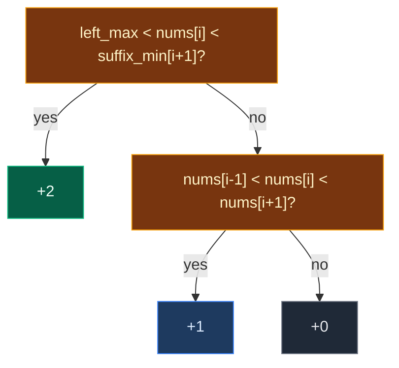

# 04. 2012. Sum of Beauty in the Array

| Difficulty | Pattern | Source | Time | Space |
|:---:|:---:|:---:|:---:|:---:|
| **Medium** | Prefix and Suffix Precomputation | [2012. Sum of Beauty in the Array](https://leetcode.com/problems/sum-of-beauty-in-the-array/) | `O(n)` | `O(n)` |

## 1. Problem Statement

You get a 0-indexed integer array `nums`.

For each index `i` with `1 <= i <= n - 2`, the **beauty** of `nums[i]` is:

- `2` if `nums[j] < nums[i] < nums[k]` for **every** `j < i` and **every** `k > i`.
- `1` if `nums[i - 1] < nums[i] < nums[i + 1]`, and the rule for `2` is not met.
- `0` otherwise.

Return the sum of the beauty of all those indexes.

### Example

```text
nums = [1, 2, 4, 6, 3, 7]

index:  0  1  2  3  4  5
value: [1][2][4][6][3][7]

i = 1 (value 2): bigger than all before {1}, smaller than all after {4,6,3,7}  -> 2
i = 2 (value 4): smaller than all after? No, 3 is after it.
                 But 2 < 4 < 6 (its neighbors)                              -> 1
i = 3 (value 6): 4 < 6 but 6 < 3 is false                                   -> 0
i = 4 (value 3): 6 < 3 is false                                             -> 0

Output: 2 + 1 + 0 + 0 = 3
```

We use this same example in every section below. It has all three beauty values.

LeetCode examples:

```text
[1, 2, 3]    -> 2
[2, 4, 6, 4] -> 1
[3, 2, 1]    -> 0
```

### Constraints

- `3 <= nums.length <= 10^5`
- `1 <= nums[i] <= 10^5`

## 2. Core Theory

### Turn "every" into one number

"`nums[i]` is bigger than **every** value before it" is the same as:

```text
nums[i] > max(nums[0 .. i-1])
```

"`nums[i]` is smaller than **every** value after it" is the same as:

```text
nums[i] < min(nums[i+1 .. n-1])
```

So beauty 2 needs just two numbers: the **max to the left** and the **min to the right**.

### Prefix max and suffix min

| i | 0 | 1 | 2 | 3 | 4 | 5 |
|:---|:---:|:---:|:---:|:---:|:---:|:---:|
| `nums[i]` | 1 | 2 | 4 | 6 | 3 | 7 |
| max of everything before `i` | – | 1 | 2 | 4 | 6 | – |
| min of everything after `i` | – | 3 | 3 | 3 | 7 | – |

- Max to the left: walk left to right with one running variable.
- Min to the right: we walk left to right, so we need it **ready in advance**. Build a `suffix_min` array from the right first.

### Check order matters

Check beauty 2 **first**. If it holds, beauty 1 also holds, but we must add `2`, not `3`.



## 3. Edge Cases

| Case | Input | Expected | Why it matters |
|:---|:---|:---:|:---|
| Smallest array | `[1, 2, 3]` | `2` | Only `i = 1` is checked |
| Decreasing | `[3, 2, 1]` | `0` | No beauty anywhere |
| Far value breaks beauty 2 | `[2, 4, 6, 4]` | `1` | `i = 1`: `4 < 4` fails for the last value |
| Equal values | `[1, 2, 2, 3]` | `0` | All rules use strict `<` |
| Fully increasing | `[1, 2, 3, 4, 5]` | `6` | Every middle index gets 2 |
| Our example | `[1, 2, 4, 6, 3, 7]` | `3` | All three cases |

## 4. Brute Force: Scan Both Sides for Every Index

### Idea

For each `i`, loop over all `j < i` and all `k > i` to test the beauty 2 rule. If it fails, test the neighbors.

### Code

```python
# Import List for type hints
from typing import List


# Brute force: check every value on both sides
class SolutionBrute:

    # Main method
    def sumOfBeauties(self, nums: List[int]) -> int:

        # Number of elements
        n = len(nums)

        # Sum of beauty
        total = 0

        # Only middle indexes get a beauty
        for i in range(1, n - 1):

            # Is nums[i] bigger than everything before it?
            left_ok = all(nums[j] < nums[i] for j in range(i))

            # Is nums[i] smaller than everything after it?
            right_ok = all(nums[i] < nums[k] for k in range(i + 1, n))

            # Beauty 2
            if left_ok and right_ok:

                # Add 2
                total += 2

            # Beauty 1
            elif nums[i - 1] < nums[i] < nums[i + 1]:

                # Add 1
                total += 1

        # Return the sum
        return total
```

### Complexity

| Measure | Complexity | Why |
|:---|:---:|:---|
| **Time** | `O(n^2)` | Each index scans the whole array |
| **Space** | `O(1)` | A few variables |

## 5. Optimal Approach: Running Left Max and a Suffix Min Array

### Idea

1. Build `suffix_min[k] = min(nums[k..n-1])`, from right to left.
2. `left_max = nums[0]`.
3. For `i` from `1` to `n - 2`:
   - If `left_max < nums[i] < suffix_min[i + 1]`: add `2`.
   - Else if `nums[i - 1] < nums[i] < nums[i + 1]`: add `1`.
   - Then `left_max = max(left_max, nums[i])`.

### Visual Walkthrough (Story Version)

**The story:** six kids stand in a line, with heights `1, 2, 4, 6, 3, 7`. A photographer gives points to the kids in the middle (not the two ends):

- **Star (2 points):** taller than **everyone in front** and shorter than **everyone behind**. A perfect staircase spot.
- **Nice (1 point):** not a star, but taller than the kid just in front and shorter than the kid just behind.
- Otherwise 0 points.

To be quick, the photographer gets help:

- **Before starting**, a helper walks from the **back** of the line to the front. At every spot she writes on the floor the **shortest height from here to the back**. These are the floor notes.
- Then the photographer walks from the front, keeping in his head the **tallest kid seen so far**.

**How to read the pictures:** the first row is heights. The second row is the floor notes (shortest from here to the back). `^` is the kid being judged.

**Helper writes floor notes, from the back**

```text
heights: [1] [2] [4] [6] [3] [7]
notes:    .   .   .   .   .   7      shortest of {7} = 7
notes:    .   .   .   .   3   7      min(3, 7) = 3
notes:    .   .   .   3   3   7      min(6, 3) = 3
notes:    .   .   3   3   3   7      min(4, 3) = 3
notes:    .   2   3   3   3   7      min(2, 3) = 2
notes:    1   2   3   3   3   7      min(1, 2) = 1
```

The photographer starts with `tallest seen = 1` (the first kid).

**Judge kid 1 (height 2)**

```text
heights: [1] [2] [4] [6] [3] [7]
notes:    1   2   3   3   3   7
              ^   ^
                  shortest behind = note at the next spot = 3
tallest in front = 1
1 < 2 < 3  -> STAR, +2          points: 2
tallest seen = max(1, 2) = 2
```

**Judge kid 2 (height 4)**

```text
heights: [1] [2] [4] [6] [3] [7]
notes:    1   2   3   3   3   7
                  ^   ^
tallest in front = 2, shortest behind = 3
2 < 4, but 4 < 3? no  -> not a star
neighbors: 2 < 4 < 6? yes -> NICE, +1      points: 3
tallest seen = max(2, 4) = 4
```

**Judge kid 3 (height 6)**

```text
heights: [1] [2] [4] [6] [3] [7]
notes:    1   2   3   3   3   7
                      ^   ^
tallest in front = 4, shortest behind = 3
4 < 6, but 6 < 3? no  -> not a star
neighbors: 4 < 6 < 3? no  -> 0              points: 3
tallest seen = max(4, 6) = 6
```

**Judge kid 4 (height 3)**

```text
heights: [1] [2] [4] [6] [3] [7]
notes:    1   2   3   3   3   7
                          ^   ^
tallest in front = 6, shortest behind = 7
6 < 3? no  -> not a star
neighbors: 6 < 3? no  -> 0                  points: 3
tallest seen = max(6, 3) = 6
```

Total points: `3`.

**All kids at a glance**

| Kid | Height | Tallest in front | Shortest behind | Star? | Nice? | Points |
|:---:|:---:|:---:|:---:|:---:|:---:|:---:|
| 1 | 2 | 1 | 3 | yes | – | +2 |
| 2 | 4 | 2 | 3 | no | 2 < 4 < 6 yes | +1 |
| 3 | 6 | 4 | 3 | no | 4 < 6 < 3 no | 0 |
| 4 | 3 | 6 | 7 | no | 6 < 3 no | 0 |

**What the story teaches**

| In the story | In the code |
|:---|:---|
| Height | `nums[i]` |
| Floor notes (shortest to the back) | `suffix_min` array |
| Shortest behind kid `i` | `suffix_min[i + 1]` |
| Tallest seen so far | `left_max` |
| Star | `left_max < nums[i] < suffix_min[i + 1]` |
| Nice | `nums[i - 1] < nums[i] < nums[i + 1]` |
| Judge star first | `if ... elif ...` order |

Now the same steps again, with exact values.

### Step-by-Step Example

```text
nums = [1, 2, 4, 6, 3, 7], n = 6
```

**Build `suffix_min` (right to left)**

1. `suffix_min[5] = 7`
2. `suffix_min[4] = min(3, 7) = 3`
3. `suffix_min[3] = min(6, 3) = 3`
4. `suffix_min[2] = min(4, 3) = 3`
5. `suffix_min[1] = min(2, 3) = 2`
6. `suffix_min[0] = min(1, 2) = 1`

`suffix_min = [1, 2, 3, 3, 3, 7]`

**Main loop, `left_max = 1`, `total = 0`**

7. `i = 1`: `1 < 2 < suffix_min[2] = 3`? Yes. `total = 2`. `left_max = max(1, 2) = 2`.
8. `i = 2`: `2 < 4 < suffix_min[3] = 3`? No (`4 < 3` fails). `nums[1]=2 < 4 < nums[3]=6`? Yes. `total = 3`. `left_max = 4`.
9. `i = 3`: `4 < 6 < suffix_min[4] = 3`? No. `nums[2]=4 < 6 < nums[4]=3`? No. `total = 3`. `left_max = 6`.
10. `i = 4`: `6 < 3`? No. `nums[3]=6 < 3`? No. `total = 3`. `left_max = 6`.

**Answer:** `3`

### Code

```python
# Solution for 2012. Sum of Beauty in the Array
class Solution:

    # Main method (trace is only for tests)
    def sumOfBeauties(self, nums: List[int], trace: list = None) -> int:

        # Number of elements
        n = len(nums)

        # suffix_min[k] = smallest value in nums[k..n-1]
        suffix_min = [0] * n

        # The last spot only sees itself
        suffix_min[n - 1] = nums[n - 1]

        # Fill from right to left
        for k in range(n - 2, -1, -1):

            # Smaller of this value and everything after it
            suffix_min[k] = min(nums[k], suffix_min[k + 1])

        # Save the suffix array (only for tests)
        if trace is not None:

            # Record a copy
            trace.append(suffix_min[:])

        # Biggest value before the current index
        left_max = nums[0]

        # Sum of beauty
        total = 0

        # Only middle indexes get a beauty
        for i in range(1, n - 1):

            # Bigger than all before and smaller than all after
            if left_max < nums[i] < suffix_min[i + 1]:

                # Beauty 2
                total += 2

            # Only bigger than the left neighbor and smaller than the right neighbor
            elif nums[i - 1] < nums[i] < nums[i + 1]:

                # Beauty 1
                total += 1

            # Include nums[i] in the left max for the next index
            left_max = max(left_max, nums[i])

            # Save the state (only for tests)
            if trace is not None:

                # Record index, total and left max
                trace.append((i, total, left_max))

        # Return the sum
        return total


# The example from this note
steps = []

# Run with tracing
answer = Solution().sumOfBeauties([1, 2, 4, 6, 3, 7], steps)

# The suffix min array
assert steps[0] == [1, 2, 3, 3, 3, 7]

# i = 1: star, total 2, left max 2
assert steps[1] == (1, 2, 2)

# i = 2: nice, total 3, left max 4
assert steps[2] == (2, 3, 4)

# i = 3: nothing, total 3, left max 6
assert steps[3] == (3, 3, 6)

# i = 4: nothing, total 3, left max 6
assert steps[4] == (4, 3, 6)

# Answer
assert answer == 3

# LeetCode examples
assert Solution().sumOfBeauties([1, 2, 3]) == 2

# LeetCode example 2
assert Solution().sumOfBeauties([2, 4, 6, 4]) == 1

# LeetCode example 3
assert Solution().sumOfBeauties([3, 2, 1]) == 0

# Edge cases from the table
cases = [([1, 2, 2, 3], 0), ([1, 2, 3, 4, 5], 6)]

# Check each case with both versions
for given, expected in cases:

    # Optimal
    assert Solution().sumOfBeauties(given) == expected

    # Brute force
    assert SolutionBrute().sumOfBeauties(given) == expected

# Random tests: brute force == optimal
import random

# Try many random arrays
for _ in range(500):

    # Random array with repeats
    data = [random.randint(1, 8) for _ in range(random.randint(3, 10))]

    # Compare
    assert Solution().sumOfBeauties(data) == SolutionBrute().sumOfBeauties(data)

# All checks passed
print("All tests passed")
```

The `trace` argument is only for the step checks. LeetCode calls `sumOfBeauties(nums)` and it works the same.

### Complexity

| Measure | Complexity | Why |
|:---|:---:|:---|
| **Time** | `O(n)` | One pass for `suffix_min`, one main pass |
| **Space** | `O(n)` | The `suffix_min` array |

## 6. Common Mistakes

| Mistake | What goes wrong | Fix |
|:---|:---|:---|
| Checking beauty 1 before beauty 2 | Adds 1 where it should add 2 | Check the 2 rule first, use `elif` |
| Using `suffix_min[i]` | Includes `nums[i]` itself, so `nums[i] < nums[i]` always fails | Use `suffix_min[i + 1]` |
| Updating `left_max` before the check | Includes `nums[i]` on its own left | Update after the check |
| Using `<=` | Equal values are not allowed | All comparisons are strict |
| Looping `i` from 0 to n-1 | Ends have no beauty and `i - 1` / `i + 1` go out of range | Loop `1 .. n-2` |

## 7. Interview Follow-ups

### Q1. Can we avoid the suffix_min array?

**Answer:**
- Not in one left-to-right pass. The min to the right needs the future.
- We could build a `prefix_max` array and walk from the right with a running min instead. Still one `O(n)` array.

### Q2. Why is "bigger than all before" the same as "bigger than the max before"?

**Answer:**
- If `nums[i]` beats the biggest one, it beats all of them.
- If it does not beat the biggest one, the rule already fails.

### Q3. Where else is the "prefix max + suffix min" pair used?

**Answer:**
- 915. Partition Array into Disjoint Intervals.
- 769 / 768. Max Chunks To Make Sorted.
- Trapping Rain Water uses prefix max + suffix max.

### Q4. How would you find all "star" indexes only?

**Answer:**
- Same arrays. Collect `i` when `left_max < nums[i] < suffix_min[i + 1]`.
- These are values already at their sorted spot, with everything smaller on the left and bigger on the right.

### Q5. Does the input size allow O(n log n)?

**Answer:**
- Yes, `10^5` would pass with a sorted structure.
- But `O(n)` is simpler and faster here.

## 8. Interview Explanation

> Beauty 2 needs nums[i] to beat every value on its left and be below every value on its right, which is the same as being above the left max and below the right min. I build a suffix min array from the right, then walk from the left keeping a running left max. For each middle index I check the beauty 2 rule first with left_max and suffix_min[i + 1]; if it fails, I check the neighbor rule for beauty 1. Then I update left_max. That is O(n) time and O(n) space for the suffix array.
