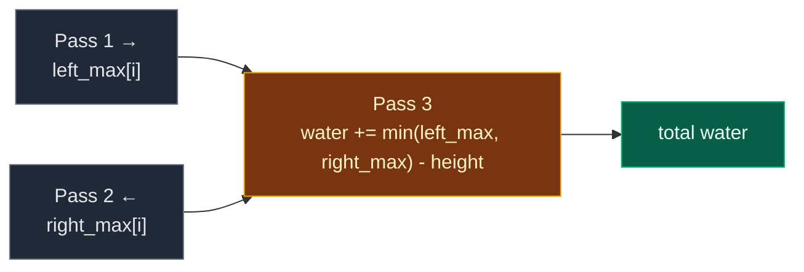

# 05. 42. Trapping Rain Water (Prefix and Suffix)

| Difficulty | Pattern | Source | Time | Space |
|:---:|:---:|:---:|:---:|:---:|
| **Hard** | Prefix and Suffix Precomputation | [42. Trapping Rain Water (Prefix and Suffix)](https://leetcode.com/problems/trapping-rain-water/) | `O(n)` | `O(n)` |

## 1. Problem Statement

You get `n` non-negative integers `height`. Each one is the height of a bar of width `1`.

Return how much rain water is trapped between the bars after it rains.

### Example

```text
height = [4, 2, 0, 3, 2, 5]

row 5:  .  .  .  .  .  #
row 4:  #  ~  ~  ~  ~  #
row 3:  #  ~  ~  #  ~  #
row 2:  #  #  ~  #  #  #
row 1:  #  #  ~  #  #  #
       i0 i1 i2 i3 i4 i5

# = bar, ~ = water

water per index: 0 + 2 + 4 + 1 + 2 + 0 = 9
Output: 9
```

We use this same example in every section below.

LeetCode example 1:

```text
[0,1,0,2,1,0,1,3,2,1,2,1] -> 6
```

### Constraints

- `n == height.length`
- `1 <= n <= 2 * 10^4`
- `0 <= height[i] <= 10^5`

## 2. Core Theory

### Look at one index at a time

Water above index `i` is held by two walls:

- the **tallest bar on its left** (including itself), and
- the **tallest bar on its right** (including itself).

Water rises to the **lower** of those two walls, then spills. So:

```text
water[i] = min(left_max[i], right_max[i]) - height[i]
```

Including `height[i]` in both maxes means the result is never negative.

### Why prefix and suffix

- `left_max[i]` = max of `height[0..i]`. Each one is `max(left_max[i-1], height[i])`. One pass left to right.
- `right_max[i]` = max of `height[i..n-1]`. One pass right to left.

| i | 0 | 1 | 2 | 3 | 4 | 5 |
|:---|:---:|:---:|:---:|:---:|:---:|:---:|
| `height` | 4 | 2 | 0 | 3 | 2 | 5 |
| `left_max` | 4 | 4 | 4 | 4 | 4 | 5 |
| `right_max` | 5 | 5 | 5 | 5 | 5 | 5 |
| `min - height` | 0 | 2 | 4 | 1 | 2 | 0 |



## 3. Edge Cases

| Case | Input | Expected | Why it matters |
|:---|:---|:---:|:---|
| One bar | `[5]` | `0` | No space to hold water |
| Two bars | `[3, 4]` | `0` | No middle |
| Increasing | `[1, 2, 3]` | `0` | Water spills left |
| Decreasing | `[3, 2, 1]` | `0` | Water spills right |
| Valley | `[3, 0, 3]` | `3` | Simplest trap |
| Flat | `[2, 2, 2]` | `0` | No dip |
| All zeros | `[0, 0, 0]` | `0` | No walls |
| Uneven walls | `[4, 2, 0, 3, 2, 5]` | `9` | Lower wall (4) decides |

## 4. Brute Force: Scan Both Sides for Every Index

### Idea

For every `i`, scan left to find the tallest bar, scan right to find the tallest bar, and add `min(...) - height[i]`.

### Code

```python
# Import List for type hints
from typing import List


# Brute force: find both walls from scratch for every index
class SolutionBrute:

    # Main method
    def trap(self, height: List[int]) -> int:

        # Number of bars
        n = len(height)

        # Total water
        water = 0

        # Go through every index
        for i in range(n):

            # Tallest bar from index 0 to i
            left_wall = max(height[: i + 1])

            # Tallest bar from index i to the end
            right_wall = max(height[i:])

            # Water rises to the lower wall
            water += min(left_wall, right_wall) - height[i]

        # Return the total
        return water
```

### Complexity

| Measure | Complexity | Why |
|:---|:---:|:---|
| **Time** | `O(n^2)` | Each index scans the whole array |
| **Space** | `O(n)` | Python slices make copies (a loop would be `O(1)`) |

## 5. Optimal Approach: Prefix Max and Suffix Max Arrays

### Idea

1. `left_max[0] = height[0]`. For `i` from `1`: `left_max[i] = max(left_max[i - 1], height[i])`.
2. `right_max[n - 1] = height[n - 1]`. For `i` from `n - 2` down: `right_max[i] = max(right_max[i + 1], height[i])`.
3. Add `min(left_max[i], right_max[i]) - height[i]` for every `i`.

### Visual Walkthrough (Story Version)

**The story:** six towers stand in a row with heights `4, 2, 0, 3, 2, 5`. It rains. Over each spot, the water can only rise as high as the **shorter** of two guards: the **tallest tower to the left** and the **tallest tower to the right** (the spot's own tower counts for both).

Two scouts help:

- The **left scout** walks left to right and shouts the tallest tower he has seen so far. We write it down for each spot.
- The **right scout** walks right to left and does the same.

Then we fill each spot with water up to the shorter guard.

**How to read the pictures:** `#` is tower, `~` is water, `.` is air. The numbers under the picture are what the scout wrote.

**Left scout walks →**

```text
heights:   4  2  0  3  2  5
i = 0:     4                      tallest so far 4
i = 1:     4  4                   max(4, 2) = 4
i = 2:     4  4  4                max(4, 0) = 4
i = 3:     4  4  4  4             max(4, 3) = 4
i = 4:     4  4  4  4  4          max(4, 2) = 4
i = 5:     4  4  4  4  4  5       max(4, 5) = 5

left_max = [4, 4, 4, 4, 4, 5]
```

**Right scout walks ←**

```text
heights:   4  2  0  3  2  5
i = 5:                    5       tallest so far 5
i = 4:                 5  5       max(5, 2) = 5
i = 3:              5  5  5       max(5, 3) = 5
i = 2:           5  5  5  5       max(5, 0) = 5
i = 1:        5  5  5  5  5       max(5, 2) = 5
i = 0:     5  5  5  5  5  5       max(5, 4) = 5

right_max = [5, 5, 5, 5, 5, 5]
```

**Fill spot 0** (guards 4 and 5, lower is 4, tower is 4)

```text
row 5:  .  .  .  .  .  #
row 4:  #  .  .  .  .  #
row 3:  #  .  .  #  .  #
row 2:  #  #  .  #  #  #
row 1:  #  #  .  #  #  #
        ^  water = 4 - 4 = 0          total 0
```

**Fill spot 1** (lower guard 4, tower 2)

```text
row 5:  .  .  .  .  .  #
row 4:  #  ~  .  .  .  #
row 3:  #  ~  .  #  .  #
row 2:  #  #  .  #  #  #
row 1:  #  #  .  #  #  #
           ^  water = 4 - 2 = 2       total 2
```

**Fill spot 2** (lower guard 4, tower 0)

```text
row 5:  .  .  .  .  .  #
row 4:  #  ~  ~  .  .  #
row 3:  #  ~  ~  #  .  #
row 2:  #  #  ~  #  #  #
row 1:  #  #  ~  #  #  #
              ^  water = 4 - 0 = 4    total 6
```

**Fill spot 3** (lower guard 4, tower 3)

```text
row 5:  .  .  .  .  .  #
row 4:  #  ~  ~  ~  .  #
row 3:  #  ~  ~  #  .  #
row 2:  #  #  ~  #  #  #
row 1:  #  #  ~  #  #  #
                 ^  water = 4 - 3 = 1 total 7
```

**Fill spot 4** (lower guard 4, tower 2)

```text
row 5:  .  .  .  .  .  #
row 4:  #  ~  ~  ~  ~  #
row 3:  #  ~  ~  #  ~  #
row 2:  #  #  ~  #  #  #
row 1:  #  #  ~  #  #  #
                    ^  water = 4 - 2 = 2   total 9
```

**Fill spot 5** (guards 5 and 5, tower 5)

```text
                       ^  water = 5 - 5 = 0   total 9
```

Total water: `9`.

**All spots at a glance**

| Spot | Tower | Left guard | Right guard | Lower guard | Water | Total |
|:---:|:---:|:---:|:---:|:---:|:---:|:---:|
| 0 | 4 | 4 | 5 | 4 | 0 | 0 |
| 1 | 2 | 4 | 5 | 4 | 2 | 2 |
| 2 | 0 | 4 | 5 | 4 | 4 | 6 |
| 3 | 3 | 4 | 5 | 4 | 1 | 7 |
| 4 | 2 | 4 | 5 | 4 | 2 | 9 |
| 5 | 5 | 5 | 5 | 5 | 0 | 9 |

**What the story teaches**

| In the story | In the code |
|:---|:---|
| Tower | `height[i]` |
| Left scout's notes | `left_max` (prefix max) |
| Right scout's notes | `right_max` (suffix max) |
| Lower guard | `min(left_max[i], right_max[i])` |
| Water over a spot | `min(...) - height[i]` |
| All water | `water` |

Now the same steps again, with exact values.

### Step-by-Step Example

```text
height = [4, 2, 0, 3, 2, 5], n = 6
```

**Pass 1: `left_max`**

1. `left_max[0] = 4`
2. `left_max[1] = max(4, 2) = 4`
3. `left_max[2] = max(4, 0) = 4`
4. `left_max[3] = max(4, 3) = 4`
5. `left_max[4] = max(4, 2) = 4`
6. `left_max[5] = max(4, 5) = 5`

`left_max = [4, 4, 4, 4, 4, 5]`

**Pass 2: `right_max`**

7. `right_max[5] = 5`
8. `right_max[4] = max(5, 2) = 5`
9. `right_max[3] = max(5, 3) = 5`
10. `right_max[2] = max(5, 0) = 5`
11. `right_max[1] = max(5, 2) = 5`
12. `right_max[0] = max(5, 4) = 5`

`right_max = [5, 5, 5, 5, 5, 5]`

**Pass 3: water**

13. `i = 0`: `min(4, 5) - 4 = 0`. `water = 0`
14. `i = 1`: `min(4, 5) - 2 = 2`. `water = 2`
15. `i = 2`: `min(4, 5) - 0 = 4`. `water = 6`
16. `i = 3`: `min(4, 5) - 3 = 1`. `water = 7`
17. `i = 4`: `min(4, 5) - 2 = 2`. `water = 9`
18. `i = 5`: `min(5, 5) - 5 = 0`. `water = 9`

**Answer:** `9`

### Code

```python
# Solution for 42. Trapping Rain Water (prefix and suffix)
class Solution:

    # Main method (trace is only for tests)
    def trap(self, height: List[int], trace: list = None) -> int:

        # Number of bars
        n = len(height)

        # left_max[i] = tallest bar in height[0..i]
        left_max = [0] * n

        # The first spot only sees itself
        left_max[0] = height[0]

        # Fill left to right
        for i in range(1, n):

            # Taller of the previous best and this bar
            left_max[i] = max(left_max[i - 1], height[i])

        # right_max[i] = tallest bar in height[i..n-1]
        right_max = [0] * n

        # The last spot only sees itself
        right_max[n - 1] = height[n - 1]

        # Fill right to left
        for i in range(n - 2, -1, -1):

            # Taller of the next best and this bar
            right_max[i] = max(right_max[i + 1], height[i])

        # Save both arrays (only for tests)
        if trace is not None:

            # Record copies
            trace.append((left_max[:], right_max[:]))

        # Total water
        water = 0

        # Go through every spot
        for i in range(n):

            # Water rises to the lower wall, minus the bar itself
            water += min(left_max[i], right_max[i]) - height[i]

            # Save the running total (only for tests)
            if trace is not None:

                # Record index and total
                trace.append((i, water))

        # Return the total
        return water


# The example from this note
steps = []

# Run with tracing
answer = Solution().trap([4, 2, 0, 3, 2, 5], steps)

# Pass 1 and pass 2 arrays
assert steps[0] == ([4, 4, 4, 4, 4, 5], [5, 5, 5, 5, 5, 5])

# Running water after each spot: 0, 2, 6, 7, 9, 9
assert [t for _, t in steps[1:]] == [0, 2, 6, 7, 9, 9]

# Answer
assert answer == 9

# LeetCode example 1
assert Solution().trap([0, 1, 0, 2, 1, 0, 1, 3, 2, 1, 2, 1]) == 6

# Edge cases from the table
cases = [
    ([5], 0), ([3, 4], 0), ([1, 2, 3], 0), ([3, 2, 1], 0),
    ([3, 0, 3], 3), ([2, 2, 2], 0), ([0, 0, 0], 0),
]

# Check each case with both versions
for given, expected in cases:

    # Optimal
    assert Solution().trap(given) == expected

    # Brute force
    assert SolutionBrute().trap(given) == expected

# Random tests: brute force == optimal
import random

# Try many random bar lists
for _ in range(300):

    # Random heights
    data = [random.randint(0, 6) for _ in range(random.randint(1, 12))]

    # Compare
    assert Solution().trap(data) == SolutionBrute().trap(data)

# All checks passed
print("All tests passed")
```

The `trace` argument is only for the step checks. LeetCode calls `trap(height)` and it works the same.

### Complexity

| Measure | Complexity | Why |
|:---|:---:|:---|
| **Time** | `O(n)` | Three passes |
| **Space** | `O(n)` | `left_max` and `right_max` |

## 6. Common Mistakes

| Mistake | What goes wrong | Fix |
|:---|:---|:---|
| Using `max` of the two walls | Water would rise above the lower wall | Use `min(left_max, right_max)` |
| Leaving `height[i]` out of the maxes | `min - height` can go negative | Include `height[i]` in both maxes |
| Filling `right_max` left to right | Gets the prefix max again | Fill from `n - 1` down to `0` |
| Starting the maxes at `0` and forgetting `height[0]` / `height[n-1]` | Off by one at the ends | Set the first value from the bar itself |
| Counting the two end bars | Fine, they always give `0`. No special case needed | – |

## 7. Interview Follow-ups

### Q1. Can you do it in O(1) extra space?

**Answer:**
- Yes, with **two pointers** `left` and `right` and two running maxes.
- Move the side with the **smaller** max. That side's water is decided, because the other side has a wall at least as tall.
- Add `left_max - height[left]` (or the right one) and move in.

### Q2. Why is the side with the smaller max safe to fill?

**Answer:**
- Say `left_max <= right_max`.
- The real right wall for `left` is at least `right_max`, so the lower wall is `left_max`.
- So `water[left] = left_max - height[left]`, no matter what is in the middle.

### Q3. Is there a stack solution?

**Answer:**
- Yes. Keep a stack of indexes with falling heights.
- When a taller bar comes, pop the bottom of a "pool" and add water between the new bar and the new stack top.
- Also `O(n)` time and `O(n)` space. It fills water row by row instead of column by column.

### Q4. What about a 2D height map? (LeetCode 407)

**Answer:**
- Walls can be on any side, so left/right maxes are not enough.
- Use a min-heap starting from the border cells, and always grow from the lowest wall.
- `O(m*n log(m*n))`.

### Q5. How is this different from Container With Most Water?

**Answer:**
- Container picks **two** lines and ignores everything between them.
- Here every bar matters, and we add water over every spot.

## 8. Interview Explanation

> The water above index i rises to the lower of the tallest bar on its left and the tallest bar on its right, so water[i] = min(left_max[i], right_max[i]) - height[i]. I build left_max with one pass from the left and right_max with one pass from the right, each including the bar itself so the result is never negative. Then I add up the water for every index. That is O(n) time and O(n) space, and with two pointers it can be cut to O(1) space.
