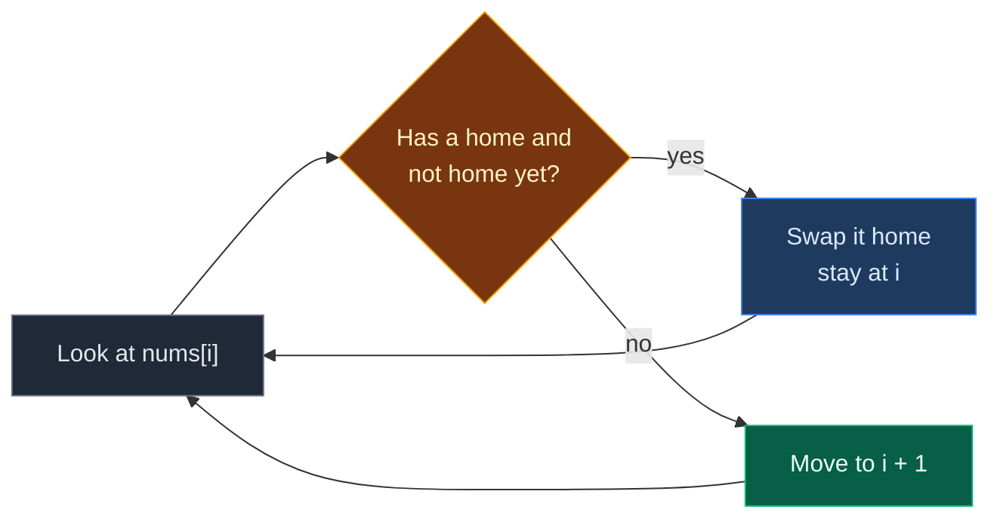

# 01. 268. Missing Number (Cyclic Sort)

| Difficulty | Pattern | Source | Time | Space |
|:---:|:---:|:---:|:---:|:---:|
| **Easy** | Cyclic Sort (Correct Index Placement) | [268. Missing Number (Cyclic Sort)](https://leetcode.com/problems/missing-number/) | `O(n)` | `O(1)` |

## 1. Problem Statement

You get an array `nums` with `n` different numbers.

Every number is in the range `0` to `n`.

That range has `n + 1` numbers, but the array has only `n`. So exactly one number is missing.

Return the missing number.

### Example

```text
nums = [4, 0, 3, 1]
n = 4

Range 0..4 = {0, 1, 2, 3, 4}
Present    = {0, 1, 3, 4}

Output: 2
```

We use this same example in every section below.

### Constraints

- `n == nums.length`
- `1 <= n <= 10^4`
- `0 <= nums[i] <= n`
- All numbers in `nums` are unique

## 2. Core Theory

### What the problem really asks

"Which number from `0..n` is not in the array?"

We want `O(n)` time and `O(1)` extra space.

### The Cyclic Sort pattern (from scratch)

Cyclic Sort works when **the values tell you where they belong**.

- Here, the values are `0..n`, and the indexes are `0..n-1`.
- So value `v` has a natural home: **index `v`**.
- If every value sits at its home, then `nums[i] == i` for every filled spot.
- A spot `i` where `nums[i] != i` is a spot whose owner never came. That owner is the missing number.

**How we put values home:**

1. Stand at index `i`.
2. Look at the value `v = nums[i]`.
3. If `v` has a home (`v < n`) and is not home yet, swap it into index `v`.
4. Do **not** move `i` after a swap. A new value just arrived at `i`, so check it too.
5. If `v` cannot be placed (out of range, or already home), move to `i + 1`.

```text
Rule: value v lives at index v

index:   0   1   2   3
want:   [0] [1] [2] [3]
```

### Why it is `O(n)` even with a loop inside a loop

- Every swap puts **at least one value in its home for good**. It never moves again.
- There are only `n` values, so there are at most `n` swaps in total.
- `i` moves forward at most `n` times.
- Total work: at most `2n` steps. That is `O(n)`.



### What about the value `n`?

- Value `n` has no home, because the last index is `n - 1`.
- We just leave it where it is.
- After sorting, it sits in the spot of the missing number.
- If **no** spot is wrong, then all of `0..n-1` are present, and the missing number is `n`.

### Where this pattern shows up

| Problem | Home of value `v` | What we read after placing |
|:---|:---:|:---|
| **268. Missing Number** | index `v` | First `i` with `nums[i] != i` |
| 645. Set Mismatch | index `v - 1` | The wrong spot gives duplicate and missing |
| 448. Find All Numbers Disappeared | index `v - 1` | Every wrong spot is a missing number |
| 442. Find All Duplicates | index `v - 1` | Every wrong value is a duplicate |
| 41. First Missing Positive | index `v - 1` (only `1..n`) | First wrong spot |

## 3. Edge Cases

| Case | Input | Expected | Why it matters |
|:---|:---|:---:|:---|
| Missing number is `n` | `[0, 1]` | `2` | No spot is wrong. We must return `n` at the end |
| Missing number is `0` | `[1]` | `0` | Value `1 == n` has no home, so index `0` stays wrong |
| One element, present `0` | `[0]` | `1` | Smallest case where the answer is `n` |
| Already in order | `[0, 1, 2, 4]` | `3` | No swaps happen, only the scan |
| Reverse order | `[3, 2, 1, 0]` | `4` | Many swaps, still `O(n)` total |

## 4. Brute Force: Check Every Number

### Idea

For every number `x` from `0` to `n`, check if `x` is in the array. The first one that is not there is the answer.

### Code

```python
# Import List for type hints
from typing import List


# Brute force: test every candidate number
class SolutionBrute:

    # Main method
    def missingNumber(self, nums: List[int]) -> int:

        # Number of elements
        n = len(nums)

        # Try every number from 0 to n
        for x in range(n + 1):

            # "in" scans the whole list, so this is O(n)
            if x not in nums:

                # x is the missing number
                return x

        # Never reached, because one number is always missing
        return -1
```

### Complexity

| Measure | Complexity | Why |
|:---|:---:|:---|
| **Time** | `O(n^2)` | `n + 1` candidates, each check scans `n` items |
| **Space** | `O(1)` | No extra structures |

## 5. Better Approach: Hash Set

### Idea

Put all numbers in a set. Then check `0..n` against the set. Each check is `O(1)`.

### Code

```python
# Better: use a set for fast lookups
class SolutionBetter:

    # Main method
    def missingNumber(self, nums: List[int]) -> int:

        # Store every number for O(1) lookups
        seen = set(nums)

        # Try every number from 0 to n
        for x in range(len(nums) + 1):

            # Found a number that is not in the set
            if x not in seen:

                # x is the missing number
                return x

        # Never reached
        return -1
```

### Complexity

| Measure | Complexity | Why |
|:---|:---:|:---|
| **Time** | `O(n)` | Build the set once, then `n + 1` fast checks |
| **Space** | `O(n)` | The set holds `n` numbers |

## 6. Optimal Approach: Cyclic Sort

### Idea

1. Put every value `v < n` at index `v` using swaps.
2. Leave the value `n` wherever it lands.
3. Scan the array. The first `i` with `nums[i] != i` is the answer.
4. If every spot is right, the answer is `n`.

### Visual Walkthrough (Story Version)

Before the arrays, let us see the idea as a story.

**The story:** there are 4 chairs in a row, with seat numbers `0, 1, 2, 3`. Kids come in with tickets. A kid with ticket `t` must sit on chair `t`. But one kid with ticket `4` has no chair (there is no chair 4). And one ticket number is missing from the group. A teacher walks from left to right and fixes the seats.

**The rules:**

- The teacher stands at one chair.
- If the kid on that chair has a ticket for a **different** chair, the teacher swaps that kid with whoever is on the right chair.
- The teacher stays at the same chair after a swap, because a new kid just sat down there.
- If the kid is in the right chair, or has ticket `4` (no chair), the teacher walks to the next chair.
- At the end, the chair with the wrong kid tells us the missing ticket.

**How to read the pictures:** `[x]` = kid with ticket `x`. `^` = where the teacher stands. `*` = kid is on the right chair.

**Start**

```text
chair:   0    1    2    3
kids:   [4]  [0]  [3]  [1]
         ^
```

**Step 1: teacher at chair 0, kid has ticket 4**

- Ticket 4 has no chair. The teacher cannot place this kid.
- Walk to chair 1.

```text
chair:   0    1    2    3
kids:   [4]  [0]  [3]  [1]
              ^
```

**Step 2: teacher at chair 1, kid has ticket 0**

- Ticket 0 belongs on chair 0. Chair 0 has kid 4, not kid 0.
- Swap kid 0 and kid 4.
- Teacher stays at chair 1.

```text
chair:   0    1    2    3
kids:   [0*] [4]  [3]  [1]
              ^
```

**Step 3: teacher at chair 1, kid has ticket 4**

- No chair for ticket 4. Walk to chair 2.

```text
chair:   0    1    2    3
kids:   [0*] [4]  [3]  [1]
                   ^
```

**Step 4: teacher at chair 2, kid has ticket 3**

- Ticket 3 belongs on chair 3. Chair 3 has kid 1.
- Swap kid 3 and kid 1. Teacher stays.

```text
chair:   0    1    2    3
kids:   [0*] [4]  [1]  [3*]
                   ^
```

**Step 5: teacher at chair 2, kid has ticket 1**

- Ticket 1 belongs on chair 1. Chair 1 has kid 4.
- Swap kid 1 and kid 4. Teacher stays.

```text
chair:   0    1    2    3
kids:   [0*] [1*] [4]  [3*]
                   ^
```

**Step 6: teacher at chair 2, kid has ticket 4**

- No chair for ticket 4. Walk to chair 3.

```text
chair:   0    1    2    3
kids:   [0*] [1*] [4]  [3*]
                        ^
```

**Step 7: teacher at chair 3, kid has ticket 3**

- Kid 3 is already on chair 3. Walk on. The teacher is past the last chair. Done.

```text
chair:   0    1    2    3
kids:   [0*] [1*] [4]  [3*]
                            ^ (done)
```

**Step 8: find the wrong chair**

- Chair 0 has kid 0. OK.
- Chair 1 has kid 1. OK.
- Chair 2 has kid 4. **Wrong!** Nobody with ticket 2 came.
- Answer: `2`.

```text
chair:   0    1    2    3
kids:   [0*] [1*] [4]  [3*]
                   ^
              missing ticket = 2
```

**All steps at a glance**

| Step | Teacher at | Kid's ticket | Action | Chairs after |
|:---:|:---:|:---:|:---|:---|
| 1 | 0 | 4 | No chair, walk | `[4, 0, 3, 1]` |
| 2 | 1 | 0 | Swap with chair 0 | `[0, 4, 3, 1]` |
| 3 | 1 | 4 | No chair, walk | `[0, 4, 3, 1]` |
| 4 | 2 | 3 | Swap with chair 3 | `[0, 4, 1, 3]` |
| 5 | 2 | 1 | Swap with chair 1 | `[0, 1, 4, 3]` |
| 6 | 2 | 4 | No chair, walk | `[0, 1, 4, 3]` |
| 7 | 3 | 3 | Already home, walk | `[0, 1, 4, 3]` |
| 8 | scan | – | Chair 2 is wrong | answer `2` |

**What the story teaches**

| In the story | In the code |
|:---|:---|
| Chair number | Index `i` |
| Kid's ticket | Value `nums[i]` |
| Kid with ticket 4 (no chair) | Value `n`, skipped |
| Swap two kids | `nums[i], nums[j] = nums[j], nums[i]` |
| Teacher stays after a swap | Do not do `i += 1` after a swap |
| Chair with the wrong kid | First `i` with `nums[i] != i` |

Now the same steps again, this time with the exact arrays.

### Step-by-Step Example

```text
nums = [4, 0, 3, 1], n = 4
```

**Phase 1: place values**

| Step | `i` | `v = nums[i]` | Check | Action | `nums` after |
|:---:|:---:|:---:|:---|:---|:---|
| 1 | 0 | 4 | `4 < 4`? No | `i = 1` | `[4, 0, 3, 1]` |
| 2 | 1 | 0 | `0 < 4` yes, `nums[0] = 4 != 0` | swap index 1 and 0 | `[0, 4, 3, 1]` |
| 3 | 1 | 4 | `4 < 4`? No | `i = 2` | `[0, 4, 3, 1]` |
| 4 | 2 | 3 | `3 < 4` yes, `nums[3] = 1 != 3` | swap index 2 and 3 | `[0, 4, 1, 3]` |
| 5 | 2 | 1 | `1 < 4` yes, `nums[1] = 4 != 1` | swap index 2 and 1 | `[0, 1, 4, 3]` |
| 6 | 2 | 4 | `4 < 4`? No | `i = 3` | `[0, 1, 4, 3]` |
| 7 | 3 | 3 | `3 < 4` yes, `nums[3] = 3 == 3` | already home, `i = 4` | `[0, 1, 4, 3]` |

`i = 4` is not `< 4`, so the loop stops. Total swaps: 3.

**Phase 2: scan**

| `i` | `nums[i]` | `nums[i] == i`? |
|:---:|:---:|:---:|
| 0 | 0 | Yes |
| 1 | 1 | Yes |
| 2 | 4 | **No** -> return `2` |

**Answer: `2`.**

### Code

```python
# Optimal: cyclic sort, then scan
class Solution:

    # Main method
    def missingNumber(self, nums: List[int]) -> int:

        # Number of elements
        n = len(nums)

        # Start at the first index
        i = 0

        # Place every value at its home index
        while i < n:

            # The value at the current spot
            v = nums[i]

            # Value has a home (v < n) and is not home yet
            if v < n and nums[v] != v:

                # Swap it into its home; stay at i to check the new value
                nums[i], nums[v] = nums[v], nums[i]

            # Value is n, or already home
            else:

                # Move to the next spot
                i += 1

        # Scan for the first spot with the wrong value
        for i in range(n):

            # Owner of this spot never came
            if nums[i] != i:

                # i is the missing number
                return i

        # Every spot 0..n-1 is correct, so n is missing
        return n


# Check the example from this note, step by step
a = [4, 0, 3, 1]

# Step 1: i = 0, value 4 has no home, move on
assert a[0] == 4

# Step 2: i = 1, value 0 goes to index 0
a[1], a[0] = a[0], a[1]
assert a == [0, 4, 3, 1]

# Step 3: i = 1, value 4 has no home, move on
assert a[1] == 4

# Step 4: i = 2, value 3 goes to index 3
a[2], a[3] = a[3], a[2]
assert a == [0, 4, 1, 3]

# Step 5: i = 2, value 1 goes to index 1
a[2], a[1] = a[1], a[2]
assert a == [0, 1, 4, 3]

# Step 6 and 7: value 4 skipped, value 3 already home
assert a[2] == 4 and a[3] == 3

# Scan: index 2 is the first wrong spot
assert [i for i in range(4) if a[i] != i] == [2]

# Full solution on the example
assert Solution().missingNumber([4, 0, 3, 1]) == 2

# LeetCode examples
assert Solution().missingNumber([3, 0, 1]) == 2
assert Solution().missingNumber([0, 1]) == 2
assert Solution().missingNumber([9, 6, 4, 2, 3, 5, 7, 0, 1]) == 8

# Edge cases
assert Solution().missingNumber([1]) == 0
assert Solution().missingNumber([0]) == 1
assert Solution().missingNumber([0, 1, 2, 4]) == 3
assert Solution().missingNumber([3, 2, 1, 0]) == 4

# Import random to make test inputs
import random

# Brute force and better approach agree with the optimal on random inputs
for _ in range(300):

    # Pick a random size
    n = random.randint(1, 12)

    # All numbers 0..n
    arr = list(range(n + 1))

    # Remove one number at random
    arr.remove(random.randint(0, n))

    # Mix the order
    random.shuffle(arr)

    # Brute force answer
    expected = SolutionBrute().missingNumber(arr[:])

    # Better and optimal must match it
    assert SolutionBetter().missingNumber(arr[:]) == expected
    assert Solution().missingNumber(arr[:]) == expected

# All checks passed
print("All tests passed")
```

### Complexity

| Measure | Complexity | Why |
|:---|:---:|:---|
| **Time** | `O(n)` | At most `n` swaps (each puts a value home for good) plus at most `n` moves of `i`, then one scan |
| **Space** | `O(1)` | Swaps happen in place. Only `i` and `v` are extra |

## 7. Common Mistakes

| Mistake | What goes wrong | Fix |
|:---|:---|:---|
| Writing `nums[i], nums[nums[i]] = nums[nums[i]], nums[i]` | Python sets `nums[i]` first, so `nums[nums[i]]` then uses the new value. Wrong cell gets written | Save `v = nums[i]` first, then swap `nums[i], nums[v]` |
| Moving `i` forward after a swap | The new value that arrived at `i` is never placed | Only do `i += 1` in the `else` branch |
| Not skipping `v == n` | `nums[n]` is out of range, so `IndexError` | Check `v < n` before using `nums[v]` |
| Checking `nums[i] != i` instead of `nums[v] != v` | Works here because numbers are unique, but loops forever on problems with duplicates | Always check the target spot: `nums[v] != v` |
| Forgetting `return n` at the end | Returns `None` when `n` itself is missing | Return `n` after the scan |

## 8. Interview Follow-ups

### Q1. Is there a way without changing the array?

**Answer:**
- Yes. Use the sum formula: `n * (n + 1) // 2 - sum(nums)`.
- Or XOR all indexes `0..n` with all values. Pairs cancel, the missing number is left.
- Both are `O(n)` time and `O(1)` space, and they do not touch the input.

### Q2. Why learn cyclic sort if the sum trick is shorter?

**Answer:**
- The sum trick only works when exactly one number is missing.
- Cyclic sort also handles many missing numbers, duplicates, and "first missing positive".
- It is one tool for a whole family of problems.

### Q3. Can the sum overflow?

**Answer:**
- In Python, no. Integers grow as needed.
- In Java or C++, `n * (n + 1) / 2` can overflow for big `n`. Use `long`, or use XOR, which never overflows.

### Q4. Why is the nested loop still `O(n)`?

**Answer:**
- Each swap puts one value into its home, and it never moves again.
- So there are at most `n` swaps in the whole run.
- `i` moves forward at most `n` times. Total `O(n)`.

### Q5. What if the input must not be changed?

**Answer:**
- Copy the array first (`O(n)` space), or use the sum or XOR method.
- Say this out loud in an interview. Changing input is a real side effect.

## 9. Interview Explanation

> The values are 0 to n, so each value v has a natural home at index v. I walk with a pointer i. If nums[i] is less than n and is not already at its home, I swap it into its home and stay at i, because a new value arrived. Otherwise I move i forward. Every swap puts one value home for good, so there are at most n swaps and the whole thing is O(n). After that I scan: the first index where nums[i] is not i is the missing number. If every spot is correct, the missing number is n. It uses O(1) extra space. The sum or XOR trick also works for this one problem, but cyclic sort extends to duplicates and many missing numbers.
