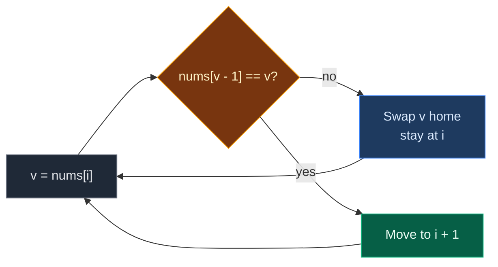

# 02. 645. Set Mismatch

| Difficulty | Pattern | Source | Time | Space |
|:---:|:---:|:---:|:---:|:---:|
| **Easy** | Cyclic Sort (Correct Index Placement) | [645. Set Mismatch](https://leetcode.com/problems/set-mismatch/) | `O(n)` | `O(1)` |

## 1. Problem Statement

A set should hold the numbers `1` to `n`, each one once.

By mistake, one number was copied over another. So one number shows up **twice**, and one number is **missing**.

You get the broken array `nums`. Return `[duplicate, missing]`.

### Example

```text
nums = [2, 4, 1, 2]
n = 4

Should be: {1, 2, 3, 4}
2 appears twice
3 never appears

Output: [2, 3]
```

We use this same example in every section below.

### Constraints

- `2 <= nums.length <= 10^4`
- `1 <= nums[i] <= 10^4`
- Exactly one number is duplicated and exactly one is missing

## 2. Core Theory

### What the problem really asks

Find two numbers at once: the one that came twice and the one that never came.

### Why Cyclic Sort fits

The values are `1..n`. So each value `v` has a home: **index `v - 1`**. (New to the pattern? See [01. 268. Missing Number (Cyclic Sort)](./01.%20268.%20Missing%20Number%20%28Cyclic%20Sort%29.md), which builds it from scratch.)

- Swap every value to its home.
- The two copies of the duplicate fight for the same home. One wins. The other is left sitting in someone else's spot.
- That "someone else" is the missing number, because nobody came to claim the spot.

```text
After placing:

index:   0   1   2   3
want:   [1] [2] [3] [4]
got:    [1] [2] [2] [4]
                 ^
         index 2 should hold 3, holds 2
         duplicate = 2, missing = 2 + 1 = 3
```

### The key check: look at the target, not at `i`

With duplicates, we must ask "is the **home** already holding `v`?":

- `nums[v - 1] != v` -> home is free or holds a stranger -> swap.
- `nums[v - 1] == v` -> home already has a copy of `v` -> stop, move on.

If we checked `nums[i] != v` instead, the two copies would keep swapping with each other forever.



## 3. Edge Cases

| Case | Input | Expected | Why it matters |
|:---|:---|:---:|:---|
| Smallest | `[1, 1]` | `[1, 2]` | The missing number is the last one |
| Missing is `1` | `[2, 2]` | `[2, 1]` | The wrong spot is index `0` |
| Already sorted | `[1, 2, 2, 4]` | `[2, 3]` | No swaps, only the scan |
| Duplicate next to its home | `[3, 2, 3, 4, 6, 5]` | `[3, 1]` | Copy of `3` sits at index `0` after sorting |
| Missing is `n` | `[1, 2, 3, 3]` | `[3, 4]` | Wrong spot is the last index |

## 4. Brute Force: Count Every Number

### Idea

For each number `x` from `1` to `n`, count how many times it appears. Count `2` means duplicate. Count `0` means missing.

### Code

```python
# Import List for type hints
from typing import List


# Brute force: count each candidate with a full scan
class SolutionBrute:

    # Main method
    def findErrorNums(self, nums: List[int]) -> List[int]:

        # Number of elements
        n = len(nums)

        # Answers start empty
        dup = missing = -1

        # Try every number 1..n
        for x in range(1, n + 1):

            # Full scan to count x
            c = nums.count(x)

            # Seen twice
            if c == 2:

                # x is the duplicate
                dup = x

            # Never seen
            elif c == 0:

                # x is the missing number
                missing = x

        # Return both answers
        return [dup, missing]
```

### Complexity

| Measure | Complexity | Why |
|:---|:---:|:---|
| **Time** | `O(n^2)` | `n` candidates, each `count` scans `n` items |
| **Space** | `O(1)` | Only two variables |

## 5. Better Approach: Count Array

### Idea

Count every value once in an array of size `n + 1`. Then read the counts.

### Code

```python
# Better: one counting pass
class SolutionBetter:

    # Main method
    def findErrorNums(self, nums: List[int]) -> List[int]:

        # Number of elements
        n = len(nums)

        # count[x] = how many times x appears
        count = [0] * (n + 1)

        # Count every value
        for v in nums:

            # One more copy of v
            count[v] += 1

        # Answers start empty
        dup = missing = -1

        # Read the counts for 1..n
        for x in range(1, n + 1):

            # Seen twice
            if count[x] == 2:

                # x is the duplicate
                dup = x

            # Never seen
            elif count[x] == 0:

                # x is the missing number
                missing = x

        # Return both answers
        return [dup, missing]
```

### Complexity

| Measure | Complexity | Why |
|:---|:---:|:---|
| **Time** | `O(n)` | Two passes |
| **Space** | `O(n)` | The count array |

## 6. Optimal Approach: Cyclic Sort

### Idea

1. Put every value `v` at index `v - 1`. Skip when the home already holds `v`.
2. Scan. At the one index `i` where `nums[i] != i + 1`:
   - `nums[i]` is the duplicate.
   - `i + 1` is the missing number.

### Visual Walkthrough (Story Version)

Before the arrays, let us see the idea as a story.

**The story:** 4 lockers are numbered `1, 2, 3, 4`. Four keys were handed out, each with a locker number. By mistake, two keys say `2`, and no key says `3`. A helper walks along the row and moves each key into its own locker.

**The rules:**

- The helper stands at one locker.
- If the key there belongs to another locker, and that locker does not already hold the same key, swap the two keys.
- After a swap the helper stays, because a new key just arrived.
- If the right locker already holds a copy of this key, this one is the extra copy. Leave it and walk on.
- At the end, the locker holding the wrong key gives both answers.

**How to read the pictures:** locker number on top, key inside `[ ]`. `^` = helper. `*` = key is in its own locker.

**Start**

```text
locker:  1    2    3    4
key:    [2]  [4]  [1]  [2]
         ^
```

**Step 1: helper at locker 1, key 2**

- Key 2 belongs in locker 2. Locker 2 holds key 4, not 2. Swap.

```text
locker:  1    2    3    4
key:    [4]  [2*] [1]  [2]
         ^
```

**Step 2: helper at locker 1, key 4**

- Key 4 belongs in locker 4. Locker 4 holds key 2. Swap.

```text
locker:  1    2    3    4
key:    [2]  [2*] [1]  [4*]
         ^
```

**Step 3: helper at locker 1, key 2**

- Key 2 belongs in locker 2. Locker 2 **already holds key 2**.
- This is the extra copy. Leave it. Walk on.

```text
locker:  1    2    3    4
key:    [2]  [2*] [1]  [4*]
              ^
```

**Step 4: helper at locker 2, key 2**

- Key 2 is home. Walk on.

```text
locker:  1    2    3    4
key:    [2]  [2*] [1]  [4*]
                   ^
```

**Step 5: helper at locker 3, key 1**

- Key 1 belongs in locker 1. Locker 1 holds key 2 (the extra copy). Swap.

```text
locker:  1    2    3    4
key:    [1*] [2*] [2]  [4*]
                   ^
```

**Step 6: helper at locker 3, key 2**

- Key 2's locker already holds key 2. Extra copy again. Walk on.

```text
locker:  1    2    3    4
key:    [1*] [2*] [2]  [4*]
                        ^
```

**Step 7: helper at locker 4, key 4**

- Home. Walk on. Past the end, done.

```text
locker:  1    2    3    4
key:    [1*] [2*] [2]  [4*]
                            ^ (done)
```

**Step 8: read the wrong locker**

- Locker 3 holds key 2. Wrong.
- The extra key is `2`. Locker `3` got no key. Answer: `[2, 3]`.

```text
locker:  1    2    3    4
key:    [1*] [2*] [2]  [4*]
                   ^
          extra = 2, empty owner = 3
```

**All steps at a glance**

| Step | Helper at | Key | Its locker holds | Action | Keys after |
|:---:|:---:|:---:|:---:|:---|:---|
| 1 | 1 | 2 | 4 | Swap | `[4, 2, 1, 2]` |
| 2 | 1 | 4 | 2 | Swap | `[2, 2, 1, 4]` |
| 3 | 1 | 2 | 2 | Extra copy, walk | `[2, 2, 1, 4]` |
| 4 | 2 | 2 | 2 | Home, walk | `[2, 2, 1, 4]` |
| 5 | 3 | 1 | 2 | Swap | `[1, 2, 2, 4]` |
| 6 | 3 | 2 | 2 | Extra copy, walk | `[1, 2, 2, 4]` |
| 7 | 4 | 4 | 4 | Home, walk | `[1, 2, 2, 4]` |
| 8 | scan | – | – | Locker 3 wrong | `[2, 3]` |

**What the story teaches**

| In the story | In the code |
|:---|:---|
| Locker number | `i + 1` |
| Key | `nums[i]` |
| Key's own locker | Index `v - 1` |
| "Locker already holds this key" | `nums[v - 1] == v` |
| Extra copy left behind | The duplicate |
| Locker that got no key | The missing number |

Now the same steps again, this time with the exact arrays.

### Step-by-Step Example

```text
nums = [2, 4, 1, 2], n = 4
```

**Phase 1: place values**

| Step | `i` | `v = nums[i]` | `nums[v - 1]` | `== v`? | Action | `nums` after |
|:---:|:---:|:---:|:---:|:---:|:---|:---|
| 1 | 0 | 2 | `nums[1] = 4` | No | swap index 0 and 1 | `[4, 2, 1, 2]` |
| 2 | 0 | 4 | `nums[3] = 2` | No | swap index 0 and 3 | `[2, 2, 1, 4]` |
| 3 | 0 | 2 | `nums[1] = 2` | Yes | `i = 1` | `[2, 2, 1, 4]` |
| 4 | 1 | 2 | `nums[1] = 2` | Yes | `i = 2` | `[2, 2, 1, 4]` |
| 5 | 2 | 1 | `nums[0] = 2` | No | swap index 2 and 0 | `[1, 2, 2, 4]` |
| 6 | 2 | 2 | `nums[1] = 2` | Yes | `i = 3` | `[1, 2, 2, 4]` |
| 7 | 3 | 4 | `nums[3] = 4` | Yes | `i = 4` | `[1, 2, 2, 4]` |

`i = 4` is not `< 4`. Loop stops. 3 swaps.

**Phase 2: scan**

| `i` | `nums[i]` | `i + 1` | Match? |
|:---:|:---:|:---:|:---:|
| 0 | 1 | 1 | Yes |
| 1 | 2 | 2 | Yes |
| 2 | 2 | 3 | **No** -> duplicate `2`, missing `3` |

**Answer: `[2, 3]`.**

### Code

```python
# Optimal: cyclic sort, then find the one wrong spot
class Solution:

    # Main method
    def findErrorNums(self, nums: List[int]) -> List[int]:

        # Number of elements
        n = len(nums)

        # Start at the first index
        i = 0

        # Place every value at index v - 1
        while i < n:

            # Value at the current spot
            v = nums[i]

            # Home does not hold v yet
            if nums[v - 1] != v:

                # Swap v into its home; stay at i
                nums[i], nums[v - 1] = nums[v - 1], nums[i]

            # Home already holds v (it is here, or this is the extra copy)
            else:

                # Move to the next spot
                i += 1

        # Scan for the wrong spot
        for i in range(n):

            # Spot i should hold i + 1
            if nums[i] != i + 1:

                # Extra copy sits here; the owner i + 1 never came
                return [nums[i], i + 1]

        # Never reached for valid input
        return [-1, -1]


# Check the example from this note, step by step
a = [2, 4, 1, 2]

# Step 1: i = 0, value 2 goes to index 1
a[0], a[1] = a[1], a[0]
assert a == [4, 2, 1, 2]

# Step 2: i = 0, value 4 goes to index 3
a[0], a[3] = a[3], a[0]
assert a == [2, 2, 1, 4]

# Step 3: i = 0, home of 2 already holds 2, move on
assert a[1] == 2

# Step 4: i = 1, value 2 is home
assert a[1] == 2

# Step 5: i = 2, value 1 goes to index 0
a[2], a[0] = a[0], a[2]
assert a == [1, 2, 2, 4]

# Step 6 and 7: extra 2 skipped, 4 already home
assert a[a[2] - 1] == a[2] and a[3] == 4

# Scan: index 2 is the only wrong spot
assert [i for i in range(4) if a[i] != i + 1] == [2]

# Full solution on the example
assert Solution().findErrorNums([2, 4, 1, 2]) == [2, 3]

# LeetCode examples
assert Solution().findErrorNums([1, 2, 2, 4]) == [2, 3]
assert Solution().findErrorNums([1, 1]) == [1, 2]

# Edge cases
assert Solution().findErrorNums([2, 2]) == [2, 1]
assert Solution().findErrorNums([3, 2, 3, 4, 6, 5]) == [3, 1]
assert Solution().findErrorNums([1, 2, 3, 3]) == [3, 4]

# Import random to make test inputs
import random

# All three approaches agree on random inputs
for _ in range(300):

    # Random size
    n = random.randint(2, 12)

    # Pick the duplicate and the missing number (different)
    d, m = random.sample(range(1, n + 1), 2)

    # Build 1..n with m replaced by d
    arr = [d if x == m else x for x in range(1, n + 1)]

    # Mix the order
    random.shuffle(arr)

    # All approaches must give [d, m]
    assert SolutionBrute().findErrorNums(arr[:]) == [d, m]
    assert SolutionBetter().findErrorNums(arr[:]) == [d, m]
    assert Solution().findErrorNums(arr[:]) == [d, m]

# All checks passed
print("All tests passed")
```

### Complexity

| Measure | Complexity | Why |
|:---|:---:|:---|
| **Time** | `O(n)` | At most `n` swaps plus `n` moves of `i`, then one scan |
| **Space** | `O(1)` | Everything happens in place |

## 7. Common Mistakes

| Mistake | What goes wrong | Fix |
|:---|:---|:---|
| Checking `nums[i] != i + 1` to decide a swap | The two copies of the duplicate swap with each other forever | Check the home: `nums[v - 1] != v` |
| Using index `v` instead of `v - 1` | Off by one, and `IndexError` for `v = n` | Values are `1..n`, so home is `v - 1` |
| Swapping with `nums[nums[i] - 1]` inline | Python writes `nums[i]` first, so the second target is computed with the new value | Save `v = nums[i]` first |
| Returning `[missing, duplicate]` | Wrong order | The problem wants `[duplicate, missing]` |
| Using `sum` alone | One equation, two unknowns | Use cyclic sort, or `sum` plus sum of squares |

## 8. Interview Follow-ups

### Q1. Can we solve it without changing the array?

**Answer:**
- Yes, with math. Let `d` = duplicate, `m` = missing.
- `sum(nums) - n(n+1)/2 = d - m`.
- `sum of squares(nums) - sum of squares(1..n) = d² - m² = (d - m)(d + m)`.
- Two equations give `d` and `m`. Watch overflow in other languages.

### Q2. Is there an XOR way?

**Answer:**
- XOR all values and all of `1..n`. The result is `d XOR m`.
- Split numbers by one set bit of that result into two groups. XOR each group.
- You get `d` and `m`, then check which one is in `nums`.

### Q3. Can we use sign marking instead of swaps?

**Answer:**
- Yes. For each `v`, flip `nums[abs(v) - 1]` to negative.
- If it is already negative, `abs(v)` is the duplicate.
- After the pass, the index that is still positive gives the missing number.

### Q4. Why does each step stay `O(n)` in total, even with duplicates?

**Answer:**
- A swap happens only when the home does not hold `v`. After it, the home holds `v` for good.
- So at most `n` swaps can happen. The extra copy never causes a swap, it just moves `i` forward.

### Q5. What if there could be many duplicates and many missing numbers?

**Answer:**
- The same sort works. After it, every wrong spot `i` gives one missing number `i + 1`, and the value there is a duplicate.
- That is exactly problems 448 and 442 in this pattern.

## 9. Interview Explanation

> The values should be 1 to n, so value v belongs at index v minus 1. I walk with a pointer and swap each value into its home, but only if the home does not already hold that value. If it does, this is the extra copy, so I just move on. That check is what stops the two copies from swapping forever. Every swap places one value for good, so it is O(n) time and O(1) space. After placing, exactly one index i holds the wrong value: that value is the duplicate, and i plus 1 is the missing number.
