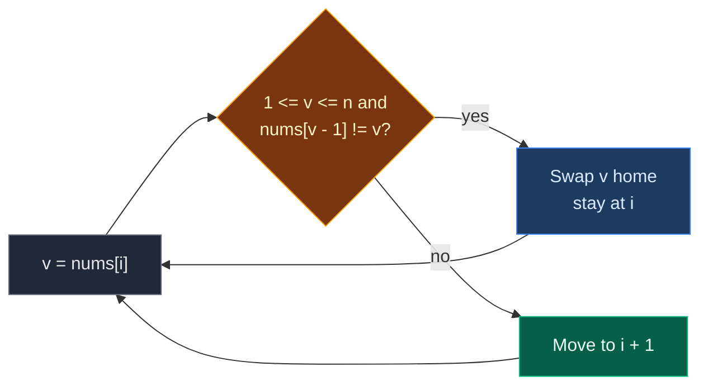

# 05. 41. First Missing Positive

| Difficulty | Pattern | Source | Time | Space |
|:---:|:---:|:---:|:---:|:---:|
| **Hard** | Cyclic Sort (Correct Index Placement) | [41. First Missing Positive](https://leetcode.com/problems/first-missing-positive/) | `O(n)` | `O(1)` |

## 1. Problem Statement

You get an unsorted integer array `nums`. It can have negatives, zeros, huge numbers and repeats.

Return the **smallest positive integer** (`1, 2, 3, ...`) that is not in `nums`.

You must use `O(n)` time and `O(1)` extra space.

### Example

```text
nums = [3, 4, -1, 1, 9]
n = 5

Positives present: 1, 3, 4, 9
1 is there. 2 is not.

Output: 2
```

We use this same example in every section below.

### Constraints

- `1 <= nums.length <= 10^5`
- `-2^31 <= nums[i] <= 2^31 - 1`

## 2. Core Theory

### What the problem really asks

"Count up from 1. Where is the first gap?"

### The key insight: the answer is between `1` and `n + 1`

- The array has `n` slots.
- Best case, it holds exactly `1, 2, ..., n`. Then the answer is `n + 1`.
- Any other case leaves a gap somewhere in `1..n`, and the answer is that gap.
- So **only values in `1..n` matter**. Negatives, zero and anything above `n` can be ignored.

```text
n = 5, answer is always in 1..6

useful values:   1  2  3  4  5
ignore:          <= 0, or > 5
```

### Why Cyclic Sort fits

Now it looks like the other problems in this pattern. (Pattern from scratch: [01. 268. Missing Number (Cyclic Sort)](./01.%20268.%20Missing%20Number%20%28Cyclic%20Sort%29.md).)

- A useful value `v` (`1 <= v <= n`) lives at **index `v - 1`**.
- Swap each useful value home. Skip useless values and extra copies.
- Scan. The first index `i` with `nums[i] != i + 1` gives the answer `i + 1`.
- No wrong index at all? Answer is `n + 1`.



### Why this is "Hard"

The trick is not the code. It is seeing that only `1..n` matters, which turns a problem about any integers into a "values have a home" problem.

## 3. Edge Cases

| Case | Input | Expected | Why it matters |
|:---|:---|:---:|:---|
| `1` is missing | `[7, 8, 9, 11, 12]` | `1` | All values too big. Index `0` stays wrong |
| Full `1..n` | `[1, 2, 3]` | `4` | No wrong spot. Return `n + 1` |
| Only negatives and zero | `[0, -1, -5]` | `1` | Nothing placed |
| Duplicates | `[1, 1]` | `2` | Extra copy must not loop forever |
| Single `1` | `[1]` | `2` | Smallest full case |
| Huge values | `[2147483647]` | `1` | Must not index with the huge value |

## 4. Brute Force: Try 1, 2, 3, ...

### Idea

Try `k = 1, 2, 3, ...`. Check if `k` is in the array. The first `k` that is not there is the answer. We never need to go past `n + 1`.

### Code

```python
# Import List for type hints
from typing import List


# Brute force: test candidates one by one
class SolutionBrute:

    # Main method
    def firstMissingPositive(self, nums: List[int]) -> int:

        # Try every candidate from 1 to n + 1
        for k in range(1, len(nums) + 2):

            # "in" scans the whole list
            if k not in nums:

                # First gap found
                return k

        # Never reached: n + 1 numbers cannot all fit in n slots
        return -1
```

### Complexity

| Measure | Complexity | Why |
|:---|:---:|:---|
| **Time** | `O(n^2)` | Up to `n + 1` candidates, each scan is `n` |
| **Space** | `O(1)` | No extra structures |

## 5. Better Approach: Hash Set

### Idea

Put all values in a set. Try `k = 1, 2, ...` with `O(1)` lookups.

### Code

```python
# Better: set lookups
class SolutionBetter:

    # Main method
    def firstMissingPositive(self, nums: List[int]) -> int:

        # All values for fast lookups
        seen = set(nums)

        # Start from the smallest positive
        k = 1

        # Walk up while k is present
        while k in seen:

            # Try the next number
            k += 1

        # First number not present
        return k
```

### Complexity

| Measure | Complexity | Why |
|:---|:---:|:---|
| **Time** | `O(n)` | Build set, then at most `n + 1` checks |
| **Space** | `O(n)` | The set (breaks the `O(1)` rule) |

## 6. Optimal Approach: Cyclic Sort

### Idea

1. For each index, while the value `v` is in `1..n` and its home `v - 1` does not hold `v`, swap it home.
2. Otherwise move on.
3. Scan. First `i` with `nums[i] != i + 1` gives `i + 1`.
4. If none, return `n + 1`.

### Visual Walkthrough (Story Version)

Before the arrays, let us see the idea as a story.

**The story:** a bus has 5 seats, numbered `1` to `5`. Passengers hold tickets. Some tickets are fake: negative numbers, or seat numbers the bus does not have (like seat `9`). A conductor walks the aisle, puts every real ticket holder in the right seat, and then calls out the first seat with no proper passenger.

**The rules:**

- The conductor stands at one seat.
- If the passenger there has a real ticket (`1` to `5`) for another seat, and that seat does not already have the right passenger, swap them.
- After a swap, the conductor stays, because a new passenger arrived.
- Fake tickets and passengers already in place: walk on.
- At the end, the first seat with the wrong passenger is the answer.

**How to read the pictures:** seat number on top, ticket in `[ ]`. `^` = conductor. `*` = right passenger in the seat.

**Start**

```text
seat:    1    2    3    4    5
ticket: [3]  [4]  [-1] [1]  [9]
         ^
```

**Step 1: conductor at seat 1, ticket 3**

- Real ticket for seat 3. Seat 3 has ticket -1. Swap.

```text
seat:    1    2    3    4    5
ticket: [-1] [4]  [3*] [1]  [9]
         ^
```

**Step 2: conductor at seat 1, ticket -1**

- Fake ticket. Walk on.

```text
seat:    1    2    3    4    5
ticket: [-1] [4]  [3*] [1]  [9]
              ^
```

**Step 3: conductor at seat 2, ticket 4**

- Real ticket for seat 4. Seat 4 has ticket 1. Swap.

```text
seat:    1    2    3    4    5
ticket: [-1] [1]  [3*] [4*] [9]
              ^
```

**Step 4: conductor at seat 2, ticket 1**

- Real ticket for seat 1. Seat 1 has ticket -1. Swap.

```text
seat:    1    2    3    4    5
ticket: [1*] [-1] [3*] [4*] [9]
              ^
```

**Step 5: conductor at seat 2, ticket -1**

- Fake ticket. Walk on.

```text
seat:    1    2    3    4    5
ticket: [1*] [-1] [3*] [4*] [9]
                   ^
```

**Step 6: conductor at seat 3, ticket 3**

- Right seat. Walk on.

```text
seat:    1    2    3    4    5
ticket: [1*] [-1] [3*] [4*] [9]
                        ^
```

**Step 7: conductor at seat 4, ticket 4**

- Right seat. Walk on.

```text
seat:    1    2    3    4    5
ticket: [1*] [-1] [3*] [4*] [9]
                             ^
```

**Step 8: conductor at seat 5, ticket 9**

- No seat 9 on this bus. Fake. Walk on. Done.

```text
seat:    1    2    3    4    5
ticket: [1*] [-1] [3*] [4*] [9]
                                  ^ (done)
```

**Step 9: call out the first wrong seat**

- Seat 1 has ticket 1. OK.
- Seat 2 has ticket -1. **Wrong.** Nobody with ticket 2.
- Answer: `2`.

```text
seat:    1    2    3    4    5
ticket: [1*] [-1] [3*] [4*] [9]
              ^
        first missing = 2
```

**All steps at a glance**

| Step | Conductor at | Ticket | Real? | Its seat has | Action | Seats after |
|:---:|:---:|:---:|:---:|:---:|:---|:---|
| 1 | 1 | 3 | Yes | -1 | Swap | `[-1, 4, 3, 1, 9]` |
| 2 | 1 | -1 | No | – | Walk | `[-1, 4, 3, 1, 9]` |
| 3 | 2 | 4 | Yes | 1 | Swap | `[-1, 1, 3, 4, 9]` |
| 4 | 2 | 1 | Yes | -1 | Swap | `[1, -1, 3, 4, 9]` |
| 5 | 2 | -1 | No | – | Walk | `[1, -1, 3, 4, 9]` |
| 6 | 3 | 3 | Yes | 3 | Home, walk | `[1, -1, 3, 4, 9]` |
| 7 | 4 | 4 | Yes | 4 | Home, walk | `[1, -1, 3, 4, 9]` |
| 8 | 5 | 9 | No | – | Walk | `[1, -1, 3, 4, 9]` |
| 9 | scan | – | – | – | Seat 2 wrong | answer `2` |

**What the story teaches**

| In the story | In the code |
|:---|:---|
| Seat number | `i + 1` |
| Ticket | `nums[i]` |
| Real ticket | `1 <= v <= n` |
| Fake ticket (negative, zero, too big) | Value outside `1..n`, skipped |
| "Seat already has the right passenger" | `nums[v - 1] == v` |
| First seat with the wrong passenger | First `i` with `nums[i] != i + 1` |
| Every seat right | Return `n + 1` |

Now the same steps again, this time with the exact arrays.

### Step-by-Step Example

```text
nums = [3, 4, -1, 1, 9], n = 5
```

**Phase 1: place values**

| Step | `i` | `v = nums[i]` | `1 <= v <= 5`? | `nums[v - 1]` | Action | `nums` after |
|:---:|:---:|:---:|:---:|:---:|:---|:---|
| 1 | 0 | 3 | Yes | `nums[2] = -1` | swap index 0 and 2 | `[-1, 4, 3, 1, 9]` |
| 2 | 0 | -1 | No | – | `i = 1` | `[-1, 4, 3, 1, 9]` |
| 3 | 1 | 4 | Yes | `nums[3] = 1` | swap index 1 and 3 | `[-1, 1, 3, 4, 9]` |
| 4 | 1 | 1 | Yes | `nums[0] = -1` | swap index 1 and 0 | `[1, -1, 3, 4, 9]` |
| 5 | 1 | -1 | No | – | `i = 2` | `[1, -1, 3, 4, 9]` |
| 6 | 2 | 3 | Yes | `nums[2] = 3` (home) | `i = 3` | `[1, -1, 3, 4, 9]` |
| 7 | 3 | 4 | Yes | `nums[3] = 4` (home) | `i = 4` | `[1, -1, 3, 4, 9]` |
| 8 | 4 | 9 | No | – | `i = 5` | `[1, -1, 3, 4, 9]` |

`i = 5` is not `< 5`. Loop stops. 3 swaps.

**Phase 2: scan**

| `i` | `nums[i]` | `i + 1` | Match? |
|:---:|:---:|:---:|:---:|
| 0 | 1 | 1 | Yes |
| 1 | -1 | 2 | **No** -> return `2` |

**Answer: `2`.**

### Code

```python
# Optimal: cyclic sort on the useful values 1..n
class Solution:

    # Main method
    def firstMissingPositive(self, nums: List[int]) -> int:

        # Number of elements
        n = len(nums)

        # Start at the first index
        i = 0

        # Place every useful value at index v - 1
        while i < n:

            # Value at the current spot
            v = nums[i]

            # Useful value whose home does not hold it yet
            if 1 <= v <= n and nums[v - 1] != v:

                # Swap v home; stay at i
                nums[i], nums[v - 1] = nums[v - 1], nums[i]

            # Useless value, extra copy, or already home
            else:

                # Move on
                i += 1

        # Find the first spot without its owner
        for i in range(n):

            # Spot i should hold i + 1
            if nums[i] != i + 1:

                # First gap
                return i + 1

        # 1..n are all present
        return n + 1


# Check the example from this note, step by step
a = [3, 4, -1, 1, 9]

# Step 1: i = 0, value 3 goes to index 2
a[0], a[2] = a[2], a[0]
assert a == [-1, 4, 3, 1, 9]

# Step 2: i = 0, value -1 is skipped
assert not (1 <= a[0] <= 5)

# Step 3: i = 1, value 4 goes to index 3
a[1], a[3] = a[3], a[1]
assert a == [-1, 1, 3, 4, 9]

# Step 4: i = 1, value 1 goes to index 0
a[1], a[0] = a[0], a[1]
assert a == [1, -1, 3, 4, 9]

# Step 5 to 8: -1 skipped, 3 and 4 home, 9 too big
assert a[1] == -1 and a[2] == 3 and a[3] == 4 and a[4] == 9

# Scan: index 1 is the first wrong spot
assert next(i + 1 for i in range(5) if a[i] != i + 1) == 2

# Full solution on the example
assert Solution().firstMissingPositive([3, 4, -1, 1, 9]) == 2

# LeetCode examples
assert Solution().firstMissingPositive([1, 2, 0]) == 3
assert Solution().firstMissingPositive([3, 4, -1, 1]) == 2
assert Solution().firstMissingPositive([7, 8, 9, 11, 12]) == 1

# Edge cases
assert Solution().firstMissingPositive([1, 2, 3]) == 4
assert Solution().firstMissingPositive([0, -1, -5]) == 1
assert Solution().firstMissingPositive([1, 1]) == 2
assert Solution().firstMissingPositive([1]) == 2
assert Solution().firstMissingPositive([2147483647]) == 1

# Import random to make test inputs
import random

# All three approaches agree on random inputs
for _ in range(500):

    # Random size
    n = random.randint(1, 10)

    # Random values, including negatives, zero, repeats and big ones
    arr = [random.randint(-3, n + 3) for _ in range(n)]

    # Brute force answer
    expected = SolutionBrute().firstMissingPositive(arr[:])

    # Others must match
    assert SolutionBetter().firstMissingPositive(arr[:]) == expected
    assert Solution().firstMissingPositive(arr[:]) == expected

# All checks passed
print("All tests passed")
```

### Complexity

| Measure | Complexity | Why |
|:---|:---:|:---|
| **Time** | `O(n)` | Each swap puts one useful value home for good: at most `n` swaps, plus `n` moves of `i`, plus one scan |
| **Space** | `O(1)` | In place |

## 7. Common Mistakes

| Mistake | What goes wrong | Fix |
|:---|:---|:---|
| Not checking `1 <= v <= n` | `nums[v - 1]` with `v = 0` reads the last cell, with big `v` it crashes | Check the range first |
| Swap check `nums[i] != i + 1` | Duplicates like `[1, 1]` swap forever | Check the home: `nums[v - 1] != v` |
| Inline swap `nums[i], nums[nums[i] - 1] = ...` | Python writes `nums[i]` first, then uses the new value as the index | Save `v` first |
| Forgetting `return n + 1` | Wrong answer when `1..n` are all there | Return `n + 1` after the scan |
| Sorting the array | `O(n log n)`, breaks the time rule | Cyclic sort is `O(n)` |

## 8. Interview Follow-ups

### Q1. Why can the answer never be bigger than `n + 1`?

**Answer:**
- `n` slots can hold at most `n` different values from `1..n`.
- If all of `1..n` are present, the answer is `n + 1`.
- If any one is missing, the answer is smaller.

### Q2. Is there a way without swapping?

**Answer:**
- Yes, sign marking.
- Step 1: replace every value outside `1..n` with `n + 1`.
- Step 2: for each `v`, if `abs(v) <= n`, make `nums[abs(v) - 1]` negative.
- Step 3: the first index still positive gives the answer. All negative means `n + 1`.

### Q3. What if we cannot change the input?

**Answer:**
- Then `O(1)` space is not possible in general.
- Use a set or a boolean array of size `n + 1`.

### Q4. How is this different from 268 Missing Number?

**Answer:**
- In 268, every value is in range and unique, and exactly one is missing.
- Here values can be anything, repeat, and many can be missing. We want the **smallest** missing.
- The extra range check `1 <= v <= n` is the only real change in the code.

### Q5. What is the worst case number of swaps?

**Answer:**
- At most `n`. Each swap puts one value in its home, and that value never moves again.

## 9. Interview Explanation

> The answer must be between 1 and n plus 1, because n slots can hold at most 1 to n. So only values in 1 to n matter, and each such value v has a home at index v minus 1. I cyclic sort: at each index, if the value is in range and its home does not already hold it, I swap it home and stay; otherwise I move on. Negatives, zero, big values and extra copies are skipped. Then I scan, and the first index i where nums[i] is not i plus 1 gives the answer i plus 1. If every spot is right, the answer is n plus 1. Each swap places a value for good, so this is O(n) time and O(1) space.
