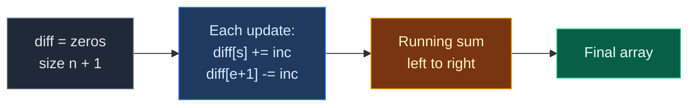

# 01. 370. Range Addition

| Difficulty | Pattern | Source | Time | Space |
|:---:|:---:|:---:|:---:|:---:|
| **Medium** | Difference Array (Range Update) | [370. Range Addition](https://leetcode.com/problems/range-addition/) | `O(n + k)` | `O(n)` |

## 1. Problem Statement

You have an array of `length` zeros.

You get `k` updates. Each update is `[start, end, inc]`: add `inc` to every element from index `start` to index `end` (both included).

Return the array after all updates.

### Example

```text
length = 5
updates = [[1, 3, 2], [2, 4, 3], [0, 2, -2]]

Start:              [ 0,  0,  0,  0,  0]
After [1, 3, 2]:    [ 0,  2,  2,  2,  0]
After [2, 4, 3]:    [ 0,  2,  5,  5,  3]
After [0, 2, -2]:   [-2,  0,  3,  5,  3]

Output: [-2, 0, 3, 5, 3]
```

We use this same example in every section below.

### Constraints

- `1 <= length <= 10^5`
- `0 <= updates.length <= 10^4`
- `0 <= start <= end < length`
- `-1000 <= inc <= 1000`

## 2. Core Theory

### What the problem really asks

Many "add to a whole range" updates, and we only need the final array once at the end.

Doing each update cell by cell costs `O(range length)`. With `k` big ranges that is `O(n * k)`.

### The Difference Array pattern (from scratch)

Instead of writing the change into every cell, write down **only where the change starts and where it stops**.

- `diff[start] += inc` means "from here on, everything goes up by `inc`".
- `diff[end + 1] -= inc` means "from here on, take that `inc` back".
- At the end, walk left to right with a running sum. The running sum at index `i` is the total change for cell `i`.

```text
Update [1, 3, 2] on length 5

index:    0   1   2   3   4   5
diff:    [0] [+2] [0] [0] [-2] [0]
              ^start       ^end + 1

running:  0   2   2   2   0
                ^^^^^^^^^
           the +2 is "on" for 1..3 only
```

Each update now costs `O(1)`, no matter how long the range is.

### Why the running sum works

- The running sum at `i` adds up every `diff[j]` with `j <= i`.
- An update `[s, e, inc]` adds `+inc` at `s` and `-inc` at `e + 1`.
- For `i < s`: neither mark is counted. Change `0`.
- For `s <= i <= e`: only `+inc` is counted. Change `inc`.
- For `i > e`: both are counted. `inc - inc = 0`.
- So every cell gets exactly the updates that cover it.



### Difference array vs prefix sum

| Tool | Fast at | Slow at |
|:---|:---|:---|
| Prefix sum | Range **queries** (sum of `l..r`) | Updates |
| Difference array | Range **updates** (add to `l..r`) | Reading in the middle (needs the running sum) |

They are opposites: the prefix sum of a difference array gives back the array.

### Where this pattern shows up

| Problem | What a "range update" is |
|:---|:---|
| **370. Range Addition** | Add `inc` to `start..end` |
| 1109. Corporate Flight Bookings | Add seats to flights `first..last` |
| 1094. Car Pooling | Add riders from pickup to drop-off, check capacity |
| 2381. Shifting Letters II | Add `+1` or `-1` shift to a range of letters |
| 2772. Make Array Zero | Subtract from a window of size `k`, greedily |

## 3. Edge Cases

| Case | Input | Expected | Why it matters |
|:---|:---|:---:|:---|
| No updates | `length = 3, updates = []` | `[0, 0, 0]` | Running sum of zeros |
| Range ends at the last index | `length = 3, [[0, 2, 5]]` | `[5, 5, 5]` | `end + 1 = length`. Needs the extra cell (or a bound check) |
| Single cell range | `length = 3, [[1, 1, 4]]` | `[0, 4, 0]` | `+4` at 1, `-4` at 2 |
| Negative increments | `length = 2, [[0, 1, -3]]` | `[-3, -3]` | Works the same |
| Updates cancel out | `length = 2, [[0, 1, 2], [0, 1, -2]]` | `[0, 0]` | Marks cancel in `diff` |

## 4. Brute Force: Apply Each Update Cell by Cell

### Idea

For each update, loop from `start` to `end` and add `inc`.

### Code

```python
# Import List for type hints
from typing import List


# Brute force: touch every cell of every range
class SolutionBrute:

    # Main method
    def getModifiedArray(self, length: int, updates: List[List[int]]) -> List[int]:

        # Start with all zeros
        arr = [0] * length

        # Apply each update
        for start, end, inc in updates:

            # Walk the whole range
            for i in range(start, end + 1):

                # Add the increment to this cell
                arr[i] += inc

        # Return the final array
        return arr
```

### Complexity

| Measure | Complexity | Why |
|:---|:---:|:---|
| **Time** | `O(n * k)` | Each of `k` updates can cover `n` cells |
| **Space** | `O(1)` extra | Only the output |

## 5. Optimal Approach: Difference Array

### Idea

1. Make `diff` of size `length + 1`, all zeros.
2. For each update: `diff[start] += inc`, `diff[end + 1] -= inc`.
3. Walk `i = 0..length-1` with a running sum. Write the running sum into the answer.

### Visual Walkthrough (Story Version)

Before the arrays, let us see the idea as a story.

**The story:** there are 5 houses on a street, numbered `0` to `4`. The city gives gifts of coins to stretches of houses. Instead of walking to every house each time, a clever mail carrier puts just two signs on the street: a **green sign** "start giving `X` coins here" and a **red sign** "stop giving `X` coins here". At the end, the carrier walks the street once, from left to right, keeping a running count of how many coins each house should get.

**The rules:**

- A gift `[start, end, X]` puts a green `+X` sign at house `start`.
- It puts a red `-X` sign right after the last house, at `end + 1`.
- The final walk keeps a running total. At each house, add the sign there (if any) to the total. The total is that house's coins.

**How to read the pictures:** `[ ]` = sign board in front of each spot (spot `5` is just past the last house). `^` = where the sign was just placed.

**Start: no signs**

```text
spot:    0    1    2    3    4    5
signs:  [0]  [0]  [0]  [0]  [0]  [0]
```

**Gift 1: `[1, 3, 2]`** — houses 1 to 3 get 2 coins.

- Green `+2` at spot 1. Red `-2` at spot 4.

```text
spot:    0    1    2    3    4    5
signs:  [0]  [+2] [0]  [0]  [-2] [0]
              ^              ^
```

**Gift 2: `[2, 4, 3]`** — houses 2 to 4 get 3 coins.

- Green `+3` at spot 2. Red `-3` at spot 5 (just past the street).

```text
spot:    0    1    2    3    4    5
signs:  [0]  [+2] [+3] [0]  [-2] [-3]
                   ^                ^
```

**Gift 3: `[0, 2, -2]`** — houses 0 to 2 lose 2 coins.

- Green `-2` at spot 0. Red `+2` at spot 3 (taking back a minus is a plus).

```text
spot:    0    1    2    3    4    5
signs:  [-2] [+2] [+3] [+2] [-2] [-3]
         ^              ^
```

**The final walk**

```text
House 0: total = 0 + (-2) = -2
signs:  [-2] [+2] [+3] [+2] [-2]
         ^
coins:  [-2]

House 1: total = -2 + 2 = 0
signs:  [-2] [+2] [+3] [+2] [-2]
              ^
coins:  [-2] [0]

House 2: total = 0 + 3 = 3
signs:  [-2] [+2] [+3] [+2] [-2]
                   ^
coins:  [-2] [0]  [3]

House 3: total = 3 + 2 = 5
signs:  [-2] [+2] [+3] [+2] [-2]
                        ^
coins:  [-2] [0]  [3]  [5]

House 4: total = 5 + (-2) = 3
signs:  [-2] [+2] [+3] [+2] [-2]
                             ^
coins:  [-2] [0]  [3]  [5]  [3]
```

Spot 5 is past the street, so we never walk there. Answer: `[-2, 0, 3, 5, 3]`.

**All steps at a glance**

| Step | What happens | Signs (`diff`) | Coins so far |
|:---:|:---|:---|:---|
| Gift 1 | `+2` at 1, `-2` at 4 | `[0, 2, 0, 0, -2, 0]` | – |
| Gift 2 | `+3` at 2, `-3` at 5 | `[0, 2, 3, 0, -2, -3]` | – |
| Gift 3 | `-2` at 0, `+2` at 3 | `[-2, 2, 3, 2, -2, -3]` | – |
| Walk 0 | total `= -2` | – | `[-2]` |
| Walk 1 | total `= 0` | – | `[-2, 0]` |
| Walk 2 | total `= 3` | – | `[-2, 0, 3]` |
| Walk 3 | total `= 5` | – | `[-2, 0, 3, 5]` |
| Walk 4 | total `= 3` | – | `[-2, 0, 3, 5, 3]` |

**What the story teaches**

| In the story | In the code |
|:---|:---|
| House | Index `i` |
| Gift `[start, end, X]` | Update `[start, end, inc]` |
| Green sign | `diff[start] += inc` |
| Red sign after the last house | `diff[end + 1] -= inc` |
| Spot 5, just past the street | Extra cell `diff[length]` |
| Running total on the walk | `running += diff[i]` |
| Coins at a house | `result[i] = running` |

Now the same steps again, this time with the exact arrays.

### Step-by-Step Example

```text
length = 5
updates = [[1, 3, 2], [2, 4, 3], [0, 2, -2]]
diff = [0, 0, 0, 0, 0, 0]   (size 6)
```

**Phase 1: mark the updates**

| Update | `diff[start] += inc` | `diff[end + 1] -= inc` | `diff` after |
|:---:|:---|:---|:---|
| `[1, 3, 2]` | `diff[1] = 0 + 2 = 2` | `diff[4] = 0 - 2 = -2` | `[0, 2, 0, 0, -2, 0]` |
| `[2, 4, 3]` | `diff[2] = 0 + 3 = 3` | `diff[5] = 0 - 3 = -3` | `[0, 2, 3, 0, -2, -3]` |
| `[0, 2, -2]` | `diff[0] = 0 + (-2) = -2` | `diff[3] = 0 - (-2) = 2` | `[-2, 2, 3, 2, -2, -3]` |

**Phase 2: running sum**

| `i` | `diff[i]` | `running` before | `running` after | `result` |
|:---:|:---:|:---:|:---:|:---|
| 0 | -2 | 0 | -2 | `[-2, 0, 0, 0, 0]` |
| 1 | 2 | -2 | 0 | `[-2, 0, 0, 0, 0]` |
| 2 | 3 | 0 | 3 | `[-2, 0, 3, 0, 0]` |
| 3 | 2 | 3 | 5 | `[-2, 0, 3, 5, 0]` |
| 4 | -2 | 5 | 3 | `[-2, 0, 3, 5, 3]` |

**Answer: `[-2, 0, 3, 5, 3]`.**

### Code

```python
# Optimal: difference array plus one running sum
class Solution:

    # Main method
    def getModifiedArray(self, length: int, updates: List[List[int]]) -> List[int]:

        # One extra cell so end + 1 never goes out of range
        diff = [0] * (length + 1)

        # Mark every update in O(1)
        for start, end, inc in updates:

            # Change starts here
            diff[start] += inc

            # Change stops right after end
            diff[end + 1] -= inc

        # The answer array
        result = [0] * length

        # Total change active at the current index
        running = 0

        # Walk left to right
        for i in range(length):

            # Add the mark at this index
            running += diff[i]

            # This cell gets the total change so far
            result[i] = running

        # Return the final array
        return result


# Check the example from this note, step by step
d = [0] * 6

# Update [1, 3, 2]: start mark
d[1] += 2

# Update [1, 3, 2]: stop mark
d[4] -= 2
assert d == [0, 2, 0, 0, -2, 0]

# Update [2, 4, 3]: start mark
d[2] += 3

# Update [2, 4, 3]: stop mark
d[5] -= 3
assert d == [0, 2, 3, 0, -2, -3]

# Update [0, 2, -2]: start mark
d[0] += -2

# Update [0, 2, -2]: stop mark
d[3] -= -2
assert d == [-2, 2, 3, 2, -2, -3]

# Running sum starts at 0
run = 0

# Check the running sum at each index
for i, expected in enumerate([-2, 0, 3, 5, 3]):

    # Add this index's mark
    run += d[i]
    assert run == expected

# Full solution on the example (also the LeetCode example)
assert Solution().getModifiedArray(5, [[1, 3, 2], [2, 4, 3], [0, 2, -2]]) == [-2, 0, 3, 5, 3]

# Second LeetCode example
assert Solution().getModifiedArray(10, [[2, 4, 6], [5, 6, 8], [1, 9, -4]]) == [0, -4, 2, 2, 2, 4, 4, -4, -4, -4]

# Edge cases
assert Solution().getModifiedArray(3, []) == [0, 0, 0]
assert Solution().getModifiedArray(3, [[0, 2, 5]]) == [5, 5, 5]
assert Solution().getModifiedArray(3, [[1, 1, 4]]) == [0, 4, 0]
assert Solution().getModifiedArray(2, [[0, 1, -3]]) == [-3, -3]
assert Solution().getModifiedArray(2, [[0, 1, 2], [0, 1, -2]]) == [0, 0]

# Import random to make test inputs
import random

# Brute force and optimal agree on random inputs
for _ in range(300):

    # Random array length
    n = random.randint(1, 10)

    # Random list of updates
    ups = []

    # Make up to 6 updates
    for _ in range(random.randint(0, 6)):

        # Random start
        s = random.randrange(n)

        # Random end at or after start
        e = random.randint(s, n - 1)

        # Random increment
        ups.append([s, e, random.randint(-5, 5)])

    # Both must match
    assert Solution().getModifiedArray(n, ups) == SolutionBrute().getModifiedArray(n, ups)

# All checks passed
print("All tests passed")
```

### Complexity

| Measure | Complexity | Why |
|:---|:---:|:---|
| **Time** | `O(n + k)` | `O(1)` per update, then one pass of length `n` |
| **Space** | `O(n)` | The `diff` array (plus the output) |

## 6. Common Mistakes

| Mistake | What goes wrong | Fix |
|:---|:---|:---|
| `diff` of size `length` | `diff[end + 1]` is out of range when `end = length - 1` | Size `length + 1`, or check `end + 1 < length` |
| Subtracting at `end` instead of `end + 1` | The last cell of the range loses the update | The range includes `end`, so stop at `end + 1` |
| Forgetting the running sum | Returning `diff` itself | Always take the prefix sum at the end |
| Returning `diff` with the extra cell | Output has `length + 1` items | Build the result only for `0..length-1` |
| Mixing up signs for negative `inc` | `diff[end + 1] -= inc` with `inc < 0` must add | Just use `-= inc`; Python does the math |

## 7. Interview Follow-ups

### Q1. What if we need to read values between updates?

**Answer:**
- A plain difference array needs the full running sum to read one cell: `O(n)`.
- Use a Fenwick tree (BIT) on the difference array: range update and point query both `O(log n)`.
- For range update and range sum, use a segment tree with lazy propagation.

### Q2. Can we do it without the extra array?

**Answer:**
- Yes. Write the marks into the result array itself, then do the prefix sum in place.
- Still `O(n)` space for the output. No extra space beyond that.

### Q3. What if the array is huge but the updates are few?

**Answer:**
- Store marks in a dictionary or sorted list of `(index, change)`.
- Sort the keys and sweep. Time `O(k log k)`, independent of `n`.

### Q4. How does this extend to 2D?

**Answer:**
- Add `+inc` at `(r1, c1)`, `-inc` at `(r1, c2+1)` and `(r2+1, c1)`, `+inc` at `(r2+1, c2+1)`.
- Take a 2D prefix sum at the end.

### Q5. How is this related to prefix sums?

**Answer:**
- They are opposites. The difference array stores "how much each cell differs from the one before".
- The prefix sum of the difference array rebuilds the array.

## 8. Interview Explanation

> Doing each range update cell by cell is O(n times k). Instead I keep a difference array of size length plus 1. For each update I add inc at start and subtract inc at end plus 1, so the change turns on at start and off right after end. Each update is O(1). At the end I walk left to right with a running sum, and the running sum at each index is the total change for that cell. That gives O(n plus k) time and O(n) space.
