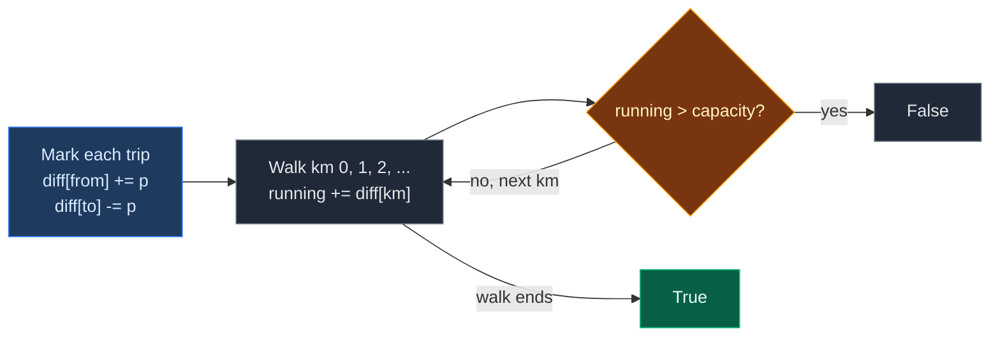

# 03. 1094. Car Pooling

| Difficulty | Pattern | Source | Time | Space |
|:---:|:---:|:---:|:---:|:---:|
| **Medium** | Difference Array (Range Update) | [1094. Car Pooling](https://leetcode.com/problems/car-pooling/) | `O(k + L)` | `O(L)` |

`L` = largest drop-off location (at most `1000`), `k` = number of trips.

## 1. Problem Statement

A car has `capacity` empty seats. It only drives east, so it never turns back.

You get `trips`. Each `trips[i] = [numPassengers, from, to]` means `numPassengers` people get in at km `from` and get out at km `to`.

Return `True` if the car can do all trips without ever holding more than `capacity` people. Otherwise return `False`.

### Example

```text
trips = [[2, 1, 5], [3, 3, 7]]
capacity = 4

km:      0  1  2  3  4  5  6  7
trip 1:     2  2  2  2  .           (in at 1, out at 5)
trip 2:           3  3  3  3  .     (in at 3, out at 7)
in car:  0  2  2  5  5  3  3  0
                  ^
             5 > 4 at km 3

Output: False
```

We use this same example in every section below.

### Constraints

- `1 <= trips.length <= 1000`
- `trips[i].length == 3`
- `1 <= numPassengers <= 100`
- `0 <= from < to <= 1000`
- `1 <= capacity <= 10^5`

## 2. Core Theory

### What the problem really asks

At every km, count the people in the car. Is the count ever more than `capacity`?

Each trip adds `numPassengers` to a range of km. That is a range update, so we use a difference array. (Pattern from scratch: [01. 370. Range Addition](./01.%20370.%20Range%20Addition.md).)

### The one twist: people get out **at** `to`

- At km `to`, the passengers have already left. Their seats are free.
- So a trip covers km `from .. to - 1`, not `from .. to`.
- The stop mark goes at `(to - 1) + 1 = to`.

```text
Trip [2, 1, 5]

km:      0   1   2   3   4   5
diff:   [0] [+2] [0] [0] [0] [-2]
             ^ in            ^ out (seat is free here)
```

That is why two trips like `[2, 1, 5]` and `[2, 5, 7]` never share seats: one leaves at km 5 just as the other gets in.

### Why we can stop early

We only need a yes or no. As soon as the running count goes over `capacity`, the answer is `False`.



## 3. Edge Cases

| Case | Input | Expected | Why it matters |
|:---|:---|:---:|:---|
| Drop-off equals next pickup | `[[2,1,5],[3,5,7]], cap = 3` | `True` | At km 5 the first group is already out |
| Exactly at capacity | `[[2,1,5],[3,3,7]], cap = 5` | `True` | `5 > 5` is false. Use `>` not `>=` |
| One trip too big | `[[9,0,1]], cap = 4` | `False` | Fails at the very first km |
| Pickup at km 0 | `[[3,0,2]], cap = 3` | `True` | `diff[0]` is used |
| Drop-off at km 1000 | `[[1,0,1000]], cap = 1` | `True` | `diff[1000]` must exist |
| Many small trips stacked | `[[1,0,3]] * 5, cap = 4` | `False` | Marks add up at the same km |

## 4. Brute Force: Fill Every Km

### Idea

Keep a count for every km. For each trip, add its passengers to every km from `from` to `to - 1`. Then check every count.

### Code

```python
# Import List for type hints
from typing import List


# Brute force: add each trip to every km it covers
class SolutionBrute:

    # Main method
    def carPooling(self, trips: List[List[int]], capacity: int) -> bool:

        # People in the car at each km 0..1000
        load = [0] * 1001

        # Apply each trip
        for people, start, end in trips:

            # Passengers are in the car from start up to end - 1
            for km in range(start, end):

                # Add them at this km
                load[km] += people

                # Too many people here
                if load[km] > capacity:

                    # Car cannot do it
                    return False

        # Never over capacity
        return True
```

### Complexity

| Measure | Complexity | Why |
|:---|:---:|:---|
| **Time** | `O(k * L)` | Each of `k` trips can cover `L` km |
| **Space** | `O(L)` | The `load` array |

## 5. Optimal Approach: Difference Array

### Idea

1. `diff` of size `max(to) + 1`.
2. For each trip: `diff[from] += people`, `diff[to] -= people`.
3. Walk km `0, 1, 2, ...` with a running sum. If it ever goes over `capacity`, return `False`.
4. Return `True` at the end.

### Visual Walkthrough (Story Version)

Before the arrays, let us see the idea as a story.

**The story:** a small car with 4 seats drives along a straight road with km posts `0` to `7`. Groups of friends booked rides. At each km post there is a little board. When a group books, the driver writes **"+people get in"** on the board where they start and **"-people get out"** on the board where they leave. Then the driver drives the road once, reading each board and counting heads.

**The rules:**

- Trip `[p, from, to]`: write `+p` on board `from`, write `-p` on board `to`.
- At each km, heads = heads so far + the board's number.
- If heads ever go above 4, the driver says "Sorry, too full!" and stops.

**How to read the pictures:** `[ ]` = board at each km. `^` = where we are or where a note was just written.

**Start: empty boards**

```text
km:      0    1    2    3    4    5    6    7
board:  [0]  [0]  [0]  [0]  [0]  [0]  [0]  [0]
```

**Trip 1: `[2, 1, 5]`** — 2 friends ride from km 1 to km 5.

- `+2` on board 1. `-2` on board 5.

```text
km:      0    1    2    3    4    5    6    7
board:  [0]  [+2] [0]  [0]  [0]  [-2] [0]  [0]
              ^                   ^
```

**Trip 2: `[3, 3, 7]`** — 3 friends ride from km 3 to km 7.

- `+3` on board 3. `-3` on board 7.

```text
km:      0    1    2    3    4    5    6    7
board:  [0]  [+2] [0]  [+3] [0]  [-2] [0]  [-3]
                        ^                   ^
```

**The drive**

```text
km 0: heads = 0 + 0 = 0      (0 <= 4, fine)
board:  [0]  [+2] [0]  [+3] [0]  [-2] [0]  [-3]
         ^

km 1: heads = 0 + 2 = 2      (2 <= 4, fine)
board:  [0]  [+2] [0]  [+3] [0]  [-2] [0]  [-3]
              ^

km 2: heads = 2 + 0 = 2      (2 <= 4, fine)
board:  [0]  [+2] [0]  [+3] [0]  [-2] [0]  [-3]
                   ^

km 3: heads = 2 + 3 = 5      (5 > 4, TOO FULL!)
board:  [0]  [+2] [0]  [+3] [0]  [-2] [0]  [-3]
                        ^
```

The driver stops at km 3. Answer: `False`.

**All steps at a glance**

| Step | What happens | Boards (`diff`) | Heads | Over 4? |
|:---:|:---|:---|:---:|:---:|
| Trip 1 | `+2` at 1, `-2` at 5 | `[0, 2, 0, 0, 0, -2, 0, 0]` | – | – |
| Trip 2 | `+3` at 3, `-3` at 7 | `[0, 2, 0, 3, 0, -2, 0, -3]` | – | – |
| km 0 | read `0` | – | 0 | No |
| km 1 | read `+2` | – | 2 | No |
| km 2 | read `0` | – | 2 | No |
| km 3 | read `+3` | – | 5 | **Yes, stop** |

**What the story teaches**

| In the story | In the code |
|:---|:---|
| Km post | Index `km` |
| "+p get in" on board `from` | `diff[from] += p` |
| "-p get out" on board `to` | `diff[to] -= p` |
| Counting heads while driving | `running += diff[km]` |
| "Too full!" | `running > capacity`, return `False` |
| Drive ends with no problem | Return `True` |

Now the same steps again, this time with the exact arrays.

### Step-by-Step Example

```text
trips = [[2, 1, 5], [3, 3, 7]], capacity = 4
max to = 7, so diff has size 8
diff = [0, 0, 0, 0, 0, 0, 0, 0]
```

**Phase 1: mark the trips**

| Trip | `diff[from] += p` | `diff[to] -= p` | `diff` after |
|:---:|:---|:---|:---|
| `[2, 1, 5]` | `diff[1] = 0 + 2 = 2` | `diff[5] = 0 - 2 = -2` | `[0, 2, 0, 0, 0, -2, 0, 0]` |
| `[3, 3, 7]` | `diff[3] = 0 + 3 = 3` | `diff[7] = 0 - 3 = -3` | `[0, 2, 0, 3, 0, -2, 0, -3]` |

**Phase 2: running sum with the capacity check**

| `km` | `diff[km]` | `running` before | `running` after | `> 4`? |
|:---:|:---:|:---:|:---:|:---:|
| 0 | 0 | 0 | 0 | No |
| 1 | 2 | 0 | 2 | No |
| 2 | 0 | 2 | 2 | No |
| 3 | 3 | 2 | 5 | **Yes** -> return `False` |

km 4 to 7 are never read.

**Answer: `False`.**

### Code

```python
# Optimal: difference array with an early capacity check
class Solution:

    # Main method
    def carPooling(self, trips: List[List[int]], capacity: int) -> bool:

        # Farthest drop-off decides how many km we need
        last_km = max(end for _, _, end in trips)

        # One board per km 0..last_km
        diff = [0] * (last_km + 1)

        # Mark every trip in O(1)
        for people, start, end in trips:

            # They get in at start
            diff[start] += people

            # They are out at end (seat free at end)
            diff[end] -= people

        # People in the car right now
        running = 0

        # Drive along every km
        for km in range(last_km + 1):

            # Apply the board at this km
            running += diff[km]

            # Too many people
            if running > capacity:

                # Car cannot do it
                return False

        # Never over capacity
        return True


# Check the example from this note, step by step
d = [0] * 8

# Trip [2, 1, 5]: get in
d[1] += 2

# Trip [2, 1, 5]: get out
d[5] -= 2
assert d == [0, 2, 0, 0, 0, -2, 0, 0]

# Trip [3, 3, 7]: get in
d[3] += 3

# Trip [3, 3, 7]: get out
d[7] -= 3
assert d == [0, 2, 0, 3, 0, -2, 0, -3]

# Running sum starts at 0
run = 0

# Check km 0 to 3; km 3 is the first one over capacity
for km, expected in enumerate([0, 2, 2, 5]):

    # Apply this km's board
    run += d[km]
    assert run == expected
    assert (run > 4) == (km == 3)

# Full solution on the example (also LeetCode example 1)
assert Solution().carPooling([[2, 1, 5], [3, 3, 7]], 4) is False

# LeetCode example 2
assert Solution().carPooling([[2, 1, 5], [3, 3, 7]], 5) is True

# Edge cases
assert Solution().carPooling([[2, 1, 5], [3, 5, 7]], 3) is True
assert Solution().carPooling([[9, 0, 1]], 4) is False
assert Solution().carPooling([[3, 0, 2]], 3) is True
assert Solution().carPooling([[1, 0, 1000]], 1) is True
assert Solution().carPooling([[1, 0, 3]] * 5, 4) is False

# Import random to make test inputs
import random

# Brute force and optimal agree on random inputs
for _ in range(300):

    # Random trips
    ts = []

    # Make 1 to 6 trips
    for _ in range(random.randint(1, 6)):

        # Random pickup
        s = random.randint(0, 15)

        # Drop-off after pickup
        ts.append([random.randint(1, 5), s, random.randint(s + 1, 20)])

    # Random capacity
    cap = random.randint(1, 15)

    # Both must match
    assert Solution().carPooling(ts, cap) == SolutionBrute().carPooling(ts, cap)

# All checks passed
print("All tests passed")
```

### Complexity

| Measure | Complexity | Why |
|:---|:---:|:---|
| **Time** | `O(k + L)` | `O(1)` per trip, one walk over at most `L + 1` km |
| **Space** | `O(L)` | The `diff` array, `L <= 1000` |

## 6. Common Mistakes

| Mistake | What goes wrong | Fix |
|:---|:---|:---|
| Stop mark at `to + 1` | Passengers seem to stay one km too long. `[[2,1,5],[3,5,7]], cap = 3` wrongly fails | They are out **at** `to`, so mark `diff[to]` |
| `running >= capacity` | Full car counts as over | Over means `> capacity` |
| Checking only the final sum | Final sum is always `0` | Check at every km |
| `diff` of size `1000` | `diff[1000]` crashes when `to = 1000` | Size `max(to) + 1` (or `1001`) |
| Sorting trips by pickup only | Gets complicated, easy to miss drop-offs | The difference array needs no sorting |

## 7. Interview Follow-ups

### Q1. What if km values go up to `10^9`?

**Answer:**
- A big array is too large. Make events instead: `(from, +p)` and `(to, -p)`.
- Sort the events. At equal km, process `-p` before `+p` (people get out first).
- Sweep and keep a running count. `O(k log k)`.

### Q2. Can we solve it with a heap?

**Answer:**
- Yes. Sort trips by pickup. Keep a min-heap of `(to, people)` for people in the car.
- Before each pickup, pop everyone with `to <= from`. Then add the new group and check.
- Also `O(k log k)`.

### Q3. Why does the order of `+` and `-` at the same km not matter here?

**Answer:**
- Both marks at one km are added into one `diff[km]` before we check.
- So the check sees the net change, which is the right count after drop-offs and pickups.

### Q4. What if the car could drive both ways?

**Answer:**
- Then "km order" is not the order of time. You would need trip times instead.
- Sort events by time, then use the same running count idea.

### Q5. How would you return the first km where it fails?

**Answer:**
- Return `km` instead of `False` inside the loop. Return `-1` if it never fails.

## 8. Interview Explanation

> Each trip adds its passengers to every km from pickup up to, but not including, drop-off. That is a range update, so I use a difference array: plus passengers at from, minus passengers at to. Using to and not to plus 1 matters, because people are already out at their drop-off point. Then I walk the km in order with a running sum, which is the number of people in the car at each km. If it ever goes above capacity I return false right away, otherwise true. That is O(k plus L) time and O(L) space, with L at most 1000.
