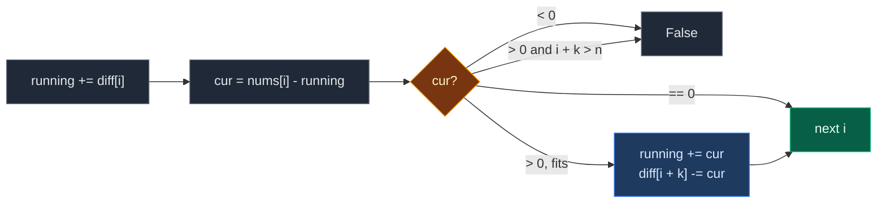

# 05. 2772. Apply Operations to Make All Array Elements Equal to Zero

| Difficulty | Pattern | Source | Time | Space |
|:---:|:---:|:---:|:---:|:---:|
| **Medium** | Difference Array (Range Update) | [2772. Apply Operations to Make All Array Elements Equal to Zero](https://leetcode.com/problems/apply-operations-to-make-all-array-elements-equal-to-zero/) | `O(n)` | `O(n)` |

## 1. Problem Statement

You get an array `nums` and a number `k`.

One operation: pick **any subarray of size exactly `k`** and subtract `1` from every element in it.

You can do this as many times as you like. Return `True` if you can make every element `0`. Otherwise return `False`.

### Example

```text
nums = [2, 2, 3, 1, 1, 0]
k = 3

Window [0..2] twice:  [0, 0, 1, 1, 1, 0]
Window [2..4] once:   [0, 0, 0, 0, 0, 0]

Output: True
```

We use this same example in every section below.

### Constraints

- `1 <= k <= nums.length <= 10^5`
- `0 <= nums[i] <= 10^6`

## 2. Core Theory

### What the problem really asks

Can we cover each element with exactly `nums[i]` windows of size `k`?

### The greedy idea: the leftmost element decides

Look at index `0`.

- Only windows that **start at index 0** can touch index 0.
- So exactly `nums[0]` windows must start at index 0. No choice.

Now move to index `1`. Some windows from index 0 already lowered it. Whatever is left can only be fixed by windows that **start at index 1** (windows starting earlier are already decided). Again, no choice.

So we go left to right. At each `i`:

- `cur = nums[i] - (windows still covering i)`.
- `cur < 0`: too many windows already hit it. **Impossible.**
- `cur > 0`: we must start `cur` new windows at `i`. If `i + k > n`, the window does not fit. **Impossible.**
- `cur == 0`: nothing to do.

```text
nums = [2, 2, 3, 1, 1, 0], k = 3

i = 0 must start 2 windows:  [==2==]
                              0  1  2  3  4  5
```

### Why a difference array

The slow part is "subtract `cur` from the next `k` elements". That is a range update.

- Keep `running` = how many windows cover index `i` right now.
- Starting `cur` windows at `i`: `running += cur`, and note that they end after `i + k - 1`, so `diff[i + k] -= cur`.
- At each new index, `running += diff[i]` drops the windows that just ended.

Each step is `O(1)`. (Difference array from scratch: [01. 370. Range Addition](./01.%20370.%20Range%20Addition.md).)



### Difference from the earlier problems

In 370, 1109, 1094, 2381 all updates are given up front. Here **we decide** the updates as we walk, so the marks and the running sum happen in the same pass.

## 3. Edge Cases

| Case | Input | Expected | Why it matters |
|:---|:---|:---:|:---|
| `k = 1` | `[5, 0, 3], k = 1` | `True` | Every element can be fixed alone |
| `k = n` | `[2, 2, 2], k = 3` | `True` | Only one window exists. All must be equal |
| `k = n`, not equal | `[2, 1, 2], k = 3` | `False` | Index 1 goes negative |
| Leftover at the tail | `[0, 0, 1], k = 2` | `False` | A window cannot start at index 2 |
| Middle goes negative | `[1, 3, 1, 1], k = 2` | `False` | After index 1 starts 2 windows, index 2 is `1 - 2 = -1` |
| All zeros | `[0, 0], k = 2` | `True` | Nothing to do |

## 4. Brute Force: Greedy with Direct Subtraction

### Idea

Same greedy, but do the subtraction for real: at each `i`, if `nums[i] > 0`, subtract `nums[i]` from all `k` elements of the window starting at `i`.

(Trying every possible set of windows is exponential. The greedy above is forced, so this is the natural slow version.)

### Code

```python
# Import List for type hints
from typing import List


# Brute force: greedy, subtracting from every element of each window
class SolutionBrute:

    # Main method
    def checkArray(self, nums: List[int], k: int) -> bool:

        # Work on a copy so the input stays the same
        a = nums[:]

        # Number of elements
        n = len(a)

        # Walk left to right
        for i in range(n):

            # Earlier windows took too much
            if a[i] < 0:

                # Cannot fix this
                return False

            # This element still needs to go down
            if a[i] > 0:

                # A window starting here would not fit
                if i + k > n:

                    # Cannot fix this
                    return False

                # Number of windows to start here
                x = a[i]

                # Subtract from every element of the window
                for j in range(i, i + k):

                    # One cell of the window
                    a[j] -= x

        # Every element reached zero
        return True
```

### Complexity

| Measure | Complexity | Why |
|:---|:---:|:---|
| **Time** | `O(n * k)` | Each index can trigger a loop of length `k` |
| **Space** | `O(n)` | The copy |

## 5. Optimal Approach: Greedy + Difference Array

### Idea

1. `diff` of size `n + 1`, `running = 0`.
2. For each `i`:
   - `running += diff[i]` (drop windows that ended).
   - `cur = nums[i] - running`.
   - `cur < 0` -> `False`.
   - `cur > 0` and `i + k > n` -> `False`.
   - `cur > 0` -> `running += cur`, `diff[i + k] -= cur`.
3. Return `True`.

### Visual Walkthrough (Story Version)

Before the arrays, let us see the idea as a story.

**The story:** six snow piles stand in a row. A snowplow is exactly 3 piles wide. Each pass of the plow over 3 neighboring piles removes 1 layer from each. A driver goes left to right. The leftmost pile that still has snow can only be cleared by passes that **start** there, so the driver has no choice about how many passes to start. A notebook keeps track of how many passes are still "rolling over" the current pile, and where each batch of passes ends.

**The rules:**

- At each pile, first cross off passes that ended before this pile.
- Snow left = pile height - passes rolling over it.
- Negative snow? The plow dug into the ground. **Fail.**
- Snow left but the plow does not fit (pile is too close to the end)? **Fail.**
- Snow left and it fits: start that many passes here. Write in the notebook: "these passes end before pile `i + 3`".

**How to read the pictures:** `[ ]` = pile heights. `^` = driver. `rolling` = passes covering this pile. `notes` = the `diff` notebook (spot 6 is past the end).

**Start**

```text
pile:     0    1    2    3    4    5
height:  [2]  [2]  [3]  [1]  [1]  [0]
notes:   [0]  [0]  [0]  [0]  [0]  [0]  [0]
rolling = 0
```

**Step 1: pile 0**

- No passes ended here (`note 0`). Rolling `= 0`.
- Snow left `= 2 - 0 = 2`. Plow fits (`0 + 3 <= 6`).
- Start 2 passes. Rolling `= 2`. Note `-2` at spot 3.

```text
pile:     0    1    2    3    4    5
height:  [2]  [2]  [3]  [1]  [1]  [0]
          ^
notes:   [0]  [0]  [0]  [-2] [0]  [0]  [0]
rolling = 2        [====2====]
```

**Step 2: pile 1**

- Note at 1 is `0`. Rolling stays `2`.
- Snow left `= 2 - 2 = 0`. Clean. Nothing to do.

```text
pile:     0    1    2    3    4    5
height:  [2]  [2]  [3]  [1]  [1]  [0]
               ^
notes:   [0]  [0]  [0]  [-2] [0]  [0]  [0]
rolling = 2
```

**Step 3: pile 2**

- Note at 2 is `0`. Rolling stays `2`.
- Snow left `= 3 - 2 = 1`. Plow fits (`2 + 3 <= 6`).
- Start 1 pass. Rolling `= 3`. Note `-1` at spot 5.

```text
pile:     0    1    2    3    4    5
height:  [2]  [2]  [3]  [1]  [1]  [0]
                    ^
notes:   [0]  [0]  [0]  [-2] [0]  [-1] [0]
rolling = 3                  [====1====]
```

**Step 4: pile 3**

- Note at 3 is `-2`. The first 2 passes ended. Rolling `= 3 - 2 = 1`.
- Snow left `= 1 - 1 = 0`. Clean.

```text
pile:     0    1    2    3    4    5
height:  [2]  [2]  [3]  [1]  [1]  [0]
                         ^
notes:   [0]  [0]  [0]  [-2] [0]  [-1] [0]
rolling = 1
```

**Step 5: pile 4**

- Note at 4 is `0`. Rolling stays `1`.
- Snow left `= 1 - 1 = 0`. Clean.

```text
pile:     0    1    2    3    4    5
height:  [2]  [2]  [3]  [1]  [1]  [0]
                              ^
notes:   [0]  [0]  [0]  [-2] [0]  [-1] [0]
rolling = 1
```

**Step 6: pile 5**

- Note at 5 is `-1`. The last pass ended. Rolling `= 0`.
- Snow left `= 0 - 0 = 0`. Clean.

```text
pile:     0    1    2    3    4    5
height:  [2]  [2]  [3]  [1]  [1]  [0]
                                   ^
notes:   [0]  [0]  [0]  [-2] [0]  [-1] [0]
rolling = 0
```

Every pile is clean. Answer: `True`.

**All steps at a glance**

| Step | Pile | Note read | Rolling | Snow left | Action | Rolling after |
|:---:|:---:|:---:|:---:|:---:|:---|:---:|
| 1 | 0 | 0 | 0 | 2 | Start 2, note `-2` at 3 | 2 |
| 2 | 1 | 0 | 2 | 0 | Nothing | 2 |
| 3 | 2 | 0 | 2 | 1 | Start 1, note `-1` at 5 | 3 |
| 4 | 3 | -2 | 1 | 0 | Nothing | 1 |
| 5 | 4 | 0 | 1 | 0 | Nothing | 1 |
| 6 | 5 | -1 | 0 | 0 | Nothing | 0 |

**What the story teaches**

| In the story | In the code |
|:---|:---|
| Pile height | `nums[i]` |
| Plow width | `k` |
| Passes rolling over a pile | `running` |
| Cross off ended passes | `running += diff[i]` |
| Snow left | `cur = nums[i] - running` |
| Start passes here | `running += cur` |
| "These passes end before pile `i + k`" | `diff[i + k] -= cur` |
| Plow dug into the ground | `cur < 0` -> `False` |
| Plow does not fit | `i + k > n` -> `False` |

Now the same steps again, this time with the exact arrays.

### Step-by-Step Example

```text
nums = [2, 2, 3, 1, 1, 0], k = 3, n = 6
diff = [0, 0, 0, 0, 0, 0, 0]   (size 7)
running = 0
```

| `i` | `diff[i]` | `running` after drop | `cur = nums[i] - running` | Check | Action | `running` after | `diff` after |
|:---:|:---:|:---:|:---:|:---|:---|:---:|:---|
| 0 | 0 | 0 | `2 - 0 = 2` | `0 + 3 = 3 <= 6` | start 2, `diff[3] -= 2` | 2 | `[0, 0, 0, -2, 0, 0, 0]` |
| 1 | 0 | 2 | `2 - 2 = 0` | – | nothing | 2 | `[0, 0, 0, -2, 0, 0, 0]` |
| 2 | 0 | 2 | `3 - 2 = 1` | `2 + 3 = 5 <= 6` | start 1, `diff[5] -= 1` | 3 | `[0, 0, 0, -2, 0, -1, 0]` |
| 3 | -2 | 1 | `1 - 1 = 0` | – | nothing | 1 | `[0, 0, 0, -2, 0, -1, 0]` |
| 4 | 0 | 1 | `1 - 1 = 0` | – | nothing | 1 | `[0, 0, 0, -2, 0, -1, 0]` |
| 5 | -1 | 0 | `0 - 0 = 0` | – | nothing | 0 | `[0, 0, 0, -2, 0, -1, 0]` |

The loop ends with no failure.

**Answer: `True`.**

### Code

```python
# Optimal: greedy left to right, difference array for active windows
class Solution:

    # Main method
    def checkArray(self, nums: List[int], k: int) -> bool:

        # Number of elements
        n = len(nums)

        # diff[j] = change in active windows when we reach index j
        diff = [0] * (n + 1)

        # Windows covering the current index
        running = 0

        # Walk left to right
        for i in range(n):

            # Drop windows that ended before i
            running += diff[i]

            # What is still left at index i
            cur = nums[i] - running

            # Too many windows already hit this index
            if cur < 0:

                # Cannot fix it
                return False

            # Still need to go down
            if cur > 0:

                # A window starting here would not fit
                if i + k > n:

                    # Cannot fix it
                    return False

                # Start cur new windows at i
                running += cur

                # They stop covering at index i + k
                diff[i + k] -= cur

        # Every element reached zero
        return True


# Check the example from this note, step by step
nums_ex, k_ex = [2, 2, 3, 1, 1, 0], 3

# Empty notebook and no active windows
d, run = [0] * 7, 0

# i = 0: cur = 2, start 2 windows ending at 3
run += d[0]
assert nums_ex[0] - run == 2

# Start 2 windows
run += 2

# They stop covering at index 3
d[3] -= 2
assert run == 2 and d == [0, 0, 0, -2, 0, 0, 0]

# i = 1: cur = 0, nothing
run += d[1]
assert nums_ex[1] - run == 0 and run == 2

# i = 2: cur = 1, start 1 window ending at 5
run += d[2]
assert nums_ex[2] - run == 1

# Start 1 window
run += 1

# It stops covering at index 5
d[5] -= 1
assert run == 3 and d == [0, 0, 0, -2, 0, -1, 0]

# i = 3: two windows end, cur = 0
run += d[3]
assert run == 1 and nums_ex[3] - run == 0

# i = 4: cur = 0
run += d[4]
assert run == 1 and nums_ex[4] - run == 0

# i = 5: last window ends, cur = 0
run += d[5]
assert run == 0 and nums_ex[5] - run == 0

# Full solution on the example (also LeetCode example 1)
assert Solution().checkArray(nums_ex, k_ex) is True

# LeetCode example 2
assert Solution().checkArray([1, 3, 1, 1], 2) is False

# Edge cases
assert Solution().checkArray([5, 0, 3], 1) is True
assert Solution().checkArray([2, 2, 2], 3) is True
assert Solution().checkArray([2, 1, 2], 3) is False
assert Solution().checkArray([0, 0, 1], 2) is False
assert Solution().checkArray([0, 0], 2) is True

# Import random to make test inputs
import random

# Brute force and optimal agree on random inputs
for _ in range(500):

    # Random length
    n = random.randint(1, 8)

    # Random window size
    k = random.randint(1, n)

    # Half the time build a solvable array, half the time a random one
    if random.random() < 0.5:

        # Start from zeros
        arr = [0] * n

        # Apply some windows in reverse (add instead of subtract)
        for _ in range(random.randint(0, 5)):

            # Random window start that fits
            s = random.randint(0, n - k)

            # Add 1 to the whole window
            for j in range(s, s + k):

                # One cell of the window
                arr[j] += 1

    # Random array
    else:

        # Small random values
        arr = [random.randint(0, 3) for _ in range(n)]

    # Both must match
    assert Solution().checkArray(arr, k) == SolutionBrute().checkArray(arr, k)

# All checks passed
print("All tests passed")
```

### Complexity

| Measure | Complexity | Why |
|:---|:---:|:---|
| **Time** | `O(n)` | Each index does `O(1)` work |
| **Space** | `O(n)` | The `diff` array |

## 6. Common Mistakes

| Mistake | What goes wrong | Fix |
|:---|:---|:---|
| Forgetting `running += diff[i]` before computing `cur` | Old windows never end, later elements look negative | Drop ended windows first, every step |
| Checking `i + k >= n` | Rejects a valid window that ends exactly at `n - 1` | Window fits when `i + k <= n` |
| Not checking `cur < 0` | Says `True` for `[1, 3, 1, 1], k = 2` | Negative means too many windows: `False` |
| `diff` of size `n` | `diff[i + k]` crashes when `i + k == n` | Size `n + 1` |
| Doing the subtraction for real | `O(n * k)`, too slow for `10^5` | Track windows with `running` and `diff` |

## 7. Interview Follow-ups

### Q1. Why is the greedy correct?

**Answer:**
- The leftmost index that is not yet zero can only be lowered by windows starting at it (earlier starts are already fixed).
- So the number of windows starting there is forced. There is never a choice to get wrong.

### Q2. Can we do it with `O(1)` extra space?

**Answer:**
- Yes, if we can change `nums`. Store "windows started at `i`" in `nums[i]` itself.
- At index `i`, subtract the windows started at `i - k` from `running` by reading `nums[i - k]`.

### Q3. What if the operation added 1 instead of subtracting, and we want all elements equal to some target?

**Answer:**
- Same greedy. Compare against the target instead of zero, and flip the signs.

### Q4. What if windows could have any size up to `k`?

**Answer:**
- Then the problem is different. With size 1 allowed, every non-negative array is solvable.
- The fixed size `k` is what makes the tail check `i + k <= n` matter.

### Q5. Can we return the number of operations?

**Answer:**
- Yes. Add up every `cur > 0` that we start. That total is the number of operations, and it is the only possible count.

## 8. Interview Explanation

> I walk left to right. The leftmost element that is not zero can only be lowered by windows that start at it, so the number of windows to start there is forced: it is nums[i] minus the windows still covering i. If that is negative, too many windows already hit it, so false. If it is positive but a window of size k does not fit from i, also false. Otherwise I start that many windows. To track how many windows cover each index in O(1), I use a running count plus a difference array: starting cur windows adds cur to running and subtracts cur at index i plus k, where they stop. That gives O(n) time and O(n) space.
