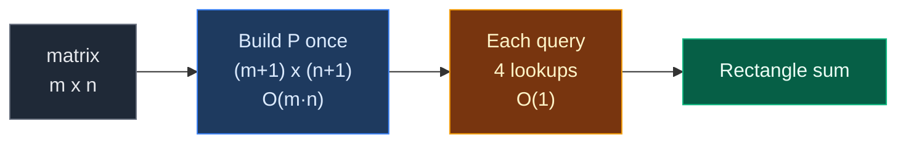

# 01. 304. Range Sum Query 2D - Immutable

| Difficulty | Pattern | Source | Time | Space |
|:---:|:---:|:---:|:---:|:---:|
| **Medium** | 2D Prefix Sum | [304. Range Sum Query 2D - Immutable](https://leetcode.com/problems/range-sum-query-2d-immutable/) | `O(m · n)` build, `O(1)` query | `O(m · n)` |

## 1. Problem Statement

You get a 2D grid of numbers called `matrix`. It never changes.

Build a class `NumMatrix` with:

- `NumMatrix(matrix)`: set things up once.
- `sumRegion(row1, col1, row2, col2)`: return the sum of all numbers inside the rectangle whose top-left corner is `(row1, col1)` and bottom-right corner is `(row2, col2)`. Both corners are included.

`sumRegion` will be called many times, so each call must be fast. LeetCode asks for `O(1)` per call.

### Example

```text
matrix = [[3, 0, 1],
          [5, 6, 3],
          [1, 2, 0]]

        col 0  col 1  col 2
row 0     3      0      1
row 1     5      6      3
row 2     1      2      0

Query A: sumRegion(1, 1, 2, 2)
        col 0  col 1  col 2
row 0     3      0      1
row 1     5    [ 6 ]  [ 3 ]
row 2     1    [ 2 ]  [ 0 ]
Sum = 6 + 3 + 2 + 0 = 11

Query B: sumRegion(0, 1, 1, 2)
        col 0  col 1  col 2
row 0     3    [ 0 ]  [ 1 ]
row 1     5    [ 6 ]  [ 3 ]
row 2     1      2      0
Sum = 0 + 1 + 6 + 3 = 10

Output: 11, 10
```

We use this same example in every section below.

### Constraints

- `m == matrix.length`, `n == matrix[i].length`
- `1 <= m, n <= 200`
- `-10^4 <= matrix[i][j] <= 10^4`
- `0 <= row1 <= row2 < m`
- `0 <= col1 <= col2 < n`
- At most `10^4` calls to `sumRegion`

## 2. Core Theory

This is the first problem of the **2D Prefix Sum** pattern, so we build the idea from zero.

### What the problem really asks

"Give me the sum of any rectangle, many times, fast."

Adding every cell of the rectangle on each call is too slow when there are many calls. We want to do the hard work **once** and then answer each call with a few lookups.

### Step 1: remember 1D prefix sums

For a 1D array, `pre[i]` = sum of the first `i` numbers. Then:

```text
sum of nums[l..r] = pre[r + 1] - pre[l]
```

One subtraction answers any range. We want the same trick for a grid.

### Step 2: the 2D prefix grid

We make a new grid `P` that is **one row and one column bigger** than `matrix`. The extra row 0 and column 0 are all zeros. They are a "padding" so we never go out of bounds.

```text
P[r][c] = sum of the rectangle from (0, 0) to (r - 1, c - 1) in matrix
        = everything above and to the left, including that cell
```

Picture for `P[2][2]` (the top-left 2 x 2 block of `matrix`):

```text
matrix:
  [3][0] 1
  [5][6] 3
   1  2  0

P[2][2] = 3 + 0 + 5 + 6 = 14
```

### Step 3: how to build `P` (add, add, subtract the double)

To fill `P[r + 1][c + 1]` we use the cell itself plus two neighbors that are already filled:

```text
P[r + 1][c + 1] = matrix[r][c]       (the cell itself)
                + P[r][c + 1]        (the block above)
                + P[r + 1][c]        (the block to the left)
                - P[r][c]            (the top-left block, counted twice)
```

```text
   +-----------+---+
   |  P[r][c]  | ^ |   <- "above" block = P[r][c+1]
   |  (twice!) | | |      covers top-left + this column strip
   +-----------+---+
   |  <- left  | X |   X = matrix[r][c]
   +-----------+---+
     "left" block = P[r+1][c] covers top-left + this row strip

above + left counts the top-left block two times, so subtract it once.
```

### Step 4: how to answer a query (the four-corner rule)

To get the rectangle `(r1, c1)` to `(r2, c2)`:

```text
answer = P[r2 + 1][c2 + 1]     (big block from (0,0) to the bottom-right corner)
       - P[r1][c2 + 1]         (cut off the rows above the rectangle)
       - P[r2 + 1][c1]         (cut off the columns left of the rectangle)
       + P[r1][c1]             (the top-left corner block was cut twice, add it back)
```

```text
   +--------+-----------+
   |   D    |     B     |    D = P[r1][c1]
   |        |           |    B + D = P[r1][c2+1]
   +--------+-----------+
   |   C    |  ANSWER   |    C + D = P[r2+1][c1]
   |        |           |    all four = P[r2+1][c2+1]
   +--------+-----------+

ANSWER = all - (B + D) - (C + D) + D
```

This is called **inclusion-exclusion**: add the big piece, remove the two extra strips, add back the part removed twice.



### Why the padding row and column help

Without padding, `P[r1 - 1][...]` breaks when `r1 = 0`. With padding we always read `P[r1][...]`, and when `r1 = 0` that row is just zeros. No `if` checks needed.

### How this connects to other 2D Prefix Sum problems

| Problem | How it uses the prefix grid |
|:---|:---|
| **304. Range Sum Query 2D** | Build `P`, answer each rectangle with 4 lookups |
| 1314. Matrix Block Sum | Every cell asks for a rectangle around it; clamp the corners to the grid |
| 1074. Submatrices That Sum to Target | Fix two rows, squash columns into a 1D array, then use 1D prefix sum + hash map |

## 3. Edge Cases

| Case | Input | Expected | Why it matters |
|:---|:---|:---:|:---|
| Single cell query | `sumRegion(1, 1, 1, 1)` | `6` | Rectangle of size 1 x 1. Formula still works |
| Query starts at row 0 or col 0 | `sumRegion(0, 0, 1, 1)` | `14` | Padding row and column give zeros, so no index `-1` |
| Whole grid | `sumRegion(0, 0, 2, 2)` | `21` | Answer is just `P[m][n]` |
| 1 x 1 matrix | `[[-4]]`, `sumRegion(0,0,0,0)` | `-4` | Smallest grid |
| Negative numbers | `[[-1, -2], [-3, -4]]`, whole grid | `-10` | Prefix sums work with negatives too |
| Single row matrix | `[[1, 2, 3]]`, `sumRegion(0,1,0,2)` | `5` | Becomes normal 1D prefix sum |

## 4. Brute Force: Add Every Cell

### Idea

Store the matrix. For each query, loop over every row and column inside the rectangle and add them up.

### Code

```python
# Import List for type hints
from typing import List


# Brute force: add every cell on every query
class NumMatrixBrute:

    # Save the matrix
    def __init__(self, matrix: List[List[int]]):

        # Keep a reference to the grid
        self.matrix = matrix

    # Add all cells inside the rectangle
    def sumRegion(self, row1: int, col1: int, row2: int, col2: int) -> int:

        # Running total
        total = 0

        # Go through every row of the rectangle
        for r in range(row1, row2 + 1):

            # Go through every column of the rectangle
            for c in range(col1, col2 + 1):

                # Add this cell
                total += self.matrix[r][c]

        # Return the sum
        return total
```

### Complexity

| Measure | Complexity | Why |
|:---|:---:|:---|
| **Time** | `O(m · n)` per query | A query can cover the whole grid. With `10^4` queries on a 200 x 200 grid that is `4 · 10^8` steps |
| **Space** | `O(1)` extra | Only a running total |

## 5. Better Approach: Prefix Sum per Row

### Idea

Build a normal 1D prefix sum for **each row**. A query then takes one subtraction per row:

```text
rowPre[r][c] = sum of matrix[r][0..c-1]
row r part of the rectangle = rowPre[r][col2 + 1] - rowPre[r][col1]
```

For Query A, rows 1 and 2: row 1 gives `6 + 3 = 9`, row 2 gives `2 + 0 = 2`, total `11`.

### Code

```python
# Better: one 1D prefix sum per row
class NumMatrixBetter:

    # Build a prefix sum for every row
    def __init__(self, matrix: List[List[int]]):

        # Number of columns
        n = len(matrix[0])

        # Empty list of row prefix arrays
        self.row_pre = []

        # Handle each row
        for row in matrix:

            # Prefix array starts with a zero
            pre = [0] * (n + 1)

            # Fill the prefix array for this row
            for c in range(n):

                # Sum of first c + 1 numbers in this row
                pre[c + 1] = pre[c] + row[c]

            # Save this row's prefix array
            self.row_pre.append(pre)

    # Add one range sum per row
    def sumRegion(self, row1: int, col1: int, row2: int, col2: int) -> int:

        # Running total
        total = 0

        # Go through every row of the rectangle
        for r in range(row1, row2 + 1):

            # Sum of columns col1..col2 in this row, in O(1)
            total += self.row_pre[r][col2 + 1] - self.row_pre[r][col1]

        # Return the sum
        return total
```

### Complexity

| Measure | Complexity | Why |
|:---|:---:|:---|
| **Time** | `O(m · n)` build, `O(m)` per query | One subtraction per row of the rectangle |
| **Space** | `O(m · n)` | One prefix array per row |

Better, but still not `O(1)` per query. Next we remove the loop over rows too.

## 6. Optimal Approach: 2D Prefix Sum

### Idea

1. Make `P` of size `(m + 1) x (n + 1)`, all zeros.
2. For every cell `(r, c)`: `P[r+1][c+1] = matrix[r][c] + P[r][c+1] + P[r+1][c] - P[r][c]`.
3. For a query: `P[r2+1][c2+1] - P[r1][c2+1] - P[r2+1][c1] + P[r1][c1]`.

### Visual Walkthrough (Story Version)

Before the formulas, let us see the idea as a story.

**The story:** a farmer has a field cut into 3 x 3 plots. Each plot has some apples on it. Every day, customers ask: "How many apples are in this rectangle of plots?" Counting every plot each time is tiring. So the farmer's helper walks the field **once** and puts a **sign** on every plot.

**The rules:**

- A sign says: "Apples in **all plots above me and to my left, including me**."
- There is an extra row of signs on the top edge and an extra column on the left edge. They all say `0` (no plots there).
- To write a new sign, the helper looks at three signs that are already written: the one **above**, the one to the **left**, and the one **diagonally up-left**. Then: my apples + above + left - up-left.
- Why subtract up-left? The "above" sign and the "left" sign both already counted that corner area. Counted twice, so remove it once.

**How to read the pictures:** each picture shows the signs grid (4 x 4, with the zero edge). `( )` marks the sign just written. `.` means not written yet.

**Start: only the zero edge is written**

```text
apples on plots:      signs:
  3  0  1              0  0  0  0
  5  6  3              0  .  .  .
  1  2  0              0  .  .  .
                       0  .  .  .
```

**Step 1: plot (0,0) has 3 apples**

- Above = 0, left = 0, up-left = 0.
- Sign = 3 + 0 + 0 - 0 = **3**.

```text
  0   0   0   0
  0  (3)  .   .
  0   .   .   .
  0   .   .   .
```

**Step 2: plot (0,1) has 0 apples**

- Above = 0, left = 3, up-left = 0.
- Sign = 0 + 0 + 3 - 0 = **3**.

```text
  0   0   0   0
  0   3  (3)  .
  0   .   .   .
  0   .   .   .
```

**Step 3: plot (0,2) has 1 apple**

- Above = 0, left = 3, up-left = 0.
- Sign = 1 + 0 + 3 - 0 = **4**. The whole top row has 4 apples.

```text
  0   0   0   0
  0   3   3  (4)
  0   .   .   .
  0   .   .   .
```

**Step 4: plot (1,0) has 5 apples**

- Above = 3, left = 0, up-left = 0.
- Sign = 5 + 3 + 0 - 0 = **8**.

```text
  0   0   0   0
  0   3   3   4
  0  (8)  .   .
  0   .   .   .
```

**Step 5: plot (1,1) has 6 apples**

- Above = 3, left = 8, up-left = 3.
- The plot with 3 apples is inside "above" **and** inside "left". Counted twice.
- Sign = 6 + 3 + 8 - 3 = **14**.

```text
  0   0   0   0
  0   3   3   4
  0   8  (14) .
  0   .   .   .
```

**Step 6: plot (1,2) has 3 apples**

- Above = 4, left = 14, up-left = 3.
- Sign = 3 + 4 + 14 - 3 = **18**.

```text
  0   0   0   0
  0   3   3   4
  0   8   14 (18)
  0   .   .   .
```

**Step 7: plot (2,0) has 1 apple**

- Above = 8, left = 0, up-left = 0.
- Sign = 1 + 8 + 0 - 0 = **9**.

```text
  0   0   0   0
  0   3   3   4
  0   8   14  18
  0  (9)  .   .
```

**Step 8: plot (2,1) has 2 apples**

- Above = 14, left = 9, up-left = 8.
- Sign = 2 + 14 + 9 - 8 = **17**.

```text
  0   0   0   0
  0   3   3   4
  0   8   14  18
  0   9  (17) .
```

**Step 9: plot (2,2) has 0 apples**

- Above = 18, left = 17, up-left = 14.
- Sign = 0 + 18 + 17 - 14 = **21**. That is every apple in the field.

```text
  0   0   0   0
  0   3   3   4
  0   8   14  18
  0   9   17 (21)
```

**Customer A asks: plots from (1,1) to (2,2)?**

The helper reads just four signs. `[ ]` = add, `{ }` = subtract.

```text
  0    0    0    0
  0   {3}   3   {4}       21 = all apples up to the bottom-right
  0    8   14   18        - 4 = the top strip we do not want
  0   {9}  17  [21]       - 9 = the left strip we do not want
                          + 3 = the corner removed twice, add back
```

- 21 - 4 - 9 + 3 = **11** apples.

**Customer B asks: plots from (0,1) to (1,2)?**

```text
 {0}   0    0   {0}       18 = all apples up to (1,2)
  0    3    3    4        - 0 = no strip above (top edge)
 {8}  14  [18]            - 8 = the left strip (column 0, rows 0-1)
  0    9   17   21        + 0 = corner is the zero edge
```

- 18 - 0 - 8 + 0 = **10** apples.

**All steps at a glance**

| Step | Plot | Apples | Above | Left | Up-left | Sign |
|:---:|:---:|:---:|:---:|:---:|:---:|:---:|
| 1 | (0,0) | 3 | 0 | 0 | 0 | 3 |
| 2 | (0,1) | 0 | 0 | 3 | 0 | 3 |
| 3 | (0,2) | 1 | 0 | 3 | 0 | 4 |
| 4 | (1,0) | 5 | 3 | 0 | 0 | 8 |
| 5 | (1,1) | 6 | 3 | 8 | 3 | 14 |
| 6 | (1,2) | 3 | 4 | 14 | 3 | 18 |
| 7 | (2,0) | 1 | 8 | 0 | 0 | 9 |
| 8 | (2,1) | 2 | 14 | 9 | 8 | 17 |
| 9 | (2,2) | 0 | 18 | 17 | 14 | 21 |
| A | (1,1)-(2,2) | – | – | – | – | 21 - 4 - 9 + 3 = 11 |
| B | (0,1)-(1,2) | – | – | – | – | 18 - 0 - 8 + 0 = 10 |

**What the story teaches**

| In the story | In the code |
|:---|:---|
| Plot | Cell `matrix[r][c]` |
| Sign on a plot | `P[r + 1][c + 1]` |
| Zero edge of signs | Padding row 0 and column 0 of `P` |
| Above, left, up-left signs | `P[r][c + 1]`, `P[r + 1][c]`, `P[r][c]` |
| "Counted twice, remove once" | `- P[r][c]` in the build |
| Reading four signs for a customer | The four lookups in `sumRegion` |
| "Corner removed twice, add back" | `+ P[r1][c1]` in the query |

Now the same steps again, this time with the exact indexes.

### Step-by-Step Example

```text
matrix = [[3, 0, 1],
          [5, 6, 3],
          [1, 2, 0]]
m = 3, n = 3
```

**Start: `P` is 4 x 4, all zeros**

```text
        c=0 c=1 c=2 c=3
P r=0:   0   0   0   0
P r=1:   0   0   0   0
P r=2:   0   0   0   0
P r=3:   0   0   0   0
```

**Build, row `r = 0`**

1. `c = 0`: `P[1][1] = matrix[0][0] + P[0][1] + P[1][0] - P[0][0] = 3 + 0 + 0 - 0 = 3`
2. `c = 1`: `P[1][2] = matrix[0][1] + P[0][2] + P[1][1] - P[0][1] = 0 + 0 + 3 - 0 = 3`
3. `c = 2`: `P[1][3] = matrix[0][2] + P[0][3] + P[1][2] - P[0][2] = 1 + 0 + 3 - 0 = 4`

```text
P r=0:   0   0   0   0
P r=1:   0   3   3   4
P r=2:   0   0   0   0
P r=3:   0   0   0   0
```

**Build, row `r = 1`**

4. `c = 0`: `P[2][1] = matrix[1][0] + P[1][1] + P[2][0] - P[1][0] = 5 + 3 + 0 - 0 = 8`
5. `c = 1`: `P[2][2] = matrix[1][1] + P[1][2] + P[2][1] - P[1][1] = 6 + 3 + 8 - 3 = 14`
6. `c = 2`: `P[2][3] = matrix[1][2] + P[1][3] + P[2][2] - P[1][2] = 3 + 4 + 14 - 3 = 18`

```text
P r=0:   0   0   0   0
P r=1:   0   3   3   4
P r=2:   0   8  14  18
P r=3:   0   0   0   0
```

**Build, row `r = 2`**

7. `c = 0`: `P[3][1] = matrix[2][0] + P[2][1] + P[3][0] - P[2][0] = 1 + 8 + 0 - 0 = 9`
8. `c = 1`: `P[3][2] = matrix[2][1] + P[2][2] + P[3][1] - P[2][1] = 2 + 14 + 9 - 8 = 17`
9. `c = 2`: `P[3][3] = matrix[2][2] + P[2][3] + P[3][2] - P[2][2] = 0 + 18 + 17 - 14 = 21`

```text
P r=0:   0   0   0   0
P r=1:   0   3   3   4
P r=2:   0   8  14  18
P r=3:   0   9  17  21
```

Check: `P[3][3] = 21` and `3+0+1+5+6+3+1+2+0 = 21`. Correct.

**Query A: `sumRegion(1, 1, 2, 2)`**

- `row1 = 1, col1 = 1, row2 = 2, col2 = 2`
- `P[row2 + 1][col2 + 1] = P[3][3] = 21`
- `P[row1][col2 + 1] = P[1][3] = 4`
- `P[row2 + 1][col1] = P[3][1] = 9`
- `P[row1][col1] = P[1][1] = 3`
- Answer = `21 - 4 - 9 + 3 = 11`

**Query B: `sumRegion(0, 1, 1, 2)`**

- `row1 = 0, col1 = 1, row2 = 1, col2 = 2`
- `P[row2 + 1][col2 + 1] = P[2][3] = 18`
- `P[row1][col2 + 1] = P[0][3] = 0` (padding row)
- `P[row2 + 1][col1] = P[2][1] = 8`
- `P[row1][col1] = P[0][1] = 0` (padding row)
- Answer = `18 - 0 - 8 + 0 = 10`

### Code

```python
# Optimal: 2D prefix sum with a zero border
class NumMatrix:

    # Build the prefix grid once
    def __init__(self, matrix: List[List[int]]):

        # Number of rows
        m = len(matrix)

        # Number of columns
        n = len(matrix[0])

        # Prefix grid with one extra row and column of zeros
        self.P = [[0] * (n + 1) for _ in range(m + 1)]

        # Go through every row
        for r in range(m):

            # Go through every column
            for c in range(n):

                # Cell + block above + block left - top-left block counted twice
                self.P[r + 1][c + 1] = (matrix[r][c] + self.P[r][c + 1] + self.P[r + 1][c] - self.P[r][c])

    # Answer one rectangle with four lookups
    def sumRegion(self, row1: int, col1: int, row2: int, col2: int) -> int:

        # Short name for the prefix grid
        P = self.P

        # Big block - strip above - strip left + corner added back
        return P[row2 + 1][col2 + 1] - P[row1][col2 + 1] - P[row2 + 1][col1] + P[row1][col1]


# The example from this note
matrix = [[3, 0, 1], [5, 6, 3], [1, 2, 0]]

# Build the prefix grid
obj = NumMatrix(matrix)

# Start: padding row stays all zeros
assert obj.P[0] == [0, 0, 0, 0]

# After build row r = 0 (steps 1-3)
assert obj.P[1] == [0, 3, 3, 4]

# After build row r = 1 (steps 4-6)
assert obj.P[2] == [0, 8, 14, 18]

# After build row r = 2 (steps 7-9)
assert obj.P[3] == [0, 9, 17, 21]

# Query A: 21 - 4 - 9 + 3
assert obj.sumRegion(1, 1, 2, 2) == 11

# Query B: 18 - 0 - 8 + 0
assert obj.sumRegion(0, 1, 1, 2) == 10

# LeetCode example
lc = [[3, 0, 1, 4, 2], [5, 6, 3, 2, 1], [1, 2, 0, 1, 5], [4, 1, 0, 1, 7], [1, 0, 3, 0, 5]]

# Build for the LeetCode grid
lc_obj = NumMatrix(lc)

# LeetCode query 1
assert lc_obj.sumRegion(2, 1, 4, 3) == 8

# LeetCode query 2
assert lc_obj.sumRegion(1, 1, 2, 2) == 11

# LeetCode query 3
assert lc_obj.sumRegion(1, 2, 2, 4) == 12

# Edge case: single cell
assert obj.sumRegion(1, 1, 1, 1) == 6

# Edge case: starts at row 0 and col 0
assert obj.sumRegion(0, 0, 1, 1) == 14

# Edge case: whole grid
assert obj.sumRegion(0, 0, 2, 2) == 21

# Edge case: 1 x 1 matrix
assert NumMatrix([[-4]]).sumRegion(0, 0, 0, 0) == -4

# Edge case: negatives
assert NumMatrix([[-1, -2], [-3, -4]]).sumRegion(0, 0, 1, 1) == -10

# Edge case: single row
assert NumMatrix([[1, 2, 3]]).sumRegion(0, 1, 0, 2) == 5

# Import random for comparison tests
import random

# Compare brute, better and optimal on random grids
for _ in range(200):

    # Random size
    m, n = random.randint(1, 6), random.randint(1, 6)

    # Random grid with negatives
    g = [[random.randint(-9, 9) for _ in range(n)] for _ in range(m)]

    # Build all three versions
    a, b, c = NumMatrixBrute(g), NumMatrixBetter(g), NumMatrix(g)

    # Random top row and bottom row
    r1, r2 = sorted(random.randint(0, m - 1) for _ in range(2))

    # Random left column and right column
    c1, c2 = sorted(random.randint(0, n - 1) for _ in range(2))

    # All three must agree
    assert a.sumRegion(r1, c1, r2, c2) == b.sumRegion(r1, c1, r2, c2) == c.sumRegion(r1, c1, r2, c2)

# All checks passed
print("All tests passed")
```

### Complexity

| Measure | Complexity | Why |
|:---|:---:|:---|
| **Time** | `O(m · n)` build, `O(1)` query | Each cell of `P` is filled once with 4 reads. Each query is 4 reads |
| **Space** | `O(m · n)` | The `(m + 1) x (n + 1)` prefix grid |

## 7. Common Mistakes

| Mistake | What goes wrong | Fix |
|:---|:---|:---|
| Forgetting `- P[r][c]` in the build | The top-left block is counted twice, every value grows too big | Add above + left, then subtract up-left |
| Forgetting `+ P[r1][c1]` in the query | The corner block is removed twice, answer too small | Big block - two strips + corner |
| No padding row and column | `P[r1 - 1]` becomes `P[-1]` when `r1 = 0`. Python silently reads the last row | Use size `(m + 1) x (n + 1)` and shift indexes by 1 |
| Mixing `+1` shifts | Using `P[r2][c2]` instead of `P[r2 + 1][c2 + 1]` drops the last row and column | Bottom-right uses `+1`, top-left does not |
| Building `P` as `[[0] * (n + 1)] * (m + 1)` | All rows are the same list. Changing one row changes all | Use a list comprehension |

## 8. Interview Follow-ups

### Q1. What if the matrix can change (updates between queries)?

**Answer:**
- Prefix sums break, because one update changes `O(m · n)` signs.
- Use a **2D Binary Indexed Tree (Fenwick tree)**. Update and query are both `O(log m · log n)`.
- That is LeetCode 308, Range Sum Query 2D - Mutable.

### Q2. Can we build the prefix grid in place, with no extra space?

**Answer:**
- Yes, you can overwrite `matrix` with prefix values if you are allowed to change it.
- But then you lose the padding, so the query needs `if` checks for `row1 = 0` and `col1 = 0`.
- The extra `O(m · n)` space is usually worth the cleaner code.

### Q3. Could the sums overflow?

**Answer:**
- In Python, no. Integers grow as needed.
- In Java or C++, the max total is `200 · 200 · 10^4 = 4 · 10^8`, which fits in a 32-bit int. For bigger limits use `long`.

### Q4. How does this extend to 3D?

**Answer:**
- Same idea: `P[x][y][z]` = sum of the box from the origin.
- Build and query use inclusion-exclusion with 8 corners: add 1, subtract 3, add 3, subtract 1.

### Q5. Why is the build order (row by row, left to right) important?

**Answer:**
- Each sign needs above, left and up-left to be ready.
- Row by row, left to right, makes sure all three are filled before we need them.

## 9. Interview Explanation

> Since the matrix never changes and there are many queries, I precompute a 2D prefix grid P with one extra row and column of zeros. P[r+1][c+1] is the sum of everything from the top-left corner down to cell (r, c), built as the cell plus the block above plus the block to the left minus the top-left block, which got counted twice. A rectangle query is then the big block up to the bottom-right corner, minus the strip above, minus the strip to the left, plus the corner that was removed twice. Building takes O(m · n) time and space, and every query is O(1).
