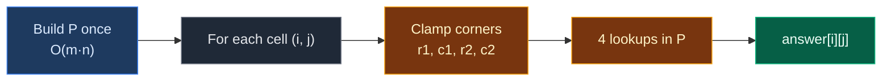

# 02. 1314. Matrix Block Sum

| Difficulty | Pattern | Source | Time | Space |
|:---:|:---:|:---:|:---:|:---:|
| **Medium** | 2D Prefix Sum | [1314. Matrix Block Sum](https://leetcode.com/problems/matrix-block-sum/) | `O(m · n)` | `O(m · n)` |

## 1. Problem Statement

You get an `m x n` grid `mat` and a number `k`.

Return a new grid `answer` of the same size. Each `answer[i][j]` is the sum of every `mat[r][c]` where:

- `i - k <= r <= i + k`
- `j - k <= c <= j + k`
- `(r, c)` is inside the grid

In plain words: for every cell, add up the square of cells around it that reaches `k` steps in every direction. Parts of the square that fall outside the grid are ignored.

### Example

```text
mat = [[1, 2, 3],
       [4, 5, 6],
       [7, 8, 9]]
k = 1

Block for cell (0, 0):         Block for cell (1, 1):
  [1][2] 3                       [1][2][3]
  [4][5] 6                       [4][5][6]
   7  8  9                       [7][8][9]
  1+2+4+5 = 12                   all nine = 45

Output:
[[12, 21, 16],
 [27, 45, 33],
 [24, 39, 28]]
```

We use this same example in every section below.

### Constraints

- `m == mat.length`, `n == mat[i].length`
- `1 <= m, n, k <= 100`
- `1 <= mat[i][j] <= 100`

## 2. Core Theory

This note builds on [01. 304. Range Sum Query 2D - Immutable](./01.%20304.%20Range%20Sum%20Query%202D%20-%20Immutable.md). Read that first if the prefix grid `P` and the four-corner rule are new to you.

Quick reminder:

```text
Build:  P[r+1][c+1] = mat[r][c] + P[r][c+1] + P[r+1][c] - P[r][c]
Query:  sum(r1, c1, r2, c2) = P[r2+1][c2+1] - P[r1][c2+1] - P[r2+1][c1] + P[r1][c1]
```

### What the problem really asks

Every cell asks one rectangle-sum question. There are `m · n` cells, so there are `m · n` questions on a grid that never changes. That is exactly problem 304, with the questions decided for us.

### The only new part: clamping

The block for cell `(i, j)` is rows `i - k .. i + k` and columns `j - k .. j + k`. Near the edges, these go outside the grid. We **clamp** (cut) them back inside:

```text
r1 = max(0, i - k)          c1 = max(0, j - k)
r2 = min(m - 1, i + k)      c2 = min(n - 1, j + k)
```

Picture for cell `(0, 0)` with `k = 1`:

```text
       c=-1  c=0  c=1  c=2
r=-1    x     x    x          <- outside, cut away
r=0     x    [1]  [2]   3
r=1     x    [4]  [5]   6
r=2           7    8    9

Wanted: rows -1..1, cols -1..1
Clamped: rows 0..1, cols 0..1
```

After clamping, the block is a normal rectangle inside the grid, and the four-corner rule answers it in `O(1)`.



## 3. Edge Cases

| Case | Input | Expected | Why it matters |
|:---|:---|:---:|:---|
| `k` bigger than the grid | `mat = [[1,2],[3,4]], k = 5` | `[[10,10],[10,10]]` | Every block clamps to the whole grid |
| 1 x 1 grid | `[[7]], k = 1` | `[[7]]` | All four sides get clamped |
| Single row | `[[1,2,3]], k = 1` | `[[3,6,5]]` | Rows clamp to row 0 only. Acts like 1D |
| Corner cells | `(0,0)` in the example | `12` | Two sides clamped |
| Middle cell with `k` covering all | `(1,1)` in the example | `45` | No clamping happens |

## 4. Brute Force: Add Every Cell of Every Block

### Idea

For each cell, loop over its clamped block and add every value.

### Code

```python
# Import List for type hints
from typing import List


# Brute force: add the whole block for every cell
class SolutionBrute:

    # Main method
    def matrixBlockSum(self, mat: List[List[int]], k: int) -> List[List[int]]:

        # Number of rows
        m = len(mat)

        # Number of columns
        n = len(mat[0])

        # Answer grid filled with zeros
        answer = [[0] * n for _ in range(m)]

        # Go through every row
        for i in range(m):

            # Go through every column
            for j in range(n):

                # Top row of the block, clamped
                r1 = max(0, i - k)

                # Bottom row of the block, clamped
                r2 = min(m - 1, i + k)

                # Left column of the block, clamped
                c1 = max(0, j - k)

                # Right column of the block, clamped
                c2 = min(n - 1, j + k)

                # Go through every row of the block
                for r in range(r1, r2 + 1):

                    # Go through every column of the block
                    for c in range(c1, c2 + 1):

                        # Add this cell to the answer
                        answer[i][j] += mat[r][c]

        # Return the answer grid
        return answer
```

### Complexity

| Measure | Complexity | Why |
|:---|:---:|:---|
| **Time** | `O(m · n · k²)` | Each of `m · n` cells adds up to `(2k + 1)²` values |
| **Space** | `O(1)` extra | Only the output |

## 5. Better Approach: Prefix Sum per Row

### Idea

Build a 1D prefix sum for each row. Then each row of a block costs one subtraction instead of `2k + 1` additions.

```text
row r part of the block = rowPre[r][c2 + 1] - rowPre[r][c1]
```

### Code

```python
# Better: row prefix sums
class SolutionBetter:

    # Main method
    def matrixBlockSum(self, mat: List[List[int]], k: int) -> List[List[int]]:

        # Number of rows
        m = len(mat)

        # Number of columns
        n = len(mat[0])

        # One prefix array per row, each starting with 0
        row_pre = [[0] * (n + 1) for _ in range(m)]

        # Fill every row's prefix array
        for r in range(m):

            # Go through every column of this row
            for c in range(n):

                # Sum of the first c + 1 numbers in row r
                row_pre[r][c + 1] = row_pre[r][c] + mat[r][c]

        # Answer grid filled with zeros
        answer = [[0] * n for _ in range(m)]

        # Go through every row
        for i in range(m):

            # Go through every column
            for j in range(n):

                # Left column of the block, clamped
                c1 = max(0, j - k)

                # Right column of the block, clamped
                c2 = min(n - 1, j + k)

                # Go through every row of the block, clamped
                for r in range(max(0, i - k), min(m - 1, i + k) + 1):

                    # Add this row's part in O(1)
                    answer[i][j] += row_pre[r][c2 + 1] - row_pre[r][c1]

        # Return the answer grid
        return answer
```

### Complexity

| Measure | Complexity | Why |
|:---|:---:|:---|
| **Time** | `O(m · n · k)` | Each cell does one subtraction per block row |
| **Space** | `O(m · n)` | Row prefix arrays |

## 6. Optimal Approach: 2D Prefix Sum + Clamping

### Idea

1. Build the padded prefix grid `P` (same as 304).
2. For each cell `(i, j)`, clamp the block corners to the grid.
3. Fill `answer[i][j]` with the four-corner rule.

### Visual Walkthrough (Story Version)

**The story:** a 3 x 3 village has one house on each plot. Each house has some candies. Every child wants to know: "How many candies are in my **neighborhood**?" A neighborhood is my house plus every house at most `k = 1` step away, in any direction, including diagonals. The village has a wall. Houses outside the wall do not exist.

The village helper first puts a **sign** on each house, just like the farmer's helper in problem 304: "candies in all houses above me and to my left, including me". Then every child reads only four signs.

**How to read the pictures:** `[ ]` marks houses inside the child's neighborhood. `*` marks the child. The sign grid has a zero edge on top and left.

**Start: candies on each house**

```text
  1  2  3
  4  5  6
  7  8  9
```

**Build signs, row 0:** `1`, then `1 + 2 = 3`, then `3 + 3 = 6`.

```text
signs:  0  0  0  0
        0  1  3  6
        0  .  .  .
        0  .  .  .
```

**Build signs, row 1:** `4 + 1 = 5`, then `5 + 3 + 5 - 1 = 12`, then `6 + 6 + 12 - 3 = 21`.

```text
signs:  0  0  0  0
        0  1  3  6
        0  5 12 21
        0  .  .  .
```

**Build signs, row 2:** `7 + 5 = 12`, then `8 + 12 + 12 - 5 = 27`, then `9 + 21 + 27 - 12 = 45`.

```text
signs:  0  0  0  0
        0  1  3  6
        0  5 12 21
        0 12 27 45
```

**Child at (0,0)**

- Neighborhood rows `-1..1` → wall cuts it to `0..1`. Columns `-1..1` → `0..1`.
- Signs: `P[2][2] - P[0][2] - P[2][0] + P[0][0] = 12 - 0 - 0 + 0 =` **12**.

```text
 [1*][2]  3
 [4] [5]  6
  7   8   9
```

**Child at (0,1)**

- Rows `0..1`, columns `0..2`.
- Signs: `P[2][3] - P[0][3] - P[2][0] + P[0][0] = 21 - 0 - 0 + 0 =` **21**.

```text
 [1][2*][3]
 [4][5] [6]
  7  8   9
```

**Child at (0,2)**

- Rows `0..1`, columns `1..2`.
- Signs: `P[2][3] - P[0][3] - P[2][1] + P[0][1] = 21 - 0 - 5 + 0 =` **16**.

```text
  1 [2][3*]
  4 [5][6]
  7  8  9
```

**Child at (1,0)**

- Rows `0..2`, columns `0..1`.
- Signs: `P[3][2] - P[0][2] - P[3][0] + P[0][0] = 27 - 0 - 0 + 0 =` **27**.

```text
 [1] [2]  3
 [4*][5]  6
 [7] [8]  9
```

**Child at (1,1)**

- Rows `0..2`, columns `0..2`. The wall cuts nothing.
- Signs: `P[3][3] - P[0][3] - P[3][0] + P[0][0] = 45 - 0 - 0 + 0 =` **45**.

```text
 [1][2] [3]
 [4][5*][6]
 [7][8] [9]
```

**Child at (1,2)**

- Rows `0..2`, columns `1..2`.
- Signs: `P[3][3] - P[0][3] - P[3][1] + P[0][1] = 45 - 0 - 12 + 0 =` **33**.

```text
  1 [2][3]
  4 [5][6*]
  7 [8][9]
```

**Child at (2,0)**

- Rows `1..2`, columns `0..1`.
- Signs: `P[3][2] - P[1][2] - P[3][0] + P[1][0] = 27 - 3 - 0 + 0 =` **24**.

```text
  1   2   3
 [4] [5]  6
 [7*][8]  9
```

**Child at (2,1)**

- Rows `1..2`, columns `0..2`.
- Signs: `P[3][3] - P[1][3] - P[3][0] + P[1][0] = 45 - 6 - 0 + 0 =` **39**.

```text
  1  2   3
 [4][5] [6]
 [7][8*][9]
```

**Child at (2,2)**

- Rows `1..2`, columns `1..2`.
- Signs: `P[3][3] - P[1][3] - P[3][1] + P[1][1] = 45 - 6 - 12 + 1 =` **28**.

```text
  1  2  3
  4 [5][6]
  7 [8][9*]
```

**All children at a glance**

| Child | Rows | Cols | Big | - Top strip | - Left strip | + Corner | Candies |
|:---:|:---:|:---:|:---:|:---:|:---:|:---:|:---:|
| (0,0) | 0..1 | 0..1 | 12 | 0 | 0 | 0 | 12 |
| (0,1) | 0..1 | 0..2 | 21 | 0 | 0 | 0 | 21 |
| (0,2) | 0..1 | 1..2 | 21 | 0 | 5 | 0 | 16 |
| (1,0) | 0..2 | 0..1 | 27 | 0 | 0 | 0 | 27 |
| (1,1) | 0..2 | 0..2 | 45 | 0 | 0 | 0 | 45 |
| (1,2) | 0..2 | 1..2 | 45 | 0 | 12 | 0 | 33 |
| (2,0) | 1..2 | 0..1 | 27 | 3 | 0 | 0 | 24 |
| (2,1) | 1..2 | 0..2 | 45 | 6 | 0 | 0 | 39 |
| (2,2) | 1..2 | 1..2 | 45 | 6 | 12 | 1 | 28 |

**What the story teaches**

| In the story | In the code |
|:---|:---|
| House with candies | `mat[r][c]` |
| Neighborhood | Block `i-k..i+k`, `j-k..j+k` |
| Village wall | Clamping with `max(0, ...)` and `min(m-1, ...)` |
| Signs on houses | Prefix grid `P` |
| Reading four signs | Four-corner rule |
| Child's total | `answer[i][j]` |

Now the same steps again, this time with the exact indexes.

### Step-by-Step Example

```text
mat = [[1, 2, 3], [4, 5, 6], [7, 8, 9]], k = 1, m = 3, n = 3
```

**Part 1: build `P` (4 x 4, starts all zeros)**

Row `r = 0`:

1. `P[1][1] = mat[0][0] + P[0][1] + P[1][0] - P[0][0] = 1 + 0 + 0 - 0 = 1`
2. `P[1][2] = mat[0][1] + P[0][2] + P[1][1] - P[0][1] = 2 + 0 + 1 - 0 = 3`
3. `P[1][3] = mat[0][2] + P[0][3] + P[1][2] - P[0][2] = 3 + 0 + 3 - 0 = 6`

Row `r = 1`:

4. `P[2][1] = mat[1][0] + P[1][1] + P[2][0] - P[1][0] = 4 + 1 + 0 - 0 = 5`
5. `P[2][2] = mat[1][1] + P[1][2] + P[2][1] - P[1][1] = 5 + 3 + 5 - 1 = 12`
6. `P[2][3] = mat[1][2] + P[1][3] + P[2][2] - P[1][2] = 6 + 6 + 12 - 3 = 21`

Row `r = 2`:

7. `P[3][1] = mat[2][0] + P[2][1] + P[3][0] - P[2][0] = 7 + 5 + 0 - 0 = 12`
8. `P[3][2] = mat[2][1] + P[2][2] + P[3][1] - P[2][1] = 8 + 12 + 12 - 5 = 27`
9. `P[3][3] = mat[2][2] + P[2][3] + P[3][2] - P[2][2] = 9 + 21 + 27 - 12 = 45`

```text
P r=0:  0  0  0  0
P r=1:  0  1  3  6
P r=2:  0  5 12 21
P r=3:  0 12 27 45
```

**Part 2: fill `answer`**

For each cell: `r1 = max(0, i-1)`, `r2 = min(2, i+1)`, `c1 = max(0, j-1)`, `c2 = min(2, j+1)`, then
`answer[i][j] = P[r2+1][c2+1] - P[r1][c2+1] - P[r2+1][c1] + P[r1][c1]`.

| Step | `(i, j)` | `r1, r2` | `c1, c2` | `P[r2+1][c2+1]` | `P[r1][c2+1]` | `P[r2+1][c1]` | `P[r1][c1]` | `answer[i][j]` |
|:---:|:---:|:---:|:---:|:---:|:---:|:---:|:---:|:---:|
| 10 | (0,0) | 0, 1 | 0, 1 | `P[2][2]` = 12 | `P[0][2]` = 0 | `P[2][0]` = 0 | `P[0][0]` = 0 | 12 |
| 11 | (0,1) | 0, 1 | 0, 2 | `P[2][3]` = 21 | `P[0][3]` = 0 | `P[2][0]` = 0 | `P[0][0]` = 0 | 21 |
| 12 | (0,2) | 0, 1 | 1, 2 | `P[2][3]` = 21 | `P[0][3]` = 0 | `P[2][1]` = 5 | `P[0][1]` = 0 | 16 |
| 13 | (1,0) | 0, 2 | 0, 1 | `P[3][2]` = 27 | `P[0][2]` = 0 | `P[3][0]` = 0 | `P[0][0]` = 0 | 27 |
| 14 | (1,1) | 0, 2 | 0, 2 | `P[3][3]` = 45 | `P[0][3]` = 0 | `P[3][0]` = 0 | `P[0][0]` = 0 | 45 |
| 15 | (1,2) | 0, 2 | 1, 2 | `P[3][3]` = 45 | `P[0][3]` = 0 | `P[3][1]` = 12 | `P[0][1]` = 0 | 33 |
| 16 | (2,0) | 1, 2 | 0, 1 | `P[3][2]` = 27 | `P[1][2]` = 3 | `P[3][0]` = 0 | `P[1][0]` = 0 | 24 |
| 17 | (2,1) | 1, 2 | 0, 2 | `P[3][3]` = 45 | `P[1][3]` = 6 | `P[3][0]` = 0 | `P[1][0]` = 0 | 39 |
| 18 | (2,2) | 1, 2 | 1, 2 | `P[3][3]` = 45 | `P[1][3]` = 6 | `P[3][1]` = 12 | `P[1][1]` = 1 | 28 |

`answer` after each row:

```text
after i = 0:  [[12, 21, 16], [ 0,  0,  0], [ 0,  0,  0]]
after i = 1:  [[12, 21, 16], [27, 45, 33], [ 0,  0,  0]]
after i = 2:  [[12, 21, 16], [27, 45, 33], [24, 39, 28]]
```

### Code

```python
# Optimal: 2D prefix sum with clamped corners
class Solution:

    # Main method
    def matrixBlockSum(self, mat: List[List[int]], k: int) -> List[List[int]]:

        # Number of rows
        m = len(mat)

        # Number of columns
        n = len(mat[0])

        # Prefix grid with a zero border
        P = [[0] * (n + 1) for _ in range(m + 1)]

        # Build the prefix grid row by row
        for r in range(m):

            # Go through every column
            for c in range(n):

                # Cell + above + left - top-left counted twice
                P[r + 1][c + 1] = mat[r][c] + P[r][c + 1] + P[r + 1][c] - P[r][c]

        # Save the grid so the tests can look at it
        self.P = P

        # Answer grid filled with zeros
        answer = [[0] * n for _ in range(m)]

        # Go through every row
        for i in range(m):

            # Go through every column
            for j in range(n):

                # Top row of the block, clamped to the grid
                r1 = max(0, i - k)

                # Bottom row of the block, clamped to the grid
                r2 = min(m - 1, i + k)

                # Left column of the block, clamped to the grid
                c1 = max(0, j - k)

                # Right column of the block, clamped to the grid
                c2 = min(n - 1, j + k)

                # Four-corner rule
                answer[i][j] = P[r2 + 1][c2 + 1] - P[r1][c2 + 1] - P[r2 + 1][c1] + P[r1][c1]

        # Return the answer grid
        return answer


# The example from this note
mat = [[1, 2, 3], [4, 5, 6], [7, 8, 9]]

# Run the solution
sol = Solution()

# Get the answer
res = sol.matrixBlockSum(mat, 1)

# Part 1, steps 1-3: prefix row r = 0
assert sol.P[1] == [0, 1, 3, 6]

# Part 1, steps 4-6: prefix row r = 1
assert sol.P[2] == [0, 5, 12, 21]

# Part 1, steps 7-9: prefix row r = 2
assert sol.P[3] == [0, 12, 27, 45]

# Part 2, steps 10-12: answer row i = 0
assert res[0] == [12, 21, 16]

# Part 2, steps 13-15: answer row i = 1
assert res[1] == [27, 45, 33]

# Part 2, steps 16-18: answer row i = 2
assert res[2] == [24, 39, 28]

# LeetCode example 2: k = 2 covers the whole grid for every cell
assert Solution().matrixBlockSum(mat, 2) == [[45, 45, 45], [45, 45, 45], [45, 45, 45]]

# Edge case: k bigger than the grid
assert Solution().matrixBlockSum([[1, 2], [3, 4]], 5) == [[10, 10], [10, 10]]

# Edge case: 1 x 1 grid
assert Solution().matrixBlockSum([[7]], 1) == [[7]]

# Edge case: single row
assert Solution().matrixBlockSum([[1, 2, 3]], 1) == [[3, 6, 5]]

# Import random for comparison tests
import random

# Compare brute, better and optimal on random grids
for _ in range(200):

    # Random size
    m, n = random.randint(1, 6), random.randint(1, 6)

    # Random grid
    g = [[random.randint(1, 100) for _ in range(n)] for _ in range(m)]

    # Random k
    kk = random.randint(1, 4)

    # All three must agree
    assert SolutionBrute().matrixBlockSum(g, kk) == SolutionBetter().matrixBlockSum(g, kk) == Solution().matrixBlockSum(g, kk)

# All checks passed
print("All tests passed")
```

### Complexity

| Measure | Complexity | Why |
|:---|:---:|:---|
| **Time** | `O(m · n)` | Build `P` in `O(m · n)`, then `O(1)` per cell. `k` does not matter |
| **Space** | `O(m · n)` | The prefix grid (the output is not counted) |

## 7. Common Mistakes

| Mistake | What goes wrong | Fix |
|:---|:---|:---|
| Not clamping | Negative indexes read from the other end in Python, or index error past the end | `max(0, ...)` for top/left, `min(m-1, ...)` / `min(n-1, ...)` for bottom/right |
| Clamping `r2` to `m` instead of `m - 1` | Then `P[r2 + 1]` is out of range | Clamp to the last real index, then add 1 in the lookup |
| Writing the answer into `mat` while reading it | Later cells read changed values | Build `P` first, or write to a new grid |
| Forgetting the `- P[r][c]` in the build | Prefix values too big | Above + left - up-left |
| Thinking time depends on `k` | Over-thinking optimisation | With `P`, every block costs 4 lookups no matter its size |

## 8. Interview Follow-ups

### Q1. Can this be done with less extra space?

**Answer:**
- You can build `P` inside the answer grid, but you still need the prefix values while filling the answers.
- A clean `O(1)` extra-space version is tricky. `O(m · n)` is the expected answer.

### Q2. What if the block is not a square, like `k1` rows and `k2` columns?

**Answer:**
- Only the clamping changes: use `i ± k1` for rows and `j ± k2` for columns.
- The four-corner rule stays the same.

### Q3. Can we solve it with a sliding window instead?

**Answer:**
- Yes. First slide a window of width `2k + 1` along every row, then slide one down every column of that result.
- That is also `O(m · n)` and is the 2D version of "running window sum".
- Prefix sums are usually easier to get right.

### Q4. What is the largest possible value of one answer cell?

**Answer:**
- Whole grid: `100 · 100 · 100 = 10^6`. Fits in a 32-bit int easily.

### Q5. Where does this idea show up in real life?

**Answer:**
- Image blur (box filter): each pixel becomes the average of its neighborhood.
- Summed-area tables in graphics use exactly this prefix grid.

## 9. Interview Explanation

> Each cell asks for the sum of a square around it, so this is many rectangle-sum queries on a fixed grid. I build a padded 2D prefix grid in O(m · n), where each entry is the cell plus the block above plus the block to the left minus the top-left block. Then for each cell I clamp the square to the grid with max and min, and use the four-corner rule: the big block minus the strip above minus the strip to the left plus the corner. Each cell is O(1), so the whole thing is O(m · n) time and space, no matter how big k is.
