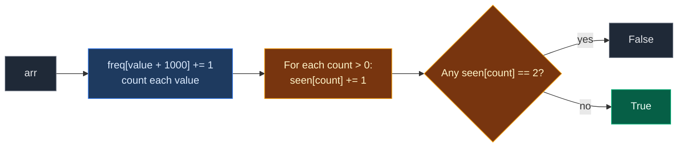

# 01. 1207. Unique Number of Occurrences

| Difficulty | Pattern | Source | Time | Space |
|:---:|:---:|:---:|:---:|:---:|
| **Easy** | Frequency Array (Counting Buckets) | [1207. Unique Number of Occurrences](https://leetcode.com/problems/unique-number-of-occurrences/) | `O(n + R)` | `O(R)` |

`R` = size of the value range (here `2001`, from `-1000` to `1000`).

## 1. Problem Statement

You get an array of integers `arr`.

Return `True` if the number of times each value appears is **different for every value**. Otherwise return `False`.

### Example

```text
arr = [1, 2, 2, 1, 1, 3]

Value 1 appears 3 times
Value 2 appears 2 times
Value 3 appears 1 time

Counts are 3, 2, 1. No two are the same.
Output: True
```

We use this same example in every section below.

### Constraints

- `1 <= arr.length <= 1000`
- `-1000 <= arr[i] <= 1000`

## 2. Core Theory

This is the first problem of the **Frequency Array (Counting Buckets)** pattern, so we build the idea from zero.

### What is a frequency array?

A frequency array is a list of counters. **Index = the value. Cell = how many times that value appeared.**

```text
arr  = [1, 2, 2, 1, 1, 3]

value:  0  1  2  3
freq:  [0][3][2][1]
```

To count, we walk the array once and do `freq[value] += 1`. Each step is `O(1)`. No sorting, no searching.

### When can we use it instead of a hash map?

When the values live in a **small, known range**. Here values are `-1000..1000`, only `2001` possible values. An array of size `2001` is tiny.

| Tool | Good when | Cost |
|:---|:---|:---|
| Frequency array | Values in a small known range | Very fast, simple indexing |
| Hash map (`dict`, `Counter`) | Values are huge or unknown | Works for anything, a bit slower |

### Negative values: use an offset

An array index cannot be negative. So we shift every value by `+1000`:

```text
index = value + 1000

value -1000 -> index 0
value     0 -> index 1000
value     1 -> index 1001
value  1000 -> index 2000
```

### What the problem really asks

Two questions, one after the other:

1. How many times does each value appear? → **count values** (first frequency array).
2. Are those counts all different? → **count the counts** (second frequency array). If any count shows up twice, answer `False`.

Counts are between `1` and `n <= 1000`, so the second array needs only `n + 1` cells.



### How this connects to other Frequency Array problems

| Problem | What we do after counting |
|:---|:---|
| **1207. Unique Number of Occurrences** | Count the counts. Any repeat → `False` |
| 1748. Sum of Unique Elements | Add values whose count is exactly 1 |
| 3005. Count Elements With Maximum Frequency | Find the max count, add all counts equal to it |
| 274. H-Index | Bucket papers by citations, scan from high to low |
| 1338. Reduce Array Size to The Half | Bucket values by their count, remove the biggest first |

Same counting step. Only the question after it changes.

## 3. Edge Cases

| Case | Input | Expected | Why it matters |
|:---|:---|:---:|:---|
| One element | `[5]` | `True` | Only one count, nothing to clash with |
| Two values, same count | `[1, 2]` | `False` | Both appear once. LeetCode example 2 |
| All same value | `[4, 4, 4]` | `True` | One value, one count |
| Negative values | `[-3, 0, 1, -3, 1, 1, 1, -3, 10, 0]` | `True` | Needs the `+1000` offset. Counts 3, 2, 4, 1 |
| Extreme values | `[-1000, 1000, 1000]` | `True` | Index `0` and index `2000`, both edges of the array |

## 4. Brute Force: Count with `arr.count`, Compare Every Pair

### Idea

1. Get the distinct values.
2. For each, count how often it appears by scanning the whole array.
3. Compare every pair of counts. If two are equal, return `False`.

### Code

```python
# Import List for type hints
from typing import List


# Brute force: count by scanning, compare all pairs
class SolutionBrute:

    # Main method
    def uniqueOccurrences(self, arr: List[int]) -> bool:

        # Distinct values in first-seen order
        values = list(dict.fromkeys(arr))

        # Count each value by scanning the whole array
        counts = [arr.count(v) for v in values]

        # Pick the first count
        for i in range(len(counts)):

            # Pick a later count
            for j in range(i + 1, len(counts)):

                # Two values with the same count
                if counts[i] == counts[j]:
                    return False

        # No two counts were equal
        return True
```

### Complexity

| Measure | Complexity | Why |
|:---|:---:|:---|
| **Time** | `O(n²)` | `arr.count` is `O(n)` per distinct value, and pair comparison is `O(d²)` |
| **Space** | `O(n)` | The distinct values and their counts |

## 5. Optimal Approach: Two Frequency Arrays

### Idea

1. `freq` of size `2001`. For each `x`, do `freq[x + 1000] += 1`.
2. `seen` of size `n + 1`. For each non-zero `freq` cell `c`:
   - If `seen[c]` is already `1`, another value has this count → `False`.
   - Else set `seen[c] = 1`.
3. Return `True`.

### Visual Walkthrough (Story Version)

**The story:** kids walk into a room one by one. Each kid holds a ball with a number on it. Along the wall there is a row of **boxes**, one box for every possible number. When a kid comes in, they drop a **pebble** into the box with their ball's number.

When everyone is in, the teacher looks at each box and counts the pebbles. Then she asks: "Do two boxes have the **same** number of pebbles?" To check fast, she has a second row of **trophy shelves**: shelf 1, shelf 2, shelf 3, ... For each box, she puts a flag on the shelf that matches its pebble count. If a shelf already has a flag, two boxes tie.

**How to read the pictures:** we only draw boxes 1, 2, 3 (all other boxes stay empty). `o` = one pebble. `^` = the kid who just came in.

**Start: all boxes empty**

```text
kids:  1  2  2  1  1  3

box 1: [   ]
box 2: [   ]
box 3: [   ]
```

**Kid 0 holds 1** → pebble in box 1.

```text
kids:  1  2  2  1  1  3
       ^
box 1: [o  ]   1
box 2: [   ]   0
box 3: [   ]   0
```

**Kid 1 holds 2** → pebble in box 2.

```text
kids:  1  2  2  1  1  3
          ^
box 1: [o  ]   1
box 2: [o  ]   1
box 3: [   ]   0
```

**Kid 2 holds 2** → pebble in box 2.

```text
kids:  1  2  2  1  1  3
             ^
box 1: [o  ]   1
box 2: [oo ]   2
box 3: [   ]   0
```

**Kid 3 holds 1** → pebble in box 1.

```text
kids:  1  2  2  1  1  3
                ^
box 1: [oo ]   2
box 2: [oo ]   2
box 3: [   ]   0
```

**Kid 4 holds 1** → pebble in box 1.

```text
kids:  1  2  2  1  1  3
                   ^
box 1: [ooo]   3
box 2: [oo ]   2
box 3: [   ]   0
```

**Kid 5 holds 3** → pebble in box 3.

```text
kids:  1  2  2  1  1  3
                      ^
box 1: [ooo]   3
box 2: [oo ]   2
box 3: [o  ]   1
```

**Teacher checks box 1: 3 pebbles.** Shelf 3 is empty, so she puts a flag there.

```text
shelf 1: [ ]
shelf 2: [ ]
shelf 3: [F]   <- box 1
```

**Teacher checks box 2: 2 pebbles.** Shelf 2 is empty, so she puts a flag there.

```text
shelf 1: [ ]
shelf 2: [F]   <- box 2
shelf 3: [F]
```

**Teacher checks box 3: 1 pebble.** Shelf 1 is empty, so she puts a flag there.

```text
shelf 1: [F]   <- box 3
shelf 2: [F]
shelf 3: [F]
```

No shelf got two flags. Answer: **`True`**.

**All steps at a glance**

| Step | Action | box 1 | box 2 | box 3 | Shelves with a flag |
|:---:|:---|:---:|:---:|:---:|:---|
| 1 | Kid holds 1 | 1 | 0 | 0 | – |
| 2 | Kid holds 2 | 1 | 1 | 0 | – |
| 3 | Kid holds 2 | 1 | 2 | 0 | – |
| 4 | Kid holds 1 | 2 | 2 | 0 | – |
| 5 | Kid holds 1 | 3 | 2 | 0 | – |
| 6 | Kid holds 3 | 3 | 2 | 1 | – |
| 7 | Check box 1 (3) | 3 | 2 | 1 | 3 |
| 8 | Check box 2 (2) | 3 | 2 | 1 | 2, 3 |
| 9 | Check box 3 (1) | 3 | 2 | 1 | 1, 2, 3 → `True` |

**What the story teaches**

| In the story | In the code |
|:---|:---|
| Kid with a numbered ball | `x` in `arr` |
| Row of boxes | `freq` array |
| Box number | Index `x + 1000` |
| Pebbles in a box | `freq[x + 1000]` |
| Trophy shelves | `seen` array |
| Flag on shelf `c` | `seen[c] = 1` |
| Shelf already has a flag | Two values share a count → `False` |

Now the same steps again, this time with the exact indexes.

### Step-by-Step Example

```text
arr = [1, 2, 2, 1, 1, 3], n = 6
OFFSET = 1000
freq = [0] * 2001       (we show only indexes 1001, 1002, 1003)
seen = [0] * 7
```

**Part 1: count values**

| Step | `i` | `x = arr[i]` | Index `x + 1000` | `freq[1001]` | `freq[1002]` | `freq[1003]` |
|:---:|:---:|:---:|:---:|:---:|:---:|:---:|
| start | – | – | – | 0 | 0 | 0 |
| 1 | 0 | 1 | 1001 | 1 | 0 | 0 |
| 2 | 1 | 2 | 1002 | 1 | 1 | 0 |
| 3 | 2 | 2 | 1002 | 1 | 2 | 0 |
| 4 | 3 | 1 | 1001 | 2 | 2 | 0 |
| 5 | 4 | 1 | 1001 | 3 | 2 | 0 |
| 6 | 5 | 3 | 1003 | 3 | 2 | 1 |

**Part 2: check the counts**

We walk `freq` from index `0` to `2000`. Indexes `0..1000` hold `0`, so they are skipped.

| Step | Index | `c = freq[index]` | `seen[c]` before | Action | `seen` (indexes 0..6) |
|:---:|:---:|:---:|:---:|:---|:---|
| 7 | 1001 | 3 | 0 | Set `seen[3] = 1` | `[0, 0, 0, 1, 0, 0, 0]` |
| 8 | 1002 | 2 | 0 | Set `seen[2] = 1` | `[0, 0, 1, 1, 0, 0, 0]` |
| 9 | 1003 | 1 | 0 | Set `seen[1] = 1` | `[0, 1, 1, 1, 0, 0, 0]` |

Indexes `1004..2000` hold `0`, so they are skipped. No clash found. Return `True`.

### Code

```python
# Optimal: frequency array for values, then a frequency array for counts
class Solution:

    # Main method
    def uniqueOccurrences(self, arr: List[int]) -> bool:

        # Shift so value -1000 lands at index 0
        OFFSET = 1000

        # One counter for every value from -1000 to 1000
        freq = [0] * 2001

        # Count every value
        for x in arr:

            # One more of this value
            freq[x + OFFSET] += 1

        # Save the counts so the tests can look at them
        self.freq = freq

        # seen[c] = 1 if some value already has count c
        seen = [0] * (len(arr) + 1)

        # Save the shelves so the tests can look at them
        self.seen = seen

        # Look at every counter
        for c in freq:

            # Skip values that never appeared
            if c == 0:
                continue

            # Another value already has this count
            if seen[c]:
                return False

            # Mark this count as taken
            seen[c] = 1

        # Every count was different
        return True


# The example from this note
arr = [1, 2, 2, 1, 1, 3]

# Run the solution
sol = Solution()

# Get the answer
ans = sol.uniqueOccurrences(arr)

# Part 1, step 6: final counts for values 1, 2, 3
assert sol.freq[1001:1004] == [3, 2, 1]

# Part 1: nothing else was counted
assert sum(sol.freq) == 6

# Part 2, step 9: shelves 1, 2, 3 all flagged
assert sol.seen == [0, 1, 1, 1, 0, 0, 0]

# Final answer
assert ans is True

# LeetCode example 2
assert Solution().uniqueOccurrences([1, 2]) is False

# LeetCode example 3 (negatives)
assert Solution().uniqueOccurrences([-3, 0, 1, -3, 1, 1, 1, -3, 10, 0]) is True

# Edge case: one element
assert Solution().uniqueOccurrences([5]) is True

# Edge case: all same value
assert Solution().uniqueOccurrences([4, 4, 4]) is True

# Edge case: extreme values
assert Solution().uniqueOccurrences([-1000, 1000, 1000]) is True

# Import random for comparison tests
import random

# Compare brute force and optimal on random arrays
for _ in range(500):

    # Random array with small values so counts repeat often
    a = [random.randint(-5, 5) for _ in range(random.randint(1, 15))]

    # Both must agree
    assert SolutionBrute().uniqueOccurrences(a) == Solution().uniqueOccurrences(a)

# All checks passed
print("All tests passed")
```

### Complexity

| Measure | Complexity | Why |
|:---|:---:|:---|
| **Time** | `O(n + R)` | One pass over `arr`, one pass over the `R = 2001` counters |
| **Space** | `O(R + n)` | `freq` has `2001` cells, `seen` has `n + 1`. Both are fixed small sizes |

## 6. Common Mistakes

| Mistake | What goes wrong | Fix |
|:---|:---|:---|
| No offset for negatives | `freq[-3]` in Python silently reads from the end of the array | Use `freq[x + 1000]` |
| Array size `2000` instead of `2001` | Value `1000` goes out of range | Range `-1000..1000` has `2001` values |
| Checking `seen` for zero counts | Every missing value has count `0`, so it looks like a clash | Skip `c == 0` |
| Comparing `len(set(counts))` with the wrong length | Comparing with `len(arr)` instead of the number of distinct values | Compare with the number of distinct values |
| `seen` too small | A count can be as large as `n` | Size `n + 1` |

## 7. Interview Follow-ups

### Q1. How would you write it in one line with Python tools?

**Answer:**
- `c = Counter(arr)` then `return len(c) == len(set(c.values()))`.
- Same idea, same `O(n)` time. Good for speed in an interview, but explain the counting first.

### Q2. When is a hash map better than a frequency array?

**Answer:**
- When values are huge (like up to `10^9`) or unknown. An array that big wastes memory.
- When the array is tiny and the range is huge, a hash map only stores what appears.

### Q3. Could we sort instead?

**Answer:**
- Yes. Sort, then count runs of equal values. Then sort the counts and check neighbors.
- `O(n log n)` time, `O(1)` extra space if sorting in place is allowed.

### Q4. Can we stop early?

**Answer:**
- Yes, in the second pass we return `False` as soon as a shelf already has a flag.
- The counting pass must finish first, because a count is only known at the end.

### Q5. What if we wanted to know which values share a count?

**Answer:**
- Make `seen[c]` a list of values instead of a flag.
- Any list with two or more values is a group that shares a count.

## 8. Interview Explanation

> Values are between -1000 and 1000, so I use a frequency array of size 2001 with an offset of 1000 to count how many times each value appears in one pass. Then I need to know whether any two counts are equal, so I count the counts: a second array seen of size n + 1. For every non-zero counter c, if seen[c] is already set, two values share a count and I return False; otherwise I set it. If I finish, I return True. That is O(n + 2001) time and O(2001 + n) space, which is effectively linear.
