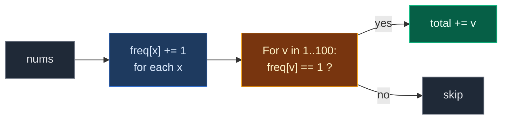

# 02. 1748. Sum of Unique Elements

| Difficulty | Pattern | Source | Time | Space |
|:---:|:---:|:---:|:---:|:---:|
| **Easy** | Frequency Array (Counting Buckets) | [1748. Sum of Unique Elements](https://leetcode.com/problems/sum-of-unique-elements/) | `O(n + R)` | `O(R)` |

`R` = size of the value range (here `101`, values `1..100`).

## 1. Problem Statement

You get an array `nums`.

A value is **unique** if it appears **exactly once** in `nums`.

Return the sum of all unique values.

### Example

```text
nums = [1, 2, 3, 2]

Value 1 appears 1 time   -> unique
Value 2 appears 2 times  -> not unique
Value 3 appears 1 time   -> unique

Sum = 1 + 3 = 4
Output: 4
```

We use this same example in every section below.

### Constraints

- `1 <= nums.length <= 100`
- `1 <= nums[i] <= 100`

## 2. Core Theory

This note uses the frequency array idea from [01. 1207. Unique Number of Occurrences](./01.%201207.%20Unique%20Number%20of%20Occurrences.md). Read that first if counting buckets are new to you.

Quick reminder: **index = value, cell = how many times it appeared.**

### What the problem really asks

1. How many times does each value appear? → count with a frequency array.
2. Add up the values whose count is exactly `1`.

### Why a frequency array fits

Values are `1..100`. That is a tiny, known range, so an array of size `101` is enough. No offset is needed because there are no negatives. Index `0` is just never used.

```text
nums = [1, 2, 3, 2]

value:  0  1  2  3  4 ... 100
freq:  [0][1][2][1][0]... [0]
            ^     ^
         count 1  count 1  -> add 1 and 3
```



### Careful: add the value, not the count

The answer adds `v` (the index), not `freq[v]`. For every unique value, `freq[v]` is always `1`, so adding the count would just count unique values.

## 3. Edge Cases

| Case | Input | Expected | Why it matters |
|:---|:---|:---:|:---|
| All the same | `[1, 1, 1, 1, 1]` | `0` | No unique values. LeetCode example 2 |
| All different | `[1, 2, 3, 4, 5]` | `15` | Every value counts. LeetCode example 3 |
| One element | `[7]` | `7` | Smallest input, one unique value |
| Value 100 | `[100, 100, 99]` | `99` | Index `100` must exist, so size is `101` |
| Value appears 3 times | `[5, 5, 5, 6]` | `6` | "Not unique" means count is not 1, not just "count 2" |

## 4. Brute Force: Count Each Element by Scanning

### Idea

For each element, scan the whole array to count it. If its count is `1`, add it.

### Code

```python
# Import List for type hints
from typing import List


# Brute force: count every element with a full scan
class SolutionBrute:

    # Main method
    def sumOfUnique(self, nums: List[int]) -> int:

        # Running total
        total = 0

        # Look at every element
        for x in nums:

            # Scan the whole array to count x; add it if it appears once
            if nums.count(x) == 1:

                # x is unique, add it
                total += x

        # Return the sum
        return total
```

### Complexity

| Measure | Complexity | Why |
|:---|:---:|:---|
| **Time** | `O(n²)` | `nums.count` scans `n` items, for each of `n` items |
| **Space** | `O(1)` | Only a running total |

## 5. Optimal Approach: Frequency Array, Then Add Count-1 Values

### Idea

1. `freq = [0] * 101`. For each `x`, do `freq[x] += 1`.
2. For each `v` from `1` to `100`: if `freq[v] == 1`, add `v` to the total.

### Visual Walkthrough (Story Version)

**The story:** a sticker shop sells stickers numbered `1` to `100`. A kid brings a bag of stickers. The shopkeeper says: "I will pay you for every sticker you have **only one** of. Duplicates get nothing." The sticker's number is its price.

The shopkeeper has a wall of **slots**, one per sticker number. She drops each sticker into its slot. Then she walks along the wall and pays for every slot that holds **exactly one** sticker.

**How to read the pictures:** we draw slots 1, 2, 3 (all others stay empty). `#` = one sticker. `^` = the sticker just placed.

**Start: all slots empty**

```text
bag: 1  2  3  2

slot 1: [  ]  0
slot 2: [  ]  0
slot 3: [  ]  0
```

**Sticker 1** → slot 1.

```text
bag: 1  2  3  2
     ^
slot 1: [# ]  1
slot 2: [  ]  0
slot 3: [  ]  0
```

**Sticker 2** → slot 2.

```text
bag: 1  2  3  2
        ^
slot 1: [# ]  1
slot 2: [# ]  1
slot 3: [  ]  0
```

**Sticker 3** → slot 3.

```text
bag: 1  2  3  2
           ^
slot 1: [# ]  1
slot 2: [# ]  1
slot 3: [# ]  1
```

**Sticker 2** → slot 2 again.

```text
bag: 1  2  3  2
              ^
slot 1: [# ]  1
slot 2: [##]  2
slot 3: [# ]  1
```

**Pay for slot 1:** exactly one sticker. Pay `1`. Total `1`.

```text
slot 1: [# ]  1   -> pay 1     total = 1
slot 2: [##]  2
slot 3: [# ]  1
```

**Pay for slot 2:** two stickers. Duplicates get nothing. Total stays `1`.

```text
slot 1: [# ]  1   paid
slot 2: [##]  2   -> skip      total = 1
slot 3: [# ]  1
```

**Pay for slot 3:** exactly one sticker. Pay `3`. Total `4`.

```text
slot 1: [# ]  1   paid
slot 2: [##]  2   skipped
slot 3: [# ]  1   -> pay 3     total = 4
```

Slots `4..100` are empty, nothing to pay. Answer: **4**.

**All steps at a glance**

| Step | Action | slot 1 | slot 2 | slot 3 | Total |
|:---:|:---|:---:|:---:|:---:|:---:|
| 1 | Place sticker 1 | 1 | 0 | 0 | 0 |
| 2 | Place sticker 2 | 1 | 1 | 0 | 0 |
| 3 | Place sticker 3 | 1 | 1 | 1 | 0 |
| 4 | Place sticker 2 | 1 | 2 | 1 | 0 |
| 5 | Check slot 1 (1 sticker) | 1 | 2 | 1 | 1 |
| 6 | Check slot 2 (2 stickers) | 1 | 2 | 1 | 1 |
| 7 | Check slot 3 (1 sticker) | 1 | 2 | 1 | 4 |

**What the story teaches**

| In the story | In the code |
|:---|:---|
| Sticker | `x` in `nums` |
| Wall of slots | `freq` array |
| Slot number | Index `x` |
| Stickers in a slot | `freq[x]` |
| "Only one of it" | `freq[v] == 1` |
| Pay the sticker's number | `total += v` |

Now the same steps again, this time with the exact indexes.

### Step-by-Step Example

```text
nums = [1, 2, 3, 2]
freq = [0] * 101        (we show only indexes 1, 2, 3)
total = 0
```

**Part 1: count values**

| Step | `x` | `freq[1]` | `freq[2]` | `freq[3]` |
|:---:|:---:|:---:|:---:|:---:|
| start | – | 0 | 0 | 0 |
| 1 | 1 | 1 | 0 | 0 |
| 2 | 2 | 1 | 1 | 0 |
| 3 | 3 | 1 | 1 | 1 |
| 4 | 2 | 1 | 2 | 1 |

**Part 2: add values with count 1**

| Step | `v` | `freq[v]` | `== 1`? | `total` |
|:---:|:---:|:---:|:---:|:---:|
| 5 | 1 | 1 | Yes | `0 + 1 = 1` |
| 6 | 2 | 2 | No | 1 |
| 7 | 3 | 1 | Yes | `1 + 3 = 4` |
| – | 4..100 | 0 | No | 4 |

Return `4`.

### Code

```python
# Optimal: frequency array, then add values seen exactly once
class Solution:

    # Main method
    def sumOfUnique(self, nums: List[int]) -> int:

        # One counter for every value 0..100 (index 0 is unused)
        freq = [0] * 101

        # Count every value
        for x in nums:

            # One more of this value
            freq[x] += 1

        # Save the counts so the tests can look at them
        self.freq = freq

        # Running total
        total = 0

        # Record the total after each check of values 1..3, for the tests
        self.totals = []

        # Look at every possible value
        for v in range(1, 101):

            # Only values that appear exactly once
            if freq[v] == 1:

                # Add the value itself, not its count
                total += v

            # Save the total after checking v
            self.totals.append(total)

        # Return the sum
        return total


# The example from this note
nums = [1, 2, 3, 2]

# Run the solution
sol = Solution()

# Get the answer
ans = sol.sumOfUnique(nums)

# Part 1, step 4: counts for values 1, 2, 3
assert sol.freq[1:4] == [1, 2, 1]

# Part 2, steps 5-7: total after checking v = 1, 2, 3
assert sol.totals[:3] == [1, 1, 4]

# Final answer
assert ans == 4

# LeetCode example 2: no unique values
assert Solution().sumOfUnique([1, 1, 1, 1, 1]) == 0

# LeetCode example 3: all unique
assert Solution().sumOfUnique([1, 2, 3, 4, 5]) == 15

# Edge case: one element
assert Solution().sumOfUnique([7]) == 7

# Edge case: value 100
assert Solution().sumOfUnique([100, 100, 99]) == 99

# Edge case: value appears 3 times
assert Solution().sumOfUnique([5, 5, 5, 6]) == 6

# Import random for comparison tests
import random

# Compare brute force and optimal on random arrays
for _ in range(500):

    # Random array with values 1..10 so repeats are common
    a = [random.randint(1, 10) for _ in range(random.randint(1, 20))]

    # Both must agree
    assert SolutionBrute().sumOfUnique(a) == Solution().sumOfUnique(a)

# All checks passed
print("All tests passed")
```

### Complexity

| Measure | Complexity | Why |
|:---|:---:|:---|
| **Time** | `O(n + R)` | One pass over `nums`, one pass over `R = 100` values |
| **Space** | `O(R)` | `101` counters, a fixed size |

## 6. Common Mistakes

| Mistake | What goes wrong | Fix |
|:---|:---|:---|
| Adding `freq[v]` instead of `v` | Returns how many unique values, not their sum | `total += v` |
| `freq = [0] * 100` | Value `100` goes out of range | Size `101` |
| Using `set(nums)` and summing it | Adds values that appear twice too | Only add when count is exactly `1` |
| Removing duplicates while looping | Changes the list under the loop, skips items | Count first, then sum |
| Treating "not unique" as "count == 2" | Values with count 3+ get added | Check `== 1`, not `!= 2` |

## 7. Interview Follow-ups

### Q1. Can it be done in one pass?

**Answer:**
- Yes. When `freq[x]` goes from `0` to `1`, add `x`. When it goes from `1` to `2`, subtract `x`. For `3` and more, do nothing.
- At the end, the total holds only values seen once.

### Q2. What if values could be up to `10^9`?

**Answer:**
- An array that big is too much memory.
- Use a hash map (`Counter`) instead. Same logic, same `O(n)` time.

### Q3. What if values could be negative?

**Answer:**
- Shift with an offset, like `freq[x + OFFSET]`, the same way as problem 1207.
- Remember to add the real value `v`, not the shifted index.

### Q4. How would you return the unique values themselves?

**Answer:**
- Walk `freq` and collect each `v` with `freq[v] == 1` into a list.
- Walking the array in index order gives them already sorted.

### Q5. Why not sort and look at neighbors?

**Answer:**
- That works: a value is unique if it differs from both neighbors after sorting.
- But it is `O(n log n)`. Counting is `O(n + R)` and simpler.

## 8. Interview Explanation

> Values are only 1 to 100, so I count them with a frequency array of size 101 in one pass. Then I walk the values from 1 to 100 and add each value whose count is exactly 1, making sure to add the value itself, not its count. That is O(n + 100) time and O(100) space. If I wanted a single pass, I could add a value the first time I see it and subtract it the second time.
